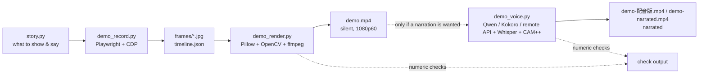

# autoRecording

**Turn a web app into a polished, narrated demo video — from a Python story file.**

This is a [Claude Code](https://claude.com/claude-code) and [Codex](https://openai.com/codex/) skill (and a set of
standalone Python scripts) that records a web app in a headless browser, draws a professional 1080p60 video around
it, adds a narration when one is wanted, and verifies the result numerically — no screen-recording software, no
manual editing. Linux, Windows and macOS; a local engine keeps the audio on your machine.

[中文说明](README.zh-CN.md) · [▶ 1-minute demo](https://orrrge.github.io/autoRecording/#demo-en) ·
[Interactive page](https://orrrge.github.io/autoRecording/) · [README](README.md) ·
[How it works](#how-it-works) · [Quick start](#quick-start) · [Tutorial](#tutorial)

---

## What you get

A single MP4 that looks like a produced product tour, not a raw screen capture:

- **1920×1080, 60 fps, H.264 + AAC**, with a fixed top band (title, chapters) and a caption band below.
- **Camera moves** — zoom into the form or list being discussed, then back out to the page.
- **Highlights and numbered steps** — outline the element, dim the rest (`spot`), or number each click.
- **Original-text highlights** — mark the exact words you are talking about inside a paragraph.
- **Captions** that are also the narration script.
- **Fast-forward for waiting** — a slow job plays at 4× and the top band says so.
- **Off-page notes** — downloads, OS dialogs and other things the page cannot show.
- **Narration, optional** — ten languages (Mandarin, English, Japanese, Korean, German, French, Spanish, Italian,
  Portuguese, Russian) in one consistent voice, fitted to each caption, with speech and speaker verification.
- **Three kinds of engine** — local Qwen3-TTS on an NVIDIA GPU, local Kokoro on any CPU (Windows and macOS
  included), or a remote API (OpenAI-compatible / ElevenLabs / Alibaba DashScope).

Page frames and a `timeline.json` are kept separately, so captions, marks and timing can be re-rendered
without recording again.

## How it works



The **story file** is the only thing you write. It says which page elements to show, in which order, with which
captions and marks. `demo_record.py` drives the app and records one JPEG per changed frame plus a timeline of
camera moves, marks, captions and cursor positions. `demo_render.py` composites every frame at 60 fps and
encodes it. `demo_voice.py` reads the captions, generates the narration, and muxes it without touching the
picture.

Every stage ends with a **numeric check** instead of a human watching the video: marked regions must contain
ink and match expected colours, labels must not cover text, marks must be inside the camera, captions must fit,
the recogniser must hear the written words, and the finished file must have the same picture packets and
duration as the silent one.

## Features

| | |
| --- | --- |
| **Script-driven** | A story is plain Python: `await d.click(...)`, `await d.say(...)`, `await d.zoom(...)` |
| **Cross-platform** | Linux, Windows, macOS; Chrome/Edge and Microsoft YaHei on Windows, PingFang on macOS |
| **Isolated recording** | Starts a throwaway instance on its own port and data; never touches the live service |
| **Reusable** | Any web app Chromium can open; no framework integration |
| **Editable after recording** | Camera, marks and captions live in `timeline.json` |
| **Deterministic checks** | `--check` catches empty marks, wrong colours, covered labels, clipped boxes, overflowing captions, missing glyphs |
| **Narration optional** | No narration → silent video. With one → choose language and engine; the choice is written into the story |
| **Three engines** | Local GPU (Qwen3-TTS), local CPU (Kokoro), remote API (OpenAI-compatible / ElevenLabs / DashScope) |
| **Ten languages** | Mandarin, English, Japanese, Korean, German, French, Spanish, Italian, Portuguese, Russian |
| **Local first** | Local engines need no API key, no per-minute fee, and upload nothing |
| **Verifiable output** | Whisper re-listens to every line; CAM++ checks the voice; packet hashes prove the picture is untouched |
| **Resumable** | Narration steps cache their work; rerunning only does what is missing |

## Requirements

| | Record / render | Narration |
| --- | --- | --- |
| OS | Linux (tested), Windows, macOS | same; the Qwen engine is NVIDIA-only (so not macOS) |
| Python | 3.10+ | 3.10–3.12 |
| GPU | not needed | Qwen: NVIDIA, ~6 GB free VRAM; Kokoro and remote: none |
| System | `ffmpeg` with libx264/aac/atempo/ebur128, Chromium, Noto Sans CJK | `ffmpeg` |
| Models | none | by engine: two Qwen3-TTS 1.7B models (~9 GB) / Kokoro (~400 MB) / a remote key; checks need Whisper large-v3 and CAM++ |

Recording/rendering works on a CPU-only laptop. Narration is optional; without it you still get the silent
video. Full setup details: [`references/environment.md`](references/environment.md).

## Install

### As a Claude Code skill

```bash
git clone https://github.com/OrrrGE/autoRecording \
    ~/.claude/skills/autoDemoRecordingSkill
```

Start a new Claude Code session and ask for a demo video. Claude reads `SKILL.md`, writes the story, and runs
the pipeline. You can also run every script yourself — the skill is just a directory of Python files.

### As a Codex skill

```bash
git clone https://github.com/OrrrGE/autoRecording \
    ~/.agents/skills/autoDemoRecordingSkill
# or into Codex's own folder: ~/.codex/skills/autoDemoRecordingSkill
```

Codex loads the same `SKILL.md`; `agents/openai.yaml` gives it a display name and a starting prompt. The only
difference is the questions: Claude Code asks with selectable options, Codex asks in the conversation.

### As plain scripts

```bash
git clone https://github.com/OrrrGE/autoRecording
cd autoRecording
python3 scripts/demo_env.py          # read-only: what is present, what is missing
python3 scripts/demo_env.py setup    # create the skill's Python and packages
```

No package is installed system-wide except `ffmpeg`, fonts and optionally Chromium. Everything the skill
creates lives in `~/.cache/auto-demo-recording` (`AUTO_DEMO_HOME` overrides it).

## Quick start

Run the built-in self-test: a small to-do page that exercises every feature. It needs no app, no data and no
GPU for the first three commands. If you have not installed the skill's Python yet:

```bash
cd ~/.claude/skills/autoDemoRecordingSkill
python3 scripts/demo_env.py setup
```

Then:

```bash
cd ~/.claude/skills/autoDemoRecordingSkill
PY=~/.cache/auto-demo-recording/venv/bin/python

# 1. record (about a minute)
$PY scripts/demo_record.py --story examples/selftest/story.py --work /tmp/demo-selftest

# 2. check the timeline in numbers
$PY scripts/demo_render.py --work /tmp/demo-selftest --check

# 3. render the silent video (about 20 s on a laptop)
$PY scripts/demo_render.py --work /tmp/demo-selftest --out /tmp/demo-selftest/selftest.mp4

# 4. narrate it (optional — any one of these engines)
$PY scripts/demo_voice.py --work /tmp/demo-selftest                  # auto: Qwen on the GPU → Kokoro on the CPU → a remote key
python3 scripts/demo_env.py setup --kokoro                           # no GPU: install Kokoro (~400 MB)
python3 scripts/demo_env.py key openai=sk-…                          # or remember a remote key
```

Result: `/tmp/demo-selftest/selftest.mp4` (silent) and `selftest-配音版.mp4` / `selftest-narrated.mp4` (narrated),
1920×1080, 60 fps, about 64 seconds. The render check should print no `注意：` lines and the narration check should
end with `没有发现问题`. The English path is exercised by `examples/selftest/story-en.py`.

## Tutorial

### 0. Ask the user first

Before anything else, settle three things and write the answers into the story:

1. **Narration or not?** Without one, the silent video is the deliverable.
2. **Language of the narration** (and of the captions, which it reads): Mandarin, English, Japanese, Korean, German,
   French, Spanish, Italian, Portuguese or Russian.
3. **Engine.** Prefer a local model that is already installed (Qwen if there is an NVIDIA GPU, else Kokoro); use a
   remote API if the user offers a key; if neither, ask whether to install Kokoro or to go silent. A remote key goes
   into the environment or `demo_env.py key`, never into the story.

Rule of thumb: **local if it is ready, remote if the user provides an API, no narration if none is wanted.** Claude
Code asks with selectable options; Codex asks in plain words.

### 1. Isolate the app

Never record the service your users are running. Start a copy on another port with its own data directory.
For example, a Python app:

```bash
DATA_DIR=/tmp/demo-data python -m myapp --port 8799
```

Or let the story start it (better: the recorder starts and stops it automatically, and the port is checked).
Put the database, uploads and cache under the recording's `work` folder and list them in `wipe` so each take
starts from identical data.

### 2. Write the story

Copy [`story_template.py`](story_template.py) and edit the top section:

```python
TITLE = 'Acme Inbox'
SUBTITLE = 'Product tour'
CHAPTERS = ['Inbox', 'Filters', 'Summary']
LANGUAGE = 'en'             # the captions' language, and so the narration's
VIEW = (1280, 620)          # 64:31, required
DENSITY = 2.5
PORT = 8799

VOICE = {'engine': 'kokoro', 'speaker': 'af_maple'}   # narration: engine and voice; leave it out for a silent video

def launch(work, port):
    return {
        'command': ['python', '-m', 'myapp', '--port', str(port)],
        'url': f'http://127.0.0.1:{port}/',
        'env': {'DATA_DIR': str(work / 'data')},
        'wipe': ['data'],
    }

async def guard(d):
    if await d.page.locator('.message').count() != 12:
        raise SystemExit('not in the initial state')
```

Then direct the video:

```python
async def story(d):
    page = d.page
    await d.card([TITLE, SUBTITLE, 'Finding and summarising messages'], 2.6)
    d.cursor()
    await d.say('This demo shows how to filter the inbox and summarise a thread.')
    await d.read()

    d.chapter(0)
    await d.say('Open the filter menu and choose Unread.')
    await d.zoom(page.locator('header'), most=1.6, pad=30)
    await d.choose(page.locator('#filter'), 'Unread', 'Filter unread')
    await d.zoom()

    await d.say('The count updates immediately.')
    count = page.locator('#count')
    await d.until(lambda: count.inner_text() != '12', speed=2, what='count to update')
    d.facts['count'] = await count.inner_text()
    marked = d.mark([await d.box(count)], 'Updated count', place='right')
    await d.read()
    d.clear(marked)

    d.chapter(1)
    await d.say('A summary of the visible messages is one click away.')
    await d.click(page.locator('#summarize'), 'Summarise')
    await d.until(page.locator('#summary').is_visible, speed=4, limit=60, what='summary')
    await d.say('The summary keeps the original wording for the next action.')
    spot = d.mark(await d.words(page.locator('#summary'), 'next action'), 'Original text', kind='spot')
    await d.read()
    d.clear(spot)

    await d.hush()
    await d.card(['Acme Inbox', 'Filters and summaries'], 3.0)
```

Notes:

- `VIEW` must be 64:31 (1280×620, 1536×744, 1600×775, 1920×930).
- One idea per caption. They are read aloud; 10–35 Chinese characters or 6–18 English words is a good target.
- Use `d.facts` for values that the page actually computed.
- Long waits: `await d.until(..., speed=4)` instead of cutting them.
- The full API — marks, places, `expect`, `flash`, `note`, `chip`, scrolling, downloads — is in
  [`references/director.md`](references/director.md).

### 3. Trial, record, check, render

```bash
PY=~/.cache/auto-demo-recording/venv/bin/python
$PY scripts/demo_record.py --story story.py --work /tmp/demo-work --quick   # fast trial
$PY scripts/demo_record.py --story story.py --work /tmp/demo-work           # real take
$PY scripts/demo_render.py --work /tmp/demo-work --check
$PY scripts/demo_render.py --work /tmp/demo-work --out /tmp/demo-work/demo.mp4
```

`--quick` skips viewer pauses and only waits for the app, so it catches bad selectors and wrong page state in
a fraction of the time. It is not a finished video.

The recording prints a JSON summary (wall time, video length, frame count, browser, frame latency, page
errors). The check prints a summary and every problem it can prove without looking at the picture. Fix the
story and record again until the check is clean.

### 4. Add the narration

```bash
$PY scripts/demo_voice.py lines --work /tmp/demo-work   # see pronunciation and timing first
$PY scripts/demo_voice.py --work /tmp/demo-work
```

The narration goes under every caption, in one voice. Each line is generated several times, checked by a speech
recogniser, fitted into its caption's time window, and levelled. The silent picture is copied untouched. The output
is `<name>-配音版.mp4` for Mandarin and `<name>-narrated.mp4` for the other languages.

The engine comes from `VOICE['engine']` or `work/voice/settings.json`:

| Engine | Needs | Notes |
| --- | --- | --- |
| `qwen` | NVIDIA GPU, the two Qwen models | best quality; one fixed voice cloned from a reference clip; nine built-in speakers; not macOS |
| `kokoro` | `demo_env.py setup --kokoro` | any CPU, Windows/macOS included; Chinese and English; fixed voices (no cloning) |
| `openai` / `compatible` | a key, optional `base_url` | OpenAI's audio endpoint and the services that copy it |
| `elevenlabs` | a key and a voice id | multilingual models |
| `dashscope` | an Alibaba Cloud key | Qwen-TTS, 48 voices, no speed parameter |

Kokoro skips English words its lexicon does not have — the anchor step lists them, and `say` writes how they sound.
See [`references/engines.md`](references/engines.md).

The final check verifies the file, line positions, voice consistency, loudness and that no sound sits outside a
caption. See [`references/narration.md`](references/narration.md) for changing the voice, pronunciation fixes
(`VOICE['say']`), speed limits, and what to do when a line is too tight.

### 5. Iterate

| What changed | What to rerun |
| --- | --- |
| Caption text, marks, camera, order | `demo_record.py` → `demo_render.py` → `demo_voice.py` |
| Only caption/mark timing in `timeline.json` | `demo_render.py` (recording will overwrite it) |
| Narration settings only | `demo_voice.py build`, then `check` |
| Engine, voice or language | `demo_voice.py anchor` (or delete `work/voice`), then the whole narration |
| One badly spoken line | delete its takes in `work/voice/takes`, then `demo_voice.py takes N` |
| Different reference voice | `demo_voice.py anchor NAME`, then `demo_voice.py` |

## Story API cheat sheet

| Call | What it does |
| --- | --- |
| `await d.say(text)` | show a caption and make it the narration line |
| `await d.read()` | hold until the caption has been readable |
| `await d.hush()` | clear the caption |
| `d.chapter(i)` | start a chapter |
| `await d.card(lines, seconds)` | full-frame title/end card |
| `await d.zoom(*locators, most=1.8, pad=26)` | move the camera; no arguments = whole page |
| `d.mark(rects, label, kind='outline', place='above', expect='#rrggbb')` | outline / underline / spotlight a region |
| `await d.flash(locator)` | stand still on a transient toast |
| `d.note(title, lines)` / `d.chip(text)` | off-page note / short lower-right sign |
| `await d.click(locator, 'step text')` | click with a numbered callout |
| `await d.choose(select, 'Option', 'step')` | choose in a native dropdown |
| `await d.type(locator, text)` | type like a person |
| `await d.scroll(y)` / `await d.bring(locator)` / `await d.reveal(locator)` | page / element / row scrolling |
| `await d.until(async_predicate, speed=4)` | wait for the app, played fast |
| `d.facts['key'] = value` | record a value read from the page |

Coordinates are CSS pixels; the renderer scales them to 1080p. All placements and checks are documented in
[`references/director.md`](references/director.md).

## Commands

| Command | Purpose |
| --- | --- |
| `python3 scripts/demo_env.py` | check the machine |
| `python3 scripts/demo_env.py setup [--models] [--kokoro]` | create the skill's Python; optionally fetch check models / Kokoro |
| `python3 scripts/demo_env.py key provider=…` / `--list` | remember / show remote keys (never in the story) |
| `python3 scripts/demo_env.py set name=path ...` | remember where a tool or model is |
| `demo_record.py --story S --work W [--quick]` | record frames + timeline |
| `demo_render.py --work W --check` | check the timeline in numbers |
| `demo_render.py --work W --out F [--start S --end E]` | render the video (or a part) |
| `demo_voice.py --work W [--video F] [--out F]` | narrate the whole video |
| `demo_voice.py lines\|anchor\|trial\|takes\|hear\|build\|check --work W` | individual narration steps |

## Output layout

```
work/
├── timeline.json        camera, marks, captions, cursor, chapters, facts, clock, language
├── frames/              recorded page frames (JPEG)
├── server.log           the throwaway app's output
├── render.json          what the renderer wrote and checked
├── demo.mp4             silent video
└── voice/
    ├── anchor/          candidate reference clips
    ├── anchor.wav       the chosen reference (every engine has one: it fixes the voice check and the pace)
    ├── trial/           trial clips per candidate
    ├── takes/           every take of every line (+ measurements)
    ├── final/           each line cut from the finished file
    ├── report.json      which take, where, how much it was fitted
    ├── check.json       verification facts and problems
    └── voice.wav        the mixed narration
```

The silent video's name is what you passed to `--out`; the narrated one is its name plus `-配音版`.

## Troubleshooting

| Symptom | Fix |
| --- | --- |
| `缺 …` | `python3 scripts/demo_env.py` and follow the `→` line |
| Port already in use | change `PORT`; do not stop the running service |
| `VIEW 的宽高比要是 64:31` | use 1280×620, 1536×744, 1600×775 or 1920×930 |
| `页面宽 … 预想的是 …` | make the page responsive at `VIEW`, or change `VIEW` |
| `点不到这个元素` | scroll/zoom to it first, or choose an element that is actually visible |
| Labels cover text | change `place`, use `pin`, or move the camera |
| `字体里没有这些字符` | install Noto Sans CJK or set `DEMO_FONT_*` |
| Narration line too tight | shorten that caption or give it more screen time, then record again |
| `Kokoro 的词表里没有这些词` | write how they sound in `VOICE['say']` (e.g. `"API": "A P I"`), or use Qwen / a remote engine |
| A remote service answers 401 | wrong key: `demo_env.py key --list`, set it again |
| `显存不够` | close other GPU programs; about 6.5 GB free is needed |
| Voice sounds different between lines | delete `work/voice` and rerun; or choose another `anchor` |

## Privacy and safe recording

- **Record a throwaway instance with sample data.** Frames are real screenshots; anything on screen ends up in
  the video and in `work/frames/`.
- **Do not commit work folders** — they contain page screenshots, excerpts of your data and the absolute story
  path in `timeline.json`. The bundled `.gitignore` excludes common output paths.
- **Local engines upload nothing.** Qwen and Kokoro run on your machine; so do the verification models.
- **A remote engine receives the caption text of every line** for synthesis. Keys stay local (environment or
  `secrets.json`, mode 600). Use a local engine or no narration if that matters.
- **Check before publishing.** Watch the final file once; the numeric checks cannot tell you that a customer
  name should not have been on screen.

## FAQ

**Does it work with any web app?** Any app Chromium can open and that can run as a separate instance with
demo data. Apps behind login work too: put the login flow in the story (or use a dedicated demo account).

**Can the narration be English?** Yes: `LANGUAGE = 'en'`, and all three engines speak English. Kokoro's English
voices are `af_maple`, `af_sol`, `bf_vale`. Japanese, Korean and the rest come from Qwen or a remote engine.

**Does it need a GPU?** Only the Qwen engine. Recording, rendering, Kokoro narration and all picture checks are
CPU-only.

**Can I skip the narration?** Yes. Do not run `demo_voice.py`; the silent video is the deliverable, and captions are
still timed by the chosen language's reading speed.

**Windows and macOS?** Yes. Windows process handling (`taskkill /T`), Chrome/Edge paths and Microsoft YaHei, and
macOS PingFang on Apple Silicon are handled. Full regression testing has been on Linux. The Qwen engine needs NVIDIA
CUDA, so on macOS use Kokoro or a remote service.

**Why Python and not a GUI?** A story is diffable, reviewable and repeatable. The same story produces the same
video after a UI change; a manual screen recording does not.

## License

MIT — see [LICENSE](LICENSE).

## Acknowledgements

Thanks to the [Linux Do community](https://linux.do/) for the discussion, feedback and support.
