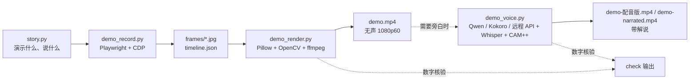

# autoRecording

**用一个 Python 脚本文件，把 Web 应用自动做成带解说的演示视频。**

这是一个 [Claude Code](https://claude.com/claude-code) / [Codex](https://openai.com/codex/) 技能，也是一组可以直接运行的 Python 脚本：在无头浏览器里操作应用、录制画面，按分镜合成 1080p60 视频，按需配上解说（语言与引擎可选），再用数字指标核验成片。支持 Linux、Windows、macOS；不需要录屏软件，不需要手工剪辑；用本地引擎时音频不出本机。

[English](README.en.md) · [▶ 观看 1 分钟演示](https://orrrge.github.io/autoRecording/#demo) ·
[交互式页面](https://orrrge.github.io/autoRecording/) · [README](README.md) ·
[工作原理](#工作原理) · [快速开始](#快速开始) · [使用教程](#使用教程)

---

## 效果

成片是一个像产品介绍视频的 MP4，而不是原始录屏：

- **1920×1080、60 fps、H.264 + AAC**，顶部固定标题/章节条，底部字幕条。
- **镜头运动**：讲到表单或列表时推近，讲完拉回整页。
- **标注与步骤**：框出元素、压暗其余部分（spot）、给每次点击编号。
- **原文高亮**：在一段文字里精确标出正在讲解的句子。
- **字幕**：同时就是解说稿。
- **等待快进**：耗时的任务按 4 倍速播放，顶部会标明「快进 ×4」。
- **画面外提示**：下载、系统弹窗等页面里看不到的事情。
- **旁白（可选）**：十种语言（普通话、英语、日、韩、德、法、西、意、葡、俄）；同一个音色，逐句贴合字幕时长，用语音识别和声纹核验。
- **三种引擎**：本地 Qwen3-TTS（NVIDIA GPU）、本地 Kokoro（任意 CPU，Windows/macOS 可用）、远程 API（OpenAI 兼容 / ElevenLabs / 阿里百炼）。

录制时画面帧和时间线（`timeline.json`）分开保存，所以改字幕、标注和镜头后可以只重新渲染，不必重录。

## 工作原理



你只需写一个 **story 文件**：先演示哪个页面元素、按什么顺序、配什么字幕和标注。`demo_record.py` 负责操作应用，记录画面变化时的 JPEG 帧，以及镜头、标注、字幕、光标的时间线。`demo_render.py` 以 60 fps 合成并编码。`demo_voice.py` 读取字幕生成解说，混入音轨，但不重新编码画面。

每个阶段末尾都会做 **数字核验**，而不是靠人看视频判断：标注区域里必须有内容且颜色符合预期、标注文字不能压住正文、标注框必须在镜头内、字幕必须放得下、语音识别必须听到对的字、成片画面必须和无声版逐包相同且时长一致。

## 特性

| | |
| --- | --- |
| **脚本驱动** | story 就是普通 Python：`await d.click(...)`、`await d.say(...)`、`await d.zoom(...)` |
| **跨平台** | Linux、Windows、macOS；Windows 用 Chrome/Edge 与微软雅黑，macOS 用苹方，全自动适配 |
| **隔离录制** | 在另一个端口、独立数据目录启动临时实例，绝不动正在使用的服务 |
| **通用** | Chromium 能打开的 Web 应用都行，不绑定框架 |
| **录后可改** | 镜头、标注、字幕都在 `timeline.json` 里 |
| **确定性检查** | `--check` 能发现空标注、颜色不符、文字压住正文、标注出画、字幕超宽、缺字 |
| **旁白可选** | 不要旁白就只出无声片；要旁白就选语言和引擎，选择写进 story，可复现 |
| **三种引擎** | 本地 GPU（Qwen3-TTS）、本地 CPU（Kokoro）、远程 API（OpenAI 兼容 / ElevenLabs / 百炼） |
| **十种语言** | 普通话、英语、日、韩、德、法、西、意、葡、俄 |
| **本地优先** | 本地引擎（Qwen / Kokoro）无 API Key、无按分钟计费、音频不出本机 |
| **可验证** | Whisper 重听听每一句，CAM++ 核对音色，包哈希证明画面未被改动 |
| **可续跑** | 配音各步骤有缓存，重跑只做缺的部分 |

## 环境要求

| | 录制 / 渲染 | 解说 |
| --- | --- | --- |
| 操作系统 | Linux（已测试）、Windows、macOS | 同左；Qwen 引擎不支持 macOS（无 CUDA） |
| Python | 3.10+ | 3.10–3.12 |
| 显卡 | 不需要 | Qwen：NVIDIA，约 6 GB 空闲显存；Kokoro 与远程：不需要 |
| 系统依赖 | `ffmpeg`（libx264/aac/atempo/ebur128）、Chromium、Noto Sans CJK | `ffmpeg` |
| 模型 | 无 | 按引擎：Qwen3-TTS 1.7B ×2（约 9 GB）／Kokoro（约 400 MB）／远程密钥；核验另需 Whisper large-v3、CAM++ |

录制和渲染在纯 CPU 笔记本上就能跑；解说可选，没有 GPU 也能得到无声成片。完整安装见 [`references/environment.md`](references/environment.md)。

## 安装

### 作为 Claude Code 技能

```bash
git clone https://github.com/OrrrGE/autoRecording \
    ~/.claude/skills/autoDemoRecordingSkill
```

新开一个 Claude Code 会话，直接让它做演示视频即可。Claude 会读取 `SKILL.md`、编写 story 并运行整条流程。你也可以完全不用 Claude，自己运行脚本。

### 作为 Codex 技能

```bash
git clone https://github.com/OrrrGE/autoRecording \
    ~/.agents/skills/autoDemoRecordingSkill
# 或放进 Codex 自己的技能目录：~/.codex/skills/autoDemoRecordingSkill
```

Codex 加载同一个 `SKILL.md`；`agents/openai.yaml` 提供显示名和默认提示词。区别只在提问方式：Claude Code 用选择框，Codex 直接在对话里问。

### 只用脚本

```bash
git clone https://github.com/OrrrGE/autoRecording
cd autoRecording
python3 scripts/demo_env.py          # 只读：检查有什么、缺什么
python3 scripts/demo_env.py setup    # 创建技能自己的 Python 和依赖
```

除 `ffmpeg`、字体和可选的 Chromium 外，不往系统里装任何东西。技能自己的文件都在 `~/.cache/auto-demo-recording`（可用 `AUTO_DEMO_HOME` 改）。

## 快速开始

先用自检页面跑通整条流程。它不依赖任何应用和数据；前三条命令不需要 GPU。如果还没装技能自己的 Python：

```bash
cd ~/.claude/skills/autoDemoRecordingSkill
python3 scripts/demo_env.py setup
```

然后：

```bash
cd ~/.claude/skills/autoDemoRecordingSkill
PY=~/.cache/auto-demo-recording/venv/bin/python

# 1. 录制（约 1 分钟）
$PY scripts/demo_record.py --story examples/selftest/story.py --work /tmp/demo-selftest

# 2. 用数字检查时间线
$PY scripts/demo_render.py --work /tmp/demo-selftest --check

# 3. 渲染无声成片（笔记本上约 20 秒）
$PY scripts/demo_render.py --work /tmp/demo-selftest --out /tmp/demo-selftest/selftest.mp4

# 4. 配音（可选；下面三种引擎任选其一）
$PY scripts/demo_voice.py --work /tmp/demo-selftest          # 自动选：GPU 上的 Qwen → CPU 上的 Kokoro → 有密钥的远程服务
python3 scripts/demo_env.py setup --kokoro                    # 没有显卡时：装 Kokoro（约 400 MB）
python3 scripts/demo_env.py key openai=sk-…                   # 或：记下一个远程密钥
```

得到 `/tmp/demo-selftest/selftest.mp4`（无声）和 `selftest-配音版.mp4` / `selftest-narrated.mp4`（带解说），1920×1080、60 fps、约 64 秒。渲染检查不应出现 `注意：`，配音检查应以 `没有发现问题` 结尾。英文流程用 `examples/selftest/story-en.py`。

## 使用教程

### 0. 先问用户

动手前先问清楚三件事，并把答案写进 story：

1. **要不要旁白？** 不要，就只交付无声成片。
2. **旁白（也就是字幕）用什么语言？** 普通话、英语、日语、韩语、德语、法语、西班牙语、意大利语、葡萄牙语或俄语。
3. **用哪个引擎？** 本机已装好的本地模型优先（有 NVIDIA 显卡推荐 Qwen，否则 Kokoro）；用户提供 API 就用远程；都没有就问用户是装 Kokoro 还是不要旁白。远程还需要密钥（存环境变量或 `demo_env.py key`，不写进 story）。

Rule of thumb：**本地能用就用本地；给了 API 就用远程；不要旁白就不跑配音。** Claude Code 里用选择框问，Codex 里直接问。

### 1. 隔离应用

不要录制用户正在使用的服务。在另一个端口、独立数据目录启动一份副本，例如：

```bash
DATA_DIR=/tmp/demo-data python -m myapp --port 8799
```

也可以让 story 自己启动它（推荐：录制器会自动启动、检查端口并在结束后停掉）。把数据库、上传目录、缓存都放在本次录制的 `work` 目录下，并写进 `wipe`，保证每次录制都从相同数据开始。

### 2. 编写 story

复制 [`story_template.py`](story_template.py)，改顶部：

```python
TITLE = 'Acme 收件箱'
SUBTITLE = '产品演示'
CHAPTERS = ['收件箱', '筛选', '小结']
LANGUAGE = 'zh'             # 字幕语言，也是旁白语言
VIEW = (1280, 620)          # 必须 64:31
DENSITY = 2.5
PORT = 8799

VOICE = {'engine': 'kokoro', 'speaker': 'zf_039'}   # 旁白：引擎与音色；不要旁白就不写

def launch(work, port):
    return {
        'command': ['python', '-m', 'myapp', '--port', str(port)],
        'url': f'http://127.0.0.1:{port}/',
        'env': {'DATA_DIR': str(work / 'data')},
        'wipe': ['data'],
    }

async def guard(d):
    if await d.page.locator('.message').count() != 12:
        raise SystemExit('页面不是初始状态')
```

然后写分镜：

```python
async def story(d):
    page = d.page
    await d.card([TITLE, SUBTITLE, '筛选邮件并生成小结'], 2.6)
    d.cursor()
    await d.say('这个演示展示如何筛选收件箱，并给一段会话生成小结。')
    await d.read()

    d.chapter(0)
    await d.say('打开筛选菜单，选择「未读」。')
    await d.zoom(page.locator('header'), most=1.6, pad=30)
    await d.choose(page.locator('#filter'), '未读', '只看未读')
    await d.zoom()

    await d.say('数量会立即更新。')
    count = page.locator('#count')
    await d.until(lambda: count.inner_text() != '12', speed=2, what='数量更新')
    d.facts['count'] = await count.inner_text()
    marked = d.mark([await d.box(count)], '更新后的数量', place='right')
    await d.read()
    d.clear(marked)

    d.chapter(1)
    await d.say('点一下就能给当前可见的邮件生成小结。')
    await d.click(page.locator('#summarize'), '生成小结')
    await d.until(page.locator('#summary').is_visible, speed=4, limit=60, what='小结')
    await d.say('小结保留了原文措辞，指出接下来要做的事。')
    spot = d.mark(await d.words(page.locator('#summary'), '接下来要做'), '原文', kind='spot')
    await d.read()
    d.clear(spot)

    await d.hush()
    await d.card(['Acme 收件箱', '筛选与小结'], 3.0)
```

要点：

- `VIEW` 必须是 64:31（1280×620、1536×744、1600×775、1920×930）。
- 一条字幕一个意思。字幕会被朗读：中文 10–35 字、英文 6–18 个词比较合适。
- 需要陈述结果时，用 `d.facts` 读取页面真实显示的内容。
- 等待时间长用 `await d.until(..., speed=4)` 快进，不要剪掉。
- 完整 API（标注、位置、`expect`、`flash`、`note`、`chip`、滚动、下载）见 [`references/director.md`](references/director.md)。

### 3. 试录、正式录制、检查、渲染

```bash
PY=~/.cache/auto-demo-recording/venv/bin/python
$PY scripts/demo_record.py --story story.py --work /tmp/demo-work --quick   # 快速试录
$PY scripts/demo_record.py --story story.py --work /tmp/demo-work           # 正式录制
$PY scripts/demo_render.py --work /tmp/demo-work --check
$PY scripts/demo_render.py --work /tmp/demo-work --out /tmp/demo-work/demo.mp4
```

`--quick` 跳过观众停顿、只等应用本身，能很快暴露选择器和页面状态问题；它不是成片。

录制结束会打印 JSON 摘要（实际耗时、成片长度、帧数、浏览器、帧延迟、页面报错）。检查会打印摘要和所有能证明的问题。按提示改 story，重录，直到检查干净。

### 4. 配解说

```bash
$PY scripts/demo_voice.py lines --work /tmp/demo-work   # 先看每句的念法和时长
$PY scripts/demo_voice.py --work /tmp/demo-work
```

每一句字幕都会生成解说，同一个音色；每句生成多遍，用语音识别核对内容，放进字幕窗口内，再统一响度。无声画面原样复制，不重新编码。输出名在普通话下是 `-配音版`，其他语言是 `-narrated`。

引擎由 `VOICE['engine']` 或 `work/voice/settings.json` 决定：

| 引擎 | 需要 | 说明 |
| --- | --- | --- |
| `qwen` | NVIDIA 显卡、Qwen 两个模型 | 音质最好；参考音固定音色，9 个内置音色；不支持 macOS |
| `kokoro` | `demo_env.py setup --kokoro` | CPU 即可，Windows/macOS 也能用；中英双语；音色固定（不能克隆） |
| `openai` / `compatible` | 密钥、可选 `base_url` | OpenAI 语音接口及其兼容服务（含自建/第三方） |
| `elevenlabs` | 密钥与 voice id | 多语言模型，音色用 voice id |
| `dashscope` | 阿里云百炼密钥 | Qwen-TTS，48 个音色；没有语速参数 |

Kokoro 的英文词表里没有的词会被跳过，`anchor` 步骤会列出来，需要 `say` 写出念法或换引擎。详见 [`references/engines.md`](references/engines.md)。

最后的检查会核对画面是否逐包相同、每句是否落在字幕时间内、音色是否一致、响度是否合格、字幕之外有没有声音。更换音色、修正数字/字母念法（`VOICE['say']`）、调整语速、某句放不下怎么办，见 [`references/narration.md`](references/narration.md)。

### 5. 修改与重跑

| 改了什么 | 要重跑什么 |
| --- | --- |
| 字幕文字、标注、镜头、顺序 | `demo_record.py` → `demo_render.py` → `demo_voice.py` |
| 只改 `timeline.json` 里的字幕/标注时间 | `demo_render.py`（下次录制会覆盖它） |
| 只改配音设置 | `demo_voice.py build`，再 `check` |
| 换引擎、音色或语言 | `demo_voice.py anchor`（或删掉 `work/voice`），再跑一遍 |
| 某一句念错 | 删掉它在 `work/voice/takes` 里的录音，再 `demo_voice.py takes N` |
| 换参考音色 | `demo_voice.py anchor 名字`，再跑一遍 `demo_voice.py` |

## Story API 速查

| 调用 | 作用 |
| --- | --- |
| `await d.say(text)` | 显示字幕，并作为解说稿 |
| `await d.read()` | 停留到这条字幕可读完 |
| `await d.hush()` | 清空字幕 |
| `d.chapter(i)` | 进入第 i 章 |
| `await d.card(lines, seconds)` | 全屏片头/片尾卡 |
| `await d.zoom(*locators, most=1.8, pad=26)` | 移动镜头；不传参数回到整页 |
| `d.mark(rects, label, kind='outline', place='above', expect='#rrggbb')` | 框选 / 下划线 / 聚焦压暗 |
| `await d.flash(locator)` | 定格短暂出现的提示（toast） |
| `d.note(title, lines)` / `d.chip(text)` | 画面外提示 / 右下角小标 |
| `await d.click(locator, '步骤文字')` | 点击并显示编号步骤 |
| `await d.choose(select, '选项', '步骤')` | 原生的下拉选择 |
| `await d.type(locator, text)` | 逐字输入 |
| `await d.scroll(y)` / `await d.bring(locator)` / `await d.reveal(locator)` | 页面 / 元素 / 列表行滚动 |
| `await d.until(async_predicate, speed=4)` | 等应用完成，并快进 |
| `d.facts['key'] = value` | 记录页面上读到的值 |

坐标都是页面 CSS 像素，渲染时缩放到 1080p。所有位置与检查规则见 [`references/director.md`](references/director.md)。

## 命令

| 命令 | 用途 |
| --- | --- |
| `python3 scripts/demo_env.py` | 检查环境 |
| `python3 scripts/demo_env.py setup [--models] [--kokoro]` | 创建技能 Python；可选下载核验模型 / Kokoro |
| `python3 scripts/demo_env.py key provider=…` / `--list` | 记住 / 查看远程密钥（不进 story） |
| `python3 scripts/demo_env.py set name=path ...` | 记住工具或模型的位置 |
| `demo_record.py --story S --work W [--quick]` | 录制帧和时间线 |
| `demo_render.py --work W --check` | 数字检查时间线 |
| `demo_render.py --work W --out F [--start S --end E]` | 渲染整片或片段 |
| `demo_voice.py --work W [--video F] [--out F]` | 给整片配音 |
| `demo_voice.py lines\|anchor\|trial\|takes\|hear\|build\|check --work W` | 配音的单步操作 |

## 输出目录

```
work/
├── timeline.json        镜头、标注、字幕、光标、章节、facts、时钟、语言
├── frames/              录制的页面帧（JPEG）
├── server.log           临时应用实例的输出
├── render.json          渲染写了什么、检查了什么
├── demo.mp4             无声成片
└── voice/
    ├── anchor/          候选参考音
    ├── anchor.wav       选中的参考音（所有引擎都有，用来核对音色、定速）
    ├── trial/           各候选的试念
    ├── takes/           每句的每一遍（附测量数据）
    ├── final/           从成片中切出的每一句
    ├── report.json      哪一遍、放在哪、加快了多少
    ├── check.json       核验结果和问题
    └── voice.wav        混好的解说轨
```

无声成片的文件名由 `--out` 决定；配音版在它后面加 `-配音版`。

## 常见问题

| 现象 | 处理 |
| --- | --- |
| `缺 …` | 运行 `python3 scripts/demo_env.py`，按 `→` 的提示补 |
| 端口已被占用 | 改 story 里的 `PORT`；不要去停别人的服务 |
| `VIEW 的宽高比要是 64:31` | 用 1280×620、1536×744、1600×775 或 1920×930 |
| `页面宽 … 预想的是 …` | 让页面在 `VIEW` 下自适应，或改 `VIEW` |
| `点不到这个元素` | 先滚动/推近到它，或换一个真正可见的元素 |
| 标注文字压住正文 | 改 `place`、用 `pin`，或移动镜头 |
| `字体里没有这些字符` | 安装 Noto Sans CJK，或设置 `DEMO_FONT_*` |
| 解说某句太紧 | 缩短该字幕或在画面里多留时间，然后重录 |
| `Kokoro 的词表里没有这些词` | 在 `VOICE['say']` 里写念法（如 `"API": "A P I"`），或换 Qwen / 远程引擎 |
| 远程接口报 401 | 密钥不对：`demo_env.py key --list` 看看，重设密钥 |
| `显存不够` | 关掉占显卡的程序；需要约 6.5 GB 空闲 |
| 各句音色不一致 | 删掉 `work/voice` 重跑，或换一个 `anchor` |

## 隐私与安全录制

- **用临时实例和示例数据录制。** 画面帧就是真实截图，屏幕上出现什么，视频里就有什么。
- **不要提交 work 目录**：里面有页面截图、数据片段，`timeline.json` 还记录了 story 文件的绝对路径。仓库自带的 `.gitignore` 已排除常见输出路径。
- **本地引擎不上传任何东西。** Qwen 与 Kokoro、核验模型都在本机运行。
- **远程引擎会把每句字幕发到服务商**（用于合成语音）；密钥只存在本机（环境变量或 `secrets.json`，0600）。介意的话用本地引擎或不要旁白。
- **发布前亲自看一遍。** 数字检查无法判断画面上是否出现了不该出现的客户名称。

## 常见疑问

**任何 Web 应用都能用吗？** Chromium 能打开、并且能用演示数据单独启动的应用都可以。需要登录的应用也行：把登录流程写进 story，或使用专门的演示账号。

**能配英文解说吗？** 能，`LANGUAGE = 'en'`，三种引擎都支持英文；Kokoro 的英文音色是 `af_maple`、`af_sol`、`bf_vale`。日语、韩语等其余语言由 Qwen 或远程引擎发音。

**一定要显卡吗？** 只有 Qwen 引擎需要。录制、渲染、Kokoro 配音和所有画面检查都只用 CPU。

**不要旁白可以吗？** 可以。不运行 `demo_voice.py`，无声成片就是交付物；字幕仍然按所选语言计时。

**Windows 和 macOS 能用吗？** 能。Linux 上做过完整回归；Windows 的进程管理（`taskkill /T`）、Chrome/Edge 路径、微软雅黑字体，macOS 的苹方字体与 Apple Silicon 都做了适配。Qwen 引擎只在 NVIDIA CUDA 上可用，macOS 请用 Kokoro 或远程。

**为什么要写 Python 而不是用图形界面？** story 可以版本化、评审、重复执行。UI 改版后，同一个 story 仍然能产出同样的视频；手工录屏做不到。

## 许可证

MIT，见 [LICENSE](LICENSE)。

## 致谢

感谢 [Linux Do 社区](https://linux.do/) 的交流、反馈与支持。
