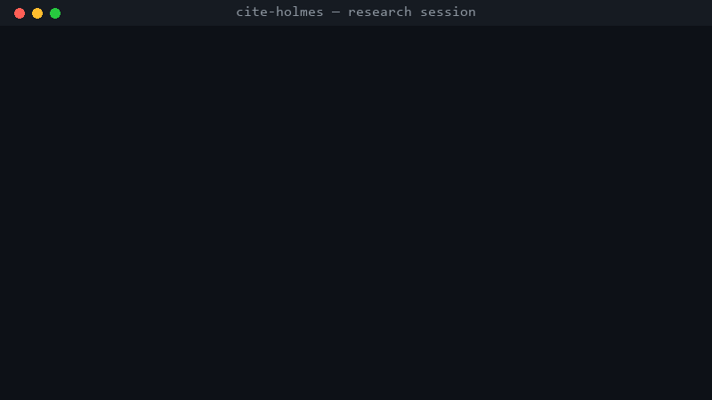

# Cite Holmes 🔍

[](https://github.com/docsor1212/cite-holmes/stargazers)


**Deep research that interrogates its own sources.**

Every AI research report you've ever read had a dirty secret: some of those polished references were probably fabricated. [A Nature news analysis suggests tens of thousands of 2025 publications might include invalid AI-generated references](https://www.nature.com/articles/d41586-026-00969-z). [GPTZero scanned 4,841 NeurIPS 2025 submissions; as independently reported, at least 100 hallucinated citations were found across 51 accepted papers](https://medium.com/@ljingshan6/100-fake-citations-just-slipped-through-neurips-2025-peer-review-5f34f4436560).

Cite Holmes is a deep-research skill with a badge and a magnifying glass: it researches like any deep-research agent — then **arrests its own citations before you can cite them**.



*(Demo is real output: 8 references, 3 deliberately planted fabrications — a fake DOI, a dead URL, and a no-URL citation. All 3 were caught and excluded; the 5 real ones passed. Measured: **7.7 s for all 8** — 4.2 s of pure network checks, the rest is deliberate throttling.)*

Reproduce it yourself — the planted-fakes file ships with the repo:

```bash
python scripts/verify_refs.py --refs examples/demo_refs.json
```


## 你可能会这样说（示例请求）

**核验引用**：「帮我核验这份参考文献列表」「这些 DOI 是真的吗」「查一下这几篇论文是否被撤稿」

**查文献**：「帮我找近三年关于支气管炎诊疗的文献，要能导出 GB/T 格式」「做个 COPD 综述的文献清单」

**深度研究**：「调研一下 CRISPR 温度传感的研究现状」「深度研究 A 和 B 两条技术路线的优劣」

**医学场景**：「这份儿科指南的参考文献可信吗」「核验这篇论文的 PMID 和 DOI」

**投稿前**：「投稿前帮我终检参考文献」「对这份报告做一次审稿人视角的审查」

以上任一说法都会触发对应能力；翻译、润色、改写类请求不会触发。

## 30-second quickstart

```bash
# MCP server (for agents — Claude Code / Codex / Cursor):
uvx --from "git+https://github.com/docsor1212/cite-holmes#subdirectory=mcp" cite-holmes-mcp
```


```bash
python scripts/verify_refs.py --refs refs.json --out report.md
# or verify straight from your reference manager (v1.9):
python scripts/verify_refs.py --refs bibliography.bib --out report.md
# v3.7.0 context check — verify in-text citations inside a finished draft:
python scripts/verify_refs.py --refs bibliography.bib --check-document paper.md --out report.md
```

**China mirror (ModelScope 魔搭)**: <https://modelscope.cn/skills/Docsor/cite-holmes> — if you find this skill useful, a like there helps others find it.

Open `report.md`: CiteScore + pre-submission conclusion at the top,
per-reference verdicts below.
Medical work: add `--profile medical`.  Writing a paper: add `--export bibtex`.
Institution/CI: add `--mailto you@lab.edu` (Crossref polite pool).

## What NOT to do (anti-patterns)

- **Don't feed `semantic` fields from the same model that wrote the draft** —
  the semantic cap trusts structured model judgments; self-review defeats it.
- **Don't treat `verified` as "the paper supports my claim"** — verified means
  the source exists at an authoritative tier and registry metadata matches the
  claimed title/authors/journal/year. Whether the *specific sentence* is
  supported is the semantic layer (agent judgment, or L4 cascade with a judge).
- **Don't batch >50 references per MCP call** — the server rejects oversized
  batches by design; split them.
- **Don't hand-edit `mcp/verify_refs.py`** — it is a sha-gated copy of
  `scripts/verify_refs.py`; edit the trunk and run `mcp/sync_engine.sh`.
- **Don't cite from the report without reading `needs_human_check` flags** —
  partial/unreachable items carry explicit re-check instructions on purpose.
- **Don't skip `--cn` on lossy CN egress and then report unreachable as
  "fake"** — unreachable is not invalid; re-run with `--cn` or a proxy first.

## How it works

Five phases, two modes:

| Phase | What happens |
|---|---|
| **CALIBRATE** | Asks you 3–5 sharp questions first (scope, timeframe, audience) — prevents researching the wrong question |
| **PLAN** | Breaks your question into 3–7 sub-questions with a search budget |
| **SEARCH** | Diamond-shaped iterative search: broad → narrow → gap-filling, Chinese + English, source-tier pyramid |
| **VERIFY** | Two layers: semantic check (does the source actually support the claim?) + mechanical check (reachability, domain authority, field completeness, dedup) |
| **SYNTHESIZE** | Report where every conclusion carries a confidence grade — 🟢 two independent sources / 🟡 single authority / 🔴 contested |

Modes: **QUICK** (single fact-check, ≤6 searches, no interrogation) vs **FULL** (open-ended research, ≤15 searches, calibration mandatory).

## Benchmarks (live runs + quality audit, 2026-09-26; zero-shot pipeline, qwen3:4b judge)

| Benchmark | Setting | n | micro-acc | macro-F1 | Honest reading |
|---|---|---|---|---|---|
| SciFact-Open | open retrieval (mxbai top-3) + judge | 279 | 0.484 | 0.381 | the sanctioned zero-shot vehicle; 0.444/0.313 as first run before label-case normalization (both disclosed, sweep-reproducible); top systems (fine-tuned) reach 0.55-0.64 — our gap concentrates in REFUTES recall: abstract-level evidence rarely shows contradiction; remedies on the roadmap are the NLI third vote, claim-triplet judging, and full-text escalation |
| CFEVER (zh) oracle + panel | gold evidence, zh judge + Erlangshen flip | 1000 | **0.817** | — | panel +8.1 over the 0.736 solo run; REFUTES correct 71→248 | oracle upper bound for the Chinese judge; same REFUTES weakness (R 0.18), excellent NEI discipline (R 1.0) |
| SciFact-Open + L2 panel | judge + NLI contradiction flip (zero-param) | 279 | **0.617** | 0.563 (R-F1 0.667) | the heterogeneous two-vote panel lifts the same zero-shot pipeline +13 micro points into the fine-tuned top-system range (0.55-0.64); REFUTES F1 from 0 to 0.667 (paired flip 45/8, p=2.4e-7) |
| SCitance v2.1 (self-built) | citation verification, hard negatives | 2576 | **0.713** (judge solo) / 0.646 (with NLI flip) | — | honest successor of the deprecated v1 0.947; the NLI contradiction flip that helps fact-check framing (+13 on SciFact-Open) HURTS here (-7) — topically-close hard negatives make the NLI over-report contradiction; aggregation is task-dependent, so the product exposes the panel as opt-in | released with quality audits: embedding-only separability 0.726 (v1 was 0.95 = degenerate), PIR 0/40; 751 false negatives filtered (36% of mined negatives actually supported the claim) |

**Ablation (SciFact-Open, zero-shot)**: no-retrieval 0.262 (all-NEI floor) → top-1 **0.488** → top-3 0.444 → top-5 0.441; short-evidence (400ch) 0.405.
Reading: retrieval is decisive, but deeper evidence pools amplify the judge's SUPPORTS
bias — precision-oriented retrieval (top-1) is optimal for this judge class.

Retrieval: bge-m3 (corpus cache) / mxbai-embed-large (SciFact-Open runs). Judge:
qwen3:4b via ollama (think:false + JSON-schema output; 8k-ctx resident). Full
confusion matrices and the audit gate scripts ship with the benchmark repo.

## The five citation verdicts

| Verdict | Meaning |
|---|---|
| `verified` | Reachable + authoritative tier (official/journal/preprint/major media) + complete fields — may support conclusions |
| `partial` | Reachable but community/blog tier or missing fields — downgraded use |
| `unreachable` | 404/timeout (≠ nonexistent — flagged for human review) |
| `invalid` | Unresolvable or nonexistent identifier (bad/fake DOI, arXiv ID, PMID, URL) — never enters the report |
| `unverified` | Not checked — never masquerades as verified |

## v1.2: medical evidence mode + bibliography export

```bash
# medical profile: journal-tier sources extend to Cochrane/BMJ/ClinicalTrials/
# NMPA/CDC/NICE/万方/ChiCTR; community-tier sources get an explicit
# "unfit for medical conclusions" warning
python scripts/verify_refs.py --refs refs.json --profile medical

# PMID-only references work out of the box — and every PubMed URL gets its
# PMID existence-checked via NCBI E-utilities. A fabricated PMID is caught
# even though PubMed's own page happily returns 2xx for it.

# export: verified-only BibTeX (straight into your paper) + full audit CSV
python scripts/verify_refs.py --refs refs.json --export bibtex,csv
```

Try the medical demo — real tocilizumab/sJIA references from PubMed, plus one
planted fake PMID and one planted duplicate (both caught):

```bash
python scripts/verify_refs.py --refs examples/medical_refs.json --profile medical --export bibtex,csv
```

## v1.5: arXiv verification + Wayback fallback

```bash
# arXiv IDs are now first-class: the official export.arxiv.org API cross-checks
# the registered title/year with the same thresholds as DOIs. A well-formed but
# nonexistent ID is judged invalid (fabricated) — never silently "unreachable".
# refs may carry "arxiv": "2310.10631" (or "hep-th/9901001"); arxiv.org/abs|pdf
# URLs are auto-detected.
python scripts/verify_refs.py --refs refs.json

# Unreachable entries are automatically checked against the Wayback Machine;
# when an archived copy exists, the report note carries the archive link so
# human review has something to compare against.
```

## Install

**AI agents (skills.sh / one command):**

```bash
npx skills add docsor1212/cite-holmes
```

**OpenClaw users (ClawHub — versioned, auto-updatable):**

```bash
clawhub search cite-holmes        # find it on the registry
clawhub install @docsor1212/cite-holmes
```

**Any Agent Skills-compatible agent** (Claude Code, Codex, Cursor, Gemini CLI, ZCode):

```bash
clawhub install @docsor1212/cite-holmes        # ClawHub registry
# or grab the folder directly from SkillHub: https://skillhub.cn/skills/cite-holmes
# then drop it into ~/.claude/skills/cite-holmes (or your agent's skills directory)
```

**China mirror (SkillHub 腾讯)**: <https://skillhub.cn/skills/cite-holmes> — fast downloads inside China, 中文说明.

## The DoctorQ Lab academic family

Cite Holmes works alongside three sibling skills:

- [academic-figures](https://skillhub.cn/skills/academic-figures) — publication-ready scientific figures (22+ chart types incl. composite panels, PRISMA, forest, KM) from one command
- [paper-polisher-pro](https://skillhub.cn/skills/paper-polisher-pro) — AI-rate self-check, polish guidance and AIGC-compliance labeling for academic writing, bilingual, 100% local
- [pubmed-verifier](https://skillhub.cn/skills/pubmed-verifier) — focused PubMed citation verification for medical literature

## Usage

Just talk to your agent — it triggers automatically:

```
> deep research: what changed in the agent-skills ecosystem this year?
> is it true that NeurIPS 2025 papers contained 100+ hallucinated citations?
```

Or use the verifier standalone on any reference list:

```bash
python scripts/verify_refs.py --refs research_refs.json --out report.md
# offline structural check / strict CI mode
python scripts/verify_refs.py --refs refs.json --offline
python scripts/verify_refs.py --refs refs.json --strict
```

## What it won't catch (honest limits)

- A fabricated citation that points to a **real, live, plausible page** passes the mechanical check. The semantic layer (the model judging whether the source actually supports the claim) may catch it — it is model judgment, not a guarantee.
- `unreachable` ≠ fake: pages behind login walls or bot-blocking are flagged for human review, not condemned.
- The planted fakes in our demo are exactly the catchable types (dead URL / fake DOI / missing URL). We are not claiming it catches everything.

## Why not just use deep research / a citation checker?

- Deep-research skills **research more** but trust their own citations.
- Standalone citation checkers verify but don't research.
- Cite Holmes does both in one flow: **every reference in every report is machine-checked before it reaches you.**

Zero dependencies (pure Python stdlib), cross-platform (Windows/Linux/macOS), MIT license.

## Install

```bash
# Via the skills CLI (Claude Code / Codex / any agent):
npx skills add docsor1212/cite-holmes
# Or clone and run directly (no install step):
git clone https://github.com/docsor1212/cite-holmes && python cite-holmes/scripts/verify_refs.py --refs refs.json --out report.md
```

## CiteScore — every report carries a grade

Each verification report opens with a **CiteScore**: a 0-100 confidence score
(verified +10 / partial +4 / unreachable 0 / unverified −2 / invalid −8,
normalized by reference count) with an A–D grade. Screenshot it, quote it,
or gate your CI on it (`--strict`).

## What's new

**v6.9.0** — --grill challenge questions are error-code driven from the single-source registry (12 codes, legacy aliases honored, per-entry dedup); verdicts untouched.

**v6.8.0** — holdout set expanded to 54 refs via pipeline dynamic sampling (live Crossref registry entries, each live-verified; hand-written DOI surface eliminated).

**v6.7.0** — capability table reorganized into four task groups for progressive disclosure; --cn honestly skips the S2 context layer (domestic reachability; --s2-key opts in); line-budget checks single-sourced.

**v6.6.0** — license labeling unified (MIT across LICENSE/SKILL/README); per-hop redirect guard for citation reachability probes (public links redirecting into private/reserved ranges refused; security declaration now states its boundaries honestly); top-level error codes consolidated into a single-source registry (E_DOU_NOT_FOUND typo corrected to E_DOI_NOT_FOUND with legacy-code compatibility); engine sources reflowed to readable line widths under an AST-equivalence gate.

**v6.5.0** — in-package sealed test subset (manifest-driven; `selfcheck --tests`) so installers can re-verify verdict semantics and engineering locks; independent holdout set expanded to 36 refs (21 live-verified multi-domain clean + 15 planted forms, 7 new shapes) via a two-phase build pipeline with per-entry human-review freeze gate; `tools/run_tests.sh --held-out` live gate (capture=100% / zero false-kill / fidelity=100%); netcheck adds cross-registry title-consistency probe (Crossref/OpenAlex/PubMed).

**v6.4.0** — TLS-fingerprint downgrade retry in the transport layer (fixes CDN-site unreachable misjudgements; request object rebuilt on the downgrade round) and metadata-fidelity grading annotations within partial (minor/major drift, verdict semantics untouched) with a live-calibrated corrosion holdout set; OpenAlex 429 backoff retry; `--require-version` strict tier (default off); `tools/run_tests.sh` suite entry; netcheck CDN probes.

**v6.3.0** — `tools/netcheck.py` live-net stability self-check: seven-registry probes, live verification rings (freshly fetched fixtures), four-form mine matrix with zero clean-kill; two-tier verification system with the shipped offline selfcheck; the gate is content-bound against idle-pass.

**v6.2.0** — MCP wheel manifest completeness fix (seven engine layers now packaged; standalone installs verified working; install-mode --demo degrades gracefully) plus an independent holdout eval set (16 live-verified entries, six fabrication forms, zero false-kill offline and live-net) registered in the benchmark page.

**v6.1.0** — pre-submission audit package: `--check-paper doc.md` produces the verification report, tiered audit, GB/T/BibTeX/CSV exports and an INDEX overview with a mechanical READY/NOT-READY verdict (human-review boundary always attached); shipped `tools/selfcheck.py` install self-check for agent hosts.

**v6.0.0** — engine modular layering: the single-file engine becomes a shell plus seven modules (text/constants, transport/state, registry lookups, semantic audit, verdict orchestration, rendering/export, CLI), every file below the static-reader visibility boundary; verdict semantics, public API, CLI and MCP tools unchanged; ADR-0010 documents the decision.

**v5.9.0** — citation-context divergence signals in the scholarly-usage panel (heuristic contrastive-phrasing scan over S2 samples with a conservative threshold; advisory only, never a verdict, zero extra network calls) plus benchmark and ADR documentation truth fixes.

**v5.8.0** — verdict-semantics fidelity: internal exceptions land unverified (never invalid) across CLI and MCP, with actionable notes; MCP docs aligned with the 5-tool reality; retraction-semantics docs refreshed. Zero change to the main verdict paths.

**v5.7.0** — consistency hardening: error-code count unified to 12, stale version stamps removed, security declaration now covers user-submitted URLs, example artifacts refreshed with a freshness scan, grouped request examples in the README, and ADR-0009 for the dual-copy design.

**v5.6.0** — open-access enrichment (Unpaywall license/free-to-read status behind `--mailto`, data only, never verdicts) and MCP surface 3→5 (`discover_references` birth-verified topic search + `build_review_kit`); HTML report reaches md parity on scholarly usage and OA.

**v5.5.0** — arXiv title-alias guard (truncated/reordered titles land partial with the registered-title suggestion, never a false invalid; fabrications still die); `--refs-dir` local-library batch; `--next-round` retry skeleton from unresolved entries; 5-minute onboarding doc; placeholder examples replaced with real public data.

**v5.4.0** — review & audit: `--reviewer` (checklist embedded into the report), `--audit-mode` (P0/P1/P2 audit report for editors/reviewers/teachers), MCP backend wiring example. Zero verdict-semantics change.

**v5.3.0** — public eval methodology: one-command reproducible held-out metrics (tools/run_eval.py + docs/benchmark.md with real numbers and honesty boundaries); `--research-profile` persistent preference defaults (explicit flags win, never verdicts).

**v5.2.0** — deep-research workflow controls: `--plan` plan artifact (validated & rendered, never auto-edited), `--preset deep` budget tier, `--source-policy journal_only,deny-domain=x.com` (curation at discovery, annotation at verify - never verdicts), `--trace` append-only research ledger. Zero verdict-semantics change.

**v5.1.0** — SkillHub display name calibration: leads with deep research · academic research (this skill has always been citation-verifying deep research); all keyword roots retained in the description; zero capability change.

**v5.0.0** — scholarly usage panel (citation-context intents + sample citing quotes in reports and the review kit, enhancement signal only, never verdict-changing); `--doctor --net` domestic direct-reach advisory; 30-second navigation headers on long reference docs.

**v4.9.0** — review kit: `--discover "topic" --review-kit` is a one-command literature workflow (comparison table + annotated bibliography + paste-ready GB/T list, every row verdicted, partial never reads as verified); bilingual SKILL hierarchy restructure; domestic-network FAQ expansion; real-data sample.

**v4.8.0** — landing-page title cross-check for EB/OL partials (existence evidence recorded in the workpaper, never a verdict change) and a widened release-chain polling window.

**v4.7.0** — robustness for dotted-initial citation forms: European dotted-initial authors (HANSEN J.J. Title) self-heal into author + title behind a three-gate check (type-code tail, dotted-initial head shape, no year-comma) - titles containing U.S./U.K./Q.T.-style abbreviations are untouched, and abbreviation dots eaten by the guarded splits are restored; `--discover-sort cited|newest` orders literature discovery by citations or date with an honest PubMed fallback declaration.

**v4.6.0** — completeness for Chinese citation forms: [EB/OL] entries (drug labels, guidelines, consensus docs) now contribute their URLs to reachability and source-tier checks when no stronger identifier exists; abbreviation-period splitting no longer fragments U.S.-style organization names into title pieces; approval numbers (H20093320-style) no longer masquerade as publication years; `--discover` gains `--discover-since` year filtering and cross-source same-paper merging.

**v4.5.0** — literature discovery: `--discover "topic"` searches PubMed + OpenAlex and feeds every hit through the full verification stack - a born-verified reference list with GB/T 7714 / BibTeX export; `--demo` runs a bundled 8-reference sample (3 planted fakes) for a zero-setup tour of the verdict pipeline; description now carries literature-search reach terms.

**v4.4.0** — reference-list completeness audit: `--check-document` reports orphan references (listed but never cited in the body) and coverage stats - a writing-integrity advisory that never changes verdicts; one-file mode runs extraction, verification and in-text cross-checking from a single document path; in-text citation extraction truncates at the reference section, fixing false citation counts from list numbering.

**v4.3.0** — non-MEDLINE Chinese journals join the verification coverage: OpenAlex anchor search chains into DOI-registry verification (the aggregator is only an index; the verdict evidence comes entirely from the DOI registry, retraction checks included); `tools/build_retraction_cache.py` builds a local Retraction Watch index from the official daily dump for offline scale checks with notice granularity; the PMID path gains a pre-verdict bridge rescue for romanized/translated title claims; the Chinese journal TA table was live-audited and pruned to 17 verified mappings with a governance tool.

**v4.2.0** — Chinese medical citation verification end-to-end: [N]-bracket GB/T 7714 entries (bracket numbering, bare headings, title-first records) now parse; inline PMID/DOI anchors in reference strings are extracted and verified against registries; identifier-less references gain a volume/issue/page locator channel (unique PubMed hit upgrades to verified with the PMID anchor back-filled - language-independent, so a Chinese claimed title against an English registered title caps at human review, never fabrication); PMID-path titles now carry the cross-language guard; Chinese scholarly registries classify at journal tier. Release tooling: full-coverage fallback publishing, MCP engine-copy sha gate, hermetic test sweep.

**v4.1.0** — reliability and nuance: a failed network check is retried, then reported as incomplete - never as a miss; the Vancouver reverse-lookup channel works from two content words (short medical titles); retraction checks distinguish partial retractions, withdrawals, Expressions of Concern (cap verified at partial) and corrections (note-only), and a failed retraction check is flagged instead of silently passing.

**v4.0.0** — version-scheme alignment (major increments in decimal from here on; minor caps at 9): parameterized release tooling, hardlink sentinel, golden regression gate, description negative triggers, capability-boundary tables, finding-ledger closing. Engine addition: a PubMed title-reverse-lookup verification channel for identifier-less (Vancouver-style) medical references — a hit upgrades to `verified` with the PMID anchor back-filled into exports and cache keys.

**v3.17.0** — release tooling debut (internal engineering, no engine changes): parameterized release pipeline, hardlink sentinel, golden regression gate.


- **v3.16.0** — card conversion release: the SkillHub card's first line now
  leads with what searchers actually type (citation verification / reference
  checking / AI-hallucination detection / fabricated DOI / pre-submission
  check) instead of brand phrasing; the listing category was corrected from
  knowledge-management to professional/科研学术 to match the peer tool in the
  same space. No engine changes — this is a discoverability-and-conversion
  release informed by a controlled comparison experiment on default search
  ordering. 443 tests green.
- **v3.15.0** — the script-aware-guard release: the cross-language guard now
  works by **writing system** (Latin / Cyrillic / Greek / Han / Kana / Hangul)
  instead of CJK-only — a Russian, Greek, Japanese or Korean claimed title
  against an English registry record can no longer be mis-judged `invalid` by
  low similarity; it goes through the same cross-language guard (partial +
  bridge, or an upgrade on a bridging hit). Same-family pairs (German vs
  German, French vs French) still compare normally, and German-claimed vs
  English-registered stays a real similarity judgment. Docs answer the two
  remaining boundary questions with measured numbers: an expected-duration
  table for large batches (20-ref mixed list: ~18s at `--workers 4`, ~7s
  cache-warm, ~47s serial — measured, with 100-ref projections) and a
  multilingual boundary section. SKILL.md mechanical/semantic layers gained
  sub-headings for scan-ability. 443 tests green.
- **v3.14.0** — the lean-main-file release: SKILL.md slimmed ~30% (294→207
  lines EN / 249→176 ZH) by moving the anti-patterns catalog, the full
  security declaration (`references/security.md`) and the honest limits (now
  in `references/out-of-scope.md`) to their reference pages — the main file
  keeps every command, the task→flag table and one-line summaries, so the
  first read is short and the deep reads are opt-in. New `--grill
  report.json`: an adversarial pre-submission checklist ("reviewer rehearsal")
  that generates the strongest challenge questions per reference (per-verdict
  templates + clone/profile/preprint follow-ups, pure templates, zero
  network, never changes a verdict) so you answer every hard question before
  a reviewer asks it. 424 tests green.
- **v3.13.0** — methodology infrastructure release (borrowed from the
  best-run open-source skills and adapted to citation verification):
  `references/GLOSSARY.md` — an opinionated canonical-terms table (five
  verdicts / signals / error codes), each term with an _Avoid_ list, so
  report language and your language always line up; `docs/adr/` — public
  architecture decision records (verdict contract, circuit-breaker scope,
  offline honesty, cross-lingual guard, signals-never-verdicts, one-way
  mirror, neutral language), each a short "what we decided and why";
  `references/out-of-scope.md` — explicit non-goals, each with its reason;
  a Codex-compatible `agents/openai.yaml`; and a CALIBRATE upgrade —
  questions now carry recommended answers phrased so "yes" accepts them,
  ordered by dependency, with decisions always left to you. 399 tests
  green.
- **v3.12.0** — the submission workbench release: `--preset submission`
  bundles the pre-submission final check into one flag (strict CI exit codes
  + GB·T 7714/BibTeX/CSV exports; verdict semantics unchanged); `--explain N`
  prints a plain-language explanation chain for any single reference
  (verdict semantics / evidence steps / error-code translations / notes /
  completeness / recommended action). Docs get a usability pass: every deep
  reference now opens with a 30-second entry (when to read it, shortest
  path), the anti-pattern list grew from 8 to 14 entries (now 16) each with a
  concrete alternative, the FAQ covers clone pairs / profiling / preprint
  hints / bridging, and INDEX.md gained a task-based 30-second routing
  table. 411 tests green.
- **v3.11.0** — bibliography profiling & version hints: a list-level
  fabrication fingerprint scan (pure-local, zero network) catches what
  per-reference checks cannot — serial identifier clusters, year
  over-concentration or future years, single-source concentration, and the
  bare-entry share; flags are human-review leads, never verdicts. An
  arXiv-only reference that has since been registered as a journal article
  gets a preprint→published hint (formal-version DOI via Semantic Scholar,
  silent on rate limits). Verified DOI entries now carry a per-reference
  **completeness score** — how many export fields the registry CSL can
  back-fill, with the missing-field list, so authors know exactly what to
  complete before exporting. 379 tests green.
- **v3.10.0** — cross-lingual titles & clone detection: a Chinese original
  title claimed against an English registry record (the normal case for
  Chinese-journal DOIs) is now resolved by a three-stage bridge — the
  bilingual `original-title` registry field, then the DOI landing page, then
  OpenAlex — a hit upgrades the verdict to `verified`, a miss keeps
  `partial`, and a language difference is never treated as fabrication
  evidence. **Clone-pair detection** flags same-title/different-DOI and
  same-DOI/different-title pairs inside one bibliography (the most common
  fabrication shape in generated text) as pairs — a lead for review, never a
  verdict change. `--doctor` (add `--net`) gives a zero-outbound environment
  self-check with per-registry connectivity probes, PASS/WARN/FAIL verdicts
  and CI-friendly exit codes. The SKILL VERIFY section is restructured
  command-first (run → verdicts → mechanical/semantic layers → task→flag
  table). 355 tests green.
- **v3.9.0** — structured error codes + escalation routing: every result now
  carries machine-readable `error_codes` (E_DOI_NOT_FOUND / E_TITLE_MISMATCH /
  E_RETRACTED / E_STITCHED / E_UNREACHABLE / ... — five verdicts plus the
  reason class, derivable offline); the L4 evidence cascade gains a **fast-judge
  pre-screen route** (with `--fast-judge-url`, suspected mis-citations flagged
  by the small student classifier are escalated first — routing, not skipping: every
  candidate is still fully cascaded); MCP `verify_references` clipping is now
  explicit (`max_field_chars` parameter + `output_clipped` marker when fields
  are shortened — no silent truncation). 306 tests green.
- **v3.8.0** — documentation & examples completeness release: end-to-end worked example (input refs → real generated report →
  all four export formats, shipped under `examples/end-to-end/`);
  `references/INDEX.md` + consolidated anti-patterns list (incl. "trigger-word
  mis-fires" and cross-language mixed-citation boundary); **context-check
  results now appear in the md/html reports** (previously console/JSON only);
  author-surname anchor credit (a citing sentence naming a registry author
  counts as strong binding evidence). 299 tests green.
- **v3.7.0** — document-level citation checking (`--check-document paper.md`):
  parse in-text citation markers ([12], [1-4], (Author, Year), doi.org links),
  bind each marker to the verified reference list, and score anchor-word
  overlap between the citing sentence and the cited title — low anchors are
  flagged as possible mis-citations for human review. This moves verification
  from the reference *list* to the *context*: the list can be clean while the
  citations still point at the wrong papers. Also: `check_document` as a third
  MCP tool; RIS export (Zotero/EndNote round-trip); `--preflight` registry
  status panel. 292 tests green.
- **v3.6.0** — GB/T 7714-2025 reference-list export (`--export gbt7714`):
  verified entries formatted per the Chinese national bibliography standard
  effective 2026-07-01, **built from registry-authoritative CSL metadata**
  (authors in GB/T abbreviation form, [J]/[EB/OL] type codes,
  volume(issue):pages, DOI) — not from user-claimed fields. Title-disputed
  partials are excluded by policy (better absent than wrong). Plus `--cn`
  resilience preset: 25s timeout floor and a Crossref second-host fallback
  for DOI metadata (independent host; doi.org outages no longer blind the
  checker). Anti-pattern guide + scenario best-practices docs. MCP server:
  batch cap 50, output clipping, packaged entry point (tag mcp-v2.0.0).
  292 tests green.
- **v3.5.0** — fast-judge pre-screen (opt-in): point `--fast-judge-url` at
  any OpenAI-compatible endpoint (a small local classifier works best —
  smaller models keep latency low) and references stuck in
  semantic-limbo (no official text to escalate, no metadata to verify) get a
  screening note before a human ever looks at them. Guardrails by design: it
  NEVER produces or changes a verdict, never flags for review, and only
  annotates high-confidence SUPPORTS leanings (calibrated threshold 0.95;
  calibration curve ships in the repo). Off by default — zero behavior change
  without the flag. Also: label-case normalization disclosed in benchmark
  table, evaluation FAQ expanded.
- **v3.4.1** — dedup fingerprint fix: batch deduplication now keys on
  identifier + normalized title fingerprint, so two references sharing a
  URL/DOI/PMID but carrying different titles (the classic stitched-fake
  variant) are independently verified instead of silently inheriting each
  other's verdict. Genuine duplicates (same identifier + same title) are
  still merged with the partial downgrade.
- **v3.4.0** — PMID metadata verification + identifier-free search: PMID-only
  references now get full title/journal/year cross-checks against PubMed
  registry data (NLM abbreviation-aware journal matching; genuine-PMID-fake-paper
  splice attacks are caught as invalid), references without any identifier go
  through OpenAlex + Semantic Scholar title search (confirmation -> partial,
  not-found -> honest unverified for human review, never "fabricated"), and
  BLUF key_numbers now reports "reviewed N (retracted X)" separately.
- **v3.3.1** — title cleaning for metadata matching: reference lines are cleaned
  (strip numbering, DOI/PMID/arXiv suffixes, author+year blocks) before title
  similarity is computed against official registry metadata — demo-validated to
  raise AlphaFold-style matches from 0.66 to 0.9+.
- **v3.3.0** — the heterogeneous-panel release. Optional NLI third vote
  (`--nli-url`): an independent NLI service watches the generative judge;
  agreement records high confidence, disagreement marks human review without
  flipping mechanical verdicts (conservative philosophy, mirroring L4).
  Experimentally validated: the same panel lifts SciFact-Open zero-shot micro
  from 0.484 to 0.617 with REFUTES F1 0-to-0.667. 252 tests green.
- **v3.2.0** — the conformance release. JSON reports carry the BLUF block as a
  first-class object, conformant with the published BLUF Report Specification v1.0
  (five core keys, worst-actionable rule; `bluf_yaml` kept for compatibility) —
  our own validator now passes our own output. Optional offline retraction checking:
  `--retraction-cache <index.json>` built from the official Crossref/Retraction Watch
  GitLab dump (63k+ DOIs) turns retraction flags into a local, zero-network lookup.
  241 tests green.
- **v3.1.0** — the closed-loop release. The L4 evidence cascade is now wired
  into the main flow: references the semantic layer could not resolve
  (not_in_source/unclear) escalate automatically to official PubMed abstracts or
  arXiv full text, get passage retrieval (bge-m3, TF-IDF fallback) and a
  configurable external judge. Judge findings annotate the report and never flip
  verdicts; without --judge-url the run is byte-identical (zero network calls).
  The judge client handles thinking models (qwen3 family): native ollama calls
  use think:false + JSON-schema enum output, /v1 endpoints fall back from empty
  content to the reasoning field (all verified live on SciFact/SCitance/CFEVER).
- **v3.0.0** — the BLUF release. Every report opens with a machine-parseable
  YAML block (verdict / key_numbers / blocker / next_action) plus a 5-line
  human TL;DR — cite-holmes defines the "3-second dual-reader" report standard
  (a gap no tool fills today). Scholarly reception: verified DOIs fetch
  Semantic Scholar citation contexts (times-cited, context excerpts, coverage
  honestly labeled — the free Scite.ai counterpart). L4 evidence cascade:
  abstract-level judging via configurable external judge endpoints (OpenAI-
  compatible: ollama / llama-server), NEI escalates to full-text passage
  retrieval with local bge-m3 embeddings (TF-IDF fallback, zero hard deps).
  Cross-language title guard (Chinese claims vs English registrations no
  longer misjudged invalid). 210 tests green.

- **v2.0.0** — MCP three-primitives server (`verify_references` + `explain_verdict`
  tools, capability-matrix/changelog resources, fact-check workflow prompt),
  arXiv multi-version notes (unversioned citations to multi-revision papers,
  stale version pointers), optional `NCBI_API_KEY` (E-utilities 3→10 req/s for
  parallel batches), and a per-reference **evidence chain** in HTML reports
  (doi.org → retraction → S2 → OpenAlex → reachability, at a glance). First
  Major: the transparent multi-source citation verification stack, as shipped.
  195 tests green, real-network acceptance, package security self-scan clean.

- **v1.13.0** — the discoverability release. EN description rewritten around
  task-language roots (citation verification, verify citations, citation
  checker, hallucinated references, fact check) so task-word searches on
  skills.sh and agent skill markets finally surface it. New MCP server
  (`mcp/server.py`, FastMCP): expose the same mechanical verification engine
  as a `verify_references` tool for agents that prefer tools over skills —
  official MCP Registry ready (publish-once to Smithery, mcp.so, PulseMCP).
  Security & behavior declaration retained. 188 tests green, real-network
  acceptance 5/5, package security self-scan clean.

- **v1.12.0** — trust & transparency release. Persistent disk cache (default
  on, 7-day TTL, local SQLite): re-running or extending a bibliography reuses
  stable verdicts with zero network round-trips — the repeat-run pain behind
  every Trust score. `--strict` always bypasses the cache; `--refresh-cache`
  forces re-verification; `unreachable` is never cached. `--proxy` flag for
  restricted-egress environments (env `HTTPS_PROXY` also honored). A
  **Security & behavior declaration** section now ships in both languages:
  network access limited to the official academic registries over HTTPS, no
  telemetry, single-run CLI, nothing installed, env vars limited to your own
  API keys. The capability matrix adds an explicit "unsupported inputs" line
  (PDF/Word documents, Wanfang/CQVIP-only IDs, fact-checking claims).
  Private maintainer tooling removed from the shipped package. 181 tests.

- **v1.11.0** — the determinism release: arXiv API transient 406/403 (its anti-bot
  window trips even under our 3s global pacing) no longer silently skips content
  verification — exponential backoff, then a fallback to the official arXiv.org/abs
  landing page for title comparison (0.50/0.82 thresholds), so the same references
  produce the same verdicts on re-runs. Structured semantic audit: the model's
  per-reference semantic judgment now travels as machine-readable workpapers
  (`semantic: {claim, support, quote, note}` → `semantic_audit` in `--export
  auditjson` and a dedicated report section); `not_in_source`/`contradicted`
  judgments cap the verdict at `partial` with a human-review flag. Pre-submission
  conclusion corrected to arXiv's actual May 2026 enforcement start (was June) and
  now names ICML 2026 desk-rejections too. `tools/agentskills_check.py --distro`
  prints a skills.sh/agentskills.io distribution readiness checklist. 166 tests
  green. Zero new dependencies.

- **v1.10.0** — the speed release, aimed squarely at the top evaluation
  complaint ("verification leans on overseas databases; flaky from CN
  networks"): **parallel verification** (`--workers`, default 4 — references
  are independent, so a 20-item bibliography takes roughly a quarter of the
  serial time; results stay index-ordered and the host circuit breaker /
  rate-limiters are now thread-safe), **degraded-network mode** (3+ different
  hosts failing at the transport layer in one run flips remaining lookups to
  fast honest skips with a proxy/retry suggestion — minutes of waiting become
  a fast verdict), **Semantic Scholar title-search confirmation** for
  references with no DOI/PMID/arXiv (confirmation only, never a downgrade;
  hyphens normalized to spaces per S2 API docs), **intra-run cache** (a
  duplicate DOI/URL reuses the first verdict instead of re-hitting the
  network), fast-fail (no retry) once the network is known-degraded, and an
  OpenAlex 429 hint (key now required for production since 2026-02; free tier
  is 100 credits/day). 147 tests.
- **v1.9.0** — Semantic Scholar third source: when DOI.org metadata cannot be
  fetched, the DOI is re-confirmed at the S2 Graph API (confirmation only,
  never a downgrade — S2 record quality is uneven; 403/429 landing pages can
  now be rescued on S2 confirmation too). BibTeX import: `--refs
  bibliography.bib` verifies Zotero/EndNote exports directly (nested braces,
  `\url{}` macros, eprint→arXiv). OpenAlex API key support
  (`--openalex-key`/`OPENALEX_API_KEY`) with an actionable 403 hint — OpenAlex
  requires keys for production use since 2026-02. `--mailto` joins the
  Crossref polite pool; 429 `Retry-After` is honored. Every report now opens
  with a one-line **pre-submission conclusion** (arXiv has banned authors over
  hallucinated references since 2026-06). `--export auditjson`: a
  machine-readable per-reference check trail for institutional audit.
  SKILL.md slimmed (details moved to `references/verification-details.md` +
  `references/faq.md`). 120 tests.
- **v1.8.1** — fix: OpenAlex bibliographic confirmation could silently
  no-op (response read outside its context manager); caught by the new strict
  real-network acceptance gate and corrected.
- **v1.8.0** — retraction detection: verified DOIs are cross-checked against
  the Crossref/Retraction Watch database (free, updated every working day);
  a retracted paper is real — and uncitable — so retracted references are
  capped at `partial` and flagged for human review. Bibliographic existence
  check via OpenAlex for references without DOI/PMID/arXiv (positive
  confirmation only; "not found" never means "fabricated"). UA-rotation retry
  for metadata endpoints (403/406 resilience). New "common mistakes"
  anti-patterns section and a 30-second quickstart. Capability matrix now
  covers 10 fabrication/problem types. 89 tests.
- **v1.7.0** — author-name consistency check against DOI-registered authors
  (any claimed surname hit counts; a full miss downgrades to `partial`),
  capability-boundary matrix in every report (9 machine-caught fabrication
  types vs what stays with the semantic layer), `--format html`: a
  self-contained single-file HTML report (zero external assets, mobile
  readable — shareable with advisors/editors), agentskills.io spec self-check,
  internal competitive landscape. 73 tests.
- **v1.6.0** — host-level circuit breaker (2 consecutive transport failures to
  the same host → skip for the rest of the batch with an honest note; broken
  networks no longer stall the whole run), actionable error notes (timeout
  suggests `--timeout 20`, DNS vs refused distinguished, human-review section
  carries suggested actions), DOI↔PMID cross-check (catches "stitched fakes"
  where both IDs are real but belong to different papers), journal-name
  consistency check against DOI-registered metadata (mismatch → `partial`),
  CN-network FAQ section, regression suite grown to 62 tests.
- **v1.5.0** — arXiv ID metadata validation (export.arxiv.org official API,
  DOI-grade similarity thresholds; nonexistent IDs → `invalid`, never
  `unreachable`), Wayback Machine fallback for unreachable entries (archive
  link attached for human review), `arxiv` reference field, `eprint` in BibTeX
  + arXiv column in the audit CSV, regression suite grown to 53 tests.
- **v1.4.0** — DOI metadata cross-check (DOI.org CSL JSON vs cited title/year —
  catches "real DOI, wrong paper"), `--easy` one-flag mode (auto medical profile +
  auto BibTeX/CSV export), transient-network retry, human-readable Chinese error
  messages, expanded FAQ.
- **v1.3.0** — CiteScore scorecard in every report (Markdown + JSON), official
  icon, `tests/` regression suite (offline golden + medical profile + exports).
- **v1.2.0** — medical evidence mode (`--profile medical`), PMID verification
  via NCBI E-utilities, BibTeX/CSV bibliography export, 3-key dedup
  (URL/DOI/PMID).

## License

MIT © DoctorQ Lab
