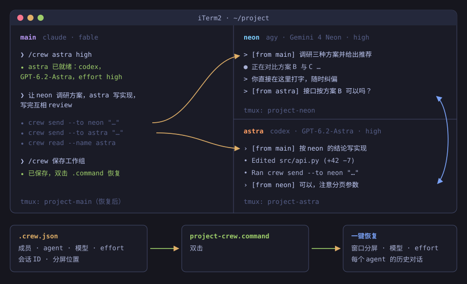

# crew

English · [中文](README.md)

A skill for Claude Code, Codex and Antigravity (`agy`): split the current iTerm2 pane and start another agent (Codex, `agy` or Claude Code) in a few seconds, with the model and reasoning effort you choose. Agents message each other through tmux. The whole group can be saved to the project folder and restored later with one double-click: windows, models, effort and every agent's conversation.



## When it helps

**Quick multi-agent work.** You are working in Claude Code and want another model to take a piece in parallel (research, an implementation, a review). `/crew astra high` adds a pane. No opening terminals, changing folders, starting tmux or typing launch flags.

**Watch the work and steer it.** Every agent is a real interactive session in a pane in front of you. You see what it is thinking, which files it changes, where it is stuck. If it drifts, type a correction straight into its pane instead of waiting for it to finish. That is the main difference from background sub-agents.

**Cross-vendor teams.** Put models from different vendors in one group. Main hands out tasks and reads progress; members can also talk to each other directly (one writes, one reviews).

**Anonymous panel.** For an important decision, several models each write a position, review each other anonymously and then revise. The result is a map of the disagreement: what everyone agrees on, where and why they differ, and minority positions kept intact. No voting, no forced consensus.

**Pick models by task and quota.** `/crew open one for frontend work` first reads every CLI's remaining quota, then combines it with a leaderboard snapshot and your own preferences to recommend a model, with reasons, so the most expensive model is not started everywhere and quota does not run out early.

**Long projects.** Need to shut down mid-discussion? Save. Next time, double-click one file and the whole group comes back to the same panes with its context.

## Install

From ClawHub:

```bash
clawhub install crew
```

Or from GitHub:

```bash
git clone https://github.com/garmanwu/crew ~/.claude/skills/crew
```

To use it from Codex and agy as well, link the same folder:

```bash
ln -s ~/.claude/skills/crew ~/.codex/skills/crew
mkdir -p ~/.gemini/config/skills && ln -s ~/.claude/skills/crew ~/.gemini/config/skills/crew
```

Currently **macOS + iTerm2 only**, with the Claude Code, Codex and agy CLIs. Needs `tmux`, `python3` (3.8 or later; the system one is fine) and whichever agent CLIs you want to use, logged in. Restart the CLI afterwards: `/crew` in Claude Code, `$crew` in Codex, plain language in agy. Run `crew.py doctor` if something does not work.

## Usage

In a Claude Code, Codex or agy session in your project folder (the first session that creates the group is called **main**):

```
/crew                          # menu: first 2 models of each installed CLI, with remaining quota; reply e.g. "2 design high"
/crew astra high               # start model astra with effort high directly
/crew save the group           # save members, models, effort, session ids, pane layout
/crew panel should we do X?    # three-round anonymous panel; main writes the disagreement map
/crew open one for frontend    # recommend a model from quota, rankings and your preferences, then start it once you confirm
/crew show quota               # remaining quota of each CLI
```

Plain language works too:

```
open a codex agent called design, model astra, effort high
ask design to review section 3 of SPEC.md
how far is design?
```

To restore: quit the window main is running in, then double-click `<folder>-crew.command` in the project folder.

### Choosing a model

| Command | What it does |
|---|---|
| `crew.py quota` | Remaining quota for Codex, Claude Code and agy (local reads only, cached 10 minutes) |
| `crew.py advise --task frontend` | Among options with ≥ 20% quota and within 50 points of the best score, picks the cheapest per task; your preferences go first |
| `crew.py rankings [show]` | Status or contents of the leaderboard snapshot; when older than 30 days, main refreshes it from arena.ai and runs `rankings import` |
| `crew.py doctor` | Checks dependencies, model lists, quota sources and config |

Task types: `frontend`, `coding`, `agentic`, `review`, `writing`, `vision`, `research`, `3d`, `labeling` (defaults in `defaults.json`). Personal preferences, such as "use astra for 3D", go in `~/.config/crew/roles.json` and are never part of the published skill:

```json
{
  "tasks": {
    "3d":       {"prefer": ["gpt-6.2-astra"]},
    "frontend": {"prefer": ["gemini-4-neon", "gemini-4-carbon"]}
  },
  "policy": {"min_quota": 20, "elo_margin": 50}
}
```

A 50-point Elo gap is roughly a 57% win rate, which is why options inside that margin count as "good enough" and the cheaper one wins. Leaderboards measure general preference, not your project, and per-task cost is API pricing, not subscription usage: treat the recommendation as a well-reasoned default, not a verdict.

### What each step does

| Action | Result |
|---|---|
| Start an agent | Splits a pane next to main, enters the same folder, creates tmux session `<folder>-<name>`, starts the CLI with the model and effort, and tells it who is in the group and how to send messages |
| Send a message | Types the text into the other agent's input and submits it, prefixed with `[from <sender>]` |
| Read progress | Captures the other pane's current screen |
| Save | Re-reads every pane's current session id, writes `.crew.json` and `<folder>-crew.command` |
| Restore | Opens a new iTerm2 window and resumes every agent's conversation in the original layout; live tmux sessions are re-attached, not restarted |

### Using the script directly

There is one script behind the skill; agents also use it to talk to each other:

```bash
CREW=~/.claude/skills/crew/scripts/crew.py
python3 $CREW models
python3 $CREW quota
python3 $CREW advise --task frontend
python3 $CREW rankings show
python3 $CREW doctor
python3 $CREW spawn --name design --agent codex --model gpt-6.2-astra --effort high
python3 $CREW send --to design "Please review section 3 of SPEC.md"
python3 $CREW read --name design --lines 80
python3 $CREW status
python3 $CREW save
python3 $CREW restore --dir <project folder>
```

Output is JSON; messages inside it are in Chinese and the calling agent relays them in your language.

### Anonymous panel

With three or more members (ideally from different vendors):

```
/crew panel should the pattern database move from DXF to a custom JSON format? Background in SPEC.md
```

| Round | Each member |
|---|---|
| 1 Positions | Writes a position without seeing anyone else's |
| 2 Reviews | Positions are published as A, B, C…; writes the strongest objection and the best idea for each |
| 3 Revision | Reviews are published; writes a final position starting with what changed because of which argument, and what it still holds despite objections |
| Summary | Main reads only the anonymous files and writes `map.md`: agreement, disagreements and their cruxes, minority positions, changes of mind, key questions; then reveals who was who |

Files live in `<project>/.crew/panel/<panel id>/`. There is no vote; each member decides for itself whether to change its mind. Blind writing and anonymity are enforced by instructions, not isolation.

Commands: `panel start --topic "..."`, `panel wait`, `panel next`, `panel status`, `panel reveal`.

## Good to know

- **Codex starts with full access** (`-s danger-full-access -a never`): commands are not sandboxed and not approved, across the whole machine. Codex's sandbox blocks tmux, and without tmux a Codex member cannot message others. Say "keep the sandbox" (`--sandbox`) to keep it; the member can then only be read, not send.
- **Quota is read locally only** and nothing is sent anywhere: Codex from `~/.codex/sessions`; Claude Code from the `/usage` cache in `~/.claude.json` (refreshed when older than 10 minutes by running `claude -- /usage` once in a hidden terminal, with hooks, MCP and tools off and no prompt sent); agy by starting it once in a hidden terminal with a temporary status-line command that receives its quota data. Both probes run in crew's own empty folder `~/.cache/crew/probe` and confirm its trust prompt the first time. `CREW_NO_QUOTA=1` turns all of this off. These are the CLIs' internal formats, so an update can break a reader; it then shows as unknown and never blocks anything.
- **Leaderboard data** is fetched only by the main agent with its own web tool; the script never goes online.
- Files written: `.crew.json`, `.crew/` and `<folder>-crew.command` in the project; `~/.config/crew/` (preferences, rankings) and `~/.cache/crew/` (quota cache) in your home folder.
- **Main is not in tmux the first time**, so members cannot message it; main reads their panes instead. After one restore, main runs in tmux too and messaging goes both ways.
- **Restore refuses while main's original window is open**, so one conversation is never written by two processes.
- tmux session names are prefixed with the folder name, so same-named agents in different projects never collide.
- Only the split structure is restored, not exact pane sizes.
- **When main is Codex, run it with full access and inside tmux**: the sandbox blocks tmux and splitting, and Codex's background process cannot drive iTerm2 directly, so split requests go through tmux.
- Only main can start and advance a panel.
- There is no "remove member" command: `tmux kill-session -t <folder>-<name>`, then delete the member from `.crew.json`.
- License: MIT-0.

Model lists, launch flags, session storage and quota reading were verified in November 2026 with Claude Code 2.1.331, codex-cli 0.172 and agy 1.5.16. After a CLI update, run `crew.py doctor` first.
