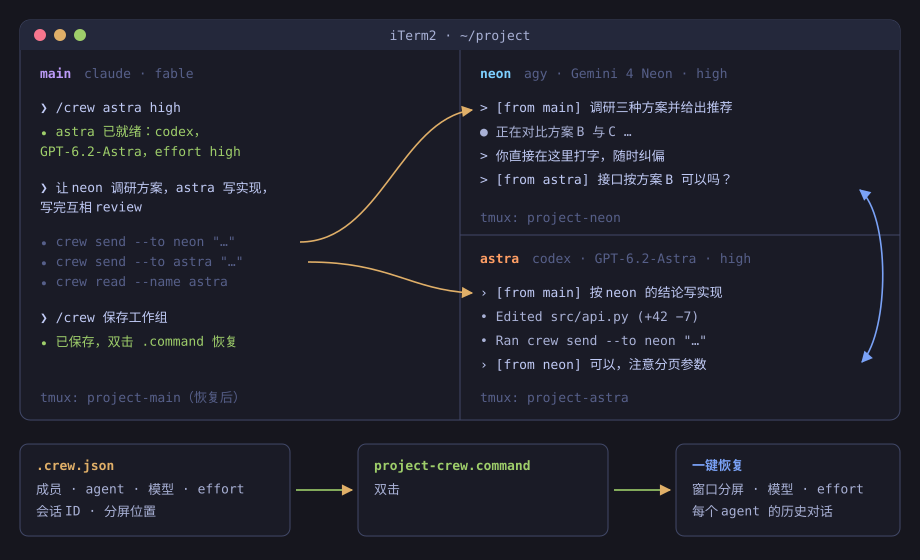

# crew

[English](README.en.md) · 中文

一个可以在 Claude Code、Codex、Antigravity（`agy`）里使用的 skill：在 iTerm2 里给当前会话分屏，几秒钟拉起一个新的 agent（Codex、Antigravity `agy`、Claude Code），指定模型和思考强度；agent 之间通过 tmux 互发消息；整组可以保存到项目目录，之后一键恢复窗口、模型、effort 和每个 agent 的历史对话。



## 适合什么场景

**快速多 agent。** 正在和 Claude Code 干活，想让另一个模型并行做一块（调研、写实现、做 review），输入 `/crew astra high` 就多一个窗格，不用自己开终端、进目录、起 tmux、敲启动参数。

**监控中间态，随时微调。** 每个 agent 都是真实的交互式界面，就在你眼前的窗格里跑。它在想什么、改了哪些文件、卡在哪一步，都直接看得到；发现方向偏了，直接在那个窗格里打字纠正，不用等它跑完再返工。这是它和后台子 agent 最大的区别。

**跨模型协作。** 不同厂商的模型放进同一个组，主会话可以分派任务、读取各自的进展，组员之间也能直接对话（比如让一个写、一个审）。

**匿名评议。** 重要决策让几个模型各写立场、匿名互评、再自行修正，最后得到一张分歧地图：共识、分歧的症结、被保留的少数派观点。不投票，不求一致。

**按任务和额度派模型。** `/crew 开个做前端的` 会先读三家 CLI 的剩余额度，再结合排行榜和你自己的偏好给出推荐和理由，避免把最贵的模型开满、额度很快见底。

**长期项目。** 讨论到一半要关机，保存一下；下次双击一个文件，整组 agent 带着各自的上下文回到原来的分屏位置。

## 安装

从 ClawHub：

```bash
clawhub install crew
```

或从 GitHub：

```bash
git clone https://github.com/garmanwu/crew ~/.claude/skills/crew
```

要在 Codex 和 agy 里也能调用，把同一份目录链接过去：

```bash
ln -s ~/.claude/skills/crew ~/.codex/skills/crew
mkdir -p ~/.gemini/config/skills && ln -s ~/.claude/skills/crew ~/.gemini/config/skills/crew
```

目前只支持 **macOS + iTerm2**，以及 Claude Code、Codex、agy 三个 CLI。需要 `tmux`、`python3`（3.8 起，系统自带即可），以及要用到的 agent CLI（`codex`、`agy`、`claude`，已登录）。重启对应的 CLI 后即可使用：Claude Code 里是 `/crew`，Codex 里是 `$crew`，agy 里直接用自然语言。

## 用法

在项目目录里的 Claude Code、Codex 或 agy 会话（第一个建组的会话称为 main）中：

```
/crew                      # 列出菜单（每个已安装 CLI 的前 2 个模型，带剩余额度），回一行选择，如：2 design high
/crew astra high           # 直接指定：模型 astra，effort high
/crew 保存工作组            # 保存成员、模型、effort、会话 ID、分屏位置
/crew panel 要不要做 X？    # 组员三轮匿名评议，main 汇总成分歧地图
/crew 开个做前端的           # 按额度、排行榜和你的偏好推荐模型，确认后再开
/crew 看看额度               # 三家 CLI 的剩余额度
```

### 按任务选模型

| 命令 | 作用 |
|---|---|
| `crew.py quota` | 读 Codex、Claude Code、agy 的剩余额度（只读本机，10 分钟缓存） |
| `crew.py advise --task frontend` | 额度 ≥ 20% 且与最高分差 ≤ 50 的候选里选单次成本最低的；你的偏好优先 |
| `crew.py rankings [show]` | 排行榜快照的状态或排名；超过 30 天由 main 从 arena.ai 更新后 `rankings import` |
| `crew.py doctor` | 检查依赖、模型列表、额度来源和配置 |

个人偏好写在 `~/.config/crew/roles.json`（例如"3D 用 astra"），不随 skill 发布；任务类型和阈值的默认值在 `defaults.json`。

也可以直接用自然语言：

```
新开一个 codex 叫 design，用 astra，effort high
让 design 看一下 SPEC.md 第 3 节，给出修改建议
看看 design 现在做到哪了
```

恢复：先退出 main 所在的窗口，然后双击项目目录里的 `<目录名>-crew.command`。

### 每一步发生了什么

| 操作 | 结果 |
|---|---|
| 新开 agent | 在 main 旁边分屏，进入同一目录，新建 tmux 会话 `<目录名>-<名称>`，带模型和 effort 启动，并告诉它组里有谁、怎么发消息 |
| 发消息 | 文本送进对方的输入框并提交，自动带 `[from 发送者]` 前缀 |
| 读进展 | 读取对方窗格当前的屏幕内容 |
| 保存 | 重新读取每个窗格当前的会话 ID，写入 `.crew.json`，生成 `<目录名>-crew.command` |
| 恢复 | 新开一个 iTerm2 窗口，按原来的分屏顺序恢复每个 agent 的对话；tmux 会话还活着时直接接回去，不重启 |

### 直接用脚本

skill 背后只有一个脚本，agent 之间也是用它通讯：

```bash
CREW=~/.claude/skills/crew/scripts/crew.py
python3 $CREW models
python3 $CREW quota
python3 $CREW advise --task frontend
python3 $CREW doctor
python3 $CREW spawn --name design --agent codex --model gpt-6.2-astra --effort high
python3 $CREW send --to design "请看一下 SPEC.md 第 3 节"
python3 $CREW read --name design --lines 80
python3 $CREW status
python3 $CREW save
python3 $CREW restore --dir <项目目录>
```

### 匿名评议（panel）

组里有 3 个以上成员（最好来自不同厂商）时，可以让它们评议一个议题：

```
/crew panel 版型数据库要不要从 DXF 迁到自定义 JSON？背景见 SPEC.md
```

| 轮次 | 每个成员做什么 |
|---|---|
| 1 独立立场 | 互不可见，各写一份立场 |
| 2 互评 | 立场以 A、B、C… 匿名公开；对每份写最强反对意见和值得借鉴的点 |
| 3 修正 | 评议匿名公开；写最终立场，开头说明因哪条论据改了什么、哪些仍坚持 |
| 汇总 | main 只读匿名文件，写 `map.md`：共识、分歧与症结、少数派立场、立场变化、核心问题；之后揭晓代号 |

所有文件在 `<项目>/.crew/panel/<评议 ID>/`。没有投票，改不改主意由每个成员自己决定。盲写和匿名靠指令约束，不是强制隔离。

脚本命令：`panel start --topic "..."`、`panel wait`、`panel next`、`panel status`、`panel reveal`。

## 需要知道的

- **Codex 默认以 full access 启动**（`-s danger-full-access -a never`）：执行命令不受沙箱限制，也不请求审批，范围是整台机器。原因是 Codex 的沙箱会拦住 tmux，关掉才能主动给组员发消息。想保留沙箱就在新开时说"保留沙箱"（`--sandbox`），这时它只能被读取，不能主动发消息。
- **main 第一次不在 tmux 里**，组员给它发不了消息，由 main 去读组员的窗格。恢复过一次之后 main 也在 tmux 里，才是双向通讯。
- **main 的原窗口还开着时拒绝恢复**，避免同一个对话被两个进程同时写入。
- tmux 会话名带目录名前缀，不同项目里同名的 agent 不会互相干扰。
- 只恢复分屏结构，不恢复窗格的精确尺寸。
- **main 是 Codex 时要以 full access 运行，并且在 tmux 里启动**：沙箱会拦住 tmux 和分屏；Codex 的后台进程也不能直接控制 iTerm2，分屏请求要由 tmux 代发。
- 匿名评议只能由 main 发起和推进。
- 没有"移除成员"命令：`tmux kill-session -t <目录名>-<名称>`，再从 `.crew.json` 里删掉对应成员。
- **额度读取只在本机进行**：Codex 读 `~/.codex/sessions`，Claude Code 读 `~/.claude.json` 里的 `/usage` 缓存（必要时在隐藏终端里跑一次 `/usage`），agy 用临时状态栏命令读额度；都不发送对话、不联网。`CREW_NO_QUOTA=1` 可全部关闭。详见 SKILL.md 的"权限与隐私"。
- 许可：MIT-0。

模型列表、启动参数、会话存储位置和额度读取在 2026-11 用 Claude Code 2.1.331、codex-cli 0.172、agy 1.5.16 验证过；CLI 更新后先跑 `crew.py doctor`。
