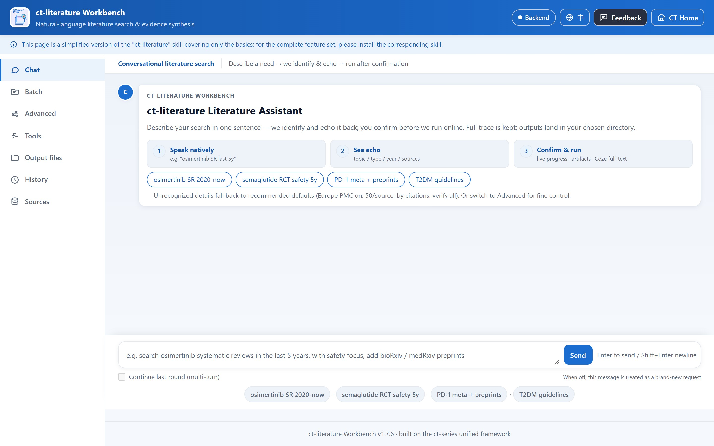

# Clinical Trial Literature Search (ct-literature)

[🇨🇳 中文](./README_zh-CN.md) | [🇺🇸 English (Current)](#)

> **Works without installation:** If you'd rather not install and just want to quickly use this skill's basic features, you can also visit the ct-series unified web portal **https://ct.medstatstar.com** directly.

  

> **Search published scholarly literature on a drug / disease / method, normalize multiple public bibliographic sources into one de-duplicated evidence base, and distill the evidence landscape plus a CSM (cumulative safety monitoring) qualitative subset.**

> Just describe what you're looking for **in plain language inside a chat**: the skill fetches from **OpenAlex (primary) + Europe PMC + bioRxiv/medRxiv** and writes a self-contained **HTML + Excel** report. Semantic Scholar and arXiv are optional sources — ask and they're added.

## Table of Contents

- [Who This Is For](#who-this-is-for)
- [1. What Can It Do — Scenarios](#1-what-can-it-do--scenarios)
- [2. Example Conversations](#2-example-conversations)
- [3. First-Time FAQ](#3-first-time-faq)
- [Why You Can Trust the Output — Anti-Hallucination](#why-you-can-trust-the-output--anti-hallucination)
- [Data Sources](#data-sources)
- [Security & Privacy](#security--privacy)
- [Confidentiality Notice](#confidentiality-notice)

---

## Who This Is For

ct-literature is part of the `ct-` clinical-trial skill family, built for three groups:

- **Clinical-trial practitioners at pharmaceutical companies** — sponsors, CROs, and medical / statistical / regulatory roles;
- **Clinicians and nurses who take part in the hands-on conduct of trials**;
- **Medical students who want to learn clinical-trial methodology in a structured way**.

---

## 1. What Can It Do — Scenarios

The skill covers published-evidence retrieval across the clinical-trial lifecycle. Each row gives the typical **situation** and a line you can **copy verbatim** under "Try saying".

### ① Published-evidence search (primary source)

| Situation | Try saying in chat |
|:---|:---|
| Evidence on a drug / disease / method | "Find systematic reviews on osimertinib in NSCLC" |
| Recent literature with a year filter | "Papers on CAR-T in lymphoma since 2020" |
| A topic with a safety angle | "Post-marketing safety literature for drug X" |

### ② Broader / deeper coverage (optional sources)

| Situation | Try saying in chat |
|:---|:---|
| MEDLINE / MeSH biomedical precision | "Also search Europe PMC for this topic" |
| Citation-ranked relevance | "Rank these by citation count via Semantic Scholar" |

### ③ Output formats & exports

| Situation | Try saying in chat |
|:---|:---|
| Excel deliverable | "Export the literature as an Excel file" |
| Self-contained HTML report only | "Just the HTML report, skip Excel" |
| Import into **Zotero** (reference manager) | "Export in Zotero format" — you get RIS / CSV files to import into the Zotero desktop app or browser connector |
| Browse as an **Obsidian** knowledge graph | "Export to Obsidian" — one Markdown note per paper plus an index page; open the folder as a vault to browse the paper network |
| **Batch-download OA PDFs** | "Download the newest 40 PDFs and log the time" — files land in a local PDF folder (DOI-named), the Excel report gets a "PDF local path" column, failures are marked honestly |

### ④ Evidence verification & provenance (on by default)

| Situation | Try saying in chat |
|:---|:---|
| Verify every DOI / PMID is real (anti-hallucination) | "Verify the citations are real before you report" |
| Also confirm title / author match the paper | "Make sure the DOI actually points to this paper" |
| Trace where each hit came from | "Show me the evidence provenance / source log" |
| Verify only the top-N works (fast large searches) | "Just verify the top 15 citations" |
| Skip verification (faster, preview-only) | "Don't verify citations this time" |

### ⑤ Rate limits & setup

| Situation | Try saying in chat |
|:---|:---|
| Raise the OpenAlex quota | "How do I raise the retrieval limit?" |
| Check the current setup | "What's configured right now?" |

### ⑥ Search cache & Sci-Hub fallback

- **Local search cache (on by default, valid for 24 hours)**: re-running the same query shortly
  after reuses the previous per-source results (cache hits are logged explicitly, fully
  auditable — never a silent swap), saving quota and returning in seconds.
  Ask for a fresh fetch to bypass it, or ask to change how long cached results stay valid.
- **Sci-Hub last-resort fallback (⚠️ OFF by default, at your own risk)**: only after open-access /
  preprint / local decode have all failed, papers that still have a DOI are resolved through
  mirrors. It never activates on its own — you have to ask for it explicitly, and a disclaimer
  is shown every time.
  **Most Sci-Hub full texts are not copyright-cleared; downloading may carry legal and compliance
  risks — all consequences are borne by the user. Strictly forbidden in institutional settings
  (GCP / sponsor projects).**
  When enabled, the download record marks this source as "user's own risk" for compliance review.

### ⑦ Download robustness

- **Manual incoming reconciliation (recommended fallback, fully legitimate)**: at the end of a
  download batch the skill lists the pending papers (with DOI links). Download those PDFs in your
  browser using your **institutional subscription**, drop them into that batch's **manual inbox
  folder**, then say "reconcile the manually downloaded PDFs": papers are matched by DOI,
  validated (real PDF + page count), moved to the standard name, and the record is updated with
  "institutional access". Uses your own subscription rights — safe for GCP / sponsor settings.
  **Prefer this over Sci-Hub.**
- **Preprint identity check**: preprint substitutes are cross-checked against the paper's authors
  before download (no shared surname → reject; first-author mismatch → hard reject; no authors →
  no download) — "better to miss than to get it wrong". Rejection reasons are recorded for audit.
- **Direct download**: the download chain connects directly by default (system proxies kill long
  connections / time out downloads); the search phase is unaffected. If your network truly needs
  a proxy, just say so and the download chain will route through your system proxy.
- **Consent-wall friendly**: sites with consent pop-ups are handled the way a normal browser
  visit would be, so legitimate downloads are blocked less often.

---

## 2. Example Conversations

> The examples below go from simple to advanced. Each has three parts: **"You say"** (a natural-language prompt you can copy verbatim) + **"Assistant replies (sketch)"** (a summary of the expected reply) + **"🖥️ Workbench"** (how to do the same thing in the web workbench). The main deliverable is a self-contained offline report in the chat output-files panel.

### ★ Basic

#### Example 1 · A simple literature search (with parameter preview)

**You say:**

> Search published literature on osimertinib in NSCLC, 2018–2025, focused on adverse events / post-marketing safety.

**Assistant replies (sketch):**

> It first shows you a parameter preview table and starts fetching only after you confirm:

| Parameter | Value |
|---|---|
| Topic | osimertinib + NSCLC (synonyms Tagrisso / AZD9291 merged automatically) |
| Years | 2018–2025 |
| Focus | adverse events / post-marketing safety |
| Sources | OpenAlex + Europe PMC + preprints (default three sources), 50 per source |
| Citation check | all (on by default) |

> Once you confirm, the search runs (~30–60s) and it reports back: **103** unique
> de-duplicated records, **81** safety-related, citation check **100 / 103** passed;
> the HTML + Excel report is generated.

**🖥️ Workbench:** open the portal linked at the top of this page and pick **ct-literature** → left sidebar **对话检索 / Chat search** → paste the same sentence in the bottom box (or click a preset example and edit it) → press **发送 / Send** → a parameter preview card appears; confirm and it runs, with the report landing in the **输出文件 / Output files** panel.

### ★★ Intermediate

#### Example 2 · Evidence-synthesis layer only (systematic reviews / meta-analyses)

**You say:**

> Same topic, keep only systematic reviews and meta-analyses — I want the evidence-synthesis conclusions, not individual trials.

**Assistant replies (sketch):**

> It re-runs with the literature type limited to systematic reviews / meta-analyses; this topic
> returns **3 systematic reviews** after cross-source de-duplication, listed separately, each with
> full abstract and citation check. If a type returns zero, it tells you explicitly "no such
> literature type" rather than substituting a nearby type.

**🖥️ Workbench:** in **对话检索 / Chat search** put the condition into your request, e.g. "systematic reviews and meta-analyses only". The workbench turns it into a literature-type filter and shows it in the echo for confirmation; the safety subset stays opt-in — ask for it if you want it.

#### Example 3 · On-demand batch download of legitimate open-access PDFs

**You say:**

> Download the PDFs of the 40 most recently published records in the report, and time it.

**Assistant replies (sketch):**

> It takes the **40 newest records by publication date** from the merged library, and **before**
> downloading gives you a pace expectation (≈10–20s per file, ≈10–15 min for the whole batch —
> normal waiting, not a hang). Download routing is automatic: **open access / preprints are fetched
> directly first** (Frontiers, MDPI, PMC author manuscripts, etc.); paywalled records with no legal
> copy are not forced. On completion it reports honestly:
>
> - Download complete: **36 / 40** succeeded, **853s (14.2 min)**, PDFs saved to a local PDF folder,
>   the Excel report's "PDF local path" column updated (absolute paths for successes, "failed"
>   labels for the rest).
> - ⚠️ The 4 undownloaded ones are all paywalled (NEJM / JCO / BMJ) — institutional subscription or
>   contact-the-author needed; the skill does not bypass paywalls.

**🖥️ Workbench:** run the search first in **对话检索 / Chat search**, then ask for the download in the same conversation (e.g. "下载最新 40 篇的 PDF"). Progress and saved locations appear in the **输出文件 / Output files** panel; the Excel "PDF local path" column is updated when the batch finishes.

---

## 3. First-Time FAQ

**Q: Do I need a key to run?**
A: No. OpenAlex works without a key (100 requests/day, enough for small searches), and a free key lifts that to 100k/day; Europe PMC needs no key, while Semantic Scholar requires your own. See below for how to apply and enter it.

**Q: Where does my query go?**
A: Your topic and filters are sent to public bibliographic services — OpenAlex, Europe PMC, and Semantic Scholar (whichever you enable). No confidential or sponsor data is ever sent.

**Q: What's the difference from `ct-safety`?**
A: `ct-literature` = published *qualitative* evidence (papers / reviews / case reports); `ct-safety` = structured FAERS disproportionality (PRR / ROR / IC). They are explicitly distinct data types — literature complements but does not replace FAERS.

**Q: On a Chinese system, is the output in Chinese?**
A: Yes. **Conversation answers and the reports** (HTML / Excel) follow your OS setting by default (Chinese on a Chinese OS, English otherwise), and you can force-switch anytime with one sentence (e.g. "switch to English"). Progress hints shown while running are Chinese auxiliary output — runtime noise that does not affect the language of the answers or deliverables.

**Q: Semantic Scholar keeps failing / being skipped?**
A: Its key requires a manual form review (not auto-issued, waits after applying), so it is usually absent short-term. When no key is configured the source is **skipped entirely** (no request sent) rather than attempting-and-degrading. Configure it later if you need citation ranking.

**Q: How long does a search take? Are there limits?**
A: A typical run takes **10–30 seconds** (three sources in parallel, ~50 works per source; add 1–4 minutes with full citation verification on). Within a source, pages are fetched one after another, so the wall-clock is the *slowest* source, not the sum.
- **Result cap**: **50 works per source** by default; you can ask for more, but time and usage scale linearly.
- **Suggested ceiling for a ~5-minute run**: 300 works per source with two sources, ~250 with three sources (either way ≈370–380 unique merged works; de-duplication is automatic, so 3×250 does not mean 750 in the report).
- **Measured reference** (2026-08-14, two sources, "osimertinib ILD"): asking for 100 works per source → fetch + merge **~20s**, full verification **~78s** (≈0.64s per work after de-duplication, which keeps **~62%** with two sources).
- **Tip**: for very large harvests, configure an OpenAlex key and verify only the top 15 works instead of pushing the per-source cap.

**Q: Why can't the fetch be faster?**
A: Because the skill only uses the **official public access methods each site provides** (their public APIs / endpoints) and **never violates any site's terms or policies** — it fetches politely, source by source, page by page, so it cannot deliver the "crawl a huge dataset in minutes" effect of an aggressive scraper. Concretely: (1) **Different sources already run in parallel** (one task per source) — adding more cross-source parallelism won't help. (2) **Each source must page serially** — public bibliographic services throttle or ban clients that fire many parallel requests; serial paging is what keeps you under the ban radar. (3) If a run feels slow, the usual bottleneck is **full citation verification** (one or more lookups per work) — verifying only the top 15 works instead saves ~1–4 minutes. (4) Keep the per-source cap moderate — time and usage scale linearly with it.

**Q: Can I search in Chinese?**
A: Partially — the skill auto-translates Chinese topics to English through **bundled offline dictionaries** (~900 entries: medical terms + drug INN names + brand names like 泰瑞沙→Tagrisso/osimertinib + MeSH synonyms; no network call) before querying, and the report banner shows the original and the translation as `中文 → English`. Equivalent names are combined with boolean OR to widen recall (e.g. `osimertinib OR Tagrisso`, `lung cancer OR pulmonary neoplasm`). Terms the dictionaries do not cover pass through as-is (recall may suffer) and a notice lists the unmapped ones — you can **extend your local term list** yourself (it stays on your machine and is never published). For best recall, use English terms, especially for rare conditions or novel compounds.

**Q: Do you support Chinese domestic databases (e.g. CNKI / 知网)?**
A: **Import — yes. Crawling — never.** The two are deliberately kept apart.
- ✅ **Import**: export RIS (or JSON) from CNKI / 万方 / SinoMed under your own institutional access, hand the file to the skill and say "merge these records in". Imported records go through the **same** de-duplication, citation verification and PRISMA accounting as OpenAlex / Europe PMC, and the import is traceable. Traditional/Simplified variants, full-width/half-width forms and CJK punctuation are normalized to one dedupe key internally, so the same paper exported from two databases no longer splits into two records. Ask for the China guideline lane to add a CDE/NMPA evidence track.
- ❌ **Crawling (never)**: Chinese databases offer no public interface to individuals and aggressively block automated access. This skill contains **no crawler, no cookies, no browser driver — not a single site request**. So: "can it fetch from CNKI automatically?" No. "Can it merge my exported records?" Yes.

**Q: Can the skill download full-text PDFs?**
A: Yes — but **for open-access (OA) works only**. (1) The Excel and HTML reports always include an **"Open Access"** column with a direct link to a free OA copy when one exists (typically 60–80% of recent works); **non-OA, paywalled papers show "—" and are not supported**. (2) The skill can also **batch-download OA PDFs to disk**. The compliance boundary first:
- **OA-only assistance; non-OA is not supported**: the skill pulls only from legitimate OA channels (publisher OA links, Europe PMC, PMC author manuscripts, open preprints) — **it performs no illegal operation of any kind**: no cracking, no bypassing, nothing touches a paywall. Paywalled works (NEJM / JCO / BMJ …) are honestly marked **"failed"** — get them via your institution's subscription, interlibrary loan, or the corresponding author.
- **For personal use only; no commercial use**: this feature exists to make it convenient for an individual to get OA copies.
- **OA direct-fetch fails → it looks for a preprint substitute**: when the canonical link cannot be pulled, it searches for an earlier preprint or author manuscript (bioRxiv / medRxiv / PMC) as a substitute; only when no usable copy exists is the work marked failed.
- **Use the free resources wisely and pace your requests (avoid an IP block)**: OA providers commonly block programmatic high-frequency downloads — to stay clear of legal trouble, the skill **strictly enforces a ≥5s gap between consecutive download requests**. Please also control your own batch frequency and **do not over-use the free resources**. The skill has built-in request throttling, and **a single batch above 50 works is refused outright** — split it (top-N / single source).

Experience details: before a batch starts it states the pace (roughly **10–20s per paper**; a 40-work batch runs ~10–15 min); afterwards PDFs land on disk (DOI-named), it reports elapsed time ("N/M succeeded, took X s"), and **the Excel report gets a "PDF local path" column** updated. Auto channels without a key give a real-world success rate of roughly **70–90%** (OA coverage and publisher blocking vary).

**Q: What if I found an error in the result — how do I report it?**
A: If you suspect the result is wrong (or the run errored), just say **"report a bug" / "上报问题" / "提交错误报告"**. The skill also **proactively asks** whether to report when it detects a likely defect — at most **once per session**, and you can always decline. Either way, the assistant will:
1. **Produce a sanitized report** — containing only runtime status fields such as skill name, version, error type and error message; **no raw input values or personal data**, with the problem description field left for you to decide what to disclose;
2. **Show the full report text for your review** — you can add to or correct anything before confirming;
3. **Send only after your explicit confirmation**; for purely local runs it is saved as a local file with a prompt to contact the author by email;
4. **Receive an acknowledgment** — including whether a previously submitted report from the same source has already been fixed.

You stay in full control: the report is shown to you **before** anything is sent, and nothing is transmitted without your explicit "send" confirmation.

---

## Why You Can Trust the Output — Anti-Hallucination

LLM-powered literature tools are notorious for **inventing papers that don't exist** — fabricated DOIs, wrong PMIDs, plausible-but-fake citations. ct-literature is built so that this is hard to happen *by construction*: four independent guardrails plus two operational safeguards.

1. **Every citation is resolved against its live source (on by default).** Before a work reaches your report, its identifier is checked against the real bibliographic services: DOI → `doi.org` (must respond normally), PMID → Europe PMC, OpenAlex record → its official endpoint. Results are graded: **verified / publisher-blocked but real / unresolved / no identifier / suspected fabrication**. A **malformed DOI is flagged "suspected fabrication"** — a hallucinated identifier is caught *before* it can appear in the report. You can scope it — verify everything (default), only the top N, or background only.
   - **Publisher blocking**: some publishers (NEJM, JAMA, Wiley, MDPI…) reject programmatic access outright even though the DOI is real. The skill reports this distinctly — it is *not* a broken link, and the work still counts as verified.
2. **Title / author consistency check.** Once an identifier resolves to a live resource, the skill fetches that resource's authoritative metadata (title + first-author surname) and compares it to the paper you hold. A resolved-but-**different** paper is flagged **"mismatched"** (not verified); a publisher-blocked DOI whose metadata matches is **upgraded to verified**. A hallucinated-but-real DOI is thus caught. Metadata-fetch failure degrades gracefully to "verified, consistency unchecked" — it never invents a mismatch from a transient fault. You can switch this layer off in the settings.
3. **Full provenance is recorded, not summarized away.** Every merged work keeps its source list (which source produced it), plus an audit trail: query → source → hit count → retrieval time → verification rate. Any claim can be traced back to the exact retrieval that produced it.
4. **The report never pads gaps with fluent prose.** Every factual line carries a source label or an explicit "⚠️ needs official verification" marker. The skill does **not** generate plausible-looking evidence to fill holes — if a source failed or a work is unverified, that is shown, not hidden.

Two operational safeguards reinforce this: **Safe Preview** keeps normalization / reporting on your machine, and **source-aware skip** avoids redundant re-checks while still trusting each identifier by provenance.

**Net:** the references this skill gives you are real, resolvable, and traceable — safe to put in a slide, a protocol, or a CSR appendix, provided you validate against the official source before any regulatory submission (see the [First-Time FAQ](#3-first-time-faq)).

---

## Data Sources

| Source | Key | Role |
|---|---|---|
| OpenAlex | free key recommended (quota lifts from 100/day to 100k/day) | **Primary** — broad, citation-rich |
| Europe PMC | none | **On by default** — MEDLINE / MeSH biomedical precision (switch off in the data-source panel) |
| Semantic Scholar | your own key (manual review) | **Opt-in only** — citation ranking; **not part of the default sources** |
| bioRxiv | none | **On by default** — biomedical preprints (switch off in the data-source panel) |
| medRxiv | none | **On by default** — medical / clinical preprints (switch off in the data-source panel) |
| arXiv | none | Optional — physics / CS / ML methodology breadth (just ask) |
| PROSPERO | your own credentials | Optional — systematic-review registry / protocol discovery; quietly skipped until working credentials are supplied |

### How the sources fit together

The default trio — **OpenAlex (primary) + Europe PMC + bioRxiv/medRxiv** — already reaches almost the entire published landscape: through these three entry points you get PubMed / PMC, the bioRxiv / medRxiv / arXiv preprints, and the Crossref, Semantic Scholar, CORE, and Unpaywall records. The extra sources are opt-in, not because the trio is incomplete, but for two practical reasons:

- **Preprint freshness** — **bioRxiv / medRxiv are now on by default**, pulling preprints straight from the source instead of waiting for them to propagate through Europe PMC's preprint feed.
- **Resilience against rate limits** — if Europe PMC is throttled, the standalone entry points let you keep widening coverage without depending on a single bottleneck.

---

## Security & Privacy

### Safe Preview (local computation)

- **Runs locally:** normalization / reporting / Excel rendering all happen on your machine — no code is executed on any remote server beyond the bundled programs.
- **Traceable, not fabricated:** every factual claim in the report carries a source label or a "⚠️ needs official verification" marker; it never fills evidence gaps with fluent prose.
- Outputs are for reference only; validate against official sources before regulatory submissions.

### Outbound & Privacy

- **Bibliographic search (public services only):** your topic and filters go to **OpenAlex** / **Europe PMC** / **Semantic Scholar** (only the sources you enable), plus **doi.org** and **Crossref** during citation verification. No confidential / sponsor data is ever sent.
- **Metadata sent with every request:** besides your business parameters, each request carries an **anonymous identifier computed on your machine** (a one-way hash — **not** your plaintext hostname) and your **system language** (for UI localization). Both are computed locally and sent as opaque identifiers — no personal information, no hostname, no IP leaves your device.
- **Error reports (optional, you confirm):** a de-identified summary containing no raw data or subject records is sent **only after a two-stage confirmation**; without connectivity it falls back to a local file.
- **Keys stay on your machine:** keys are read only from your local settings and never ship with the package. Apply for your own OpenAlex key at <https://openalex.org/settings/api> and enter it yourself; never commit a key to a shared repo.
- **Sci-Hub (optional, OFF by default):** mirrors are contacted only when you explicitly ask; the legal risk is **borne by the user**, and it is strictly forbidden in institutional settings. While off, no request is ever sent to any mirror.

---

**Version**: v1.7.10 | **License**: MIT | **Authors**: medstatstar, phoe-zip

For feature requests, bug reports, or other feedback, feel free to contact the author directly at medstatstar@gmail.com (Wintone Zhang / 张文彤).

---

## Confidentiality Notice

> The CT series consists of 20+ skills, organized into **two tiers — A and B** — by "whether the input contains confidential information", providing full coverage of the new-drug clinical trial lifecycle.
>
> - **Tier A (non-confidential input)**: the input is ordinary data and involves no confidential information. Tier A skills can run after local installation or be used via the Web interface, and all Tier A skills are published openly on GitHub.
> - **Tier B (confidential input)**: the input contains clinical-trial data / protocols / CRFs that pharma sponsors must keep strictly confidential. Tier B skills can either be installed and processed locally (data never leaves your domain) or be used via the Web interface with no installation required (data is de-identified before upload), but Tier B skills themselves are not published openly. For custom / on-prem deployment needs, contact the author.
