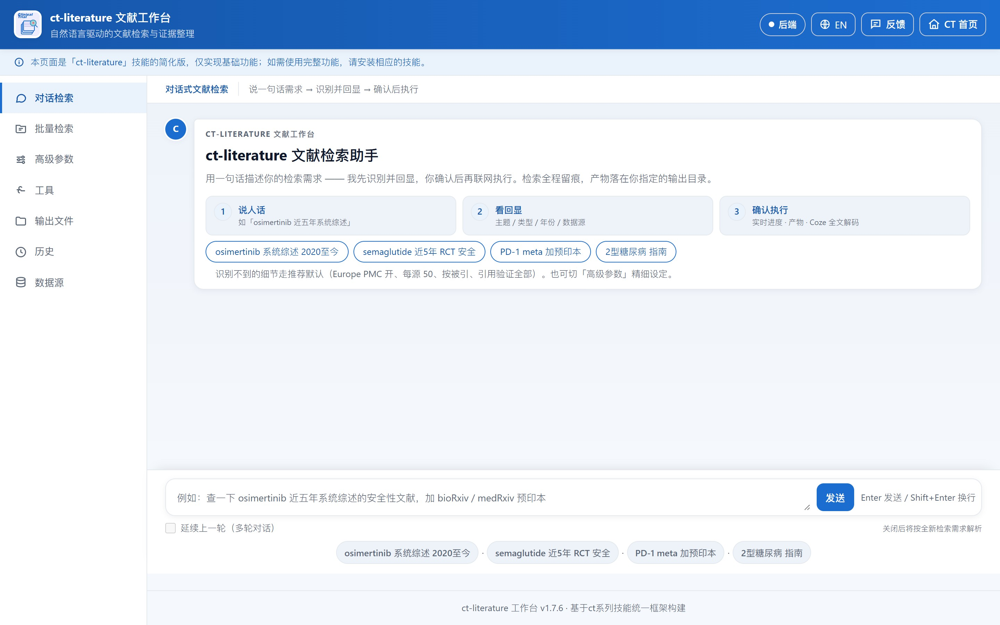

# 临床试验文献检索专家（ct-literature）

[🇨🇳 中文 (当前)](./README_zh-CN.md) | [🇺🇸 English](./README.md)

> **不安装也能用：** 如果你不想安装，只想快速使用本技能的基础功能，也可直接访问ct系列技能的总入口网页 **https://ct.medstatstar.com** 使用。

  

> **检索某药物 / 疾病 / 方法已发表的学术文献，把多个公开文献源归一化成一份去重后的证据库，并提炼证据格局与 CSM（累积安全性监测）定性子集。**

> 只要在对话里用**自然语言**说清想查什么即可：技能从 **OpenAlex（主源）+ Europe PMC + bioRxiv/medRxiv** 取数，写出自包含的 **HTML + Excel** 报告。Semantic Scholar 与 arXiv 是可选源，你说一句就加上。

## 目录

- [适用人群](#适用人群)
- [1. 你能做些什么 —— 场景索引](#1-你能做些什么--场景索引)
- [2. 使用案例大全](#2-使用案例大全)
- [3. 首次使用常见问题 FAQ](#3-首次使用常见问题-faq)
- [为什么可以信任输出 —— 反幻觉设计](#为什么可以信任输出--反幻觉设计)
- [数据源](#数据源)
- [安全与隐私](#安全与隐私)
- [保密声明](#保密声明)

---

## 适用人群

`ct-*` 临床试验技能家族专用于解决临床试验全生命周期的各类需求，主要面向三类人群：

- **各制药企业的临床试验从业者** —— 申办方、CRO，以及医学 / 统计 / 注册等角色；
- **在医疗机构中设计、管理临床试验项目，或参与临床试验研究实务的医护人员**；
- **希望系统学习临床试验知识的医学专业学生**。

---

## 1. 你能做些什么 —— 场景索引

技能覆盖临床试验全生命周期的已发表证据检索。每行给出典型**场景**与可直接照抄的**「试试这样说」**。

### ① 已发表证据检索（主源）

| 场景 | 试试这样说 |
|:---|:---|
| 某药 / 病 / 方法的证据 | "找奥希替尼在 NSCLC 的 system review" |
| 带年份过滤的近期文献 | "2020 年以来 CAR-T 在淋巴瘤的论文" |
| 带安全性角度的主题 | "药物 X 的上市后安全性文献" |

### ② 更广 / 更深覆盖（可选源）

| 场景 | 试试这样说 |
|:---|:---|
| MEDLINE / MeSH 生物医学精准 | "这个主题也搜一下 Europe PMC" |
| 按引用量排序 | "用 Semantic Scholar 按引用量排这些文献" |

### ③ 输出格式与导出

| 场景 | 试试这样说 |
|:---|:---|
| Excel 交付物 | "把文献导出成 Excel 文件" |
| 仅自包含 HTML 报告 | "只给我 HTML 报告，跳过 Excel" |
| 导入 **Zotero**（文献管理插件） | "导出 Zotero 格式" — 得到 RIS / CSV 文件，用 Zotero 桌面版或浏览器插件导入 |
| 用 **Obsidian** 做文献图谱 | "导出到 Obsidian" — 每篇文献一篇 Markdown 笔记 + 一份索引页，把文件夹作为 vault 打开即可图谱化浏览 |
| **批量下载 OA PDF** | "下载最新 40 篇的 PDF 并记录用时" — 下载到本地 PDF 文件夹（按 DOI 命名），Excel 同步回填「PDF 本地路径」列，失败项如实标注 |

### ④ 证据验证与溯源（默认开启）

| 场景 | 试试这样说 |
|:---|:---|
| 验证每条 DOI / PMID 真实存在（反幻觉） | "报告前先核实引文是不是真的" |
| 进一步确认标题 / 作者与论文吻合 | "确保这个 DOI 指向的确实是这篇论文" |
| 追溯每条命中的来源 | "给我看证据溯源 / 来源日志" |
| 只验证前 N 条（大结果集更快） | "这次只验证前 15 条引文" |
| 跳过验证（更快、仅预览） | "这次先不验证引文" |

### ⑤ 速率与配置

| 场景 | 试试这样说 |
|:---|:---|
| 提高 OpenAlex 配额 | "怎么提高检索速率上限？" |
| 查看当前配置 | "现在配置了哪些？" |

### ⑥ 搜索缓存与 Sci-Hub 兜底

- **本地搜索缓存（默认开启，24 小时内有效）**：同一检索条件短期内重跑时直接复用上次
  各源结果（日志明确标注缓存命中，透明可审计），省额度、秒级返回。
  想跳过缓存就说「这次重新抓取」，想改有效期就说「缓存保留 N 小时」。
- **Sci-Hub 最后兜底（⚠️ 默认关闭，后果自负）**：仅当开放获取 / 预印本 / 本地解码全部
  失败后，对仍有 DOI 的条目尝试经镜像解析全文。它不会自己启动——只有你明确要求时才会
  激活，且每次开启都会先给出免责声明。
  **Sci-Hub 全文多数未经版权方授权，下载存在法律与合规风险，由此产生的一切后果由使用者
  本人承担；机构环境（GCP / 申办方项目）严禁开启。**
  开启后下载记录中该来源标为「用户自担风险」，便于合规审查。

### ⑦ 下载健壮性

- **手动回传归位（推荐兜底，合法合规）**：一批下载结束时会自动列出一份待下清单（含 DOI
  链接）。用你的**机构订阅**在浏览器里下载这些 PDF，放进该批次的**手动收件文件夹**，然后
  说一句「把手动下载的 PDF 归位」：技能按 DOI 匹配、做真实 PDF 与页数校验后归位到标准命名
  并回写记录，标注「机构权限」。用的是你自己的订阅权，GCP / 申办方环境也可安全使用——
  **优先于 Sci-Hub**。
- **同篇身份校验**：预印本替代件下载前做作者交叉校验（无共同姓氏拒、第一作者不一致硬拒；
  原文献无作者则不下载）——「宁可缺漏不能弄错」，拒绝原因写入记录供审计。
- **直连下载**：下载链路默认强制直连（系统代理会杀死长连接 / 超时下载）；检索阶段不受影响。
  确需代理出网，说一声就行，下载链路会改走系统代理。
- **同意墙友好**：对带同意弹窗的站点按常规浏览方式处理，减少误拦。

---

## 2. 使用案例大全

> 下面是由简到繁的真实对话示例，每个都含三部分：**「你这样说」**（可直接复制的自然语言提示）+ **「助手会这样回（示意）」**（预期回复摘要）+ **「🖥️ 工作台」**（同一件事在网页工作台里怎么操作）。主交付物是自包含的离线报告，落在对话输出文件面板。

### ★ 基础用法

#### 案例 1 · 简单文献检索（含参数预览确认）

**你这样说：**

> 检索奥希替尼在 NSCLC 的已发表文献，2018–2025，聚焦不良事件 / 上市后安全性。

**助手会这样回（示意）：**

> 先给你一张参数预览表，你确认之后才开始取数：

| 参数 | 值 |
|---|---|
| 主题 | 奥希替尼 + NSCLC（同义词 Tagrisso / AZD9291 自动并入） |
| 年份 | 2018–2025 |
| 关注角度 | 不良事件 / 上市后安全性 |
| 数据源 | OpenAlex + Europe PMC + 预印本（默认三源），每源 50 篇 |
| 引文核验 | 全部（默认开启） |

> 你确认后开始检索（约 30–60 秒），完成后回报：去重后**唯一文献 103 篇**，其中安全性相关
> **81 篇**，引文核验 **100 / 103** 通过；HTML + Excel 报告已生成。

**🖥️ 工作台：** 从文首总入口进入并选 **ct-literature** → 左侧 **对话检索** → 底部输入框粘贴同一句话（或点预设示例再改写）→ 点 **发送** → 弹出参数预览卡，确认后执行，报告落在 **输出文件** 面板。

### ★★ 进阶用法

#### 案例 2 · 只看证据汇总层（系统综述 / Meta 分析）

**你这样说：**

> 同一主题，只保留系统综述和 Meta 分析 —— 我想看证据汇总结论，不看单篇试验。

**助手会这样回（示意）：**

> 把文献类型限定为系统综述 / Meta 分析后重新检索，本主题跨源去重后命中 **3 篇系统综述**，
> 已单独列出，每篇保留完整摘要与引文核验；若某类型零命中，会明确告知「无此类型文献」，
> 而非用相近类型凑数。

**🖥️ 工作台：** 在 **对话检索** 里把条件写进同一句话，例如「只看系统综述和 meta 分析」。工作台把它解析成文献类型过滤条件并在回显里给你确认；安全性子集仍为显式可选，想要就说「加上安全性子集」。

#### 案例 3 · 按需批量下载合法 OA PDF

**你这样说：**

> 把报告里最新发表的 40 篇的 PDF 都下载下来，记录一下用时。

**助手会这样回（示意）：**

> 先从合并库**按发表时间倒序取最新 40 篇**，下载**开始前**先给你节奏预期（每篇约 10–20 秒，
> 40 篇整批约 10–15 分钟，属正常等待而非卡死）。下载全程自动路由：**开放获取 / 预印本优先
> 直连**（Frontiers、MDPI、PMC 作者手稿等），付费墙且无合法副本的不硬来。完成后如实汇报：
>
> - 下载完成：**36 / 40** 篇成功，用时 **853 秒（14.2 分钟）**，PDF 存入本地 PDF 文件夹，
>   Excel 报告「PDF 本地路径」列同步更新（成功项绝对路径，失败项标注「失败」）。
> - ⚠️ 4 篇未下载均为付费墙（NEJM / JCO / BMJ），需机构订阅或联系作者 —— 技能不绕过付费墙。

**🖥️ 工作台：** 先在 **对话检索** 把检索跑出来，再在同一会话里说「下载最新 40 篇的 PDF」。进度与保存位置显示在 **输出文件** 面板；批量结束时 Excel 报告的「PDF 本地路径」列同步更新。

---

## 3. 首次使用常见问题 FAQ

**Q：跑起来需要 key 吗？**
A：不需要。OpenAlex 无 key 也能用（每天 100 次配额，小规模检索够用），免费 key 可提到每天 10 万次；Europe PMC 无需 key，Semantic Scholar 需自备 key。申请与填写方法见下。

**Q：我的查询发到哪里？**
A：你的检索主题与筛选条件会发往公开文献服务——OpenAlex、Europe PMC、Semantic Scholar（仅你启用的源）。绝不发送任何保密或申办方数据。

**Q：和 `ct-safety` 有什么区别？**
A：`ct-literature` = 已发表的*定性*证据（论文 / 综述 / 病例报告）；`ct-safety` = 结构化 FAERS 信号检测（PRR / ROR / IC）。二者是明确不同的数据类型——文献补充而非替代 FAERS。

**Q：中文系统下输出是中文吗？**
A：是。**对话答案与报告**（HTML / Excel）的语言默认跟随系统（中文系统→中文，其他→英文），也可随时一句话强制切换（如「用中文回复」/「switch to English」）。运行过程中的进度提示为中文辅助输出，属运行噪音，不影响答案与交付物的语言。

**Q：Semantic Scholar 老是失败 / 被跳过？**
A：它的 key 需填表人工审核、非自动发放，申请后需等待，短期内通常无 key。未配置 key 时本源被**直接跳过**（不发起请求），而非尝试后降级。若需要引用排序，之后配置即可。

**Q：一次检索要跑多久？有限额吗？**
A：典型耗时 **10–30 秒**（三源并行、每源约 50 篇，开启全量引文核验时再加 1–4 分钟）；同一源内部按页依次取数，所以墙钟时间取决于*最慢的那个源*，而非各源之和。
- **结果上限**：默认**每源 50 篇**，可要求更多，但耗时与用量线性增长。
- **5 分钟预算建议**：双源每源 ≤300 篇、三源每源 ≤250 篇（去重后均约 370–380 篇；去重自动完成，3×250 并不等于报告里 750 篇）。
- **实测参考**（2026-08-14，双源、「奥希替尼 间质性肺病」）：要求每源 100 篇 → 抓取 + 合并约 **20 秒**，全量核验约 **78 秒**（去重后约 0.64 秒 / 篇，双源去重保留约 **62%**）。
- **建议**：大批量需求请配上 OpenAlex key，并改成只核验前 15 条，而非一味加大每源篇数。

**Q：为什么文献抓取速度不能更快一些？**
A：因为技能**只使用各网站官方提供的公开抓取方式**（公开 API / 接口），**不违反任何网站的规定**——按源、按页依次礼貌抓取，因此无法做到「短时间内大批量爬取数据」那种激进爬虫的效果。具体来说：(1) **不同源之间已经并行**（每个源一个任务），再增加跨源并行度也不会更快。(2) **同一源内部必须链式串行**——公开文献服务会对并发请求过多的客户端限流甚至封禁，串行翻页正是为了不触发风控。(3) 如果某次运行觉得慢，通常瓶颈是**全量引文核验**（每篇一次或多次查询）——改成只核验前 15 条可省约 1–4 分钟。(4) 每源篇数保持适中——耗时与用量随它线性增长。

**Q：支持中文检索吗？**
A：部分支持——技能会用**内置离线词典**（约 900 条：医学术语 + 药物 INN 名 + 商品名如 泰瑞沙→Tagrisso/osimertinib + MeSH 同义词；无需联网）把中文检索词自动翻译成英文后再查询，报告头部会显示「原文 → 英文翻译」。等价名称会自动做布尔 OR 扩展以提升召回（如 `osimertinib OR Tagrisso`、`lung cancer OR pulmonary neoplasm`）。词典未收录的词会原样保留（召回可能受影响）并提示哪些未识别——你也可以**自行扩充本地词表**（只存于本机，不会随发布公开）。为获得最佳召回，建议使用英文检索词，尤其是罕见病或新化合物。

**Q：支持知网等国内文献库吗？**
A：**支持「导入」，不支持「爬取」**——这两件事本技能分得很清楚。
- ✅ **导入**：你在自己的机构权限下从知网 / 万方 / SinoMed 检索并导出 RIS（或 JSON），把文件交给技能、说一句「把这些题录合进来」即可。导入记录与 OpenAlex / Europe PMC 走同一套去重、引文核验与 PRISMA 统计，并留痕可查。中文题名的**繁简 / 全半角 / 中英标点**差异已在内部归一到同一去重键——同一篇论文从两个库导出不会再被拆成两条。想补中国监管语境，再说一句「加上中国指南证据车道」，就会补上 CDE/NMPA 证据线。
- ❌ **爬取（永远不做）**：国内库不向个人开放公开接口，同时对自动化访问严厉封禁。本技能**不含任何爬虫、Cookie、浏览器驱动，一次站点访问都没有**——不改这条红线。所以「能不能自动去知网抓」的答案是「不能」，而「我导出的题录能不能合进来」的答案是「能」。

**Q：能下载全文 PDF 吗？**
A：可以，但**仅限开放获取（OA）文献**。（1）Excel 与 HTML 报告始终包含**「开放获取链接」**列——有免费 OA 副本时直接给出链接（通常覆盖 60–80% 的近期文献），**非 OA 的付费墙论文显示「—」，不提供支持**。（2）可让技能把 OA 文献**批量下载到本地**。合规边界先说清楚：
- **只协助 OA 下载，非 OA 不提供支持**：技能只从合法 OA 渠道取数（出版社 OA 直链、Europe PMC、PMC 作者手稿、开放预印本），**技术上不做任何违法操作**——不破解、不绕过、不触碰任何付费墙；付费墙论文（NEJM / JCO / BMJ 等）如实标注「失败」，请走机构订阅 / 文献传递 / 联系作者获取。
- **仅供个人使用，请勿用于商业用途**：本功能是为方便个人获取 OA 副本而设。
- **OA 直下失败 → 尽力找预印本替代**：正文直链拉不到时，会自动检索更早的预印本版本或作者手稿（bioRxiv / medRxiv / PMC）作为替代；仍无可用副本才标注失败。
- **善用免费资源、控制请求节奏（防封 IP）**：OA 供应商普遍拦截程序化高频下载——为避免法律纠纷，本技能**严格控制相邻两次下载请求的间隔在 5 秒以上**；也请你在批量请求时注意频次，**不要过量使用免费资源**。技能内置请求节流，**单批超过 50 篇会直接拒绝**，请分批（指定前 N 篇 / 单源）请求。

体验细节：下载开始前会先告知节奏（每篇约 **10–20 秒**，40 篇整批约 10–15 分钟）；完成后逐篇落盘（DOI 命名）并汇报用时（「N/M 篇成功，用时 X 秒」），**Excel 报告同步更新「PDF 本地路径」列**。无 key 纯自动渠道真实成功率约 **70–90%**（受 OA 覆盖率与出版商拦截影响）。

**Q：发现结果有误怎么办？怎么上报？**
A：若你怀疑结果有误（或运行报错），直接说 **「上报问题」/「report a bug」/「提交错误报告」**。技能在检测到疑似缺陷时也会**主动询问**是否上报——**每会话最多 1 次**，你可随时拒绝。无论哪种方式，助手都会：
1. **生成一份脱敏报告**——只含技能名、版本、错误类型与错误信息等运行状态字段，**不含你的原始输入值或个人数据**；问题描述字段由你把关披露；
2. **展示报告全文供你检视**——可补充或更正任何内容后再确认；
3. **经你明确确认后才发送**；纯本地运行则保存为本地文件，并提示可邮件联系作者；
4. **收到回执**——包括此前从同一来源提交的报告是否已修复。

整个过程你完全可控：报告在**发送前**先展示给你，未经你明确说「发送」绝不传输任何内容。

---

## 为什么可以信任输出 —— 反幻觉设计

由 LLM 驱动的文献工具，最容易翻车的一点就是**编造根本不存在的论文**——伪造的 DOI、写错的 PMID、看似合理实则虚构的引文。ct-literature 从设计上就让这种事难以发生：四道独立防线 + 两项运行保障。

1. **每条引文都回源核验（默认开启）。** 一篇文献进入报告之前，它的标识符会先去真实的文献服务跑一遍：DOI → `doi.org`（必须正常返回）、PMID → Europe PMC、OpenAlex 记录 → 其官方接口。核验结果分档标注：**已核验 / 出版社拦截但真实 / 无法解析 / 无标识符 / 疑似伪造**。**格式错误的 DOI 会被标为「疑似伪造」**——等于在幻觉标识符进入报告之前就把它拦下来。核验范围可调——全部核验（默认）/ 只核验前 N 条 / 仅后台核验。
   - **出版社拦截**：部分出版社（NEJM、JAMA、Wiley、MDPI 等）对程序化访问一律拒绝，但 DOI 本身是真实的。技能把这种情况单独标出——它**不是**断链，文献仍记为已核验。
2. **标题 / 作者一致性深度校验。** 标识符解析到存活资源后，技能会再去拉该资源的权威元数据（标题 + 第一作者姓氏），并与你手上的这篇文献比对。解析到**另一篇**文献则标为**「不一致」**（而非已核验）；被出版社拦截但元数据吻合的则**升级为已核验**。于是即便一个「幻觉出的但真实存在的 DOI」也能被抓出来。元数据抓取失败会优雅降级为「已核验、一致性未核验」——绝不因瞬时故障捏造不一致。这一层可以在设置里关掉。
3. **完整溯源，而非被摘要掉。** 每一篇归一化后的文献都保留来源清单（来自哪个源），并附一条审计轨迹：查询 → 来源 → 命中数 → 取数时间 → 核验率。任何一条结论都能回溯到产出它的那次具体检索。
4. **报告绝不用流畅文字补窟窿。** 报告里每一句事实都带来源标注，或明确的「⚠️ 需官方核实」标记。技能**不会**为了填满空缺而编出看似合理的证据——某个来源失败了、或某篇未核验，它会明说，而不是藏着。

两项运行保障进一步加固这一点：**安全预览**把归一化 / 报告生成都留在你本机；**源感知跳过**避免冗余重复核验，同时仍按来源可信度信任每个标识符。

**结论：** 本技能给你的参考文献是真实存在、可追溯、可核验的——放进幻灯片、方案或 CSR 附录都稳妥，但任何监管提交前仍请对照官方来源复核（见 [首次使用 FAQ](#3-首次使用常见问题-faq)）。

---

## 数据源

| 源 | 密钥 | 角色 |
|---|---|---|
| OpenAlex | 建议配免费 key（配额从每天 100 次提到 10 万次） | **主源** — 覆盖广、含引用数 |
| Europe PMC | 无需 | **默认开启** — MEDLINE / MeSH 生物医学精准（可在数据源面板关闭） |
| Semantic Scholar | 需自备 key（人工审核） | **仅显式可选** — 引用排序；**不属默认数据源** |
| bioRxiv | 无需 | **默认开启** — 生物医学预印本（可在数据源面板关闭） |
| medRxiv | 无需 | **默认开启** — 医学 / 临床预印本（可在数据源面板关闭） |
| arXiv | 无需 | 可选 — 物理 / CS / ML 方法学广度（说一声就加） |
| PROSPERO | 需自备凭证 | 可选 — 系统评价注册库 / 方案发现；未提供可用凭证前静默跳过 |

### 各来源如何配合

默认组合 —— **OpenAlex（主源）+ Europe PMC + bioRxiv/medRxiv** —— 已经覆盖到几乎整个已发表文献版图：通过这三个入口，你就能拿到 PubMed / PMC、bioRxiv / medRxiv / arXiv 预印本，以及 Crossref、Semantic Scholar、CORE、Unpaywall 的记录。其它来源做成可选，不是因为这对组合不完整，而是出于两个现实考量：

- **预印本时效** —— **bioRxiv / medRxiv 现已默认开启**，直接从源头拉取预印本，不必等它慢慢同步进 Europe PMC 的预印本供稿。
- **抗限流** —— 若 Europe PMC 偶尔被限流，独立入口让你可以绕开单一瓶颈、继续拓宽覆盖。

---

## 安全与隐私

### 安全预览（本地计算）

- **本地运行**：归一化 / 报告 / Excel 渲染全部在本机完成——除随技能发布的程序外，不在任何远程服务器执行代码。
- **可溯源、不编造**：报告中每条事实性断言都带来源标注或「⚠️ 需官方核实」标记；绝不用流畅措辞填补证据空白。
- 输出仅供参考；申报 / 决策前请对照官方原文核实。

### 出站与隐私

- **文献检索（仅公开服务）**：主题词与筛选条件发往 **OpenAlex** / **Europe PMC** / **Semantic Scholar**（仅你启用的源），引文核验时额外访问 **doi.org** 与 **Crossref**；绝不发送保密 / 申办方数据。
- **每次请求附带的元数据**：除业务参数外，还携带一个**本机计算的匿名标识**（单向哈希，**不是**你的明文主机名）与**系统语言**（用于界面本地化）。两者均由本机计算后作为不透明标识符发出——无个人信息、无主机名、无 IP 离开你的设备。
- **错误报告（可选，需你确认）**：仅在**两阶段确认后**才发送一份不含原始数据与受试者信息的脱敏摘要；无法联网时回退为本地文件。
- **密钥留在本机**：key 只从你本机的设置读取，绝不随包分发。OpenAlex 免费 key 请自行到 <https://openalex.org/settings/api> 申请并自行填入；切勿把 key 提交进共享仓库。
- **Sci-Hub（可选，默认关闭）**：只有你明确要求时才会出站访问镜像；该渠道法律风险**用户后果自负**，机构环境严禁开启。默认关闭时本技能不向任何镜像源发请求。

---

**版本**：v1.7.10 | **许可证**：MIT | **作者**：medstatstar, phoe-zip

如有功能改进建议、Bug 报告或其他反馈，欢迎直接联系作者：medstatstar@gmail.com（张文彤 / Wintone Zhang）。

---

## 保密声明

> CT 全系列技能由 20+ 个技能构成，按「输入是否涉密」分为 **A、B 两档**，完整覆盖新药临床试验全流程。
>
> - **A 档（输入非涉密）**：输入为普通数据，不涉及保密信息，可本地安装后运行或Web网页方式使用，A 档技能均在 GitHub 公开发布。
> - **B 档（输入涉密）**：输入含药企需严格保密的临床试验数据 / 方案 / CRF 等；B 档既能安装后本地处理（可保证数据不出域），也能使用Web网页方式免安装使用（数据会脱敏后再上传），但B档技能本身均不对外公开发布。若有定制 / 本地部署需求，欢迎与作者联系。
