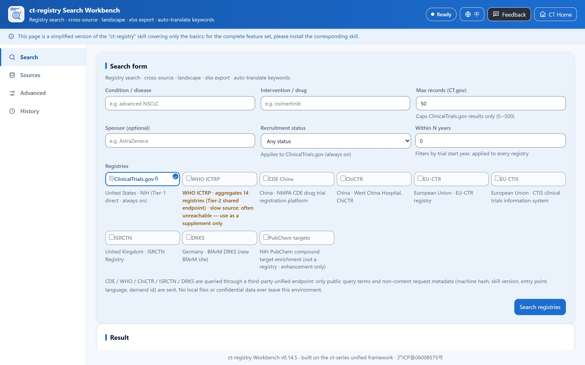

# Clinical Trial Registry Search (ct-registry)

[🇨🇳 中文](./README_zh-CN.md) / [🇺🇸 English](#)

  

> **Works without installation:** If you'd rather not install and just want to quickly use this skill's basic features, you can also visit the ct-series unified web portal **https://ct.medstatstar.com** directly.

  

> Cross-source search of global clinical-trial registries (ClinicalTrials.gov, China CDE, WHO ICTRP, EU-CTR, ChiCTR, ISRCTN, DRKS, PubChem), normalized and aggregated into one actionable landscape — for trial planning, de-duplication, control-design benchmarking, and competitive intelligence. B-tier: ordinary input + public retrieval, quickly-adoptable.

---

## Two Ways to Use It

| Entry | Best for | Notes |
|---|---|---|
| **① In conversation** | Any need — vague, complex, or follow-up detail | Just speak plainly in WorkBuddy; the assistant decides sources / keywords / mode for you |
| **② On the web workbench** | Point-and-click users who prefer a form | Pick registries, fill the fields, click search — same results, same exports |

Both entries give the same results and the same exports. Scan the capability index below first, then copy the wording in the cases to get started.

---

## What It Can Do — Scenarios

| Capability | Source(s) | Try saying / doing |
|---|---|---|
| Search by disease / intervention / sponsor | CT.gov (direct); CDE / ChiCTR (unified endpoint) | "Find phase 3 oncology trials by Pfizer since 2022" |
| Unified cross-registry normalization | All sources | "Merge CT.gov and CDE NSCLC trials into one table" |
| Aggregation: phase / status / sponsor / timeline / competitor landscape | All sources | "Show the competitor landscape for osimertinib in NSCLC" |
| China CDE advanced & multi-keyword search | China CDE (unified endpoint) | "CDE: 沙坦 + 进行中, chemical drug, since 2023" |
| Global mirror via WHO ICTRP (14+ registries) | WHO ICTRP (unified endpoint) | "Global DPP-4 inhibitor T2D trials since 2023" |
| Drug → target / property mapping | PubChem (direct) | "Map osimertinib to its target via PubChem" |
| Structured detail (sponsor / phase / endpoints) | CDE detail (65 fields), EU-CTR docs | "Pull full details for these CDE registration numbers" |
| Structured output: JSON / Markdown / PNG / Excel | — | "Export the landscape as an Excel workbook" |
| Snapshot tracking / status-change alerts | Local snapshot diff across runs | "Track status changes of these trials" |
| Chained downstream analysis | → `ct-pipeline` / `ct-protocol` | "Feed the normalized results to ct-pipeline for intel" |

---

## Use Cases

> Copy the line under "You say:" in either case and go. The default is **safe preview** (a search plan first); say "run it" to execute the real search. Every case ends with how to do the same thing on the web workbench. Ask in Chinese or English — the answer and the deliverables follow your language. For everything else (advanced CDE search, structured detail, snapshot tracking …), see the **Try saying / doing** column of the capability index above.

### Case 1 · A focused search in one registry only

**You say:**
> Find trials registered by Pfizer in oncology, ClinicalTrials.gov only.

**Assistant replies (sketch):**
> Searched ClinicalTrials.gov only, as you specified: 1,467 trials found, 10 retrieved; 10 records after merging, no duplicates.
> - Phase mix: Phase 1 — 4, Phase 2 — 3, Phase 3 — 2, unlabeled — 1
> - Region mix: United States 9, Spain 5, France 4, Belgium 3, Canada 3
> - Top sponsors: Pfizer 6 …
>
> Every trial carries its registration number and a clickable link to its registry homepage; the full list is also packaged as an Excel workbook you can download.

**🖥️ Workbench:**
> In **当前检索 / Current search**, set *Disease / condition* to `oncology` and *Sponsor* to `Pfizer`, and tick **only ClinicalTrials.gov** under *Registries* → click **检索注册库 / Search registries**.
> Before you submit, the "search plan" card lists the enabled sites and keywords (Chinese "肿瘤" is automatically rendered as Oncology). The result table gives each trial's registration number, title, phase, status, country, sponsor and registry homepage link; the Excel workbook is one click away at the top right.

### Case 2 · A Chinese drug name, automatically merged across sources

**You say:**
> Find trials of 阿西米尼 and give me a global landscape.

**Assistant replies (sketch):**
> The Chinese drug name was automatically localized to `asciminib`; ClinicalTrials.gov and the EU CTIS registry were searched in parallel and merged into one landscape:
> - ClinicalTrials.gov: 60 found, 50 retrieved; CTIS: 14 retrieved; 64 in total, 64 after de-duplication
> - Phase mix: Phase 2 — 19, Phase 1 — 13, Phase 1/2 — 10, Phase 3 — 5, unlabeled — 10
> - Region mix: United States 27, Germany 13, South Korea 12, France 11, Italy 10
> - Top sponsors: Novartis Pharmaceuticals 24, Novartis Pharma AG 8, M.D. Anderson Cancer Center 5
>
> The result also includes a status breakdown and a timeline by start year, plus an Excel workbook; every row carries its registration number and source so you can verify it back at the registry.

**🖥️ Workbench:**
> In **当前检索 / Current search**, set *Intervention / drug* to `阿西米尼`, and tick **ClinicalTrials.gov** and **CTIS** (optionally China ChiCTR as well) → click **检索注册库 / Search registries**.
> The "search plan" card shows the keyword used at each site (the Chinese drug name is automatically rendered as asciminib); the result area gives the total count, phase / status / sponsor / timeline breakdowns, and an Excel workbook to download at the top right.

---

## Data Sources & Status

> Multi-source search — every source's situation is laid out here. The merged source (WHO ICTRP) mirrors 14+ primary registries; **for any WHO-covered source, when the original site is unreachable the WHO route is used automatically as a fallback** (see "Fallback strategy") — it never silently returns 0; **and when a site is genuinely anomalous a clear message is always returned**, never masking "source unavailable" as "no results".

| Source | Access | Role / Coverage | Current status | Fallback strategy |
|---|---|---|---|---|
| ClinicalTrials.gov v2 | Direct (official REST API, no token) | US + global master registry; most complete fields | ✅ OK | — |
| PubChem (PUG-REST) | Direct (no token) | drug → CID / properties / targets | ✅ OK | — |
| EU-CTR / EudraCT legacy | Direct (pure HTTP parse, no browser) | EU pre-2022 trials | ✅ OK (~13s/page; default 3-page cap) | site down → WHO route filters EUCTR records |
| CTIS (EU 2022+ trials) | Unified Coze endpoint `source=ctis` | EU new trials; **NOT a WHO primary mirror, no WHO fallback** | ✅ OK (~9s/page; default 2-page cap) | site down → no WHO fallback, returns clear message |
| China CDE (`chinadrugtrials`) | Unified Coze endpoint | China drug trials (always searched independently; WHO English matching misses Chinese trials) | ✅ OK | — |
| WHO ICTRP (`who`) | Unified Coze endpoint | **Merged source**: mirrors 14+ primary registries in one call | ✅ OK (large, under 5-min gateway cap) | — (it IS the fallback source) |
| ChiCTR (`chictr`) | Unified Coze endpoint (**official XML API**, bypassing anti-bot challenge) | UK registry | ✅ OK (2026-09-08: switched from web scraping to official XML API, fixing false 0) | anomalous/redesigned → auto WHO route filters ISRCTN records |
| ISRCTN (`isrctn`) | Unified Coze endpoint | China academic trials (no public API) | ⚠️ backend node returning empty since 2026-09-06 (suspected fault) | 0 + control-probe confirms fault → auto WHO route filters ChiCTR records |
| DRKS (`drks`) | Unified Coze endpoint | German registry | ⚠️ old search entry migrated to BfArM (JSF new site, old shape unparsable) | migration precheck short-circuits + auto WHO route filters DRKS records |

### How the sources work together

- **CDE is always searched independently**: WHO ICTRP's English-title matching misses Chinese registrations, so China coverage relies on CDE, not the WHO mirror.
- **WHO ICTRP is the merged fallback source**: it mirrors ChiCTR / ISRCTN / DRKS / EUCTR. When a WHO-covered source (ChiCTR / ISRCTN / DRKS / EUCTR) is **unreachable** (migration, WAF block, node fault, explicit error), the orchestration layer **automatically switches to the WHO route and filters that source's records by registry-ID regex** — you still get the source's data, only labeled `fallback_used=who_ictrp`.
- **CTIS is not in WHO's primary mirror** (EU new trials aren't in ICTRP), so CTIS has no WHO fallback; if it fails it returns a clear message directly.

### What you get when a site is anomalous

- **DRKS migration**: a precheck hit (old entry 307 → BfArM) returns a "site migrated" message and switches to WHO fallback immediately — no more tens-of-seconds idle spin.
- **ChiCTR node fault**: 0 + control-probe also empty → judged source-unavailable, returns a clear "source unavailable, not a genuine zero result" message, and auto WHO fallback.
- **ISRCTN redesign/block**: web scraping was blocked by an anti-bot challenge → now uses the official XML API to bypass; if the API is also anomalous, returns a clear message and switches to WHO fallback.
- **Real zero vs source fault**: for the "0 + no error" ambiguity, the orchestration layer uses a **control-term probe** (each source has terms with massive registrations) — control term has data ⇒ genuine zero (no wasted WHO quota); control term also empty ⇒ source fault (triggers fallback).
- Any fallback failure (WHO also has no such records / WHO itself errors) **preserves a clear error_msg** (e.g. "DRKS site migrated…[WHO fallback also failed: …]") — never masking "unavailable" as "no results".

## FAQ

**Can I search with only some parameters?**
Yes. You never choose a mode or flag — the assistant auto-decides the CDE calling mode (`search` / `combined` / `multi_keyword` / `detail`) from your words. Leave any field blank; unused fields are simply omitted (empty fields would otherwise poison the query).

**Are the counts per group or total?**
Totals are aggregated into one landscape. A cross-source run reports the grand total **and** the per-source breakdown (e.g. CT.gov 20 + CDE 2057 → 2077 records). The status distribution shows both `RECRUITING` and `已完成/进行中` in the same table.

**How do I actually retrieve the data?**
- **In conversation**: by default you get a **safe preview** (the plan / payload only). Say "run it" / "请直接计算" to execute the live retrieval.

**Do I need to install the skill?**
No — for the basics you can visit the ct-series unified web portal **https://ct.medstatstar.com** without installing anything. For full capabilities (advanced fields, confirm-gated PDF download, snapshot tracking), install and invoke the `ct-registry` skill.

**Is the output in Chinese when I'm on a Chinese system?**
Yes. The scripts auto-detect locale: all user-facing prompts switch to Chinese on a `zh-*` locale and to English otherwise. Raw data values (CDE Chinese status / indication, etc.) are always kept verbatim — never translated.

**Why do some rows show phase / sponsor as `Unknown`?**
List-mode search returns only summary fields. `sponsor` and `phase` are populated only by CDE `detail` mode (65 fields) or by WHO detail. Request detail when you need sponsor / phase breakdowns.

**Is it free, and is there a quota?**
Currently free. The shared third-party endpoint is metered by **demand** (one user request = 1 demand; WHO + CDE + keyword tweaks within it collapse to 1). Daily cap is 1000 demands; direct Tier-1 sources (CT.gov v2, EU-CTR, PubChem) and preview are not counted.

**Concurrency / parallel sessions?** The daily quota counter and the output folder are shared state. Parallel calls are serialised internally, so the counter will not be corrupted — but the practical advice is still **one retrieval per session**; if several sessions drive the same skill at once, avoid pointing them at the same output folder.

**Is China CDE still on its own endpoint?** No — the separate CDE endpoint was retired on 2026-08-12. CDE queries now go through the same unified endpoint as the other sources, so you do not need to choose an endpoint or a mode.

**Is the result a regulatory submission?**
No. Output is for reference / planning only. CSR / filing documents must be produced separately per GCP.

**Is the retrieval compliant, and does it hit rate limits?**
All queries go through official public APIs / public search interfaces (CT.gov v2, EU-CTR, PubChem, WHO ICTRP, China CDE unified endpoint) — no scraping of non-public pages, no bypassing of site protections. The backend calls third-party endpoints **serially with exponential backoff**, honouring their rate limits; on 429 / timeout it retries with backoff rather than hammering them. The 5-minute gateway cap on global mirrors (14+ registries) is a compliant wait, not a throttling penalty.

**Q: What if I found an error in the result — how do I report it?**
A: This skill follows the ct-base §20.3 bug-report workflow. If you suspect the result is wrong (or the engine errored), just say **"report a bug" / "上报问题" / "提交错误报告"**. The skill also **proactively asks** whether to report when it detects a likely defect (e.g. the engine errors or retries still fail) — at most **once per session**, and you can always decline. Either way, the assistant will:
1. **Propose a sanitized report** (11-field whitelist: skill / skill_version / test / error_type / error_code / engine_status / description / locale / query_origin / session_hash / attempts — **no raw input values or personal data**, except the `description` field where you decide what to disclose, e.g. the algorithm/function used and the error message);
2. **Show the full report text for your review** — you can add a problem description or correct anything before confirming;
3. **Send after your explicit confirmation** — to the unified endpoint `https://ct-bugreport.coze.site/run` (if this session called coze) or saved locally + emailed to the author (if purely local, data never leaves your machine);
4. **Receive an acknowledgment** — including whether a previously submitted report from your source has already been fixed (with the fix note) or is still pending.

You stay in full control: the report is shown to you **before** anything is sent, and nothing is transmitted without your explicit "send" confirmation.

## Before You Run — Time & Data Limits

When you mirror 14+ registries through WHO ICTRP in one call, **latency depends on the breadth of the query** — small result sets (≤100 records / narrow terms like `osimertinib`) go through the pure-HTTP direct channel and come back **in seconds** (since 2026-09-08, no browser needed); only large result sets (broad terms, multi-field filters) fall back to browser pagination and take **1–5 minutes**. Here's what to expect:

- **How long:** small result sets (narrow terms / ≤100 records) come back **in seconds**; large result sets (broad terms like `cancer`, multi-field filters) need browser pagination and typically take **1–5 minutes**.
- **Why it can hug the 5-minute ceiling:** the unified third-party endpoint sits behind a hard **5-minute gateway cap**. The workflow uses **P4 async fire-and-forget** (`/run` returns immediately with a `run_id`, then polls `/run/status/{run_id}` with exponential backoff) to bypass this wall. Broad queries like `cancer`, or "global + no country filter", can run right up against that wall and, rarely, time out. If it does, the skill tells you explicitly instead of silently dropping data.
- **What happens after 5 minutes:** if the retrieval volume exceeds the 5-minute cap and still isn't complete, the system **returns whatever partial results have been collected so far** (rather than erroring out), and marks the output with `is_timeout: true`. You can trade off between wait time and data completeness: wait longer for full results, or accept partial results for a quick preview.
- **Roughly how many records in 5 minutes:** it depends on how broad the query is:

  | Keyword type | Typical hit count | Can it complete fast? | Empirical throughput |
  |-------------|------------------|-------------------|---------------------|
  | Narrow (e.g. `osimertinib`, ≤100) | 0-100 | ✅ **HTTP direct, seconds** (2-15s, no browser) | First page ~2-6s; ≤10 pages auto-fetched (~2-4s/page + throttle) |
  | Medium (e.g. `diabetes`) | 5,000-50,000 | ⚠️ Partial (HTTP fills 10 pages ~100, then browser takes over) | >100 records → pagination; 5 min ≈ 1000-1500 records |
  | Broad (e.g. `cancer`) | 100,000+ | ❌ Only a small fraction | First page ~2-6s (HTTP probe), ~2-3s/page thereafter (browser) |

  What to do when you can't get everything: ① Accept partial results (enough for trend analysis); ② Narrow the scope (add intervention / sponsor / country filters); ③ Split into multiple queries (by dimension).
- **How to keep the data volume sane:** WHO global results can be huge. If a query returns too few rows or times out, it's usually **too broad** — narrow the keyword (e.g. `osimertinib` instead of `cancer`), or use **advanced search** (just say "advanced search" in conversation; the code auto-builds precise `drug AND condition` filters, returning a smaller, faster set). Also (since 2026-09-08), for result sets **>100 records** the HTTP channel by design caps at 10 pages (~80-100 records) and marks the output `is_partial` — that is a **capacity boundary, not a fault**; for more, narrow the scope or request a larger page count. There's also a **daily cap of 1000 demands** (see FAQ above) — normal use won't get near it.

## Safety (safe preview)

**Safe preview by default.** Conversation scripts only generate and display a plan / payload. Network requests run **only** when you explicitly say so ("run it" / "请直接计算"). Nothing is sent or fetched until then.

**Public data only — zero confidential input.** The skill reads public registry data; you never supply subject / protocol / CRF data, and none is ever transmitted.

**Outbound data disclosure (egress).** When you run a live retrieval, **public query terms** (drug name, indication, registration number) leave your environment, together with **non-content request metadata**: `query_origin` (a stable machine-derived SHA-256 hash of the local hostname / hardware ID, used by the endpoint for abuse-limiting and call attribution — the only machine-derived identifier ever sent; the raw hostname is not transmitted), plus `skill_version`, `entry_point`, `params.user_language`, and a `demand_id` correlation id. These are sent to the following public endpoints:

- **ClinicalTrials.gov v2** — official REST API (direct, no token).
- **PubChem** — PUG-REST (drug → CID / properties / targets; direct, no token).
- **China CDE** — via the unified Coze `/run` endpoint `ct-search.coze.site/run` (third-party, Bearer token required — verified HTTP 401 without it).
- **EU-CTR** — pure-HTTP HTML parse of legacy EudraCT results (direct, no token, no browser).
- **WHO ICTRP** — unified Coze `/run` endpoint (third-party, Bearer token required); one call mirrors 14+ registries.
- **ChiCTR / ISRCTN / DRKS** — served by the **same** unified Coze `/run` endpoint via `source=chictr|isrctn|drks` (third-party, shared token).

WHO ICTRP and China CDE **share one long-lived credential** on the unified endpoint — it is a public shared credential that ships with the skill, so it works out-of-the-box. No confidential data ever reaches any of these endpoints.

### Access credential

The unified endpoint needs a shared access credential, which **ships with the skill** — retrieval runs out of the box with no setup, no key to apply for, and nothing for you to paste. If the author ever re-issues it, you will be told what to do; never paste credentials into chat.

## Why You Can Trust the Results (anti-hallucination)

Every row in the output is **retrieved, not invented**:

- **Source-authoritative.** Records come straight from the registries' own APIs / endpoints (ClinicalTrials.gov v2, PubChem PUG-REST, EU-CTR HTML, and the unified Coze endpoint for CDE / WHO / ChiCTR / ISRCTN / DRKS). No LLM generation sits between you and the source data.
- **Rule-based normalization.** Merging / field mapping (phase, status, sponsor…) is deterministic code, not free-text rewriting. Raw values (CDE Chinese status, indication, etc.) are kept **verbatim** — never translated or altered.
- **Counts are echoed, not estimated.** Totals and per-source breakdowns are taken directly from each source's response; the skill does not round, guess, or extrapolate counts.
- **Known limits are labelled, not hidden.** A broad query that hits the 5-minute gateway returns **partial** results marked `is_timeout: true` (see *Before You Run — Time & Data Limits*); list-mode rows show `Unknown` for sponsor / phase (populated only by detail mode). These caveats are printed, not silently dropped.

Caveat: registries update on their own cadence and may have gaps or lags; always cross-check against the source before any regulatory / submission use.

## Advanced Reference

### Interaction contract (two gates)
- **Gate 1 — Pre-search brief (before any live-network call):** the assistant prints keywords (EN+ZH per source), scope, any time/status filter, the `demand_id` grouping + quota impact, and the "free, 1000 demands/day" note. It asks only when there is a real choice.
- **Gate 2 — Post-list confirmation:** it presents the list (count, scope, sample rows, `Unknown` phase/sponsor caveat). Detail fetch: ≤100 items auto-runs; >100 items confirm first. PDFs are never auto-downloaded.

### Errors (quick reference)

| What you see | Why | What to do |
|---|---|---|
| CT.gov connection error | Network or proxy unreachable | Check clinicaltrials.gov is reachable, or set your proxy |
| CDE / ChiCTR "access blocked" | The site's firewall rejects automated browsers | Use the unified-endpoint route (the default); if it persists, the assistant falls back to an assisted paste that sends nothing |
| HTTP 401 on WHO / CDE | Access credential not accepted | Retry; if it persists, contact the author for a re-issued credential |
| HTTP 403 (rare) | Corrupted credential | Contact the author; this is not an expiry |
| CDE HTTP 500 field-type error | A structured field was sent in the wrong shape | Re-run with the plain form; the assistant rebuilds the request |
| ISRCTN returns 0 rows / anomalous | The official XML API returned a soft error | The orchestration auto-switches to the WHO mirror route to filter ISRCTN records |
| CDE read timed out | Large result set or transient gateway (capped ~300 s per run) | Retry; transient, not a payload problem |

### Pipeline
`ct-registry` → `ct-pipeline` (consumes `normalized.json` for competitor intel) / `ct-protocol` (design benchmarking).

---

**Version**: v1.0.1 | **License**: MIT | **Authors**: medstatstar, phoe-zip

For feature requests, bug reports, or other feedback, please contact the author directly at medstatstar@gmail.com (Wintone Zhang / 张文彤).

---

## Confidentiality Notice

> The CT series consists of 20+ skills, organized into **two tiers — A and B** — by "whether the input contains confidential information", providing full coverage of the new-drug clinical trial lifecycle.
>
> - **Tier A (non-confidential input)**: the input is ordinary data and involves no confidential information. Tier A skills can run after local installation or be used via the Web interface, and all Tier A skills are published openly on GitHub.
> - **Tier B (confidential input)**: the input contains clinical-trial data / protocols / CRFs that pharma sponsors must keep strictly confidential. Tier B skills can either be installed and processed locally (data never leaves your domain) or be used via the Web interface with no installation required (data is de-identified before upload), but Tier B skills themselves are not published openly. For custom / on-prem deployment needs, contact the author.
