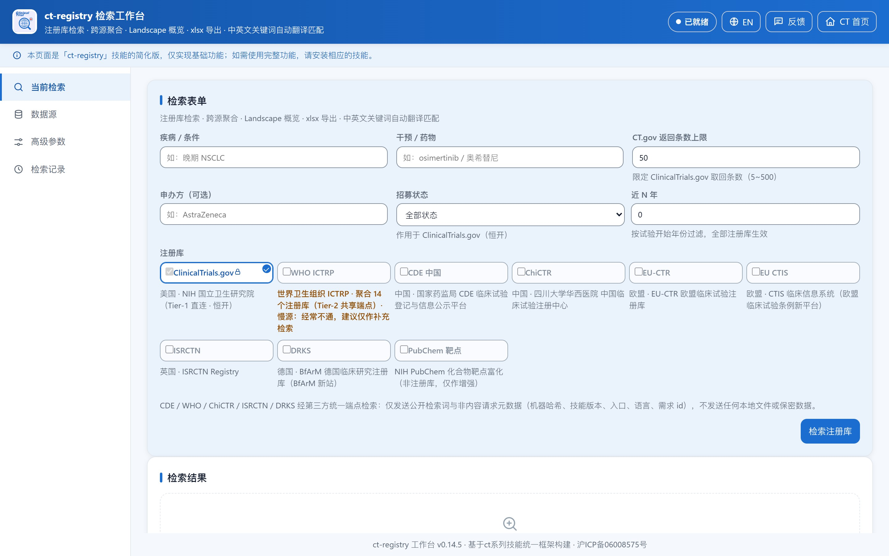

# 临床试验注册检索专家（ct-registry）

[🇨🇳 中文](#) / [🇺🇸 English](./README.md)

  

> **不安装也能用：** 如果你不想安装，只想快速使用本技能的基础功能，也可直接访问ct系列技能的总入口网页 **https://ct.medstatstar.com** 使用。

  

> 跨源检索全球临床试验注册库（ClinicalTrials.gov、中国 CDE、WHO ICTRP、EU-CTR、ChiCTR、ISRCTN、DRKS、PubChem），归一化并聚合为一张可执行的格局图——用于立项查重、对照设计对标与竞品格局分析。B 档：普通数据输入 + 对外检索，可快速推广技能。

---

## 两种使用入口

| 入口 | 适合 | 说明 |
|---|---|---|
| **① 对话式** | 任何需求 —— 模糊、复杂、或需要追问细节 | 在 WorkBuddy 里直接说人话，助手自动判断源 / 关键词 / 模式 |
| **② 网页工作台** | 喜欢点选表单的用户 | 勾注册库、填字段、点检索 —— 结果与导出完全一致 |

两个入口的结果与导出完全一致。下面先纵览能力全貌，再照着案例里的原话直接用起来。

---

## 能力一览 —— 场景

| 能力 | 检索源 | 试试这样说 / 这样做 |
|---|---|---|
| 按疾病 / 干预 / 申办方检索 | CT.gov（直连）；CDE / ChiCTR（统一端点） | "查辉瑞 2022 年以来的三期肿瘤试验" |
| 跨注册库统一归一化 | 全部源 | "把 CT.gov 和 CDE 的 NSCLC 试验合并成一张表" |
| 聚合分析：分期 / 状态 / 申办方 / 时间线 / 竞品格局 | 全部源 | "给出奥希替尼在 NSCLC 的竞品格局" |
| 中国 CDE 高级检索与多关键词检索 | 中国 CDE（统一端点） | "CDE：沙坦 + 进行中，化学药物，2023 年起" |
| WHO ICTRP 全球镜像（14+ 注册库） | WHO ICTRP（统一端点） | "DPP-4 抑制剂 T2D 全球试验，2023 年起" |
| 药物 → 靶点 / 属性映射 | PubChem（直连） | "用 PubChem 把奥希替尼映射到靶点" |
| 结构化详情（申办方 / 分期 / 终点） | CDE detail（65 字段）、EU-CTR 文档 | "拉这些 CDE 登记号的完整详情" |
| 结构化输出：JSON / Markdown / PNG / Excel | — | "把格局导出成 Excel 工作簿" |
| 快照追踪 / 状态变更提醒 | 本地跨轮次快照比对 | "跟踪这批试验的状态变化" |
| 链式下游分析 | → `ct-pipeline` / `ct-protocol` | "把归一化结果喂给 ct-pipeline 做情报" |

---

## 使用案例大全

> 下面两个场景照着「你这样说」原话复制即可用起来。默认是**安全预览**（先给检索计划），说「请直接计算」才执行真实检索；每张卡末尾给出同一件事在网页工作台里的操作路径。用中文或英文说都行，回答与交付物会跟随你的语言。其余能力（CDE 高级检索、结构化详情、快照追踪等）见上方能力索引的「试试这样说」。

### 案例 1 · 只看一个注册库的聚焦检索

**你这样说：**
> 查一下辉瑞在肿瘤领域注册的试验，只看 ClinicalTrials.gov 的。

**助手会这样回（示意）：**
> 已按你的限定只检索 ClinicalTrials.gov：共检出 1467 条，取回 10 条；合并后 10 条，无重复。
> - 分期分布：Ⅰ期 4 条、Ⅱ期 3 条、Ⅲ期 2 条、未标注 1 条
> - 地区分布：美国 9、西班牙 5、法国 4、比利时 3、加拿大 3
> - 主要申办方：Pfizer 6 条 …
>
> 每条试验都带登记号与可点击的注册库首页链接；完整清单已整理成 Excel 工作簿，可直接下载。

**🖥️ 工作台：**
> 在 **当前检索** 里，*疾病 / 条件* 填 `oncology`、*申办方* 填 `Pfizer`，*注册库* 只勾 **ClinicalTrials.gov** → 点 **检索注册库**。
> 提交前「检索计划」卡片会列出本次启用的站点与关键词（中文「肿瘤」会自动译成 Oncology）；结果表逐行给出登记号、标题、分期、状态、国家、申办方与注册库首页链接，右上角可下载 Excel 工作簿。

### 案例 2 · 中文药名自动跨源聚合

**你这样说：**
> 查一下阿西米尼的试验，给我一张全球格局图。

**助手会这样回（示意）：**
> 中文药名自动本地化为 `asciminib`，并行检索 ClinicalTrials.gov 与欧盟 CTIS，合并为一张格局图：
> - ClinicalTrials.gov 检出 60 条、取回 50 条；CTIS 取回 14 条；合计 64 条，去重后 64 条
> - 分期分布：Ⅱ期 19 条、Ⅰ期 13 条、Ⅰ/Ⅱ期 10 条、Ⅲ期 5 条、未标注 10 条
> - 地区分布：美国 27、德国 13、韩国 12、法国 11、意大利 10
> - 主要申办方：Novartis Pharmaceuticals 24 条、Novartis Pharma AG 8 条、M.D. Anderson Cancer Center 5 条
>
> 结果同时给出状态分布与起始年份时间线，并生成 Excel 工作簿；每行都带登记号与来源，可逐条回源核对。

**🖥️ 工作台：**
> 在 **当前检索** 里，*干预 / 药物* 填 `阿西米尼`，*注册库* 勾 **ClinicalTrials.gov** 与 **CTIS**（可再加中国 ChiCTR）→ 点 **检索注册库**。
> 「检索计划」卡片会显示各站点分别使用的关键词（中文药名自动译为 asciminib）；结果区给出试验总数、分期 / 状态 / 申办方 / 时间线分布，右上角下载 Excel 工作簿。

---

## 数据源与状态

> 多源检索，每个源的情况都在这里讲清。合并检索源（WHO ICTRP）会镜像 14+ 个一级注册库；**凡 WHO 覆盖的源，原站点不通时自动改用 WHO 线路兜底**（见「兜底策略」），不会静默 0 条；**确实站点异常时也一定会返回明确提示**，绝不会把「源不可用」伪装成「无结果」。

| 源 | 访问方式 | 角色 / 覆盖 | 当前状态 | 兜底策略 |
|---|---|---|---|---|
| ClinicalTrials.gov v2 | 直连（官方 REST API，无需 token） | 美国 + 全球主库；权威字段最全 | ✅ 正常 | — |
| PubChem (PUG-REST) | 直连（无需 token） | 药物 → CID / 属性 / 靶点映射 | ✅ 正常 | — |
| EU-CTR / EudraCT 旧库 | 直连（纯 HTTP 解析，无浏览器） | 欧盟 2022 前存量试验 | ✅ 正常（单页 ~13s，默认收敛 3 页） | 站点不通 → WHO 线路筛 EUCTR 记录 |
| CTIS（欧盟 2022+ 新试验） | 统一端点 `source=ctis` | 欧盟新试验；**非 WHO 一级镜像，无 WHO 兜底** | ✅ 正常（单页 ~9s，默认收敛 2 页） | 站点不通 → 无 WHO 兜底，返回明确提示 |
| 中国 CDE (`chinadrugtrials`) | 统一端点 | 中国药物试验（始终独立检索，WHO 英文匹配会漏中文试验） | ✅ 正常 | — |
| WHO ICTRP (`who`) | 统一端点 | **合并检索源**：一次调用镜像 14+ 一级注册库 | ✅ 正常（量大，受 5 分钟网关约束） | —（本身就是兜底源） |
| ChiCTR (`chictr`) | 统一端点 | 中国学术试验（无公开 API） | ⚠️ 自 2026-09-06 起后端节点持续返回空（疑似故障） | 0 条 + 对照探针判定故障 → 自动切 WHO 线路筛 ChiCTR 记录 |
| ISRCTN (`isrctn`) | 统一端点（**官方 XML API**，绕过反爬验证挑战） | 英国注册库 | ✅ 正常（2026-09-08 由网页爬取改为官方 XML API，修复 0 条误判） | 站点异常/改版 → 自动切 WHO 线路筛 ISRCTN 记录 |
| DRKS (`drks`) | 统一端点 | 德国注册库 | ⚠️ 旧搜索入口已迁移至 BfArM（JSF 新站，旧形态不可解析） | 迁移预检短路 + 自动切 WHO 线路筛 DRKS 记录 |

### 各来源如何配合

- **CDE 始终独立检索**：WHO ICTRP 英文标题匹配会漏掉中文登记试验，故 China 覆盖以 CDE 为准，不依赖 WHO 镜像。
- **WHO ICTRP 是合并兜底源**：它镜像了 ChiCTR / ISRCTN / DRKS / EUCTR 等。当某个 WHO 覆盖的源（ChiCTR / ISRCTN / DRKS / EUCTR）**原站点不通**（迁移、WAF 拦截、节点故障、显式报错）时，编排层会**自动改用 WHO 线路、并按注册号正则筛出该源的记录**回填——你仍拿到该源数据，只是来源标注为 `fallback_used=who_ictrp`。
- **CTIS 不在 WHO 一级镜像内**（欧盟新试验未进 ICTRP），故 CTIS 无 WHO 兜底；它若异常会直接返回明确提示。

### 站点异常会返回什么

- **DRKS 迁移**：预检命中（旧入口 307 → BfArM）即快速返回「站点已迁移」提示并切 WHO 兜底，不再空转数十秒。
- **ChiCTR 节点故障**：0 条 + 对照词探针也空 → 判定源不可用，返回明确提示「源不可用而非真实零结果」，并自动切 WHO 兜底。
- **ISRCTN 改版/拦截**：原网页爬取会被反爬验证挑战挡住 → 现改官方 XML API 绕过；若 API 亦异常，返回明确提示并切 WHO 兜底。
- **真实零结果 vs 源故障的区分**：对「0 条 + 无错误」的歧义，编排层用各源必有海量登记的**对照词探针**判定——对照词有数据说明是真实零结果（不浪费 WHO 配额）；对照词也空才是源故障（触发兜底）。
- 任何兜底失败（WHO 也无该源记录 / WHO 自身报错）都会**保留明确 error_msg**（如「DRKS 站点已迁移…[WHO 回退亦失败: …]」），绝不伪装成「无结果」。

## 常见问题（FAQ）

**只给部分参数能查吗？**
能。你从不需要自己选模式或旗标——助手根据你的话自动判定 CDE 调用模式（`search` / `combined` / `multi_keyword` / `detail`）。任何字段留空即可，未用字段直接省略（发送空字段反而会污染查询）。

**结果里的数量是每组还是总数？**
总数会聚合为一张格局图。跨源运行既报告总条数，**也**给出分源明细（如 CT.gov 20 + CDE 2057 → 2077 条）。状态分布里 `RECRUITING` 与 `已完成/进行中` 同表呈现。

**怎么真查出数？**
- **对话**：默认是**安全预览**（只有计划 / 载荷），说"请直接计算" / "run it" 才执行真实检索。

**必须安装技能才能用吗？**
不必须——基础功能可直接访问 ct 系列总入口网页 **https://ct.medstatstar.com** 免安装使用；完整能力（高级字段、确认门 PDF 下载、快照追踪）请安装并调用 `ct-registry` 技能。

**中文环境输出是中文吗？**
是。脚本自动检测语言环境：中文 `zh-*` 系统下所有面向用户的提示切中文，否则英文。原始数据值（CDE 中文状态 / 适应症等）一律保真不翻译。

**为什么有些行分期 / 申办方显示 `Unknown`？**
列表检索只返回概要字段。`sponsor` 与 `phase` 仅在 CDE `detail` 模式（65 字段）或 WHO detail 才有。需要申办方 / 分期明细时请抓详情（对话式或 CLI）。

**免费吗？有配额吗？**
当前免费。共享第三方端点按**需求（demand）**计次（一次用户请求 = 1 次需求；其内的 WHO+CDE、关键词微调、重复检索都合并为 1）。每日上限 1000 个需求；直连 Tier-1 源（CT.gov v2、EU-CTR、PubChem）与预览不计入。

**结果能当监管申报用吗？**
不能。输出仅用于参考 / 规划。CSR / 申报文件须另按 GCP 单独生成。

**抓取合规吗？会踩限流吗？**
全部走官方公开 API / 公开检索接口（CT.gov v2、EU-CTR、PubChem、WHO ICTRP、中国 CDE 统一端点），不爬取任何未公开页面，也不绕过站点防护。后台对第三方端点采取**串行调用 + 指数退避**，遵守其速率限制；遇到 429 / 超时按退避重试，绝不暴力并发。全球镜像（14+ 注册库）受统一端点 5 分钟网关硬墙约束，属合规等待而非限速惩罚。

**Q: 发现结果有误怎么办？怎么上报？**
A: 本技能遵循 ct-base §20.3 错误报告流程。若您怀疑结果有误（或引擎报错），直接说 **"上报问题" / "report a bug" / "提交错误报告"**。技能在检测到疑似缺陷时（如引擎报错、重试仍失败）也会**主动询问**是否上报——**每会话最多 1 次**，您可随时拒绝。无论哪种方式，助手都会：
1. **生成一份脱敏报告**（11 键白名单：skill / skill_version / test / error_type / error_code / engine_status / description / locale / query_origin / session_hash / attempts——**不含您的原始输入值或个人数据**，仅 `description` 字段由您把关披露，如所用算法/函数、错误消息原文）；
2. **展示报告全文供您检视**——可补充问题描述或更正任何内容后再确认；
3. **经您明确确认后发送**——本会话有 coze 调用则发往统一端点 `https://ct-bugreport.coze.site/run`；纯本地则保存脱敏报告 + 提示邮件联系作者（数据不出域）；
4. **收到回执**——包括您此前从同一来源提交的报告是否已被修复（含修复说明）或仍在处理中。

整个过程您完全可控：报告在**发送前**先展示给您，未经您明确说「发送」绝不传输任何内容。

## 开始检索前：耗时与数据量提示

借 WHO ICTRP 做全球检索（一次调用镜像 14+ 注册库）。**耗时取决于检索面宽窄**——小结果集（≤100 条 / 窄词如 `osimertinib`）走纯 HTTP 直连通道，**数秒即回**（2026-09-08 起，无需启动浏览器）；大结果集（宽词、多字段筛选）才会由浏览器翻页取数，需 **1 到 5 分钟**。给你一个直观的预期：

- **等多久**：小结果集（窄词 / ≤100 条）**数秒**即回；大结果集（宽词如 `cancer`、多字段筛选）后台需浏览器翻页，通常要 **1 到 5 分钟**才把数拿回来。
- **为什么会贴着 5 分钟**：统一的第三方端点外侧有一道 **5 分钟硬墙**（网关上限）。像 `cancer` 这种宽词、或"全球 + 不限国家"的大检索面，处理时间可能贴着这道墙走，极少情况下会超时失败。真遇到了，技能会明明白白告诉你，而不是悄悄把数据丢了。
- **超过 5 分钟怎么办**：如果检索量超过 5 分钟仍未能全部完成，系统会**返回已检索到的部分结果**（而非报错），并在输出中标注 `is_timeout: true`。你可以在等待时间与数据完整性之间自行取舍：要完整结果请耐心等待；要快速预览可接受部分结果。
- **5 分钟大约对应多少条数据**：取决于检索面的宽窄，经验值如下：

  | 关键词类型 | 典型命中量 | 能否快速拿完 | 经验吞吐 |
  |-----------|-----------|--------------|---------|
  | 窄词（如 `osimertinib`，≤100 条） | 0–100 条 | ✅ **HTTP 直连秒回**（2–15s，不开浏览器） | 首屏 ~2–6s；≤10 页自动翻完（~2–4s/页 + 节流） |
  | 中词（如 `diabetes`） | 5,000-50,000 条 | ⚠️ 取部分（HTTP 取满 10 页 ~100 条后浏览器接管） | >100 条走翻页，5 分钟 ≈ 1000-1500 条 |
  | 宽词（如 `cancer`） | 100,000+ 条 | ❌ 只能拿很少部分 | 首页 ~2–6s（HTTP 探测），翻页 ~2-3s/页（浏览器） |

  拿不全怎么办：① 接受部分结果（做趋势分析够用）；② 缩小检索面（加干预措施/申办方/国家限定）；③ 分多次查（按维度拆分）。
- **数据量怎么收着点**：WHO 全球检索的结果集可以非常大。如果一次查回来的数偏少、或者超时了，多半是**检索面太宽**——把关键词收窄些（比如用 `osimertinib` 而不是 `cancer`），或改用**高级检索**（在对话里说"高级检索"，由代码自动拼 `药物 AND 适应症` 这类更精准的过滤，返回量更小、也更快）。另外（2026-09-08 起）对 **>100 条**的结果集，HTTP 通道按设计最多取回 10 页（约 80–100 条）并标注 `is_partial`——这是**能力边界而非故障**；要更全请收窄范围，或用更大翻页参数。每天还有 **100 次需求**的配额上限（见上 FAQ），正常使用远碰不到。

## 安全（safe preview）

**默认安全预览。** 对话中脚本只生成并展示计划 / 载荷。网络请求**仅在你显式确认时**才执行（"请直接计算" / "run it"）。在你确认前不发任何请求、不取任何数据。

**仅公开数据——零保密输入。** 技能读取公开注册库数据；你无需提供受试者 / 方案 / CRF 数据，也绝不会传输任何保密数据。

**出域披露（egress）。** 当你执行真实检索时，**公开查询词**（药品名、适应症、登记号）离开你的环境，同时随附**非内容请求元数据**：`query_origin`（由本机主机名 / 硬件 ID 派生的稳定 SHA-256 哈希，供端点做防滥用限流与调用归因——唯一外发的机器派生标识，不传输主机名原文），以及 `skill_version`、`entry_point`、`params.user_language`、`demand_id` 关联 ID。上述内容发往以下公开端点：

- **ClinicalTrials.gov v2** —— 官方 REST API（直连，无需 token）。
- **PubChem** —— PUG-REST（药物→CID / 属性 / 靶点；直连，无需 token）。
- **中国 CDE** —— 经统一 Coze `/run` 端点 `ct-search.coze.site/run`（第三方，需 Bearer token——实测无 token 返回 401）。
- **EU-CTR** —— 纯 HTTP 解析旧 EudraCT 结果（直连，无需 token，无浏览器）。
- **WHO ICTRP** —— 统一 Coze `/run` 端点（第三方，需 Bearer token）；一次调用镜像 14+ 注册库。
- **ChiCTR / ISRCTN / DRKS** —— 经**同一**统一 Coze `/run` 端点，分别以 `source=chictr|isrctn|drks` 提供（第三方，共用 token）。

WHO ICTRP 与中国 CDE 在统一端点上**共用一枚长期有效凭证**——它是随技能一同发布的公开共用凭证，开箱即用。任何保密数据都不会发往这些端点。

### 访问凭证

统一端点需要一枚共用访问凭证，它**随技能一同发布**——检索开箱即用，不用申请 key，也没有任何东西需要你粘贴。若作者日后重新签发，会有提示告诉你该怎么做；任何时候都不要把凭证粘进对话。

## 为什么可以信任结果（反幻觉）

输出里的每一行都是**检索来的，不是编出来的**：

- **来源权威**：记录直接来自各注册库自身的 API / 端点（ClinicalTrials.gov v2、PubChem PUG-REST、EU-CTR 网页解析，以及 CDE / WHO / ChiCTR / ISRCTN / DRKS 的统一 Coze 端点）。在数据源与你之间没有任何 LLM 生成环节。
- **规则化归一化**：合并与字段映射（分期、状态、申办方……）是确定性代码，不是自由文本改写。原始值（CDE 中文状态、适应症等）一律**保真**——绝不翻译或篡改。
- **数量是回显，不是估算**：总数与分源明细直接取自各源响应；技能不会四舍五入、猜测或外推条数。
- **已知限制会标出，而非藏起**：贴着 5 分钟网关的宽词会返回**部分**结果并标注 `is_timeout: true`（见"开始检索前：耗时与数据量提示"）；列表模式的分期 / 申办方显示 `Unknown`（仅 detail 模式填充）。这些提示都会打印出来，不会偷偷丢弃。

提醒：各注册库按自身节奏更新，可能有缺口或延迟；任何监管 / 申报用途前请务必回源核对。

## 进阶参考

### 人机交互契约（两道门）
- **Gate 1 —— 检索前简报（在任一真实联网调用之前）：** 助手打印各源关键词（中英对照）、范围、时间/状态筛选、`demand_id` 分组与配额影响，以及"免费、每日 1000 个需求"提示。仅在确有选择时才追问。
- **Gate 2 —— 检索后列表确认：** 展示列表（总数、范围、样例行、`Unknown` 分期/申办方提示）。详情抓取：≤100 条自动执行；>100 条先确认。PDF 绝不自动下载。

### 错误处理（速查）

| 你会看到 | 原因 | 怎么办 |
|---|---|---|
| CT.gov 连接错误 | 网络 / 代理不通 | 确认 clinicaltrials.gov 可达，或设置代理 |
| CDE / ChiCTR「访问被拦截」 | 站点防火墙拒绝自动化浏览器 | 走统一端点路径（默认）；若持续，助手会降级为「辅助粘贴」方式，该方式不外发任何内容 |
| WHO / CDE HTTP 401 | 访问凭证未被接受 | 重试；若持续，请联系作者重新签发凭证 |
| HTTP 403（少见） | 凭证损坏 | 联系作者；这不是过期 |
| CDE HTTP 500 字段类型错误 | 结构化字段以错误形状发送 | 用普通表单重跑，助手会重建请求 |
| ISRCTN 返回 0 条 / 异常 | 官方 XML API 软错误 | 编排会自动切到 WHO 镜像路线过滤 ISRCTN 记录 |
| CDE 读取超时 | 结果集过大或网关瞬断（单次上限约 300 秒） | 重试即可；属瞬时问题，不是数据格式错误 |

### 链式调用
`ct-registry` → `ct-pipeline`（消费 `normalized.json` 做竞品情报）/ `ct-protocol`（设计对标）。

---

**版本**：v1.0.1 | **License**：MIT | **作者**：medstatstar, phoe-zip

如有功能建议、Bug 反馈或其他意见，请直接联系作者：medstatstar@gmail.com（张文彤 / Wintone Zhang）。

---

## 保密声明

> CT 全系列技能由 20+ 个技能构成，按「输入是否涉密」分为 **A、B 两档**，完整覆盖新药临床试验全流程。
>
> - **A 档（输入非涉密）**：输入为普通数据，不涉及保密信息，可本地安装后运行或Web网页方式使用，A 档技能均在 GitHub 公开发布。
> - **B 档（输入涉密）**：输入含药企需严格保密的临床试验数据 / 方案 / CRF 等；B 档既能安装后本地处理（可保证数据不出域），也能使用Web网页方式免安装使用（数据会脱敏后再上传），但B档技能本身均不对外公开发布。若有定制 / 本地部署需求，欢迎与作者联系。
