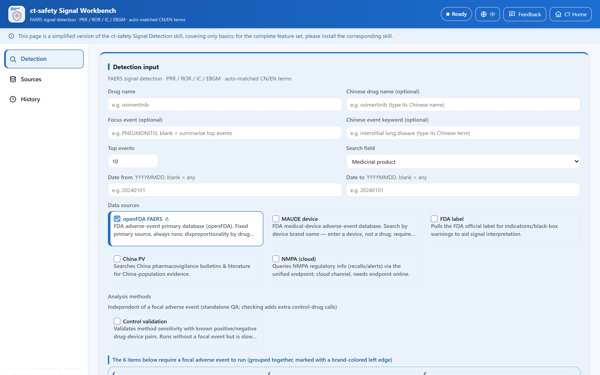

# Clinical Trial Safety Signal (ct-safety)

[🇨🇳 中文](./README_zh-CN.md) ｜ [🇺🇸 English](#)

  

> **Works without installation:** If you'd rather not install and just want to quickly use this skill's basic features, you can also visit the ct-series unified web portal **https://ct.medstatstar.com** directly.

  

> A pharmacovigilance skill that is safe out of the box: it screens **FDA FAERS** public adverse-event data for drug–event safety signals (PRR / ROR / IC / EBGM with 95% CIs), with optional **device adverse events (MAUDE)**, **China PV corroboration**, **FDA Label triangulation**, and **Naranjo causality assessment**. Analysis, aggregation and report generation run on your machine; how public records are retrieved is described under **Outbound data disclosure** below.

## Who This Is For

The `ct-*` clinical-trial skill family serves three groups:

- **Clinical-trial practitioners at pharmaceutical companies** — sponsors, CROs, and medical / statistical / regulatory roles;
- **Clinicians and nurses who design, manage, or run clinical-trial projects**;
- **Medical students who want to learn clinical-trial methodology in a structured way**.

## Time & Volume Warning

> ⚠️ **Runtime and download limits.** Retrieval is remote, so wall-clock time depends on processing + network. Measured on **2026-10-08** (Shanghai / ~200 Mbps):
>
> | What you ask for | Measured wall-clock | What you get |
> |---|---|---|
> | **Overview** — a drug name only (default path) | **≈10–30 s** | matched reports, top-10 reactions |
> | **Signal detection** — a drug + one event | **≈15–45 s** | 2×2 table + PRR/ROR/IC/EBGM |
> | **Top-N events screen** — a drug + how many events | **≈30–90 s** | multi-event disproportionality |
> | **With China PV corroboration** — add the Chinese drug / event names | **≈20–60 s** | FAERS signal + China bulletin |
> | **Multi-source + score** — ask for the label and China PV too | **≈30–90 s** | Safety Signal Score 0–100, T1–T4 |
> | **Device (MAUDE)** — a device name + event | **≈15–45 s** | device 2×2 + four measures |
>
> **Per-run limits:**
> - Case-level pulls are capped at **10,000** reports per run; larger asks are auto-clamped with a warning line.
> - A single-page case fetch tops out at **100** cases and needs a named event — for bulk pulls ask for the full report download instead.
> - openFDA quota (public API, used only for raw case paging and arbitrary count queries): anonymous 240 req/min, 1,000 req/day per IP; with a free key 240 req/min, 120,000 req/day per key. Per-request timeout 120 s.
>
> **How to avoid long waits:** start with the overview to size the population; narrow the date window; grow the case cap gradually (500 → 2,000 → …).

## How to Use (in conversation)

Tell the assistant what you want in plain language (examples below). Real computation follows the **two-step safe workflow** described under **Safety**. Every example has three parts: **what you say**, **what the reply looks like**, and **how to do the same thing in the 🖥️ workbench**.

### Example 1 · A drug's top adverse events

**You say:**
> Show me what adverse events are most reported for candesartan in FAERS.

**The reply you see (illustrative):**
> **Candesartan — FAERS distribution overview**: matched report total (54,444) with the serious share (52,258 / 96.0%), sex split, year span (2002–2026), report type (initial vs follow-up), top-5 source countries, the annual trend (first 3 years + latest), top-5 reactions, top-5 indications and the drug-role split (suspect / concomitant / interacting). No 2×2 table at this step — this is the overview.
>
> Note what is *not* here: counts are absolute, so there is no percentage share per reaction, no reporter-type (consumer / physician / pharmacist) breakdown and no serious-reason breakdown (death / life-threatening / hospitalisation).
>
> *The overview runs automatically; say "skip preview and run" (or 「跳过预览，直接跑」) to fetch the facets straight away.*

**🖥️ Workbench:** open the workbench → left sidebar **Detection** → *Drug name* `candesartan`, leave *Focus event* empty → tick **openFDA FAERS** → *Top events* `10` → **Run signal detection**. The page renders a **different** view from the chat overview: a KPI strip (drug report total / events assessed / signals flagged / source status), the event-signal table (`a`, ROR, PRR, IC025, EBGM, FDR(q), verdict) and a SOC distribution bar. The seriousness / country / indication facets above are not shown on the page, and no composite score is produced without a focus event. The same numbers download as XLSX.

### Example 2 · A specific drug–event signal

**You say:**
> Does candesartan increase the risk of angioedema?

**The reply you see (illustrative):**
> **Candesartan × ANGIOEDEMA — 2×2 table + four measures**: a=699 / b=53,745 / c=54,881 / d=20,944,834 (N=21,054,161, Haldane-Anscombe +0.5 continuity on), then the four measures side by side — ROR 4.967 (4.608–5.354), PRR 4.916 (4.565–5.294, χ²=2,160.31), IC 2.283 (2.210–2.356), EBGM 4.722 (EB05 4.377 / EB95 5.080) — each with its own ✅ / — flag, plus one overall verdict line (⚠️ signal positive).
>
> **BH-FDR q is not printed in this single-pair mode.** With one test, multiplicity control changes nothing, so q only appears in the multi-event screen (Example 3).
>
> *The overview runs first and stops for confirmation; reply "yes, run the detail" or "skip preview and run" to execute.*

**🖥️ Workbench:** **Detection** → *Drug name* `candesartan` → *Focus event* `ANGIOEDEMA` → tick **openFDA FAERS** → **Run signal detection**. The four-measure table appears in the results panel; the same numbers export to XLSX.

### Example 3 · Multi-event safety signal screen

**You say:**
> Screen the top 6 adverse events of osimertinib for safety signals in FAERS.

**The reply you see (illustrative):**
> **Osimertinib — top-6 event screen**: one row per screened event with `a`, ROR (95% CI), PRR (χ²), IC025, EBGM (EB05), FDR(q), **命中数 (how many of the four methods fired)** and the overall signal flag; rows are sorted multi-method-first, and a summary line states how many events were screened, how many were flagged and how many were multi-method positive.
>
> **Expect fewer rows than the N you asked for.** The candidate pool is the top-N most-reported PTs, and terminal / disease-progression terms (DEATH, MALIGNANT NEOPLASM PROGRESSION, DRUG RESISTANCE, ACQUIRED GENE MUTATION …) are dropped because they are not drug-specific. A top-6 request typically returns **2 rows** (DIARRHOEA, FATIGUE). The report prints a coverage note naming exactly which candidates were dropped and why, instead of silently showing a shorter table.

**🖥️ Workbench:** **Detection** → *Drug name* `osimertinib` → leave *Focus event* empty → *Top events* `6` → tick **openFDA FAERS** → **Run signal detection**. The screen table renders directly under the form, and *Top events* really limits the pool (measured: 6 candidates → 2 assessed → 2 flagged).

### Example 4 · Corroborate with China official PV bulletins

**You say:**
> Is there any Chinese official safety bulletin about osimertinib and pneumonitis?

**The reply you see (illustrative):**
> **China PV corroboration (qualitative only)**: a coverage line first — 「扫描 N 条 / 5 栏目」 — then, per hit, evidence tier, date, column, title, matched keyword and link, plus a short quoted snippet. No counts are merged into the FAERS 2×2 table; this section answers "does the Chinese regulator say anything about it", nothing more.
>
> **Zero coverage is reported as zero coverage.** When all 5 columns come back empty, the report says exactly that — "扫描 0 条 → 覆盖率为零，不可解读为「官方无相关通报」" — instead of the old blanket "no bulletin found". There is also no separate *issue number* field: the issue number sits inside the bulletin title.

**🖥️ Workbench:** **Detection** → *Drug name* `osimertinib` + *Chinese drug name* `奥希替尼` → *Focus event* `PNEUMONITIS` + *Chinese event keyword* `肺炎` → tick **openFDA FAERS** and **中国药物警戒 / China PV** → **Run signal detection**. Chinese terms raise recall; the matched bulletin list lands in the report.

### Example 5 · Multi-source triangulation + evidence tier

**You say:**
> Give me a safety signal score for osimertinib pneumonitis — pull in FDA label and China PV too.

**The reply you see (illustrative):**
> **Safety Signal Score (0–100) with evidence tier T1–T4**: the six components listed with their points (FAERS signal strength ≤50, FDR consistency ≤10, temporal anomaly ≤15, China PV ≤20, control validation ≤10, FDA-label novelty ≤5), then the tier and a one-line rationale — for instance **54.7 / 100, T3 (weak)**, components 49.66 / 5.0 / 0 / 0 / 0 / 0. The FDA-label check reports labelled vs unlabelled (the key gap signal) and China PV contributes its hit count. All source blocks stay visible so you can audit the score; when the FDA-label source is not selected, the report says so explicitly.

**🖥️ Workbench:** **Detection** → *Drug name* `osimertinib` → *Focus event* `PNEUMONITIS` → tick **openFDA FAERS**, **FDA 说明书 / FDA label** and **中国药物警戒 / China PV** → **Run signal detection**. The score card and the per-source blocks appear together.

### Example 6 · Multi-drug comparison

**You say:**
> Compare osimertinib vs gefitinib vs erlotinib for pneumonitis safety.

**The reply you see (illustrative):**
> **A pooled-reference adjusted ROR (aROR), not a per-drug four-measure table.** One row per drug with its event count `a` and drug total `n` (osimertinib 145 / 9,862 · gefitinib 38 / 2,071 · erlotinib 162 / 17,472), then aROR for the focal drug against the pooled reference — measured **1.443 (95% CI 1.164–1.790)**, verdict "focal drug reports the event more often than the reference pool ⚠️".
>
> Two limits worth knowing: there is **no routing menu** in the non-interactive / workbench path (it runs straight through with the comparators you passed), and this is an **aggregate-level** comparison — per-drug 2×2 tables and the four measures are not printed here. Covariate adjustment (age / sex / co-medication) would need case-level data, which this comparison does not pull.

**🖥️ Workbench:** **Detection** → focal drug in *Drug name*, comparators in **对照药 / comparator** and **基准药 / benchmark** → *Focus event* `PNEUMONITIS` → tick **openFDA FAERS** → **Run signal detection**. The comparison block renders per drug.

### Example 7 · Device adverse events (MAUDE)

**You say:**
> Any safety signals for pacemaker malfunction reports in MAUDE?

**The reply you see (illustrative):**
> The same 2×2 / four-measure pipeline run on MAUDE `device/event.json`, with device semantics throughout: the report is headed **MAUDE 器械不良事件信号分析 / MAUDE Device Event Signal**, the fields read *Device* and *device event type*, and the 2×2 rows read "有该器械报告 Device / 无该器械报告 No device". For example, pacemaker × MALFUNCTION: a=26,008 / b=9,471 / c=16,770,976 / d=10,043,092, ROR 1.644, PRR 1.172, IC 0.229, EBGM 1.172. Device reports are counted separately from drug reports — never pooled.
>
> One caveat: SOC mapping is MedDRA-based, so device event types usually land in **Unmapped / 未归类**.

**🖥️ Workbench:** **Detection** → tick **MAUDE 器械 / MAUDE device** → put the device name in the ***Drug name*** field (`pacemaker`) plus the event term — **there is no separate device-name field**; a hint appears reminding you to enter a device brand name rather than a drug name → **Run signal detection**. MAUDE runs alongside or instead of FAERS depending on which sources you tick.

### Example 8 · Individual case reports with de-duplication

**You say:**
> Pull the individual FAERS case reports for osimertinib pneumonitis so I can review them.

**The reply you see (illustrative):**
> A case-level table (up to 100 per page) with report id, receive date, seriousness, outcome and the reaction set per case. De-duplication runs at two levels — exact `safetyreportid` matches (L1) and suspected duplicates flagged by reaction-set Jaccard ≥ 0.8 (L2). On a 20-case page, L1 removed 0 and L2 flagged 0, and the flags are **marked, not deleted** — dropping them takes an explicit opt-in. The L1/L2 pass never re-computes PRR / ROR / IC / EBGM.

**🖥️ Workbench:** tick **个案级 / case-level** (it needs a focus event) — no need to ask in chat. The page pulls up to 100 cases per page with the same L1/L2 flags, and the exported XLSX carries a 个案明细 / case-detail sheet with those flags.

### Example 9 · Naranjo causality assessment

**You say:**
> Add a Naranjo causality assessment to the osimertinib pneumonitis signal.

**The reply you see (illustrative):**
> An independent **Naranjo** block: the 7 criteria, the question each one asks and the score assigned, then the total and the resulting causality band. Without case-level evidence all 7 criteria score 0, total **0 → doubtful (可疑/不大可能)**. There is **no free-text rationale column** — the "why" is the criterion's question plus the scoring rule; supply case-level evidence — a 7-item assessment, or the FAERS cases themselves — and the scores stop being all-zero. The block is never mixed into the PRR / ROR figures.

**🖥️ Workbench:** tick **Naranjo 因果关系 / Naranjo** (needs a focus event), or run the signal first and ask 「加 Naranjo 因果归因」 in chat. The block is appended to the report, not to the disproportionality table.

### Example 10 · PSUR auto-generation

**You say:**
> Generate a PSUR for the osimertinib signals we found.

**The reply you see (illustrative):**
> A `psur.md` assembled from the signals already detected in this session: reporting-period header, an eight-section template (executive summary, methods, new signals, validated signals, risk characterisation, benefit-risk, actions taken, references with CIOMS / ICH E2C(R2) / FDA citations), and a signal table carrying **PRR / ROR / IC / EBGM plus evidence tier, validation status and action recommendation** — for example osimertinib × PNEUMONITIS 9.724 / 9.855 / 3.276 / 7.438, tier T3. It closes with "draft, requires medical review" — a skeleton to complete, not a submission-ready document.

**🖥️ Workbench:** tick **PSUR 视角 / PSUR** (needs a focus event), or detect the signals first and request 「生成 PSUR，报告期 2026H1」 in chat. The generated `psur.md` sits next to the HTML / XLSX report in the same output folder.

### Example 11 · Bug reporting

**You say:**
> report a bug / 上报问题

**The reply you see (illustrative):**
> A sanitized 11-key report drafted for your review — what happened, the step, the error text with paths and identifiers stripped. Nothing is sent until you say "send".

**🖥️ Workbench:** click **反馈 / Feedback** in the top-right corner — a **报告问题 / Bug 反馈** dialog opens with a required description box, a read-only metadata block (skill / page / locale / ts) and **提交反馈 / Submit** + **取消 / Cancel**. It states the report is sanitized and carries no analysis data. Note the workbench dialog submits directly (no draft-to-review step); the review-then-send flow is the chat path.

## What It Can Do — Scenarios

| What you can do | Method | Try saying |
|---|---|---|
| Drug adverse-event profile | FAERS counts (top reactions, seriousness, demographics) | "Show candesartan's top reported reactions in FAERS" |
| Drug–event signal detection | PRR / ROR / IC / EBGM + 95% CI + signal flags | "Does candesartan raise angioedema risk?" |
| Multi-method cross-judgement | ROR lower-CI > 1 · PRR ≥ 2 & χ² ≥ 4 · IC lower-CI > 0 · EBGM EB05 ≥ 2 | "Is this signal robust across methods?" |
| Multi-event safety screen | Disproportionality on the focal drug's top events | "Screen the top 6 events of osimertinib for signals" |
| China official PV corroboration | cdr-adr.org.cn public bulletins (qualitative only) | "Any Chinese official bulletin on osimertinib pneumonitis?" |
| Multi-event FDR control | Benjamini-Hochberg q-value across Top-N events | "Screen all top events with false-discovery control" |
| PT→SOC organ grouping | MedDRA PT → System Organ Class mapping | "Group these signals by organ system" |
| Temporal anomaly detection | CUSUM / rolling-Z / changepoint on the report time series | "Any recent spike in osimertinib pneumonitis reports?" |
| Multi-drug adjusted ROR | aROR against a pooled reference group | "Compare osimertinib vs gefitinib for pneumonitis" |
| Competitor benchmark | Same event across competitor drugs, horizontal comparison | "Benchmark osimertinib against gefitinib and erlotinib for pneumonitis" |
| Multi-source triangulation + score | FAERS + FDA label + China PV → Safety Signal Score 0–100, T1–T4 | "Give me an overall signal score with evidence tier" |
| Device adverse events | MAUDE public device-event data, same four measures | "Any signals for pacemaker malfunction?" |
| Individual case reports | Case-level pull with L1/L2 de-duplication | "Pull case reports for review" |
| Naranjo causality | Independent 7-criteria assessment | "Add Naranjo causality to this signal" |
| Signal verification | Temporal / dose-response / deconvolution checks | "Verify this signal's robustness" |
| Signal prioritization | Label-gap + trend dimensions | "Prioritize the signals by risk" |
| PSUR auto-generation | Draft assembled from the signals already detected | "Generate a PSUR for these signals" |
| Non-ASCII drug name | Chinese drug names auto-resolve to the INN | "查一下阿司匹林的不良反应" |
| Published safety-literature corroboration | Hand off to **`ct-literature`** for the CSM subset | "Pull published reviews on osimertinib pneumonitis" |
| MedDRA verbatim coding | Verbatim term coded to PT against a local dictionary | "Code this AE verbatim term to PT" |

### Corroborating with published literature (hand off to `ct-literature`)

When a FAERS signal needs *qualitative* backing from published evidence, ask for the published-literature check — the skill hands the query to **`ct-literature`**, which returns the CSM qualitative subset as a separate **Safety-Related** sheet.

> **Boundary.** The published-literature subset is context only — it must **NOT** feed the FAERS 2×2 table. Use it to corroborate, never as a quantitative source.

## FAQ

**Can I run it with just a drug name and no event?**
Yes. Give only a drug name and you get a top-adverse-event report (no 2×2 table). Name an event as well for a specific signal.

**What's the difference between PRR and ROR?**
Both are disproportionality measures on the 2×2 table. ROR signals when its lower 95% CI > 1. PRR signals when PRR ≥ 2 **and** χ² ≥ 4. IC signals when lower CI > 0; EBGM signals when EB05 ≥ 2. All four are always reported side by side. BH-FDR q is applied **across the events in a multi-event screen**; a single drug–event pair needs no multiplicity correction, so no q column appears there.

**How do I actually get the signal table?**
By default the skill shows an overview and stops. Confirm the detail step, or say "skip preview and run" — then it executes and returns results (HTML / XLSX / JSON / Markdown).

**Does it output in Chinese?**
Yes. The skill follows your input language. Reports switch to Chinese on `zh-*` locale and English otherwise.

**How do I configure the openFDA API key?**
A key is **not required**: the default path retrieves through the unified endpoint. If you have a free openFDA key you can supply it for the direct-call exceptions (raw case-level paging and arbitrary count queries), which do go to openFDA from your machine. Register one at https://open.fda.gov/api/register/ if you need that higher throughput. The key stays on your machine and is only sent over HTTPS to the official openFDA API.

**Q: What if I found an error — how do I report it?**
A: Say **"report a bug" / "上报问题"**. The skill also proactively asks when it detects a likely defect (at most once per session). Either way: (1) propose sanitized 11-key report → (2) show for your review → (3) send after explicit consent → (4) receive acknowledgment.

**Q: Do I need to install the skill?**
A: No — for the basics you can visit the ct-series unified web portal **https://ct.medstatstar.com** without installing anything. For full capabilities, install and invoke the `ct-safety` skill.

**Q: Why can't the retrieval go faster?**
A: Because it is compliant crawling, not bulk scraping. Each source is queried through its own public interface, at the rate that interface allows: independent sources are queried in parallel, but within one source the pages are walked **serially** so we never trip its rate limit or get the client blocked. The bottleneck is therefore the source's own response time and its page-by-page walk (the China PV bulletins are walked page by page, not queried as a full database), plus network latency. Practical ways to get an answer sooner: start with the overview to size the population, narrow the date window, or add the Chinese drug / event names so recall comes from one pass instead of several.

## Safety (safe preview)

**Two-step workflow, safe out of the box.** Step 1 (overview) runs automatically. Step 2 (detailed retrieval / signal detection) runs **only after explicit confirmation** — or when you say "skip preview and run".

**Outbound data disclosure.** Local side only computes; ALL outbound retrieval goes to the unified endpoint `ct-search.coze.site` (two documented local-direct exceptions: raw case-level paging and arbitrary count queries). The skill reads:
- **FDA FAERS** (always, quantitative);
- **MAUDE** — only when you ask for device adverse events (optional, quantitative);
- **FDA Label** — only when you ask to triangulate with the label (optional, third source);
- **国家不良反应监测中心** — only when you ask for China PV corroboration (optional, qualitative).

**What leaves the machine (metadata disclosure).** Besides your query terms, each retrieval request carries a **machine hash** — a one-way `sha256` digest derived from a hardware token (SMBIOS UUID / MachineGuid / IOPlatformUUID / machine-id). It lets the service side attribute and rate-limit traffic; it is **not** your hostname, your account name, and it cannot be reversed into either. The skill version, entry point, interface language and a request id may accompany the request. No analysis results, case records or patient-level data are ever included.

**No confidential input** (A-tier). Bug reports send only an 11-key whitelist to `https://ct-bugreport.coze.site/run`. Signal detection is screening only, not causal inference.

## Advanced Reference

### Data sources

| Source | How it is retrieved | Availability |
|---|---|---|
| FDA FAERS (openFDA public adverse-event data) | Retrieved via the unified endpoint `ct-search.coze.site`; aggregate counts are computed locally | Always on (A-tier, quantitative) |
| MAUDE (openFDA public device-event data) | Retrieved via the same unified endpoint | Optional — ask for device adverse events (quantitative) |
| FDA Label (openFDA public label data) | Retrieved via the same unified endpoint | Optional — ask to triangulate with the label |
| 国家不良反应监测中心 (cdr-adr.org.cn) | Retrieved via the same unified endpoint | Optional — ask for China PV corroboration (qualitative) |

### FAERS field boundaries

- **Indexable / countable**: `patient.drug.medicinalproduct`, `patient.reaction.reactionmeddrapt` (use `.exact` for Top-N), `receivedate`, `serious*` booleans, `patient.patientsex` (1=M / 2=F / 0=unknown).
- **Not facetable via API**: `patient.patientage`, `primarysource.reportertype`, `primarysourcecountry`. Download the case-level data to compute it locally.
- Multi-word MedDRA PTs: some 3-word phrases consistently 404 — use standard PT `ACUTE KIDNEY INJURY`.

### Errors

| What you see | Why | What to do |
|---|---|---|
| Timeout / no connection | Network or proxy unreachable | Check your network or proxy and retry |
| Endpoint error | Quota exhausted or access not granted | Check the service status, then retry later |
| HTTP 429 | openFDA rate limit hit (public API path) | Wait a few minutes, or configure a free openFDA key |
| A drug name with no event | The intent reads as "top reactions" | That is expected — it returns the Top-N report; name an event for a 2×2 signal |
| China PV returns 0 hits | Zero coverage (nothing was actually crawled) or the keyword is too narrow | Read the coverage line first — `扫描 0 条` means the crawl found nothing, not that the regulator is silent; retry, or add the Chinese drug / event names |
| The top-N screen shows fewer rows than N | Terminal / disease-progression PTs (DEATH, DISEASE PROGRESSION …) were dropped as non-specific | Expected — the coverage note names every dropped candidate; name a specific event in your request to screen it |
| You asked for more than 10,000 cases | Hard cap per run | The request is clamped to 10,000 automatically; note the selection bias |

### Comparative study design mode

When the user asks for a *comparison*, switch to the comparative track: (1) data prep → (2) pick study style + workload → (3) metrics / comparators / robustness → (4) label every result with evidence tier. Hard rules: never run disproportionality on unprepared counts; always present all four configurations; forbid Tier-4 claims without external data.

**Version**: v1.0.1 | **License**: MIT | **Authors**: medstatstar, phoe-zip

For feature requests, bug reports, or feedback: medstatstar@gmail.com (Wintone Zhang / 张文彤).

---

## Confidentiality Notice

> The CT series consists of 20+ skills, organized into **two tiers — A and B** — by "whether the input contains confidential information", providing full coverage of the new-drug clinical trial lifecycle.
>
> - **Tier A (non-confidential input)**: the input is ordinary data and involves no confidential information. Tier A skills can run after local installation or be used via the Web interface, and all Tier A skills are published openly on GitHub.
> - **Tier B (confidential input)**: the input contains clinical-trial data / protocols / CRFs that pharma sponsors must keep strictly confidential. Tier B skills can either be installed and processed locally (data never leaves your domain) or be used via the Web interface with no installation required (data is de-identified before upload), but Tier B skills themselves are not published openly. For custom / on-prem deployment needs, contact the author.

