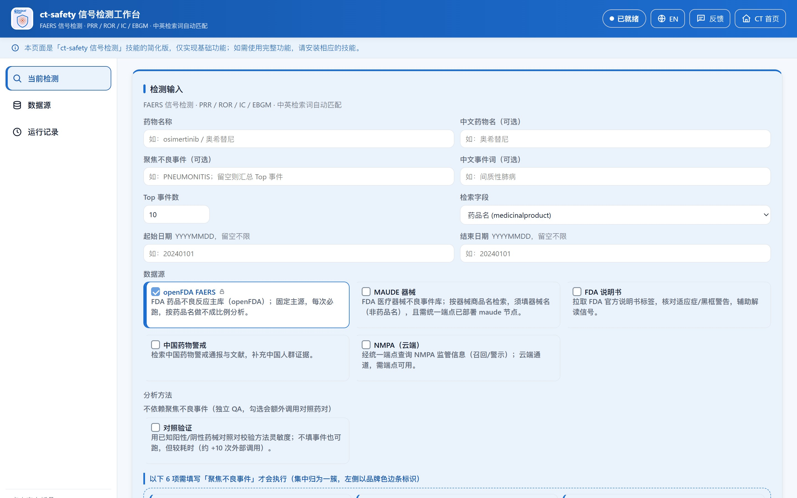

# 临床试验安全信号专家（ct-safety）

[🇨🇳 中文](#) ｜ [🇺🇸 English](./README.md)

  

> **不安装也能用：** 如果你不想安装，只想快速使用本技能的基础功能，也可直接访问ct系列技能的总入口网页 **https://ct.medstatstar.com** 使用。

  

> 一个开箱即安全的药物警戒技能：对 **FDA FAERS** 公开不良事件数据筛查药物-事件安全信号（PRR / ROR / IC / EBGM，含 95% 置信区间），并可选叠加**器械不良事件（MAUDE）**、**中国官方药物警戒通报佐证**、**FDA 标签三角验证**与 **Naranjo 因果归因**。分析、汇总与报告生成都在你本机完成；公开记录的检索方式见下文 **出站披露**。

## 适用人群

`ct-*` 临床试验技能家族面向三类人群：

- **各制药企业的临床试验从业者** —— 申办方、CRO，以及医学 / 统计 / 注册等角色；
- **在医疗机构中设计、管理临床试验项目，或参与临床试验研究实务的医护人员**；
- **希望系统学习临床试验知识的医学专业学生**。

## 耗时与检索量提示

> ⚠️ **耗时与下载量上限**。检索为远程调用，耗时取决于处理 + 网络。以下为 **2026-10-08 实测**（上海 / 约 200 Mbps）：
>
> | 你这样说 | 实测耗时 | 产出 |
> |---|---|---|
> | **概览** —— 只给药名（默认路径） | **约 10–30 秒** | 匹配报告数，top-10 反应 |
> | **信号检测** —— 药名 + 一个事件 | **约 15–45 秒** | 2×2 表 + PRR/ROR/IC/EBGM |
> | **Top-N 事件筛查** —— 药名 + 要查几个事件 | **约 30–90 秒** | 多事件不成比例分析 |
> | **叠加中国 PV 佐证** —— 再给中文药名 / 中文事件词 | **约 20–60 秒** | FAERS 信号 + 中国通报 |
> | **多源 + 评分** —— 再要 FDA 标签与中国 PV | **约 30–90 秒** | 安全信号评分 0–100、T1–T4 |
> | **器械（MAUDE）** —— 器械名 + 事件 | **约 15–45 秒** | 器械 2×2 + 四项指标 |
>
> **单次运行上限**：
> - 个案级抓取单次硬上限 **10,000** 条，超出会自动截断并给出提示。
> - 单页个案抓取最多 **100** 条，且必须点明具体事件；批量下载请改用「整批个案下载」。
> - openFDA 配额（仅公共 API 路径）：匿名 240 次/分、1,000 次/天按 IP；免费 key 240 次/分、120,000 次/天按 key。
>
> **如何避免长时间等待**：先用概览摸清基数；缩小时间窗；个案上限由小到大逐步加（500 → 2000 → …）。

## 如何在对话里使用

直接用自然语言告诉助手你想做什么（示例见下）。真实计算遵循「安全」一节的两段式安全流程。每个示例都含三部分：**你这样说**、**助手会这样回**、**在 🖥️ 工作台怎么做**。

### 示例 1 · 某药的高发不良事件

**你这样说：**
> 帮我校查一下 candesartan 在 FAERS 里报告最多的不良事件。

**助手会这样回（示意）：**
> **candesartan —— FAERS 分布概览**：先给匹配报告总数（54,444）与严重占比（52,258 / 96.0%）、性别分布、年份跨度（2002–2026）、报告类型（初始 / 随访）、来源国家 Top5、逐年趋势（首 3 年 + 末年）、Top 反应 Top5、Top 指征 Top5，以及药物角色（怀疑药 / 合并用药 / 相互作用）。这一步不出 2×2 表，只是概览。
>
> 也要知道这一节**没有**什么：计数都是绝对值 —— 没有每个反应的百分比占比、没有报告者类型（消费者 / 医师 / 药师）拆分，也没有严重原因（死亡 / 危及生命 / 住院）的细分。
>
> *概览会自动执行；说「跳过预览，直接跑」即直接抓取各分面。*

**🖥️ 工作台：** 打开工作台 → 左侧 **当前检测** → *药物名称* 填 `candesartan`（*聚焦不良事件* 留空）→ 勾选 **openFDA FAERS** → *Top 事件数* 填 `10` → 点 **运行信号检测**。页面呈现的是**另一套视图**，与对话里的概览不同：顶部 KPI 条（药物报告数 / 评估事件数 / 判定信号数 / 数据源状态）+ 事件信号清单表（`a`、ROR、PRR、IC025、EBGM、FDR(q)、判定）+ SOC 分布条形图。上面那些严重性 / 国家 / 指征分面在页面上没有，且不填「聚焦不良事件」时不会生成综合评分。同一组数字可导出 XLSX。

### 示例 2 · 某个具体药物-事件信号

**你这样说：**
> candesartan 会不会增加血管性水肿风险？

**助手会这样回（示意）：**
> **candesartan × 血管性水肿（ANGIOEDEMA）—— 2×2 表 + 四项指标**：a=699 / b=53,745 / c=54,881 / d=20,944,834（N=21,054,161，Haldane-Anscombe +0.5 连续性校正已启用），然后四项指标并排 —— ROR 4.967（4.608–5.354）、PRR 4.916（4.565–5.294，χ²=2,160.31）、IC 2.283（2.210–2.356）、EBGM 4.722（EB05 4.377 / EB95 5.080），每项各自标 ✅ / —，末尾一句总体判定（⚠️ 信号阳性）。
>
> **单事件模式不打印 BH-FDR q 值**：只有一个检验时多重性校正不改变任何结论，q 值只在多事件筛查表里出现（见示例 3）。
>
> *概览先自动跑出并停下等确认；回复「确认，跑详情」或「跳过预览，直接跑」即执行。*

**🖥️ 工作台：** **当前检测** → *药物名称* 填 `candesartan` → *聚焦不良事件* 填 `ANGIOEDEMA` → 勾 **openFDA FAERS** → 点 **运行信号检测**。四项指标表出现在结果区，同一组数字可导出 XLSX。

### 示例 3 · 多事件安全信号筛查

**你这样说：**
> 筛查奥希替尼在 FAERS 里报告最多的 6 个不良事件有没有安全信号。

**助手会这样回（示意）：**
> **奥希替尼 —— Top 6 事件筛查表**：每个进入筛查的事件一行，列出 `a`、ROR（95% CI）、PRR（χ²）、IC025、EBGM（EB05）、FDR(q)、**命中数（四种方法里有几种触发）** 与整体信号判定；排序把多方法阳性的排在前面，末尾一句汇总说明筛了几个、几个判为信号、几个是多方法阳性。
>
> **行数通常会少于你说的 N。** 候选池是报告数最高的 N 个 PT，其中终末 / 疾病进展类术语（DEATH、MALIGNANT NEOPLASM PROGRESSION、DRUG RESISTANCE、ACQUIRED GENE MUTATION 等）因不具备药物特异性而被剔除。通常 Top 6 会返回 **2 行**（DIARRHOEA、FATIGUE）。报告会显式打印覆盖率说明，列出到底剔除了哪几个、为什么，而不是悄悄给一张短表。

**🖥️ 工作台：** **当前检测** → *药物名称* 填 `osimertinib` → *聚焦不良事件* 留空 → *Top 事件数* 填 `6` → 勾 **openFDA FAERS** → 点 **运行信号检测**。筛查表直接渲染在表单下方，且 *Top 事件数* 现在真的会限制候选池（例如：候选 6 → 评估 2 → 判信号 2）。

### 示例 4 · 用中国官方药物警戒通报佐证

**你这样说：**
> 有没有奥希替尼肺炎的中国官方安全通报？

**助手会这样回（示意）：**
> **中国药物警戒通报佐证（仅定性）**：先给一行覆盖率 —— 「扫描 N 条 / 5 栏目」，然后每条命中列出佐证等级、日期、栏目、标题、命中词与链接，并附一小段原文摘录。这些内容**不会**并入 FAERS 的 2×2 表 —— 这一节只回答「中国监管方有没有提过」，不做定量合并。
>
> **零覆盖就如实报零覆盖。** 当 5 个栏目都返回空时，报告会明确写「扫描 0 条 → 覆盖率为零，不可解读为『官方无相关通报』」，而不是过去那句笼统的「未命中」。另外**没有独立的期号字段** —— 期号在通报标题里。

**🖥️ 工作台：** **当前检测** → *药物名称* 填 `osimertinib` + *中文药物名* 填 `奥希替尼` → *聚焦不良事件* 填 `PNEUMONITIS` + *中文事件词* 填 `肺炎` → 同时勾 **openFDA FAERS** 与 **中国药物警戒** → 点 **运行信号检测**。中文词能提高召回，命中的通报列表落在报告里。

### 示例 5 · 多源三角验证 + 证据分级

**你这样说：**
> 给我一个奥希替尼肺炎的安全信号评分，带证据分级——把 FDA 标签和中国 PV 也拉上。

**助手会这样回（示意）：**
> **安全信号评分（0–100）+ 证据分级 T1–T4**：先列六个评分分量及其得分（FAERS 信号强度 ≤50、FDR 一致性 ≤10、时间序列异常 ≤15、中国 PV ≤20、控制验证 ≤10、FDA 标签新信号 ≤5），再给分级与一句话理由 —— 例如 **54.7 / 100，T3（弱）**，分量为 49.66 / 5.0 / 0 / 0 / 0 / 0。FDA 标签检查给出「已标注 / 未标注」（这正是关键的标签缺口信号），中国 PV 以命中条数计入。三个来源块都保留可见，方便核对评分怎么来的；没勾选 FDA 标签源时，报告会明确写出「FDA 标签源未启用」。

**🖥️ 工作台：** **当前检测** → *药物名称* 填 `osimertinib` → *聚焦不良事件* 填 `PNEUMONITIS` → 勾 **openFDA FAERS**、**FDA 说明书**、**中国药物警戒** → 点 **运行信号检测**。评分卡与各来源块一并呈现。

### 示例 6 · 多药对比

**你这样说：**
> 对比一下 osimertinib、gefitinib、erlotinib 在肺炎上的安全性。

**助手会这样回（示意）：**
> **给的是合并参照组的调整 ROR（aROR），不是每药一张四项指标表。** 每个药一行，给出该事件报告数 `a` 与该药总报告数 `n`（osimertinib 145 / 9,862 · gefitinib 38 / 2,071 · erlotinib 162 / 17,472），然后算焦点药对合并参照组的 aROR —— 例如 **1.443（95% CI 1.164–1.790）**，判定「焦点药在该事件上报告倾向高于参照组 ⚠️」。
>
> 两个要知道的边界：非交互 / 工作台路径下**没有路由菜单**（直接按你传入的对照药跑完），而且这是**聚合层面**的比较 —— 不会逐药打印 2×2 表与四项指标。要做协变量调整（年龄 / 性别 / 合并用药）需要个案数据，这一层不做。

**🖥️ 工作台：** **当前检测** → 目标药填 *药物名称*，对照药填 **对照药** 与 **基准药** 字段 → *聚焦不良事件* 填 `PNEUMONITIS` → 勾 **openFDA FAERS** → 点 **运行信号检测**。对比块按药逐个渲染。

### 示例 7 · 器械不良事件（MAUDE）

**你这样说：**
> 起搏器故障报告在 MAUDE 里有没有安全信号？

**助手会这样回（示意）：**
> 同样的 2×2 / 四项指标流水线，数据源换成 MAUDE 的 `device/event.json`，且全程使用器械语义：报告标题为 **MAUDE 器械不良事件信号分析 / MAUDE Device Event Signal**，字段是 *器械 Device* 与 *事件（器械事件类型）*，2×2 两行读作「有该器械报告 Device / 无该器械报告 No device」。例如 pacemaker × MALFUNCTION：a=26,008 / b=9,471 / c=16,770,976 / d=10,043,092，ROR 1.644、PRR 1.172、IC 0.229、EBGM 1.172。器械报告与药品报告分开计数，绝不混池。
>
> 一个提醒：SOC 映射基于 MedDRA，器械事件类型通常落到 **Unmapped / 未归类**。

**🖥️ 工作台：** **当前检测** → 勾 **MAUDE 器械** → 器械名填在 ***药物名称*** 字段里（`pacemaker`），再填事件词 —— **没有单独的「器械名称」字段**；勾选 MAUDE 后会提示应填器械商品名而非药品名 → 点 **运行信号检测**。MAUDE 与 FAERS 可同时勾选，也可只勾其一。

### 示例 8 · 个案报告（含去重）

**你这样说：**
> 拉一下奥希替尼肺炎的 FAERS 个案报告，我要逐条审阅。

**助手会这样回（示意）：**
> 一张个案表（每页最多 100 条）：报告 id、接收日期、严重性、结局、以及每条的反应集合。重复项做两级处理 —— `safetyreportid` 完全相同的按 L1 去重，疑似重复的按反应 PT 集合 Jaccard ≥ 0.8 标 L2。一页 20 例时，L1 删除 0、L2 标记 0，且标记**只标不删**（要真删需显式选择「剔除疑似重复」）。L1/L2 这一层**不会**回头重算 PRR / ROR / IC / EBGM。

**🖥️ 工作台：** 勾 **个案级**（需填写「聚焦不良事件」）即可，不必在对话里另外说。页面每页最多拉 100 条并做同样的 L1/L2 标记，导出的 XLSX 带「个案明细」页与这些标记。

### 示例 9 · Naranjo 因果归因

**你这样说：**
> 给这个信号加一个 Naranjo 因果归因评估。

**助手会这样回（示意）：**
> 独立的 **Naranjo** 块：7 条准则、每条对应的提问、以及各自得分，然后给总分与因果等级。无个体级证据时，7 项全为 0 分，总分 **0 → 可疑/不大可能（Doubtful）**。**没有自由文本的「理由」列** —— 「为什么」就是准则的提问加上评分规则；补上个案证据（7 项评估，或 FAERS 病例本身）后，得分才不再是全 0。该块单独成块，绝不与 PRR / ROR 混算。

**🖥️ 工作台：** 勾 **Naranjo 因果关系**（需填写「聚焦不良事件」）；也可先跑信号再在对话里说「加 Naranjo 因果归因」。Naranjo 块附在报告末尾，不进失衡分析表。

### 示例 10 · PSUR 自动生成

**你这样说：**
> 根据刚才检出的信号生成一份 PSUR。

**助手会这样回（示意）：**
> 由本次会话已检出的信号拼出一份 `psur.md`：报告期标题、八节模板（概要、方法、新发现信号、已验证信号、风险特征描述、获益-风险、已采取行动、含 CIOMS / ICH E2C(R2) / FDA 引用的参考文献），以及一张信号表 —— 含 **PRR / ROR / IC / EBGM 四项指标，外加证据分级、验证状态与行动建议**。例如 osimertinib × PNEUMONITIS 9.724 / 9.855 / 3.276 / 7.438，分级 T3。文末标注 "draft, requires medical review" —— 是给你续写的骨架，不是可直接递交的定稿。

**🖥️ 工作台：** 勾 **PSUR 视角**（需填写「聚焦不良事件」）；也可先跑出信号再在对话里说「生成 PSUR，报告期 2026H1」。生成的 `psur.md` 与 HTML / XLSX 报告落在同一个输出目录。

### 示例 11 · 问题上报

**你这样说：**
> 上报问题 / report a bug

**助手会这样回（示意）：**
> 起草一份 11 键白名单脱敏报告供你审阅 —— 发生了什么、哪一步、错误文本（路径与标识符已抹除）。在你明确说「发送」之前，什么都不会发出去。

**🖥️ 工作台：** 点工作台右上角的 **反馈** —— 弹出「报告问题 / Bug 反馈」对话框：必填的问题描述框 + 只读元数据块（skill / page / locale / ts），底部是 **提交反馈** 与 **取消**，并注明报告经脱敏、不含任何检测数据。注意工作台弹窗是**直接提交**（没有「先起草再确认」这一步），「先审阅、后发送」那条流程走的是对话路径。

## 你能做些什么 —— 场景索引

| 能力 | 方法 | 试试这样说 |
|---|---|---|
| 药物不良事件画像 | FAERS 计数（高发反应、严重性、人口学） | 「查 candesartan 在 FAERS 里报告最多的反应」 |
| 药物-事件信号检测 | PRR / ROR / IC / EBGM + 95% CI + 信号判定 | 「candesartan 会不会升高血管性水肿风险？」 |
| 多方法交叉判定 | ROR 下限 CI > 1 · PRR ≥ 2 且 χ² ≥ 4 · IC 下限 CI > 0 · EBGM EB05 ≥ 2 | 「这个信号在多个方法上稳健吗？」 |
| 多事件安全筛查 | 对焦点药的 Top 事件逐个跑不成比例分析 | 「筛查奥希替尼 Top 6 不良事件的信号」 |
| 中国官方 PV 佐证 | cdr-adr.org.cn 公开通报（仅定性） | 「有任何中国官方的奥希替尼肺炎通报吗？」 |
| 多事件 FDR 控制 | Benjamini-Hochberg q 值（Top-N 事件） | 「对所有高发事件做假发现率控制筛查」 |
| PT→SOC 器官归类 | MedDRA PT → 系统器官分类映射 | 「把这些信号按器官系统分组」 |
| 时间趋势异常 | 对报告时间序列做 CUSUM / rolling-Z / 变点检测 | 「奥希替尼肺炎报告最近有突增吗？」 |
| 多药校正 ROR | aROR，以合并参照组为对照 | 「对比 osimertinib 与 gefitinib 的肺炎风险」 |
| 竞品基准 | 同事件在竞品药之间横向比较 | 「让 osimertinib 与 gefitinib、erlotinib 在肺炎上横向对比」 |
| 多源三角验证 + 评分 | FAERS + FDA 标签 + 中国 PV → 安全信号评分 0–100、T1–T4 | 「给我一个带证据分级的综合信号评分」 |
| 器械不良事件 | MAUDE 公开器械事件数据，同样四项指标 | 「起搏器故障有没有安全信号？」 |
| 个案报告 | 个案级抓取 + L1/L2 去重 | 「拉个案报告审阅」 |
| Naranjo 因果归因 | 独立 7 准则判定 | 「给这个信号加 Naranjo 归因」 |
| 信号验证 | 时序 / 剂量-反应 / 去卷积检验 | 「验证这个信号的稳健性」 |
| 信号优先级排序 | 标签缺口 + 时间趋势两个维度 | 「按风险给信号排优先级」 |
| PSUR 自动生成 | 由已检出信号拼出草稿 | 「根据这些信号生成 PSUR」 |
| 非 ASCII 药名 | 中文药名自动解析为 INN | 「查一下阿司匹林的不良反应」 |
| 已发表安全性文献佐证 | 转交 **`ct-literature`** 取 CSM 子集 | 「拉一下奥希替尼肺炎的已发表综述」 |
| MedDRA verbatim 编码 | verbatim 术语按内置字典编码为 PT | 「把这个 verbatim 术语编码成 PT」 |

### 用已发表文献佐证（转交 `ct-literature`）

当某个 FAERS 信号需要**定性**的已发表证据支撑时，说一句「拉一下已发表文献佐证」，技能会把查询转交 **`ct-literature`**，后者把 CSM 定性子集作为独立的**「安全性相关」**页返回。

> **边界。** 已发表文献子集仅作**定性语境**，绝不可进入 FAERS 的 2×2 不成比例分析表。用它来佐证、解释信号，而非作为定量来源。

## 常见问题 FAQ

**只给一个药名、不给事件能算吗？**
能。只给药名不会报错——会自动降级为高频不良事件报告。要算具体信号，再补一个事件名（MedDRA 首选术语）即可。

**PRR 和 ROR 有什么区别？**
二者都基于药物-事件 2×2 表的 disproportionality。ROR 以下限 95% CI > 1 判信号；PRR 在 PRR ≥ 2 **且** χ² ≥ 4 时判信号；IC 下限 CI > 0 判信号；EBGM 的 EB05 ≥ 2 判信号。四种方法始终并排报告。BH-FDR q 是**对多事件筛查表里的多个事件**做校正；单个药物-事件对不需要多重性校正，因此那里不出 q 列。

**怎么才能真跑出信号表？**
默认只给概览并停下。确认详情步骤，或说「跳过预览，直接跑」——即执行检索与 disproportionality 分析，返回结果（HTML / XLSX / JSON / Markdown）。

**中文环境输出是中文吗？**
是。技能跟随你的输入语言，报告均在 `zh-*` 区域下切中文。

**openFDA key 怎么配？**
默认**无需 key**：主路径经统一端点检索。若你有免费的 openFDA key，可以填上，供「本机直连例外」使用（个案原始分页与任意计数查询这两类确实由本机直连 openFDA）。需要更高吞吐就去 https://open.fda.gov/api/register/ 注册。key 仅本地存储，且仅经 HTTPS 发往官方 openFDA API。

**Q: 发现结果有误怎么办？**
A: 直接说「上报问题」/「report a bug」。技能在检测到疑似缺陷时也会主动询问（每会话最多 1 次）。流程：(1) 生成 11 键白名单脱敏报告 → (2) 展示给你审阅 → (3) 你确认后发送 → (4) 收到回执。

**Q: 必须安装技能才能用吗？**
A: 不必须——基础功能可直接访问 ct 系列总入口网页 **https://ct.medstatstar.com** 免安装使用；完整能力请安装并调用 `ct-safety` 技能。

**Q: 为什么抓取不能再快一点？**
A: 因为我们做的是**合规抓取**，不是批量爬取。每个源都走它自己的公开接口、按它允许的速率访问：相互独立的源之间**并行**，但同一个源内部是**逐页串行**遍历，避免触发限流或被封。所以瓶颈在源自身的响应速度与逐页遍历（中国药物警戒通报就是逐页翻，而不是当全量库查询），加上网络往返。想更快拿到可用答案，实际可行的做法是：先用概览把人群规模摸清、收窄时间窗，或补上中文药名 / 中文事件词，让召回一次到位而不是来回补查。

## 安全（安全预览）

**两段式流程，开箱即安全。** 第一步（概览）自动执行。第二步（详细检索 / 信号检测）**仅在你显式确认后**才执行——或当你说「跳过预览，直接跑」时。

**出站披露。** 本地仅做计算；所有出站检索统一经端点 `ct-search.coze.site` 外发（两处文档化例外：个案原始分页与任意计数查询走本机直连）。技能仅读取：
- **FDA FAERS**（始终启用，量化）；
- **MAUDE** —— 只有你要器械不良事件时才用（可选，量化）；
- **FDA Label** —— 只有你要与说明书做三角验证时才用（可选，第三来源）；
- **国家不良反应监测中心** —— 只有你要中国 PV 佐证时才用（可选，仅定性）。

**外发了什么（元数据披露）。** 除你的检索词外，每个检索请求还携带一个 **机器哈希** —— 由硬件令牌（SMBIOS UUID / MachineGuid / IOPlatformUUID / machine-id）派生的单向 `sha256` 摘要。它的用途是让服务端做归因与限流；它**不是**你的主机名、也不是你的账号名，且无法反推出二者。请求还可能附带技能版本、入口、界面语言与请求 id。任何分析结果、个案记录或受试者级数据都不在其中。

**零保密数据输入**（A 档）。错误报告只发 11 键白名单至 `https://ct-bugreport.coze.site/run`。信号检测仅供筛查，非因果结论。

## 进阶参考

### 数据源

| 源 | 获取方式 | 可用性 |
|---|---|---|
| FDA FAERS（openFDA 公开不良事件数据） | 经统一端点 `ct-search.coze.site` 检索；聚合计数在本机计算 | 始终启用（A 档，量化） |
| MAUDE（openFDA 公开器械事件数据） | 经同一统一端点检索 | 可选 —— 你要器械不良事件时才用（量化） |
| FDA Label（openFDA 公开标签数据） | 经同一统一端点检索 | 可选 —— 你要与说明书做三角验证时才用 |
| 国家不良反应监测中心（cdr-adr.org.cn） | 经同一统一端点检索 | 可选 —— 你要中国 PV 佐证时才用（仅定性） |

### FAERS 字段边界

- **可检索 / 可 count**：`patient.drug.medicinalproduct`、`patient.reaction.reactionmeddrapt`（Top-N 用 `.exact`）、`receivedate`、`serious*` 布尔、`patient.patientsex`（1=男 / 2=女 / 0=未知）。
- **API 不可分面（仅存于个案体内）**：`patient.patientage`、`primarysource.reportertype`、`primarysourcecountry`。需下载个案明细才能在本地统计。
- 多词 MedDRA PT：部分三词短语（`RENAL FAILURE ACUTE`）持续 404——改用标准 PT `ACUTE KIDNEY INJURY`；两词 PT（如 `HEPATIC FAILURE`）通常可用。`total()` 自动「404 → `.exact`」降级。

### 错误处理

| 你会看到 | 原因 | 怎么办 |
|---|---|---|
| 超时 / 连不上 | 无网络 / 代理不通 | 确认网络可达、代理可用后重试 |
| 端点错误 | 配额耗尽或访问未授权 | 查看服务状态，稍后重试 |
| HTTP 429 / 限流 | 超 openFDA 限额（公共 API 路径） | 等几分钟再试，或配置免费的 openFDA key |
| 只给药名、没给事件 | 意图被理解为「看高发反应」 | 这是预期行为，会出 Top-N 报告；要看 2×2 信号请补上事件名 |
| CN-PV 0 命中 | 零覆盖（实际什么都没扫到）或关键词过窄 | 先看覆盖率那行 —— `扫描 0 条` 表示抓取没拿到东西，不等于官方没通报；重跑，或补上中文药名 / 中文事件词 |
| Top-N 筛查表的行数少于 N | 终末 / 疾病进展类 PT（DEATH、DISEASE PROGRESSION 等）被当作非特异性术语剔除 | 属预期 —— 覆盖率说明会列出每个被剔除的候选；要筛某个具体事件，直接在请求里点名该事件 |
| 你要的个案数超过 1 万 | 单次硬上限 | 会自动截断到 1 万条，注意选择偏倚 |

### 比较研究设计模式

当用户要求*对比*，切换到比较轨道：(1) 数据准备 → (2) 选研究风格 + 工作负载 → (3) 选指标、对照逻辑、稳健性路线 → (4) 给每个结果打证据分级。硬规则：绝不在未准备原始计数上跑 disproportionality；始终先展示四种配置再推荐一种；Tier-4 主张无外部数据禁止。

**版本**：v1.0.1 | **许可证**：MIT | **作者**：medstatstar, phoe-zip

如有功能改进建议、Bug 报告或其他反馈，欢迎直接联系作者：medstatstar@gmail.com（张文彤 / Wintone Zhang）。

---

## 保密声明

> CT 全系列技能由 20+ 个技能构成，按「输入是否涉密」分为 **A、B 两档**，完整覆盖新药临床试验全流程。
>
> - **A 档（输入非涉密）**：输入为普通数据，不涉及保密信息，可本地安装后运行或Web网页方式使用，A 档技能均在 GitHub 公开发布。
> - **B 档（输入涉密）**：输入含药企需严格保密的临床试验数据 / 方案 / CRF 等；B 档既能安装后本地处理（可保证数据不出域），也能使用Web网页方式免安装使用（数据会脱敏后再上传），但B档技能本身均不对外公开发布。若有定制 / 本地部署需求，欢迎与作者联系。

