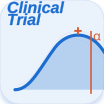
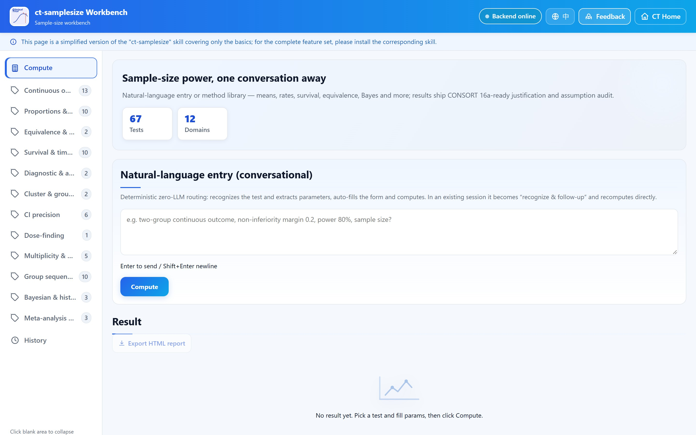

# Clinical Trial Sample Size (ct-samplesize)

- **English guide** → [README.md](https://github.com/medstatstar/ct-samplesize/blob/main/README.md) · **中文指南** → [README_zh-CN.md](https://github.com/medstatstar/ct-samplesize/blob/main/README_zh-CN.md)

  

> **Works without installation:** If you'd rather not install and just want to quickly use this skill's basic features, you can also visit the ct-series unified web portal **https://ct.medstatstar.com** directly.

  

> **Easy-to-use Clinical Sample Size & Power Calculator for Clinical Researchers**
>
> You don't need to code or memorize commands — just describe your trial design in **plain language inside a chat**, and the skill performs **65** professional sample-size & power calculations for you. Calculations run on a **cloud compute service** (rpact, TrialSize, PowerTOST and 20+ statistical packages), so your machine needs **no local R**. Results come in Chinese or English per your OS setting (force-switchable via prompt). By default the skill shows a **safe preview** of the exact request it would send — nothing leaves your machine until you confirm; the reproducible script is available on request.

---

## Who This Is For

The `ct-*` clinical-trial skill family covers the whole clinical-trial lifecycle. ct-samplesize targets three groups who need **defensible sample-size / power numbers across 65 designs**:

- **Clinical-trial practitioners at pharmaceutical companies** — sponsors, CROs, and medical / statistical / regulatory roles: quick, auditable n / power for protocols, SAPs, feasibility.
- **Clinicians and nurses who design or run trials**: estimate sample size when drafting protocols or feasibility assessments.
- **Medical students who want to learn clinical-trial methodology**: exploring design families (group-sequential, adaptive, Bayesian, non-inferiority…).

This tool only takes aggregate design parameters — never patient-level data.

---

## 1. How to Use It in a Chat (the Core)

ct-samplesize is a **conversational skill**: describe your trial design in plain language — no commands, no parameter names to memorise. It auto-loads in WorkBuddy; nothing to install.

Every example follows the same three-part shape: **You say** a copy-ready sentence → **the assistant replies (sketch)** with the number, the power curve and the assumptions → **🖥️ Workbench** shows the same job done on the web workbench, step by step.

The shortest full loop:

**You say:**
> Two-sample means, Cohen's d = 0.5, 80% power, two-sided α = 0.05

**Assistant replies (sketch):**
> Two-sample t-test (two-sided). You need **≈ 64 per group** (128 total); with 10% dropout, plan **71 per group**. An auto-attached power-vs-n curve comes with the result, and the reproducible script is available on request.

**🖥️ Workbench:** open the workbench → **ct-samplesize** → on the home page use the **natural-language box**, type the same sentence, click **Compute**. The result card shows n per group / total, the power-vs-n curve, and an **Export HTML report** button. Prefer forms? Pick *Continuous outcome → two-sample means* in the left sidebar, fill the parameters, click **Compute** — same numbers.

Three full representative cases (continuous / binary / survival) are in **Section 3**; all 65 tests with copy-ready lines are in **Section 2**.

---

## 2. What You Can Compute — 65 Test Scenarios

Tests are grouped by **endpoint / method type** (7 categories below). Each row gives the typical **clinical scenario** and a line you can **copy verbatim** under "Try saying". The same test may *also* be reached from a **design-family cross-index** (group-sequential, adaptive, equivalence / non-inferiority, Bayesian, dose-escalation, MAMS, historical control, vaccine, win-statistics …) — say **"list all 65 tests"** to expand the full capability menu.

> Calculations run on a built-in cloud compute service (rpact / TrialSize / PowerTOST and 20+ statistical packages), so your machine needs no local R. Most users never need to think about it.

### ① Continuous
| Test | Clinical Scenario | Try saying in chat |
|:---|:---|:---|
| `ttest_ind` | Two-means comparison (parallel) | "Two-group mean comparison, d=0.5, power 0.8" |
| `ttest_paired` | Paired t / 2×2 crossover | "Paired design sample size, effect 0.5" |
| `ttest_one` | One-sample vs known mean | "One-sample test, difference from known mean 0.5" |
| `anova` | Multi-group (k groups) | "3-group ANOVA, effect size f=0.25" |
| `equivalence` | Equivalence (means) | "Mean equivalence, margin=2, effect 1" |
| `mixed_model` | Repeated measures / longitudinal (power given n) | "Repeated-measures power, n=100, effect 0.5" |

### ② Binary / Proportions
| Test | Clinical Scenario | Try saying in chat |
|:---|:---|:---|
| `proportion_two` | Two-group rate (chi-square) | "Control 20% treatment 35%, two-group rate comparison" |
| `proportion_one` | Single-group rate | "Single-group rate test, expected 30%" |
| `proportion_paired` | Paired rate (McNemar) | "Paired rate comparison McNemar, p1=0.7 p2=0.5" |
| `odds_ratio` | Odds ratio | "Sample size for OR=2, control rate 50%" |
| `risk_ratio` | Risk ratio (RR) | "Sample size for RR=1.5, control rate 50%" |
| `non_inferiority` | Non-inferiority (rate) | "Non-inferiority, margin=0.1, control 85% treatment 80%" |
| `superiority_margin` | Superiority by margin | "Superiority test, margin 0.05" |
| `be_tost` | Bioequivalence (TOST) | "BE sample size, theta0=0.95, CV=25%" |
| `vaccine_efficacy` | Vaccine efficacy | "Vaccine efficacy, control VE=0.02 treatment 0.005" |
| `gsd_proportion` | Group-sequential two proportions | "Group-sequential two proportions, 1 interim, p1=0.7 p2=0.5" |

### ③ Count / Rates
| Test | Clinical Scenario | Try saying in chat |
|:---|:---|:---|
| `poisson` | Poisson rate | "Two-group rate comparison, λ1=0.05 λ2=0.03" |
| `recurrent_events` | Recurrent events (Andersen-Gill) | "Recurrent-event sample size, control rate 1.0" |
| `gsd_poisson` | Group-sequential Poisson | "Group-sequential Poisson rate" |

### ④ Survival / Time-to-event
| Test | Clinical Scenario | Try saying in chat |
|:---|:---|:---|
| `survival` | Survival (simplified logrank) | "Survival analysis, HR=0.75, power 0.85" |
| `survival_exact` | Survival (exact) | "Exact survival sample size, HR=0.75, accrual 12mo" |
| `ni_survival` | Non-inferiority survival | "Non-inferiority survival, HR margin=1.25" |
| `survival_equivalence` | Survival equivalence (TOST / log-HR) | "Survival equivalence, margin=1.25" |
| `survival_superiority` | Survival superiority w/ margin | "Survival superiority, margin 0.8" |
| `cox_covariate` | Cox regression w/ covariate R² | "Cox regression sample size, HR=2, R²=0.3" |
| `survival_one_sample` | One-sample exponential survival | "One-arm survival, median 12 vs 18" |
| `competing_risks` | Competing risks (cum. incidence) | "Competing-risk sample size, CIF 0.2 vs 0.1" |
| `survival_historical` | Historical-control logrank | "Historical-control survival, historical median 12 new 18" |
| `gsd_survival` | Group-sequential logrank | "Group-sequential survival, 1 interim, HR=0.7" |
| `gsd_hazard` | Group-sequential HR | "Group-sequential HR, HR=0.7" |
| `gsd_survival_sim` | Group-sequential logrank — Monte-Carlo | "Group-sequential survival simulation, 2 interims" |
| `gsd_hazard_sim` | Group-sequential HR — Monte-Carlo | "Group-sequential HR simulation" |

### ⑤ Diagnostic / Method comparison
| Test | Clinical Scenario | Try saying in chat |
|:---|:---|:---|
| `roc` | ROC curve / diagnostic trial | "ROC curve sample size, AUC 0.5→0.75" |
| `bland_altman` | Bland-Altman method comparison | "Bland-Altman sample size, SDdiff=5, margin 2.5" |

### ⑥ Special / Advanced designs
| Test | Clinical Scenario | Try saying in chat |
|:---|:---|:---|
| `group_sequential` | Group sequential / interim | "Group-sequential design, 2 interims, Pocock" |
| `adaptive` | Adaptive design | "Adaptive design, 2 stages" |
| `adaptive_simulate` | Adaptive design — Monte-Carlo | "Adaptive design Monte-Carlo simulation" |
| `bayesian` | Bayesian design | "Bayesian design, control 0.3 treatment 0.15" |
| `dose_escalation` | Dose escalation (Phase I) | "Phase I dose escalation, 5 doses, DLT 0.33" |
| `mams` | Multi-arm multi-stage (MAMS) | "MAMS, 3 arms 2 stages" |
| `dunnett` | Dunnett multiple comparison | "Dunnett, 3 groups control 50" |
| `win_ratio` | Win-Ratio composite endpoint | "Win-Ratio sample size, WR=1.5" |
| `must_win` | Must-Win / co-primary endpoints | "Co-primary endpoints 3, correlation 0.5" |
| `historical_controls` | Historical control borrowing | "Historical control borrowing, historical response 15/100" |
| `conditional_power` | Conditional power / SSR | "Conditional power, interim effect 0.2" |
| `assurance` | Bayesian assurance | "Assurance calculation" |
| `multiple_endpoints` | Multiple/compound endpoints | "Multiple-endpoint sample size, correlation 0.5" |
| `mediation` | Mediation effects | "Mediation sample size" |
| `cluster` | Cluster-randomized | "Cluster randomized, ICC=0.05, 30 per cluster" |

### ⑦ Correlation / variance / CI precision / regression / meta-planning (added v5.9–v5.10)
| Test | Clinical Scenario | Try saying in chat |
|:---|:---|:---|
| `correlation` | Correlation test (H0: ρ=0, Fisher-z) | "Correlation sample size, expect r=0.3, power 0.8" |
| `variance_one` | One-sample variance (χ²) | "One-sample variance test, SD ratio 1.5 vs reference" |
| `variance_two` | Two-variance ratio (F) | "Two-variance comparison, ratio 2, power 0.8" |
| `cv_one` | CV relative-error precision | "CV estimation, CV=0.2, relative error 10%" |
| `ci_mean` | Mean CI precision (half-width → n) | "Mean within ±2 at 95% confidence, SD 10 — how many?" |
| `ci_prop` | Proportion CI precision | "Proportion CI half-width 0.1, expected 50%" |
| `ci_or` | Odds-ratio CI precision | "OR CI half-width 0.5, baseline rate 30%, OR=2" |
| `ci_rr` | Risk-ratio CI precision | "RR CI half-width 0.3, baseline rate 30%, RR=1.5" |
| `ci_cor` | Correlation CI precision | "Correlation CI half-width 0.1, expect r=0.5" |
| `ci_icc` | ICC CI precision (reliability) | "ICC CI half-width 0.15, ICC=0.3, 2 raters" |
| `regression_linear` | Multiple linear regression R² (Cohen's f²) | "Linear regression R² test, 3 predictors, f²=0.15" |
| `regression_logistic` | Logistic regression (Hsieh 1998/1989) | "Logistic regression, OR=1.5, baseline 50%, power 95%" |
| `regression_poisson` | Poisson regression (Signorini 1991) | "Poisson regression, baseline rate 1, RR=1.3, φ=1" |
| `cluster_ext` | Cluster — generalized DEFF (unequal sizes) | "Cluster trial, ICC 0.05, 20 per cluster, cluster CV 0.5" |
| `rates_ext` | Rates — over-dispersion / CI precision | "Over-dispersed rate ratio, λ1=0.5 λ2=0.25, φ=2" |
| `meta_planning` | Meta-analysis prospective planning | "Meta planning, SMD 0.3, 100 per study, I²=0.3, power 0.8" |

---

## 3. Usage Gallery — three representative cases

Three real walk-throughs, one per endpoint type. Every card follows **You say → Assistant replies (sketch) → 🖥️ Workbench**; the numbers below are engine-computed.

### Case 1 · Continuous · Two-sample means
**You say:**
> Two-sample means, Cohen's d = 0.5, 80% power, two-sided α = 0.05

**Assistant replies (sketch):**
> Two-sample t-test (two-sided). **≈ 64 per group** (128 total); with 10% dropout, plan **71 per group**. A power-vs-n curve is attached, and the reproducible script is available on request.

**🖥️ Workbench:** *Continuous outcome → two-sample means* → set d = 0.5, power = 0.8, α = 0.05 two-sided → **Compute**.

### Case 2 · Binary · Two proportions
**You say:**
> Two-group proportions: control 20%, treatment 35%, chi-square, 80% power, two-sided α = 0.05

**Assistant replies (sketch):**
> Two-proportion comparison (chi-square, two-sided). **≈ 137 per group** (274 total). If you would rather express the effect as an odds or risk ratio than a rate difference, say so and I will recompute with the matching test.

**🖥️ Workbench:** *Rates & counts → two-proportion* → p1 = 0.20, p2 = 0.35, power = 0.8, α = 0.05 two-sided → **Compute**.

### Case 3 · Survival · Time-to-event
**You say:**
> Survival trial, hazard ratio 0.75, 1:1 randomisation, event rate 0.7, 12-month accrual and 12-month follow-up, 85% power, two-sided α = 0.05

**Assistant replies (sketch):**
> Two-sample log-rank. You need **434 events**; at the expected event probability (≈ 0.54) implied by your accrual and follow-up, that is **≈ 404 per arm** (808 total).

**🖥️ Workbench:** *Survival & time-to-event → log-rank* → HR = 0.75, event rate = 0.7, accrual = 12, follow-up = 12, power = 0.85 → **Compute**.

---

## 4. First-Time FAQ

**Q: I only gave effect size and power, no other parameters — will it still compute?**
A: Yes. Most tests need only three things — effect size (or rate / HR) + power + α. Omitted parts (two-sided α=0.05, 1:1 randomization, follow-up …) are filled with sensible defaults; if something truly required is missing, the assistant will ask.

**Q: Is the n in the result per group or total?**
A: By default it's **per group**; paired / crossover designs report per-sequence, and survival often reports total events needed. The output always labels this clearly, so no confusion.

**Q: It only shows code, not the number. How do I get the actual result?**
A: Just say **"please compute directly"** in the chat — the assistant will really run the compute and give you the number. That natural-language trigger is all it takes; there is no extra switch to flip. This is the default safe design: see the request preview first, compute once you're sure.

**Q: I want the reproducible R code for submission or audit — how do I ask?**
A: Say **"give me the full R code"**. The code is also shown in safe preview by default, so you can copy, modify, and re-run it yourself.

**Q: On a Chinese system, is the output in Chinese?**
A: Yes. By default the output language follows your OS language setting — Chinese on a Chinese-OS, English otherwise. You can force-switch anytime via a prompt (e.g. "用中文回复" / "switch to English").

**Q: What if my data must stay confidential?**
A: Use the same design framework but **replace the raw data** (e.g. run through the flow with placeholder values), ask the skill to output the full R code, then run that code yourself locally with your real data — the skill only ever sends design parameters and never touches your raw data.

**Q: What if I found an error in the result — how do I report it?**
A: This skill follows its built-in bug-report workflow. If you suspect the result is wrong (or the engine errored), just say **"report a bug" / "上报问题" / "提交错误报告"**. The skill also **proactively asks** whether to report when it detects a likely defect (e.g. the engine errors or retries still fail) — at most **once per session**, and you can always decline. Either way, the assistant will:
1. **Propose a sanitized report** (skill name / version / error type, plus a `description` field you decide what to disclose, e.g. the algorithm used and the error message — **no raw input values or personal data**);
2. **Show the full report text for your review** — you can add a problem description or correct anything before confirming;
3. **Send after your explicit confirmation** to the unified bug-report service; in fully local sessions it is saved as a file and emailed to the author instead (data never leaves your machine);
4. **Receive an acknowledgment** — including whether a previously submitted report from your source has already been fixed (with the fix note) or is still pending.

You stay in full control: the report is shown to you **before** anything is sent, and nothing is transmitted without your explicit "send" confirmation.

---

## 4.5 Public Evidence — Effect-Size Reference

During design you can anchor assumptions on **published public meta-analyses** instead of guessing. The workflow is deliberately human-in-the-loop:

- **Generate candidates** from public literature — each entry carries scale, point estimate, 95% CI, an excerpt and a PMID. You verify each against the source, then explicitly say **"ingest"** for the confirmed ones. Candidates never auto-ingest, and entries with an unknown scale are rejected.
- **Use a benchmark** — say **"show the reference list"** to see sources without substitution; then explicitly adopt a chosen CI endpoint (e.g. the conservative bound). The source is printed next to the result and cited in the reproducible script.
- Benchmark types span standardized mean differences, hazard ratios, odds ratios and risk ratios; a ratio-type estimate must be strictly positive, and aggregate cross-scale picks are rejected — pin one single source instead.

**Red line**: reference ≠ adoption — comparability of population / endpoint / effect-scale is yours to re-check; scale conflicts (an HR reference fed to a t-test, an OR reference fed to a t-test) are hard-rejected.

---

**Q: Can I tweak parameters from a previous computation?**
A: Yes. Each computation echoes a "current analysis setting" block; afterwards just say what to change (e.g. "raise power to 90%, make it one-sided") - untouched fields are inherited, changed fields are explicitly overridden, nothing is silently modified. You can also say "redo with a more conservative SD" for a sensitivity re-run. Every change is listed explicitly.

## 5. Safety & Disclaimer

- **What leaves your machine — and only when you say so:** by default the skill shows a **safe preview** of the exact request and sends nothing. Say **"please compute"** to send the trial-design parameters (test type, effect size, α, power, n …) to the cloud compute service and get the numbers plus optional figures; say **"preview only"** to inspect the request first. No patient-level data, file content, or personally identifiable information is ever sent.
- **Metadata disclosure:** to produce bilingual output and usage attribution, each request also carries your OS-language setting and the skill version. That is all.
- **Bug reports (optional, opt-in only):** if a likely defect is detected (e.g. an engine error after a retry), the assistant may offer to send a **sanitized** report containing the skill name/version, the error type, and a problem description you review and approve. Nothing is sent without your explicit confirmation; you can always decline, and in fully local sessions the report is saved as a file instead.
- **Cloud-only:** the published skill has no local compute fallback — if the cloud compute service is unreachable, the skill reports the error and asks you to check your connection. All 65 test types run on the cloud service.
- Outputs are for reference only; validate before regulatory submissions.

---

## 6. Advanced Reference (separate document)

Command-line examples, bidirectional solving, curve mode, core formulas, system requirements, common errors and developer notes live in a **separate advanced-reference document** that ships alongside the skill. Ordinary users don't need it — Sections 1–5 cover daily use.

---

## Version

- **Current version**: ct-samplesize v5.15.0 (2026-11-15)
- **Changelog**: [CHANGELOG.md](CHANGELOG.md)
- **v5.15.0**: a cleaner, faster session — one question now leaves far fewer background log entries, and duplicate or invalid calculations are handled before they take up your time. Existing usage is unchanged.
- **License**: MIT ｜ **Authors**: medstatstar, phoe-zip
- For feature requests, bug reports, or other feedback, please contact the author directly at medstatstar@gmail.com (Wintone Zhang / 张文彤).

---

## Confidentiality Notice

> The CT series consists of 20+ skills, organized into **two tiers — A and B** — by "whether the input contains confidential information", providing full coverage of the new-drug clinical trial lifecycle.
>
> - **Tier A (non-confidential input)**: the input is ordinary data and involves no confidential information. Tier A skills can run after local installation or be used via the Web interface, and all Tier A skills are published openly on GitHub.
> - **Tier B (confidential input)**: the input contains clinical-trial data / protocols / CRFs that pharma sponsors must keep strictly confidential. Tier B skills can either be installed and processed locally (data never leaves your domain) or be used via the Web interface with no installation required (data is de-identified before upload), but Tier B skills themselves are not published openly. For custom / on-prem deployment needs, contact the author.

