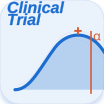
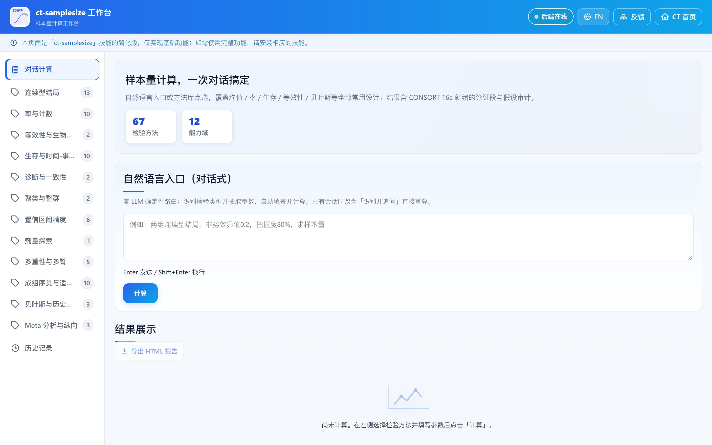

# 临床试验样本量专家（ct-samplesize）

- **English guide** → [README.md](https://github.com/medstatstar/ct-samplesize/blob/main/README.md) · **中文指南** → [README_zh-CN.md](https://github.com/medstatstar/ct-samplesize/blob/main/README_zh-CN.md)

  

> **不安装也能用：** 如果你不想安装，只想快速使用本技能的基础功能，也可直接访问ct系列技能的总入口网页 **https://ct.medstatstar.com** 使用。

  

> **面向临床试验从业者的易用型样本量与检验效能计算工具**
>
> 你不需要会编程，也不用手敲命令——只要在对话里用**日常语言描述你的试验设计**，就能完成 **65 种**专业的样本量与检验效能计算。计算由**云端计算服务**完成（rpact / TrialSize / PowerTOST 等 20+ 统计包），本机**无需安装 R**。结果默认按操作系统语言设定给出中文或英文（可用提示词强制切换）。技能默认展示**安全预览**——即它将发送的精确请求内容，在你确认前不会真正发出；可复现脚本可按需返回。

---

## 适用人群

`ct-*` 临床试验技能家族专用于解决临床试验全生命周期的各类需求，ct-samplesize 主要面向需要**可辩护的样本量 / 检验效能结果**（覆盖 **65 种**设计）的三类人群：

- **各制药企业的临床试验从业者** —— 申办方、CRO，以及医学 / 统计 / 注册等角色：为方案、SAP 或可行性评估快速算得可审计的 n / 效能。
- **在医疗机构中设计、管理临床试验项目，或参与临床试验研究实务的医护人员**：起草方案或可行性评估时估算样本量。
- **希望系统学习临床试验知识的医学专业学生**：探索组序贯、自适应、贝叶斯、非劣效等设计族。

---

## 一、如何在对话里使用（最核心）

ct-samplesize 是一个**对话式技能**：你直接用自然语言把试验设计告诉助手即可，无需记忆任何命令或参数名。技能作为 WorkBuddy 技能自动加载，无需额外安装。

每个示例都遵循同一三段式：**你这样说**（可直接照抄的一句话）→ **助手会这样回（示意）**（数字、把握度曲线、假设条件）→ **🖥️ 工作台**（在网页工作台里完成同一件事的分步操作）。

最短的一次完整闭环：

**你这样说：**
> 帮我算两组均数比较的样本量，效应量 d=0.5，把握度 80%，双侧 α=0.05

**助手会这样回（示意）：**
> 两独立样本 t 检验（双侧）。每组约 **64 例**（共 128 例）；若预计 10% 脱落，按每组 **71 例** 准备。结果附带「样本量-把握度」曲线，并可按需取回可复现脚本。

**🖥️ 工作台：** 打开工作台 → 选 **ct-samplesize** → 首页用**自然语言输入框**写同一句话 → 点 **计算**。结果卡给出每组 n / 总样本量、把握度-n 曲线，并带 **导出 HTML 报告** 按钮。想走表单也行：左侧选 *连续型结局 → 两组均数*，填参数后点 **计算**，出的是同一组数字。

三个完整代表案例（连续 / 二分类 / 生存）见 **第三节**；全部 65 种检验及可照抄提示语见 **第二节**。

---

## 二、你能算什么 — 65 种检验场景索引

按**终点 / 方法类型**分 7 大类。下表给出每类典型的「临床场景」和一句你可以**直接照抄**的「试试这样说」。同一检验也可从「设计族」交叉进入（组序贯、自适应、等效 / 非劣、贝叶斯、剂量递增、MAMS、历史对照、疫苗、胜率统计等）——对话里说「**列出全部 65 种检验**」即可展开完整能力菜单。

> 计算由内置的云端计算服务完成（rpact / TrialSize / PowerTOST 等 20 余个统计包），本机无需安装 R。普通使用者无需关心。

### ① 连续型终点
| 类型 | 临床场景 | 试试在对话里这样说 |
|:---|:---|:---|
| `ttest_ind` | 两均数比较（平行） | "两组均数比较，d=0.5，power 0.8" |
| `ttest_paired` | 配对 t / 2×2 交叉 | "配对设计样本量，效应量 0.5" |
| `ttest_one` | 单样本 vs 已知均值 | "单样本检验，和已知均值差 0.5" |
| `anova` | 多组比较（k 组） | "3 组 ANOVA，效应量 f=0.25" |
| `equivalence` | 等效性（均数） | "均数等效性，margin=2，效应量 1" |
| `mixed_model` | 重复测量 / 纵向（给定 n 求效能） | "重复测量设计效能，n=100，效应量 0.5" |

### ② 二分类终点
| 类型 | 临床场景 | 试试在对话里这样说 |
|:---|:---|:---|
| `proportion_two` | 两组率（卡方） | "对照组 20% 试验组 35%，两组率比较" |
| `proportion_one` | 单组率 | "单组率检验，预期 30%" |
| `proportion_paired` | 配对率（McNemar） | "配对率比较 McNemar，p1=0.7 p2=0.5" |
| `odds_ratio` | 比值比 | "OR=2 的样本量，对照率 50%" |
| `risk_ratio` | 风险比 | "RR=1.5 的样本量，对照率 50%" |
| `non_inferiority` | 非劣（率） | "非劣效，margin=0.1，对照 85% 试验 80%" |
| `superiority_margin` | 优效（界值） | "优效性检验，界值 0.05" |
| `be_tost` | 生物等效（TOST） | "BE 样本量，theta0=0.95，CV=25%" |
| `vaccine_efficacy` | 疫苗效力 | "疫苗效力，对照 VE=0.02 试验 0.005" |
| `gsd_proportion` | 组序贯两比例 | "组序贯两比例，1 次期中，p1=0.7 p2=0.5" |

### ③ 计数·率终点
| 类型 | 临床场景 | 试试在对话里这样说 |
|:---|:---|:---|
| `poisson` | Poisson 率 | "两组发生率比较，λ1=0.05 λ2=0.03" |
| `recurrent_events` | 复发事件（Andersen-Gill） | "复发事件样本量，对照率 1.0" |
| `gsd_poisson` | 组序贯 Poisson 率 | "组序贯 Poisson 率" |

### ④ 生存·时间-事件终点
| 类型 | 临床场景 | 试试在对话里这样说 |
|:---|:---|:---|
| `survival` | 生存（简化 logrank） | "生存分析，HR=0.75，power 0.85" |
| `survival_exact` | 生存（精确） | "精确生存样本量，HR=0.75，入组 12 月" |
| `ni_survival` | 非劣生存 | "非劣生存，HR margin=1.25" |
| `survival_equivalence` | 生存等效（TOST / log-HR） | "生存等效，margin=1.25" |
| `survival_superiority` | 生存优效 + 界值 | "生存优效，界值 0.8" |
| `cox_covariate` | Cox 回归（含协变量 R²） | "Cox 回归样本量，HR=2，R²=0.3" |
| `survival_one_sample` | 单组指数生存 | "单组生存，中位 12 vs 18" |
| `competing_risks` | 竞争风险（累积发生率） | "竞争风险样本量，CIF 0.2 vs 0.1" |
| `survival_historical` | 历史对照 logrank | "历史对照生存，历史中位 12 新 18" |
| `gsd_survival` | 组序贯 logrank | "组序贯生存，1 次期中，HR=0.7" |
| `gsd_hazard` | 组序贯风险比（HR） | "组序贯 HR，HR=0.7" |
| `gsd_survival_sim` | 组序贯 logrank — 蒙特卡洛模拟 | "组序贯生存模拟，2 次期中" |
| `gsd_hazard_sim` | 组序贯 HR — 蒙特卡洛模拟 | "组序贯 HR 模拟" |

### ⑤ 诊断·方法比较
| 类型 | 临床场景 | 试试在对话里这样说 |
|:---|:---|:---|
| `roc` | ROC 曲线 / 诊断试验 | "ROC 曲线样本量，AUC 0.5→0.75" |
| `bland_altman` | Bland-Altman 方法学比对 | "Bland-Altman 样本量，SDdiff=5，界值 2.5" |

### ⑥ 特殊·高级设计
| 类型 | 临床场景 | 试试在对话里这样说 |
|:---|:---|:---|
| `group_sequential` | 组序贯 / 期中分析 | "组序贯设计，2 次期中，Pocock" |
| `adaptive` | 适应性设计 | "适应性设计，2 阶段" |
| `adaptive_simulate` | 适应性设计 — 蒙特卡洛模拟 | "适应性设计蒙特卡洛模拟" |
| `bayesian` | 贝叶斯设计 | "贝叶斯设计，对照 0.3 试验 0.15" |
| `dose_escalation` | 剂量递增（I 期） | "I 期剂量递增，5 个剂量，DLT 0.33" |
| `mams` | 多臂多阶段（MAMS） | "MAMS，3 臂 2 阶段" |
| `dunnett` | Dunnett 多重比较 | "Dunnett，3 组对照 50" |
| `win_ratio` | Win-Ratio 复合终点 | "Win-Ratio 样本量，WR=1.5" |
| `must_win` | Must-Win / 共主要终点 | "共主要终点 3 个，相关 0.5" |
| `historical_controls` | 历史对照借用 | "历史对照借用，历史应答 15/100" |
| `conditional_power` | 条件效能 / 样本量重估计 | "条件效能，中期效应 0.2" |
| `assurance` | 贝叶斯确信度 | "确信度计算" |
| `multiple_endpoints` | 多重 / 复合终点 | "多终点样本量，相关 0.5" |
| `mediation` | 中介效应样本量 | "中介效应样本量" |
| `cluster` | 整群随机设计 | "整群随机，ICC=0.05，每群 30" |

### ⑦ 相关 / 方差 / CI 精度 / 回归 / Meta 规划（v5.9–v5.10 新增）
| 类型 | 临床场景 | 试试在对话里这样说 |
|:---|:---|:---|
| `correlation` | 相关检验（H0:ρ=0，Fisher-z 精确） | "相关分析样本量，预期 r=0.3，power 0.8" |
| `variance_one` | 单样本方差（χ²） | "单样本方差检验，标准差是参考值的 1.5 倍" |
| `variance_two` | 两方差之比（F 检验） | "两方差比较，比值 2，power 0.8" |
| `cv_one` | 变异系数估计的相对误差精度 | "CV 估计，CV=0.2，相对误差 10%" |
| `ci_mean` | 均值置信区间精度（半宽→n） | "均值 95% 置信下控制在 ±2 内，SD 10，要多少例？" |
| `ci_prop` | 比例置信区间精度 | "比例 CI 半宽 0.1，预期 50%" |
| `ci_or` | 优势比置信区间精度 | "OR 的 CI 半宽 0.5，基线率 30%，OR=2" |
| `ci_rr` | 风险比置信区间精度 | "RR 的 CI 半宽 0.3，基线率 30%，RR=1.5" |
| `ci_cor` | 相关系数置信区间精度 | "相关系数 CI 半宽 0.1，预期 r=0.5" |
| `ci_icc` | 组内相关系数置信区间精度（信度） | "ICC 的 CI 半宽 0.15，ICC=0.3，2 名评价者" |
| `regression_linear` | 多重线性回归 R² 检验（Cohen's f²） | "线性回归 R² 检验，3 个预测变量，f²=0.15" |
| `regression_logistic` | 逻辑回归（Hsieh 1998/1989） | "逻辑回归，OR=1.5，基线率 50%，power 95%" |
| `regression_poisson` | 泊松回归（Signorini 1991） | "泊松回归，基线率 1，RR=1.3，φ=1" |
| `cluster_ext` | 整群随机化广义设计效应（不等群） | "整群试验，ICC 0.05，每群 20，群大小 CV 0.5" |
| `rates_ext` | 率扩展（过离散 / CI 精度） | "过离散率比，λ1=0.5 λ2=0.25，φ=2" |
| `meta_planning` | Meta 分析前瞻规划 | "Meta 规划，SMD 0.3，每研究 100 例，I²=0.3，power 0.8" |

---

## 三、使用案例大全 — 三个代表案例

三个真实走查，分别对应三种终点类型。每张卡都遵循 **你这样说 → 助手会这样回（示意） → 🖥️ 工作台**，下列数值均由引擎计算得出。

### 案例 1 · 连续型 · 两组均数
**你这样说：**
> 帮我算两组均数比较的样本量，效应量 d=0.5，把握度 80%，双侧 α=0.05

**助手会这样回（示意）：**
> 两独立样本 t 检验（双侧）。每组约 **64 例**（共 128 例）；若预计 10% 脱落，按每组 **71 例** 准备。结果附带「样本量-把握度」曲线，并可按需取回可复现脚本。

**🖥️ 工作台：** *连续型结局 → 两组均数* → 设 d=0.5、把握度=0.8、双侧 α=0.05 → 点 **计算**。

### 案例 2 · 二分类 · 两组率
**你这样说：**
> 比较两组有效率，对照组 20%、试验组 35%，卡方检验，把握度 80%，双侧 α=0.05

**助手会这样回（示意）：**
> 两组率比较（卡方，双侧）。每组约 **137 例**（共 274 例）。若你更想用优势比或风险比而非率差来表达效应，告诉我，我会换用对应的检验重算。

**🖥️ 工作台：** *率与计数 → 两组率* → p1=0.20、p2=0.35、把握度=0.8、双侧 α=0.05 → 点 **计算**。

### 案例 3 · 生存 · 时间-事件
**你这样说：**
> 生存试验，风险比 0.75，1:1 随机，事件率 0.7，入组 12 个月、随访 12 个月，把握度 85%，双侧 α=0.05

**助手会这样回（示意）：**
> 两样本 log-rank。需要 **434 个事件**；按你的入组/随访推算的期望事件比例（约 0.54），即每组约 **404 例**（共 808 例）。

**🖥️ 工作台：** *生存与时间-事件 → log-rank* → HR=0.75、事件率=0.7、入组=12、随访=12、把握度=0.85 → 点 **计算**。

---

## 四、首次使用常见问题（FAQ）

**Q：我只说了效应量和把握度，没给别的参数，能算吗？**
A：能。多数检验只需「效应量（或率 / HR）+ 把握度 + α」三要素。没说全的部分（如双侧 α=0.05、1:1 随机、随访时间）会用常规默认补全；若某项确实必需而缺失，助手会提示你补充。

**Q：结果里的 n 是每组还是总人数？**
A：默认报 **每组 n（per group）**；配对 / 交叉设计报序列数，生存类常报所需总事件数。输出里都会标注清楚，不用担心误解。

**Q：我想要可复现的 R 代码用于递交或核查，怎么要？**
A：说 **「把完整 R 代码给我」** 即可。代码默认也会以安全预览展示，可复制、修改后自行重跑。

**Q：中文环境下面输出是中文吗？**
A：是。默认跟随操作系统的语言设定给出中文或英文结果；你也可以用提示词（如"用中文回复"或"switch to English"）随时强制切换。

**Q：如果数据要保密怎么办？**
A：可以使用相同的设计框架，但是对原始数据均进行替换（如用模拟的占位数据跑通流程），要求技能输出完整 R 代码，然后自行在本地使用真实数据运行这段代码即可——技能本身只发送设计参数，从不接触你的原始数据。

**Q: 发现结果有误怎么办？怎么上报？**
A: 本技能遵循内置的错误报告流程。若您怀疑结果有误（或引擎报错），直接说 **"上报问题" / "report a bug" / "提交错误报告"**。技能在检测到疑似缺陷时（如引擎报错、重试仍失败）也会**主动询问**是否上报——**每会话最多 1 次**，您可随时拒绝。无论哪种方式，助手都会：
1. **生成一份脱敏报告**（技能名 / 版本 / 错误类型，以及由你决定披露的 `description` 字段，如所用算法、错误消息原文——**不含您的原始输入值或个人数据**）；
2. **展示报告全文供您检视**——可补充问题描述或更正任何内容后再确认；
3. **经您明确确认后发送**至统一错误报告服务；完全本地会话则改为保存脱敏报告文件并提示邮件联系作者（数据不出域）；
4. **收到回执**——包括您此前从同一来源提交的报告是否已被修复（含修复说明）或仍在处理中。

整个过程您完全可控：报告在**发送前**先展示给您，未经您明确说「发送」绝不传输任何内容。

---

**Q：能接着上一轮的计算改参数吗？**
A：能。上一轮会回显一张「当前分析设定」块，之后你只说改什么（如"把握度提到 90%，改单侧"），未提及的字段原样继承、改动字段明确覆盖，不会被悄悄修改；也可以说"用更保守的 SD 重做一遍"做敏感性假设重算。每轮改动都会明确列出。

## 4.5 公开文献效应量参考

设计阶段可以用**已发表的公开荟萃分析**来锚定假设，而不是凭感觉猜效应量。整个流程刻意保持"人在环中"：

- **生成候选**：从公开文献检索候选效应量，每条带尺度、点估计、95% CI、原文摘录与 PMID。你逐条核对原文后，对确认的条目明确说 **「采纳」** 才会写入基准库；候选**绝不自动入库**，尺度不明的条目会被直接拒绝。
- **使用基准**：说 **「先看参考清单」** 可只查看来源、不做替换；再明确采纳某个 CI 端点（如更保守的界）。来源会随结果打印，并写入可复现脚本的注释。
- **红线**：参考 ≠ 采纳——人群、终点、效应尺度的可比性需你自己复核；CI 跨越无效线的参考只能展示、不能采纳。

---

## 五、安全与声明

- **什么会离开你的机器——且只在你确认时：** 默认先给出**安全预览**（精确请求内容），不发送任何东西。说 **「请直接计算」** 才会把试验设计参数（检验类型、效应量、α、power、n 等）发往云端计算服务并取回数字与可选图形；说 **「仅预览」** 可先查看请求。绝不发送患者级数据、文件内容或可识别个人信息。
- **元数据披露：** 为生成双语输出与使用归因，每次请求还携带你的操作系统语言设置与技能版本，仅此而已。
- **错误报告（可选，仅在你确认时）：** 若检测到疑似缺陷（如引擎错误且重试后仍在），助手可能询问是否发送一份**脱敏**报告，含技能名/版本、错误类型，以及经你审阅确认的问题描述。未经你明确确认不会发送任何内容；你可随时拒绝；完全本地会话时改为生成本地报告文件。
- **仅云端：** 发布版技能没有本地计算兜底——云端计算服务不可达时会提示你检查网络。全部 65 种检验都在云端计算。
- **输出仅供参考**，用于监管申报前请独立验证。

---

## 六、进阶参考（独立文档）

命令行示例、双向求解、曲线模式、核心公式、系统要求、常见错误与开发者说明，已整理为随技能一起提供的**独立进阶参考文档**。普通使用者无需阅读；日常使用见第一至五节。

---

## 版本信息

- **当前版本**：ct-samplesize v5.15.0（2026-11-15）
- **版本历史**：[CHANGELOG.md](CHANGELOG.md)
- **v5.15.0**：更快、更干净的使用体验——一次提问产生的后台记录大幅减少，重复或无效的计算会在占用您时间之前被处理。原有用法不变。
- **License**: MIT ｜ **Authors**: medstatstar, phoe-zip
- 如有功能改进建议、Bug 报告或其他反馈，欢迎直接联系作者：medstatstar@gmail.com（张文彤 / Wintone Zhang）

---

## 保密声明

> CT 全系列技能由 20+ 个技能构成，按「输入是否涉密」分为 **A、B 两档**，完整覆盖新药临床试验全流程。
>
> - **A 档（输入非涉密）**：输入为普通数据，不涉及保密信息，可本地安装后运行或Web网页方式使用，A 档技能均在 GitHub 公开发布。
> - **B 档（输入涉密）**：输入含药企需严格保密的临床试验数据 / 方案 / CRF 等；B 档既能安装后本地处理（可保证数据不出域），也能使用Web网页方式免安装使用（数据会脱敏后再上传），但B档技能本身均不对外公开发布。若有定制 / 本地部署需求，欢迎与作者联系。

