<p align="center">
  
</p>

<h1 align="center">de-bloat 至簡 - ちょうど足りるだけのコード</h1>

<p align="center"><strong>バージョン 1.5.1</strong></p>

<p align="center">
  <em>書く前に探す。リポジトリにあるものは再利用する。今回必要なものだけを書き、今回触る箇所だけを変える。エラーは黙って握りつぶさず、はっきり表に出す。セキュリティの最低ラインは守るが、防御を何重にも積まない。このターンで実行した証拠がなければ「完了」とは言わない。</em>
</p>

<p align="center">
  <a href="https://github.com/ninetyhe-90/de-bloat/stargazers"></a>
  <a href="https://github.com/ninetyhe-90/de-bloat"></a>
  <br>
  
  
</p>

<p align="center">
  <a href="README.md">English</a> | <a href="README.zh-CN.md">中文</a> | <a href="README.ja.md">日本語</a>
</p>

> **現状：ルールと評価ケースは用意済みですが、「スキルあり / なし」の比較はまだ実行していません。** `evals/` には 8 件の行動ケースと 18 件のトリガー用クエリがあり、各テスト用プロジェクトの初期状態がケースの前提どおりであることは確認済みです。ただし、このスキルを読み込むとエージェントの振る舞いがどれだけ変わるかを示す測定結果は、まだ公開していません。検証済みの成果ではなく、明確に書かれたルール集として扱ってください。

> **姉妹プロジェクト：** [de-armor](https://github.com/ninetyhe-90/de-armor) は AI の*回答*から防御的な前置きを取り除きます。de-bloat は AI の*コード*から膨らみを取り除きます。

## 目次

- [これは何か](#これは何か)
- [使う場面](#使う場面)
- [インストール](#インストール)
- [ワークフロー](#ワークフロー)
- [再利用と抽象化](#再利用と抽象化)
- [公式スタイルガイド](#公式スタイルガイド)
- [例](#例)
- [評価](#評価)
- [ディレクトリ構成](#ディレクトリ構成)
- [適用範囲と限界](#適用範囲と限界)
- [変更履歴](#変更履歴)

---

## これは何か

AI が書くコードは、決まったパターンで膨らみます。隣のディレクトリに既にあるヘルパーをもう一度書く。コードをコピーして 2 行だけ変える。実装が 1 つしかないのにインターフェースを作る。`or {}` や `try/except: pass` で不正な値の出どころを隠す。誰も頼んでいない設定フラグを足す。小さな修正のついでにファイル全体を整形し直す。そして、誰も実行していないのに「これで動くはずです」と言う。

**de-bloat** は、コードを変更する前に短く順序立った手順を挟む、持ち運び可能な `SKILL.md` です。単体で完結しており、他のプロセス系・規律系スキルは不要です。

| 機能 | 内容 |
|---|---|
| **構成マップ** | 着手前に、ビルドファイル・レイヤー・共通コード・慣習・テストを 5 行以内でまとめる。各行にパスを根拠として付ける |
| **再利用を優先** | リポジトリ全体を検索し、そのまま再利用 / 少し手直しして再利用 / 本当にないときだけ新規作成（理由を添える）の 3 択で決める |
| **根拠のある抽象化** | 実際の呼び出し元が既にあるときだけ、抽出またはパラメータ化する。見た目が似ているだけのコードは統合しない |
| **最小限の実装** | YAGNI、黙ったフォールバックなし、ループよりバッチ、変更は必要な箇所だけ |
| **公式スタイル** | ファイルごとに C++・Go・Java・Python・Node.js の公式ガイドを読み込む。整形はプロジェクト設定を優先 |
| **根本原因からのバグ修正** | 再現し、発生源まで遡り、失敗するテストを先に書く。3 回直して駄目なら止めて相談する |
| **セキュリティの最低ライン** | 6 つの必須ルール。境界で一度だけ検証し、内側では防御を重ねない |
| **証拠ゲート** | 「完了」「修正済み」「テスト通過」と言うには、このターンの実行結果が必要 |

「コードを短く書け」というプロンプトではありません。コードが減るのは結果にすぎず、目的はリポジトリに馴染み、頼まれたことだけを正確に行うコードです。

---

## 使う場面

- コードを新しく書く、または変更するすべての作業：機能追加、エンドポイント追加、リファクタリング、バグ修正、スクリプト作成。
- 「シンプルに」「作り込みすぎないで」「既存のものを使って」「共通関数に切り出して」「公式スタイルで」と言われたとき。
- レビューで、重複したヘルパー、コピペの変種、何重もの try/catch、空のフォールバック、来なかった未来のための抽象化が見つかったとき。

小さな変更（1 ファイル・数行・新しい関数なし）は簡易版で進めます。構成マップは変更するファイルのディレクトリだけを見て、リポジトリ全体の広域探索は省きます。成功基準と検証は省きません。

---

## インストール

de-bloat はすべて Markdown です：`SKILL.md`、`references/`、`evals/`。ファイルを読み、コードを編集できるコーディングエージェントであれば、どれでも使えます。SDK もランタイムもベンダー API も設定ファイルも要りません。

```sh
git clone https://github.com/ninetyhe-90/de-bloat.git
```

あとは、お使いのエージェントが指示を受け取る方法に合わせて 1 つ選びます。

| エージェントが対応しているもの | 手順 |
|---|---|
| スキル用フォルダ（YAML フロントマター付きの `SKILL.md`） | `de-bloat/` フォルダごと、エージェントがスキルを読み込むフォルダにコピーする。いつ使うかは `description` フィールドでエージェントが判断する |
| プロジェクト単位またはグローバルのルールファイル | `SKILL.md` の本文をルールファイルに貼る。`references/` は隣に置くか、必要な言語のファイルだけ貼る |
| システムプロンプトやカスタム指示のみ | `SKILL.md` の本文をそこに貼る |
| どれもない | `SKILL.md` を会話の先頭に置く |

`SKILL.md` にはツール名ではなく動作だけを書いています：ディレクトリの一覧、テキスト検索、ファイル名検索、そして必要に応じて広い検索をサブエージェントに任せること。エージェント内蔵のツールでも、`ls`、`find`、`rg`、`grep` でも構いません。サブエージェントがない場合も、同じ検索を同じ範囲で直接行います。

更新はリポジトリを pull してフォルダをコピーし直すだけです。アンインストールはフォルダを削除するか、貼った内容を消します。

---

## ワークフロー

<p align="center">
  
</p>

1. **構成マップと目標**：構成マップを書き、影響する呼び出し元を読み、依頼を検証可能な成功基準に書き換える。重要な前提は回答に明記し、正しさに関わる点だけをユーザーに確認する。
2. **再利用を優先**：開いているファイルだけでなく、リポジトリ全体を検索する。候補ごとにパス、機能、手直しのコストを記録する。
3. **最小限の実装**：頼まれた部分だけを実装する。値の欠落が異常を意味するならエラーにする。diff の各行は依頼にさかのぼれること。
4. **セキュリティの最低ライン**：SQL のパラメータバインド、出力先に応じたエスケープ、権限と所有者の確認、SSRF の許可リスト、安全なデシリアライズ、秘密情報は環境変数から。境界で一度検証し、内部の契約は信頼する。
5. **検証**：主張を裏づけるコマンドを実行し、出力を最後まで読んでから報告する。実行できない場合は、何を検証できなかったかとその理由を書く。

`SKILL.md` の「危険信号」表は、よくある考え（「リポジトリにはたぶん似たものはない」「落ちないようにデフォルト値を入れておこう」「もう動くはず」）を、それが飛ばしているステップに対応づけています。

---

## 再利用と抽象化

<p align="center">
  
</p>

抽象化するかどうかは、今ある呼び出し元を根拠に決めます。将来を根拠にはしません。

| ステップ 1 で見つかったもの | 対応 |
|---|---|
| 同じ意味の実装が既に 1 つあり、今回 2 つ目を書こうとしている | 1 つの関数に抽出して最も近い共通モジュールに置き、既存の呼び出し元もそれを使うように変える |
| いくつかの値だけが違う類似コードが 2 か所以上ある | 1 つの関数にまとめる。パラメータは既に現れた違いだけを扱う |
| 既存の関数があと少しで使える | その関数をその場で手直しする |
| 実装も呼び出し元も 1 つだけ | インターフェース、基底クラス、ファクトリ、ストラテジーを作らない |
| 見た目は似ているが、別々の理由で変わるコード | 統合しない。統合すると 2 つの領域が結びついてしまう |
| 理由が「後で必要になるかも」 | 抽象化しない |

「同じ意味」かどうかの判断：一方が業務上の理由で変わるとき、もう一方も必ず変える必要があるか。「必ず」と言える場合だけが該当します。抽出するときは既存の呼び出し元の振る舞いを変えないこと。既存のテストをこのターンで通すか、テストがなければ先に 1 本追加します。

---

## 公式スタイルガイド

変更するファイルごとに言語を判定し、該当するリファレンスだけを読み込みます。

| 言語 | 公式の出典 | リファレンス |
|---|---|---|
| C++ | ISO C++ Core Guidelines | `references/lang/cpp.md` |
| Go | `gofmt`、Effective Go、Go Code Review Comments | `references/lang/go.md` |
| Java | Oracle Code Conventions、Javadoc ガイド | `references/lang/java.md` |
| Python | PEP 8、PEP 257、PEP 484 | `references/lang/python.md` |
| Node.js | Node.js 公式 API ドキュメントと Learn ガイド | `references/lang/nodejs.md` |

優先順位（高い順）：言語の必須ツール（`gofmt`）> プロジェクト独自のスタイル設定（`.clang-format`、Checkstyle、Ruff、ESLint、Prettier、`.editorconfig`）> 公式ガイド > プロジェクトが宣言している言語バージョン。スタイルは今回変更する行にだけ適用します。

C++ と Node.js には公式の整形規約がありません。各リファレンスにその旨を書き、整形はプロジェクト設定に任せています。各リファレンスの最後には実行すべきチェックコマンド（`gofmt -l`、`go vet`、`clang-tidy`、`javac -Xlint`、`py_compile`、`node --check`）を載せています。ツールがなければその旨を報告し、勝手にインストールはしません。

---

## 例

<p align="center">
  
</p>

これは評価ケース 1 の期待される振る舞いを描いた図で、**モデルの実際の出力を記録したものではありません**。テスト用プロジェクト `evals/files/reuse-node` には既に `src/utils/date.js:formatDate` があります。膨らんだ版は 2 つ目のフォーマッタを追加し、使われない引数、黙って空文字を返すデフォルト、握りつぶした例外、そして気づかれにくい挙動の変化（UTC ではなくローカル時刻）を持ち込んでいます。de-bloat の版は既存の関数を再利用する 2 行の diff で、実際に実行した出力を添えます。

---

## 評価

`evals/evals.json` には 8 件の行動ケースがあり、それぞれ客観的に判定できるアサーションを持ちます。

| # | ケース | 言語 | 確認すること |
|---|---|---|---|
| 1 | reuse-existing-date-helper | Node.js | 新しく書かず `formatDate` を再利用する |
| 2 | no-silent-default | Python | 設定キーが欠けたらエラー。host や port のデフォルト値を入れない |
| 3 | bugfix-root-cause | Go | 失敗するテストを先に書き、ループの境界で直す |
| 4 | surgical-change | Java | diff は 1 行だけ。既存の整形と使われていないコードには触れない |
| 5 | security-floor-without-over-defense | Node.js | SQL バインド、所有者確認、環境変数の認証情報、黙って 200 を返さない |
| 6 | official-style | C++ | RAII、値で返す、ファイルが開けなければ例外を投げる |
| 7 | extract-shared-logic | Python | 構成マップを示し、メール検証を `app/common/` に抽出する |
| 8 | keep-coincidental-duplication | Node.js | クーポンのルールだけを変え、SKU のルールは別のまま残す |

`evals/trigger_evals.json` には 18 件のトリガー用クエリがあります。発火すべきものが 9 件、紛らわしいが発火すべきでないものが 9 件（コードの説明、コミットメッセージの作成、リポジトリ構成の説明など）です。

実行方法：各ケースについて、テスト用プロジェクトのまっさらなコピーで「スキルあり」と「スキルなし（または旧バージョン）」を 1 回ずつ実行し、diff と回答をアサーションに照らして判定します。このリポジトリには実行スクリプトは含まれていません。

---

## ディレクトリ構成

```text
de-bloat/
├── SKILL.md                       # スキルの入口
├── README.md                      # 英語版 README
├── README.zh-CN.md                # 中国語版 README
├── README.ja.md                   # 日本語版 README
├── _meta.json                     # ローカル配布用メタデータ
├── docs/                          # README の図（SVG）
├── references/
│   ├── reuse-discovery.md         # 再利用の検索方針と判断基準
│   ├── over-defense-patterns.md   # 過剰防御のパターンと書き換え方
│   ├── security-floor.md          # セキュリティの最低ラインと信頼境界
│   └── lang/                      # cpp.md go.md java.md python.md nodejs.md
└── evals/
    ├── evals.json                 # アサーション付きの行動ケース 8 件
    ├── trigger_evals.json         # トリガー用クエリ 18 件
    └── files/                     # 最小のテスト用プロジェクト
```

---

## 適用範囲と限界

- これは指示の集まりであり、強制する仕組みではありません。エージェントが従わないこともあり、その頻度を測るために評価があります。
- 「スキルあり / なし」の比較はまだ実行しておらず、結果も公開していません。
- 整形については、意図的にプロジェクト設定を公式ガイドより優先しています。
- ユーザーの指示、ホスト側のルール、権限の制限を上書きしません。
- 各言語のリファレンスは要点をまとめたものです。全文は各リファレンスにリンクした公式の出典を参照してください。

---

## 変更履歴

- **1.5.1**：特定のエージェントに依存しない形に変更。`SKILL.md` と `references/` は、あるエージェントのツール名ではなく動作（一覧、テキスト検索、ファイル名検索、任意のサブエージェント）で書くようにした。インストール手順はスキル用フォルダ、ルールファイル、システムプロンプト、会話への直接追加の 4 通りに対応。ルールの変更なし。
- **1.5.0**：名称を `de-bloat` に変更（中国語名「至簡」は表示名として残す）。3 言語の README と SVG の図を追加。ルールの変更なし。
- **1.4.0**：ステップ 0 で、パスを根拠にした構成マップを出すようにした。2.3 節を新設し、既存の呼び出し元をもとに、抽出・パラメータ化・手直し・別のまま残す、のどれにするかを判断する。「抽出すべき」と「偶然の重複は統合しない」を扱う評価ケースを 2 件追加。
- **1.3.0**：オープンソースのスキル作成の知見に沿って再構成：トリガー条件だけを書く description、検証可能な成功基準、必要な箇所だけの変更、根本原因からのバグ修正、「完了」前の証拠ゲート、危険信号の表、テスト用プロジェクト付きの最初の評価ケース 6 件。
- **1.2.0**：C++・Go・Java・Python・Node.js の公式スタイルガイドとチェックコマンドを追加。
- **1.1.0**：基本ルール：再利用の調査、最小限の実装、セキュリティの最低ライン、納品前チェックリスト。
