<p align="center">
  
</p>

<h1 align="center">de-bloat - just enough code</h1>

<p align="center"><strong>Version 1.5.1</strong> &nbsp;/&nbsp; Chinese name: 至简 (coding zhijian)</p>

<p align="center">
  <em>Look before you write: reuse what the repo already has. Write only what this task needs, change only what it touches, fail loudly instead of hiding errors, keep the security floor without stacking defenses, and never say "done" without fresh evidence.</em>
</p>

<p align="center">
  <a href="https://github.com/ninetyhe-90/de-bloat/stargazers"></a>
  <a href="https://github.com/ninetyhe-90/de-bloat"></a>
  <br>
  
  
</p>

<p align="center">
  <a href="README.md">English</a> | <a href="README.zh-CN.md">中文</a> | <a href="README.ja.md">日本語</a>
</p>

> **Status: rules and evals are written; the with/without comparison has not been run yet.** `evals/` defines 8 behavior cases and 18 trigger queries, and the fixtures are verified to start in the state each case assumes. There is no published measurement yet showing how much an agent changes when this skill is loaded. Treat it as a well-specified rulebook, not a proven result.

> **Sibling project:** [de-armor](https://github.com/ninetyhe-90/de-armor) removes the defensive padding from AI *answers*. de-bloat removes the padding from AI *code*.

## Contents

- [What this is](#what-this-is)
- [When to use it](#when-to-use-it)
- [Install](#install)
- [How it works](#how-it-works)
- [Reuse and abstraction](#reuse-and-abstraction)
- [Official language styles](#official-language-styles)
- [Example](#example)
- [Evals](#evals)
- [Repository layout](#repository-layout)
- [Boundaries](#boundaries)
- [Changelog](#changelog)

---

## What this is

AI-written code tends to bloat in predictable ways: a new helper that already exists two folders away, a copy-pasted block with two lines changed, an interface with one implementation, `or {}` and `try/except: pass` that hide where a bad value came from, a config flag nobody asked for, a "small fix" that also reformats the whole file, and a confident "should work now" that nobody ran.

**de-bloat** is a portable `SKILL.md` that puts a short, ordered workflow in front of every code change. It is self-contained: no other process or discipline skill is required.

| You get | What it does |
|---|---|
| **Structure map** | Before coding, a 5-line map of build files, layers, shared code, conventions, and tests - every line backed by a path |
| **Reuse first** | Searches the whole repo and picks one of: reuse as-is, adapt slightly, or create new (with a reason) |
| **Abstraction on evidence** | Extracts or parameterizes only when real callers already exist; keeps coincidental duplication apart |
| **Lean build** | YAGNI, no silent defaults, batch over loops, surgical diffs |
| **Official styles** | Loads the official guide for C++, Go, Java, Python, or Node.js per file; project config still wins on formatting |
| **Root-cause bug fixing** | Reproduce, trace to the source, failing test first, stop after 3 failed attempts |
| **Security floor** | Six hard rules, validated at the boundary, without stacking defenses inside |
| **Evidence gate** | "Done", "fixed", and "tests pass" require output from this turn |

It is not a "write less code" prompt. Less code is a side effect; the goal is code that fits the repo and does exactly what was asked.

---

## When to use it

- Any task that creates or changes code: features, endpoints, refactors, bug fixes, scripts.
- The user says "keep it simple", "don't over-engineer", "reuse what we have", "extract a shared function", or "follow the official style".
- Review finds duplicated helpers, copy-paste variants, layered try/catch, empty fallbacks, or abstractions built for a future that never came.

Small edits (one file, a few lines, no new function) take the short path: the structure map covers only the touched directory and the repo-wide exploration is skipped. Success criteria and verification are never skipped.

---

## Install

de-bloat is plain Markdown: `SKILL.md`, `references/`, and `evals/`. It works with any coding agent that can read files and edit code. No SDK, no runtime, no vendor API, no config file.

```sh
git clone https://github.com/ninetyhe-90/de-bloat.git
```

Then pick the way that matches how your agent takes instructions:

| Your agent supports | Do this |
|---|---|
| A skills folder (`SKILL.md` with YAML frontmatter) | Copy the whole `de-bloat/` folder into the folder your agent loads skills from. The `description` field tells the agent when to use it. |
| Project or global rule files | Paste the body of `SKILL.md` into the rule file. Keep `references/` next to it, or paste the language files you need. |
| Only a system prompt or custom instructions | Paste the body of `SKILL.md` there. |
| None of the above | Put `SKILL.md` at the start of the conversation. |

`SKILL.md` names actions, not tools: list a directory, search text, search file names, and optionally hand a wide search to a sub-agent. Any agent's built-in tools, or plain `ls`, `find`, `rg`, and `grep`, are enough. Without sub-agents, the same searches run directly with the same scope.

To update, pull the repo and copy the folder again. To uninstall, delete the folder or remove the pasted text.

---

## How it works

<p align="center">
  
</p>

1. **Map and goal** - Write the structure map, read the affected callers, and turn the request into testable success criteria. State key assumptions; ask only when the answer changes correctness.
2. **Reuse first** - Search the whole repo, not just the open file. Record each candidate's path, capability, and adaptation cost.
3. **Lean build** - Implement only what was asked. Missing values that mean an error raise an error. Every diff line traces back to the request.
4. **Security floor** - Parameterized SQL, context-aware escaping, authorization and ownership checks, SSRF allowlists, safe deserialization, secrets from the environment. Validate once at the boundary; trust internal contracts.
5. **Verify** - Run the command that proves the claim, read the full output, then report. If it cannot be run, say what was not verified and why.

A red-flag table in `SKILL.md` maps common thoughts ("there's probably nothing like this in the repo", "I'll add a default so it doesn't crash", "should work now") back to the step they skip.

---

## Reuse and abstraction

<p align="center">
  
</p>

Abstraction is decided from the callers that exist today, never from the future.

| What step 1 found | Action |
|---|---|
| One existing implementation with the same meaning; this task would write a second | Extract one function into the nearest shared module and switch the old caller to it |
| Two or more variants that differ only in a few values | Merge into one function; parameters cover only the differences already seen |
| An existing function that almost fits | Adapt it in place |
| Only one implementation or one caller | Do not add an interface, base class, factory, or strategy |
| Code that looks alike but changes for different reasons | Keep separate; merging would couple two domains |
| The reason is "might need it later" | Do not abstract |

The test for "same meaning": if one copy changes for a business reason, must the other change too? Only "yes, always" counts. When extracting, the old caller's behavior must not change - its existing tests run this turn, or a test is added first.

---

## Official language styles

The skill detects the language of each changed file and loads only that reference.

| Language | Official source | Reference |
|---|---|---|
| C++ | ISO C++ Core Guidelines | `references/lang/cpp.md` |
| Go | `gofmt`, Effective Go, Go Code Review Comments | `references/lang/go.md` |
| Java | Oracle Code Conventions, Javadoc guide | `references/lang/java.md` |
| Python | PEP 8, PEP 257, PEP 484 | `references/lang/python.md` |
| Node.js | Node.js API docs and Learn guides | `references/lang/nodejs.md` |

Priority, high to low: mandatory language tools (`gofmt`) > the project's own style config (`.clang-format`, Checkstyle, Ruff, ESLint, Prettier, `.editorconfig`) > the official guide > the language version the project declares. Style applies only to the lines being changed.

C++ and Node.js have no official formatting standard; their references say so and defer formatting to the project. Each reference ends with the check commands to run (`gofmt -l`, `go vet`, `clang-tidy`, `javac -Xlint`, `py_compile`, `node --check`); missing tools are reported, not installed.

---

## Example

<p align="center">
  
</p>

This is a drawn illustration of the target behavior for eval 1, **not a recorded model output**. The fixture `evals/files/reuse-node` already has `src/utils/date.js:formatDate`. The bloated version adds a second formatter with an unused option, a silent empty-string default, a swallowed error, and a quiet behavior change (local time instead of UTC). The de-bloat version is a two-line diff that reuses the existing function and shows the output of an actual run.

---

## Evals

`evals/evals.json` holds 8 behavior cases, each with objectively checkable assertions:

| # | Case | Language | What it checks |
|---|---|---|---|
| 1 | reuse-existing-date-helper | Node.js | Reuses `formatDate` instead of writing a new one |
| 2 | no-silent-default | Python | Missing config keys raise, no default host or port |
| 3 | bugfix-root-cause | Go | Failing test first, fix at the loop bound |
| 4 | surgical-change | Java | One-line diff; untouched formatting and dead code |
| 5 | security-floor-without-over-defense | Node.js | Bound SQL, ownership check, env secrets, no silent 200 |
| 6 | official-style | C++ | RAII, return by value, throw when the file cannot open |
| 7 | extract-shared-logic | Python | Structure map, extract the email check into `app/common/` |
| 8 | keep-coincidental-duplication | Node.js | Change the coupon rule only; SKU rule stays separate |

`evals/trigger_evals.json` holds 18 description-trigger queries: 9 that should trigger and 9 near-misses that should not (explain code, write a commit message, describe the repo layout).

How to run them: for each case, run one agent with the skill and one without (or with the previous version) on a fresh copy of the fixture, then grade the assertions against the diff and the reply. This repo does not ship a runner.

---

## Repository layout

```text
de-bloat/
├── SKILL.md                       # Skill entry point
├── README.md                      # English README
├── README.zh-CN.md                # Chinese README
├── README.ja.md                   # Japanese README
├── _meta.json                     # Local distribution metadata
├── docs/                          # README images (SVG)
├── references/
│   ├── reuse-discovery.md         # Search strategy and reuse criteria
│   ├── over-defense-patterns.md   # Over-defense patterns and rewrites
│   ├── security-floor.md          # Security floor and trust boundaries
│   └── lang/                      # cpp.md go.md java.md python.md nodejs.md
└── evals/
    ├── evals.json                 # 8 behavior cases with assertions
    ├── trigger_evals.json         # 18 trigger queries
    └── files/                     # Minimal fixture projects
```

---

## Boundaries

- It is a set of instructions, not an enforcer. An agent can still ignore it; the evals exist to measure how often.
- The with/without comparison has not been run or published yet.
- Project style configuration overrides the official guides on formatting by design.
- It does not override the user's instructions, the host's rules, or permission limits.
- The language references are condensed summaries; each one links its official source for the full text.

---

## Changelog

- **1.5.1** - Agent-agnostic: `SKILL.md` and `references/` describe actions (list, text search, file-name search, optional sub-agent) instead of one agent's tool names; install covers skills folders, rule files, system prompts, and plain conversation. No rule changes.
- **1.5.0** - Renamed to `de-bloat` (Chinese name 至简 kept as the display name). Added trilingual README and SVG diagrams. No rule changes.
- **1.4.0** - Step 0 now produces a path-backed structure map. New section 2.3 decides when to extract, parameterize, adapt, or keep code separate, based on existing callers. Two new evals cover "extract" and "do not merge coincidental duplication".
- **1.3.0** - Rebuilt against open-source skill practice: trigger-only description, testable success criteria, surgical changes, root-cause bug fixing, an evidence gate before "done", a red-flag table, and the first 6 evals with fixtures.
- **1.2.0** - Official language styles for C++, Go, Java, Python, and Node.js, with check commands.
- **1.1.0** - Baseline rules: reuse discovery, lean implementation, security floor, delivery checklist.
