<p align="center">
  
</p>

<h1 align="center">de-bloat 至简 - 刚好够用的代码</h1>

<p align="center"><strong>版本 1.5.1</strong></p>

<p align="center">
  <em>先找再写，项目里有的就复用；只写这次需要的，只改这次该改的；出错就让它显式报出来，不静默兜底；守住安全底线，但不层层堆防御；没有本轮的运行证据，就不说「完成」。</em>
</p>

<p align="center">
  <a href="https://github.com/ninetyhe-90/de-bloat/stargazers"></a>
  <a href="https://github.com/ninetyhe-90/de-bloat"></a>
  <br>
  
  
</p>

<p align="center">
  <a href="README.md">English</a> | <a href="README.zh-CN.md">中文</a> | <a href="README.ja.md">日本語</a>
</p>

> **现状：规则和评估用例已经写好，「加载 / 不加载」的对比还没跑。** `evals/` 里有 8 个行为用例和 18 条触发测试，测试项目的初始状态已确认与用例设定一致。但目前还没有公开的测量数据，证明加载这个 skill 后 AI 的写码行为会改变多少。请把它当作一套写清楚了的规则，而不是已经验证过的效果。

> **姊妹项目：** [de-armor 破甲](https://github.com/ninetyhe-90/de-armor) 去掉 AI *回答*里的防御性套话，de-bloat 去掉 AI *代码*里的膨胀。

## 目录

- [这是什么](#这是什么)
- [什么时候用](#什么时候用)
- [安装](#安装)
- [工作流程](#工作流程)
- [复用与抽象](#复用与抽象)
- [官方语言规范](#官方语言规范)
- [示例](#示例)
- [评估](#评估)
- [目录结构](#目录结构)
- [边界](#边界)
- [更新日志](#更新日志)

---

## 这是什么

AI 写的代码，膨胀的方式很固定：隔壁目录明明有现成的工具函数，又新写一个；复制一段代码改两行；只有一个实现也要先建接口；用 `or {}`、`try/except: pass` 把坏值的来源藏起来；加一个没人要的配置开关；修一个小 bug 顺手把整个文件重新格式化；最后一句「现在应该能跑了」，其实谁也没跑过。

**de-bloat** 是一个可移植的 `SKILL.md`，在每次改代码前加上一条简短、有顺序的流程。它是自包含的，不依赖其他流程类或纪律类 skill。

| 能力 | 做什么 |
|---|---|
| **结构速览** | 动手前先给 5 行以内的结构图：构建文件、分层、公共代码、惯例、测试。每一行都附路径作证据 |
| **先找复用** | 全局搜索，三选一：直接复用 / 小改造复用 / 确实没有才新建（新建要说明理由） |
| **有依据才抽象** | 只有已经存在真实调用方时才提取或参数化；长得像但含义不同的代码不合并 |
| **节俭实现** | YAGNI、不静默兜底、批量优先、精准修改 |
| **官方规范** | 按文件语言加载 C++、Go、Java、Python、Node.js 的官方规范；排版仍以项目配置为准 |
| **按根因修 bug** | 先复现，追到源头；先写失败的测试；试了 3 种修法都不行就停下讨论 |
| **安全底线** | 六条硬规则，在边界校验一次，边界内不重复堆防御 |
| **证据门禁** | 说「完成」「已修复」「测试通过」，必须有本轮的运行输出 |

它不是「少写代码」的提示词。代码变少只是结果，目标是写出贴合项目、刚好完成需求的代码。

---

## 什么时候用

- 任何会产生或修改代码的任务：新功能、加接口、重构、修 bug、写脚本。
- 用户说「简单点」「别过度设计」「复用已有的」「抽一下公共方法」「按官方规范写」。
- 代码里出现重复的工具函数、复制粘贴的变体、层层 try/catch、空兜底，或者为了一个从没到来的未来而建的抽象。

小改动（单文件、几行、不新增函数）走简版：结构速览只看改动文件所在目录，跳过全仓库的广域探索。成功标准和交付验证不能省。

---

## 安装

de-bloat 全部是 Markdown：`SKILL.md`、`references/` 和 `evals/`。任何能读文件、能改代码的编码 agent 都能用。不需要 SDK、运行时、厂商 API 或配置文件。

```sh
git clone https://github.com/ninetyhe-90/de-bloat.git
```

然后按你的 agent 接收指令的方式选一种：

| 你的 agent 支持 | 做法 |
|---|---|
| skills 目录（带 YAML frontmatter 的 `SKILL.md`） | 把整个 `de-bloat/` 文件夹复制到 agent 加载 skill 的目录。agent 会根据 `description` 字段判断何时使用 |
| 项目级或全局规则文件 | 把 `SKILL.md` 的正文贴进规则文件。`references/` 放在旁边，或只贴需要的语言文件 |
| 只有系统提示词或自定义指令 | 把 `SKILL.md` 的正文贴进去 |
| 以上都没有 | 把 `SKILL.md` 放在对话最前面 |

`SKILL.md` 只描述动作，不绑定工具：列目录、搜文本、搜文件名，以及可选地把大范围搜索交给子代理。agent 自带的工具，或者直接用 `ls`、`find`、`rg`、`grep` 都可以。不支持子代理时，同样的搜索直接执行，范围不缩小。

更新：拉取仓库后重新复制文件夹。卸载：删除文件夹或删掉贴进去的内容。

---

## 工作流程

<p align="center">
  
</p>

1. **结构速览与目标**：给出结构图，读改动涉及的调用方，把需求改写成可验证的成功标准。在回复里写明关键假设；只有会影响正确性的问题才问用户。
2. **先找复用**：搜整个仓库，不只看打开的文件。每个候选记下路径、能力和改造成本。
3. **节俭实现**：只实现被要求的部分。缺失值代表异常就直接报错。diff 的每一行都能对应到需求。
4. **安全底线**：SQL 参数绑定、按输出上下文转义、权限与归属校验、SSRF 白名单、安全的反序列化、机密只从环境变量读。在边界校验一次，内部契约直接信任。
5. **交付验证**：运行能证明结论的命令，读完输出再下结论。跑不了就写明哪些没验证、为什么。

`SKILL.md` 里有一张红旗表，把常见念头（「项目里应该没有现成的」「加个默认值防止报错」「应该能跑了」）对应回它跳过的那一步。

---

## 复用与抽象

<p align="center">
  
</p>

要不要抽象，依据是现在已经存在的调用方，不是未来。

| 第 1 步搜到的情况 | 做法 |
|---|---|
| 已有一份语义相同的实现，这次要写第二份 | 提取成一个函数，放到最近的公共模块，原来的地方也改成调用它 |
| 已有 2 处以上只差几个值的相似代码 | 合并成一个函数，参数只覆盖已经出现过的差异 |
| 现成函数差一点就够用 | 在原函数上小改 |
| 只有一个实现或一个调用方 | 不建接口、基类、工厂、策略 |
| 长得像，但会因为不同的原因各自变化 | 不合并，合并会把两个领域绑在一起 |
| 理由是「以后可能用」 | 不抽象 |

怎么判断「语义相同」：一处因业务调整要改时，另一处是否一定得跟着改。只有「一定得改」才算。提取时原调用方的行为不能变：已有测试要在本轮跑通，没有测试就先补一条。

---

## 官方语言规范

按每个改动文件的语言，只加载对应的那份参考。

| 语言 | 官方来源 | 参考文件 |
|---|---|---|
| C++ | ISO C++ Core Guidelines | `references/lang/cpp.md` |
| Go | `gofmt`、Effective Go、Go Code Review Comments | `references/lang/go.md` |
| Java | Oracle Code Conventions、Javadoc 写作指南 | `references/lang/java.md` |
| Python | PEP 8、PEP 257、PEP 484 | `references/lang/python.md` |
| Node.js | Node.js 官方 API 文档与 Learn 指南 | `references/lang/nodejs.md` |

优先级从高到低：语言强制工具（`gofmt`）> 项目自己的规范配置（`.clang-format`、Checkstyle、Ruff、ESLint、Prettier、`.editorconfig`）> 官方规范 > 项目声明的语言版本。规范只作用于本次改动的代码。

C++ 和 Node.js 没有官方的排版标准，参考文件里写明了这一点，排版交给项目配置。每份参考最后都列了要跑的检查命令（`gofmt -l`、`go vet`、`clang-tidy`、`javac -Xlint`、`py_compile`、`node --check`）；工具没装就如实说明，不自动安装。

---

## 示例

<p align="center">
  
</p>

这是按评估用例 1 的期望行为画的示意图，**不是模型的真实输出记录**。测试项目 `evals/files/reuse-node` 里已经有 `src/utils/date.js:formatDate`。膨胀写法另写了一个格式化函数：带一个没用的参数、静默返回空字符串、吞掉异常，还悄悄把 UTC 改成了本地时间。de-bloat 写法是两行 diff，复用现有函数，并贴出实际运行的输出。

---

## 评估

`evals/evals.json` 有 8 个行为用例，每个都带可以客观判定的断言：

| # | 用例 | 语言 | 检查什么 |
|---|---|---|---|
| 1 | reuse-existing-date-helper | Node.js | 复用 `formatDate`，不新写 |
| 2 | no-silent-default | Python | 缺配置项直接报错，不填默认 host 和 port |
| 3 | bugfix-root-cause | Go | 先写失败的测试，在循环边界修 |
| 4 | surgical-change | Java | diff 只有一行；不动原有排版和死代码 |
| 5 | security-floor-without-over-defense | Node.js | SQL 绑定、归属校验、凭据来自环境变量、不静默返回 200 |
| 6 | official-style | C++ | RAII、按值返回、打不开文件就抛异常 |
| 7 | extract-shared-logic | Python | 给出结构图，把邮箱校验提取到 `app/common/` |
| 8 | keep-coincidental-duplication | Node.js | 只改优惠码规则，SKU 规则保持独立 |

`evals/trigger_evals.json` 有 18 条触发测试：9 条应该触发，9 条是容易混淆但不该触发的（解释代码、写 commit message、讲仓库结构）。

怎么跑：每个用例在测试项目的干净副本上各跑一次「加载 skill」和「不加载（或旧版本）」，再按 diff 和回复逐条判定断言。本仓库不附带运行脚本。

---

## 目录结构

```text
de-bloat/
├── SKILL.md                       # Skill 入口
├── README.md                      # 英文 README
├── README.zh-CN.md                # 中文 README
├── README.ja.md                   # 日文 README
├── _meta.json                     # 本地分发元数据
├── docs/                          # README 配图（SVG）
├── references/
│   ├── reuse-discovery.md         # 复用搜索策略与判定标准
│   ├── over-defense-patterns.md   # 过度防御模式与改写方式
│   ├── security-floor.md          # 安全底线与信任边界
│   └── lang/                      # cpp.md go.md java.md python.md nodejs.md
└── evals/
    ├── evals.json                 # 8 个带断言的行为用例
    ├── trigger_evals.json         # 18 条触发测试
    └── files/                     # 最小测试项目
```

---

## 边界

- 它是一组指令，不是强制机制。AI 仍可能不照做，评估就是用来测量不照做的频率的。
- 「加载 / 不加载」的对比还没跑，也没有公开结果。
- 排版上项目配置优先于官方规范，这是有意的设计。
- 不会覆盖用户指令、宿主规则或权限限制。
- 各语言参考是压缩后的要点，完整内容见每份参考里链接的官方原文。

---

## 更新日志

- **1.5.1**：与具体 agent 解耦：`SKILL.md` 和 `references/` 改为描述动作（列目录、搜文本、搜文件名、可选子代理），不再写某个 agent 的工具名；安装说明覆盖 skills 目录、规则文件、系统提示词和直接放进对话四种方式。规则无变化。
- **1.5.0**：改名为 `de-bloat`，中文名「至简」保留为显示名。新增三语 README 和 SVG 配图。规则无变化。
- **1.4.0**：第 0 步要求给出带路径证据的结构图。新增 2.3 节，按现有调用方判定提取、参数化、小改造还是保持独立。新增两个评估用例，分别覆盖「该提取」和「偶然重复不合并」。
- **1.3.0**：参照开源 skill 实践重写：description 只写触发条件、可验证的成功标准、精准修改、按根因修 bug、完成前的证据门禁、红旗表，以及首批 6 个带测试项目的评估用例。
- **1.2.0**：新增 C++、Go、Java、Python、Node.js 的官方语言规范及检查命令。
- **1.1.0**：基线规则：复用发现、节俭实现、安全底线、交付清单。
