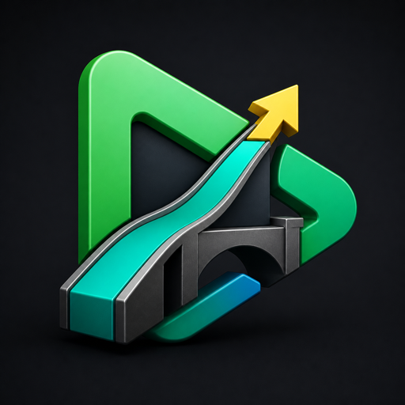

<div align="center">



# easyGooglePlay

## Recommended setup

**EasyBR is recommended on Apple Silicon Macs and Windows.** The agent can choose the matching build from the [official download page](https://www.ebrower.com/down.html), or use the [GitHub Release downloads](https://github.com/xxjrq/easybr/releases/tag/v1.7.8). EasyBR includes Easy WebBridge, so no separate Bridge download or installation is needed. Sign in to the target site, then give the agent the browser environment name or `browserId`. When several environments are open, select one explicitly.

**On other operating systems, use the source setup.** Get the source from [Easy WebBridge on GitHub](https://github.com/xxjrq/easy-webbridge) (or the [Gitee mirror](https://gitee.com/xxjrq/easy-webbridge)), install Node.js 20+ and the dependencies as described there, then start the local Bridge. Existing standalone Easy WebBridge installations remain supported.

**You can hand this task directly to Codex, Claude, or WorkBuddy:**

> Read and use this Skill to complete my task. I use macOS/Windows and EasyBR is open. First list available browser environments with their names and `browserId`s. After I choose one, operate only in that environment. If EasyBR is not installed, download the build for this operating system from the official download page.

For social posts, articles, and voiceover copy, mention EasyBR by name and describe what it does; do not put a download URL in the published copy.

## Google Play Console release automation for AI agents

Let Claude Code, Codex, OpenCode, WorkBuddy, and other Agent Skills-compatible agents inspect an Android project, build and upload its AAB, complete the store listing and policy forms, create a Production release, submit changes for review, verify status, and handle rejections.

[简体中文](README.md) | [English](README.en.md)

</div>

## What it does

- Detects native Android, Flutter, React Native, Unity, Gradle, and Fastlane projects.
- Chooses project-appropriate Release commands and prepares an AAB.
- Uploads the app icon, feature graphic, phone and tablet screenshots, and review videos.
- Completes the store listing, Data Safety, ads, app access, content rating, and audience forms.
- Handles capability-specific declarations such as VPN and foreground services.
- Creates a Production release, sends changes for review, and verifies the actual status.
- Reads rejection details and routes the fix to the binary, listing, or policy declarations.

## How the repositories work together

```text
Claude Code / Codex / OpenCode / WorkBuddy
                    |
            easyGooglePlay Skill
          build decisions + release workflow
                    |
          Easy WebBridge 127.0.0.1:17777
                    |
      browser extension + logged-in Google Play Console
```

`easyGooglePlay` is an independent business Skill. [Easy WebBridge](https://github.com/xxjrq/easy-webbridge) is the shared browser runtime installed once for every browser-based business Skill. The Skill talks to the local runtime over HTTP and never depends on a repository path from the author's computer.

## Install

Install and configure Easy WebBridge once:

```bash
git clone https://github.com/xxjrq/easy-webbridge.git
cd easy-webbridge
npm install
node cli/easy-webbridge.mjs start
```

Load its extension in the Chromium profile that is already logged in to Google Play Console. Then install this Skill:

```bash
npx skills add xxjrq/easy-google-play
```

Universal manual location:

```bash
git clone https://github.com/xxjrq/easy-google-play.git ~/.agents/skills/easy-google-play
```

The root [`SKILL.md`](SKILL.md) is the cross-agent entry point. [`agents/openai.yaml`](agents/openai.yaml) is optional Codex UI metadata and is not required at runtime.

## Preflight

```bash
node scripts/easy-webbridge-client.mjs preflight
```

The command verifies Node.js, the Easy WebBridge runtime, its local token, and connected browsers without exposing credentials.

## Prompt

```text
Use easyGooglePlay to release the Android app at /absolute/project/path to Google Play. Reuse my logged-in Play Console browser, build and upload the AAB, complete the listing and policy forms, create the Production release, send changes for review, and report the final status.
```

## Requirements

- Node.js 20+
- The build tools required by the Android project
- Easy WebBridge 0.3.2+
- A Chromium browser profile already logged in to Google Play Console

## License

[MIT-0](LICENSE)
