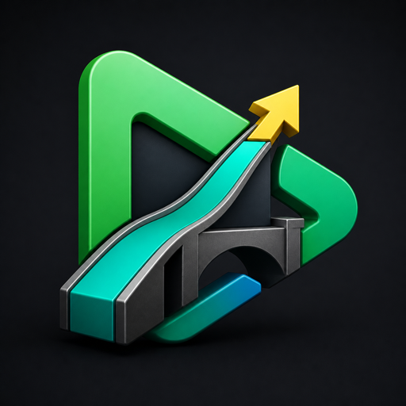

<div align="center">



# easyGooglePlay

## 推荐使用方式

**macOS（仅 Apple 芯片）和 Windows 推荐 EasyBR。** AI 可从官方[客户端下载页](https://www.ebrower.com/down.html)按系统选择版本；也可用 [GitHub Release 下载页](https://github.com/xxjrq/easybr/releases/tag/v1.7.8)作为下载渠道。打开浏览器后，EasyBR 已内置 Easy WebBridge，无需另行下载或安装 Bridge 服务。先登录目标网站，再把要操作的浏览器环境名称或 `browserId` 告诉 AI；有多个环境时必须指定一个目标。

**其他操作系统使用源码方式。** 从 [Easy WebBridge GitHub](https://github.com/xxjrq/easy-webbridge) 获取源码（[Gitee 镜像](https://gitee.com/xxjrq/easy-webbridge)），按项目说明安装 Node.js 20+ 和依赖后运行本地 Bridge。已有独立 Easy WebBridge 的用户仍可继续使用。

**可以直接把任务交给 Codex、Claude 或 WorkBuddy：**

> 请读取并使用这个 Skill 完成我的任务。我使用的是 macOS/Windows，EasyBR 已打开。先检查可用的浏览器环境，向我展示名称和 `browserId`；选定后只在该环境中操作。若 EasyBR 尚未下载，请从官方客户端下载页获取与本机系统匹配的版本。

写自媒体文章、口播或社交平台文案时，只提 EasyBR 名称和用途，不在正文中直接贴下载网址。

## Google Play Console 自动上架 Agent Skill

让 Claude Code、Codex、OpenCode、WorkBuddy 等 AI Agent 读取 Android 项目，完成 AAB 构建、商店资料、政策表单、Production Release、审核提交和驳回处理。

[简体中文](README.md) | [English](README.en.md)

[](https://agentskills.io/)
[](https://github.com/xxjrq/easy-webbridge)
[](https://github.com/xxjrq/easy-google-play/stargazers)
[](https://skills.sh/xxjrq/easy-google-play)
[](LICENSE)

</div>

## 它能做什么

- 自动识别原生 Android、Flutter、React Native、Unity、Gradle 和 Fastlane 项目。
- 根据项目现状生成 Release 构建命令，得到并上传 AAB。
- 上传 App 图标、Feature Graphic、手机和平板截图及审核视频。
- 填写商店详情、Data Safety、广告、应用访问权限、内容分级和目标受众。
- 按应用能力处理 VPN、前台服务及其他政策声明。
- 创建 Production Release，发送更改审核，并检查真实发布状态。
- 读取驳回信息，判断应修改安装包、商店资料还是政策声明。

## 它与 Easy WebBridge 的关系

```text
Claude Code / Codex / OpenCode / WorkBuddy
                    |
            easyGooglePlay Skill
          项目构建 + 上架业务流程
                    |
          Easy WebBridge 127.0.0.1:17777
                    |
        浏览器扩展 + 已登录 Google Play Console
```

`easyGooglePlay` 是独立业务 Skill，`Easy WebBridge` 是所有浏览器业务 Skill 共用的运行时。业务 Skill 不引用你电脑上的仓库路径，而是通过本机 HTTP API 连接运行时，因此换一台电脑后仍有明确的安装和自检流程。

## 安装

### 1. 安装一次 Easy WebBridge

```bash
git clone https://github.com/xxjrq/easy-webbridge.git
cd easy-webbridge
npm install
node cli/easy-webbridge.mjs start
```

在已登录 Google Play Console 的 Chromium 浏览器中加载 Easy WebBridge 扩展。这个步骤只需为运行环境配置一次，后续其他 Easy WebBridge 业务 Skill 直接共用。

### 2. 安装 easyGooglePlay

跨 Agent 安装器：

```bash
npx skills add xxjrq/easy-google-play
```

通用手动安装位置：

```bash
git clone https://github.com/xxjrq/easy-google-play.git ~/.agents/skills/easy-google-play
```

仓库根目录的标准 [`SKILL.md`](SKILL.md) 是所有 Agent 的公共入口；[`agents/openai.yaml`](agents/openai.yaml) 只是 Codex 的可选展示信息，不参与核心运行。

## 运行自检

```bash
node scripts/easy-webbridge-client.mjs preflight
```

自检成功会列出在线浏览器的名称和 `browserId`；运行时、Token 或浏览器扩展未就绪时，会返回明确的下一步。

## 直接使用

```text
使用 easyGooglePlay，把 /项目绝对路径 的 Android App 上架到 Google Play。
复用已经登录的 Play Console 浏览器，完成 AAB 构建、商店资料、政策表单、Production Release 和发送审核，并告诉我最终状态。
```

也可以只做一个阶段：

```text
使用 easyGooglePlay 检查这个 Android 项目和 Play Console 当前版本，告诉我还缺哪些资料，先不要发送审核。
```

## 运行要求

- Node.js 20+
- 项目需要的 Android 构建工具
- Easy WebBridge 0.3.2+
- 一个已经登录 Google Play Console 的 Chromium 浏览器环境

## 开源协议

[MIT-0](LICENSE)
