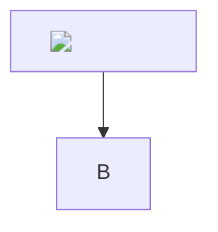
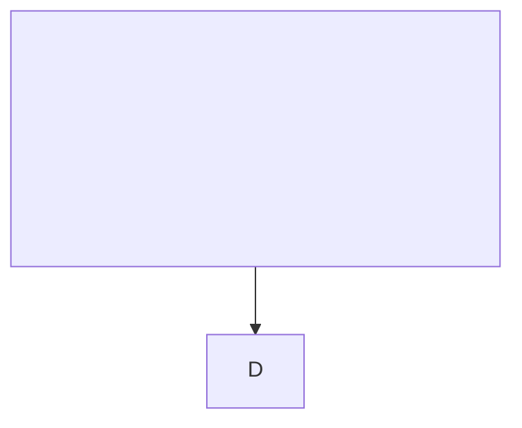

# XSS Content Canary 53050 (INERT-XSS-53050)

Authorized assessment canary. Every payload below only sets a local marker
(`window.__XSS53050`) or `document.title`; nothing is exfiltrated.


<script>window.__XSS53050=(window.__XSS53050||[]).concat('script');document.title='XSS-SCRIPT-53050'</script>

<svg onload="window.__XSS53050=(window.__XSS53050||[]).concat('svgonload');document.title='XSS-SVG-53050'"></svg>

<iframe src="javascript:window.__XSS53050=(window.__XSS53050||[]).concat('iframe');document.title='XSS-IFRAME-53050'"></iframe>

<object data="javascript:window.__XSS53050=(window.__XSS53050||[]).concat('object')"></object>

<a id="xssl-53050" href="javascript:window.__XSS53050=(window.__XSS53050||[]).concat('jslink');document.title='XSS-JSLINK-53050'">click-53050</a>

<details open ontoggle="window.__XSS53050=(window.__XSS53050||[]).concat('details');document.title='XSS-DETAILS-53050'">toggle-53050</details>

<picture><source srcset="javascript:window.__XSS53050=(window.__XSS53050||[]).concat('srcset')"></picture>

<meta http-equiv="refresh" content="0;url=javascript:document.title='XSS-META-53050'">

<math><mtext><table><mglyph><style></style></mglyph></table></mtext></math>





```mermaid
flowchart LR
  E[<iframe srcdoc="<script>window.__XSS53050=(window.__XSS53050||[]).concat('mermaid-iframe')</script>">] --> F
```

Marker: XSSCONTENT-53050-END
