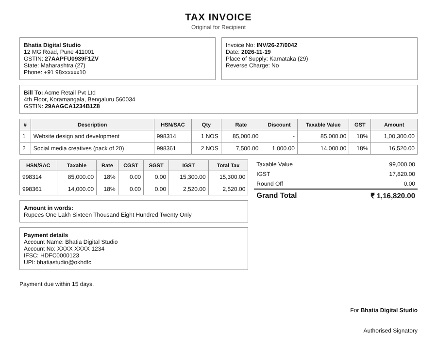

# india-gst 🇮🇳

An AI agent skill that handles **Indian GST** correctly — GSTIN checks, GST calculation, compliant invoices and compliance questions. Rules current to **November 2026** (GST 2.0: 5% / 18% / 40%).

Works with **OpenClaw, Claude Code, Codex, Cursor** and any agent that reads `SKILL.md`. Pure Python, no dependencies, works offline.



## What your agent can now do
- **Validate GSTINs offline** — catches typos via the check digit, tells you the state, PAN and entity type
- **Add or remove GST** with the right split: CGST + SGST, CGST + **UTGST** (Chandigarh, Ladakh…), or IGST
- **Create GST tax invoices** (Rule 46) as print-ready HTML → PDF: HSN-wise tax summary, amount in words in lakh/crore, round-off, bank & UPI details
- **Bill of Supply** for composition dealers and **LUT export / SEZ** invoices with the right declarations
- **Catch mistakes before you issue**: invalid invoice numbers, missing HSN, wrong HSN digits, missing buyer details on ₹50k+ B2C bills, outdated 12%/28% rates
- **Answer compliance questions**: registration threshold for your state, composition eligibility, e-invoice (₹5 crore) and 30-day IRN rule, e-way bill, monthly vs QRMP
- **Due dates** for GSTR-1, GSTR-3B, IFF, PMT-06, CMP-08

## Ask your agent things like
- "Is 27AAPFU0939F1ZV a valid GSTIN?"
- "Remove GST from ₹4,720 at 18%, I'm in Pune selling to Bengaluru"
- "Make an invoice for ₹85,000 website work to Acme Retail, Bengaluru"
- "My turnover is ₹60 lakh, do I need e-invoicing?"
- "When is my GSTR-3B due for December? I'm on QRMP in UP"

## Install
```bash
openclaw skills install india-gst          # OpenClaw
# or copy this folder into ~/.claude/skills/   # Claude Code
```

## Try it directly
```bash
python3 scripts/gst.py validate '{"gstin": "27AAPFU0939F1ZV"}'
python3 scripts/gst.py example > invoice.json
python3 scripts/gst.py invoice invoice.json --html invoice.html
python3 tests/test_gst.py      # 32 tests
```

## Limits
Does not decide the GST rate for a product (classification is yours — confirm on cbic-gst.gov.in), does not check if a GSTIN is active, and does not generate the official IRN for e-invoices. Not legal advice.
