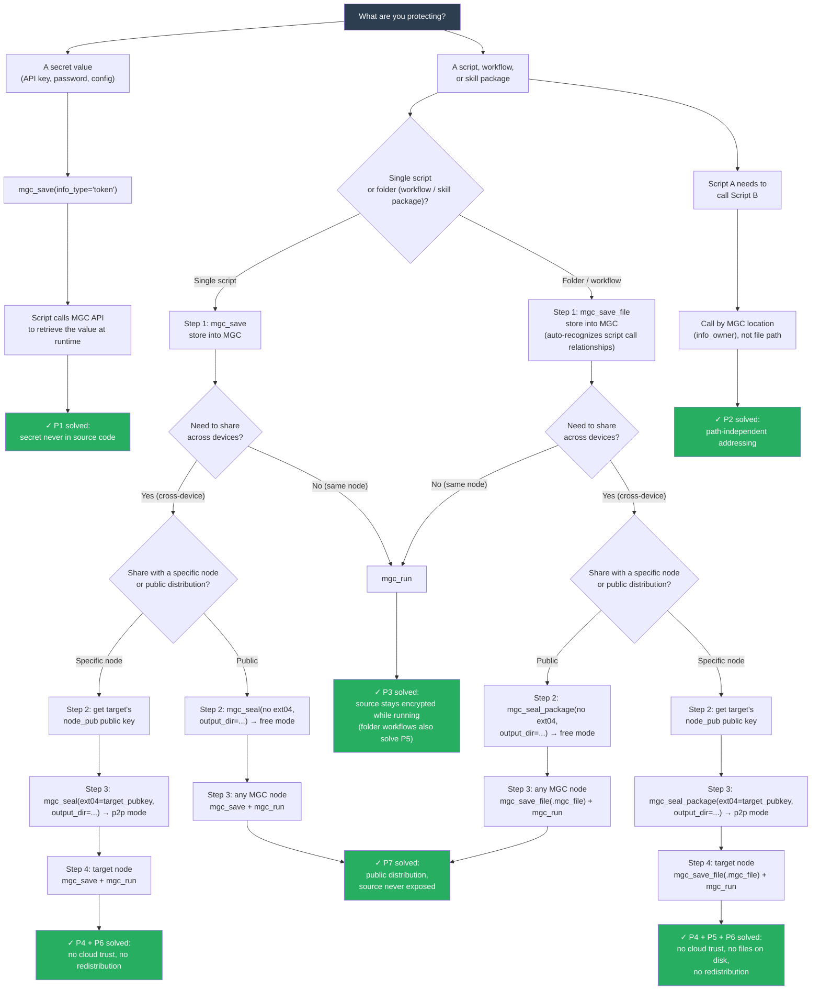

# 1. Overview — What MGC Blackbox Is

**MGC Blackbox is a Multi-Agent Cross-Node Privacy Execution Base.**

It is the encrypted execution layer *underneath* agent runtimes — not an agent itself. It lets agent runtimes, system scripts, and human users **store, execute, and delegate sensitive information, scripts, and entire workflows across trusted nodes without ever exposing plaintext.**

The core promise:

- **100% local, never touches the cloud.** All data, scripts, and encryption keys stay on your device. No third-party servers, no telemetry, no network calls outside localhost.
- **Store** sensitive data (tokens, passwords, configs) and scripts (logic, workflows, automation).
- **Execute** stored scripts with structured args and auto-detected dependencies. No rewrites, no path tricks, no plaintext on disk.
- **Seal and delegate across nodes** — seal a script or workflow package into a portable capsule and run it on another MGC node. No plaintext crosses the boundary. p2p mode binds the capsule to that node's key; free mode opens it to any 1.5.4+ node while keeping the source encrypted.
- **Source authorization** — every sealed artifact carries its source node's identity, so any modification makes it fail to unseal, in p2p and free mode alike. A p2p recipient holds no key of their own and cannot re-seal your source onward to a third party.
- **Auto-recognize workflows** — MGC automatically discovers scripts' args, dependencies, compatible OS, and cross-script workflow relationships. (MGC treats source code as the workflow.)
- **List** stored entries (metadata only, never plaintext).
- **Open WebUI** for human operations.

**Trust root.** MGC's trust root is your root key, set during first-time initialization and bound to the local device environment. It is not derived from any server, account, or third party. You can change the root key at any time, and you can migrate stored assets to another device — after migration, re-setting the root key keeps everything valid.

**Sealed source stays encrypted on disk: the executing node decrypts it in memory at run time, and the plaintext is never written out.**

---

# 2. Problem List & Solution Map

> Read this section first. It maps the real-world problems MGC solves to the exact tools and steps you need.

---

## 2.1 Problem List

| # | Problem | Root cause | MGC solution |
|---|---------|------------|--------------|
| P1 | Your API keys, database passwords, and tokens are written directly in script source. Anyone who can read the code — including an agent reviewing it — sees them. | Secrets and code live in the same file. | Store secrets in MGC. Scripts retrieve values at runtime by name — no plaintext in source. |
| P2 | Your script hardcodes an absolute path (`/home/alice/scripts/config.py`). Move to another machine or OS and it breaks. | Filesystem paths are not portable. | Address scripts by MGC location name. The same name resolves on any machine where MGC has the entry. |
| P3 | Your script source is fully visible to anyone who can open the file. Business logic can be read, copied, or modified. | No isolation layer between code and the executor. | Store scripts in MGC. The source stays encrypted while the script runs. |
| P4 | You want to authorize another machine to run your script. The conventional way requires a cloud trust broker (OAuth, license server) — costs money, adds latency, exposes your IP. | Trust root is external and centralized. | Local key exchange + sealing. No cloud, no third party. You only need the target machine's public key. |
| P5 | Your workflow has multiple scripts calling each other via `import` / `subprocess`. On another machine without the same file structure, these calls all break. | Python's import system is bound to the local filesystem. | MGC auto-discovers call relationships on save and routes them at runtime — no source files needed on the target machine. |
| P6 | You authorize a colleague to run your script. They copy it and hand it to someone else — who can also run it, without your knowledge or consent. | Execution right isn't bound to a specific machine identity — if you can run it, you can copy it. | Sealing binds the script to the recipient's device key. Only that device can decrypt and execute; the recipient cannot re-seal for someone else. |
| P7 | You want to publish a skill to a marketplace or community, but sharing plaintext means giving up source ownership, and authorizing each recipient one by one doesn't scale. | No way to separate "anyone can run" from "anyone can read" — execution rights had to be bound to specific devices. | Free mode — seal without specifying a recipient. Any MGC machine can execute, but the source never touches disk and cannot be read. Link authorization guarantees provenance — tampering with the source identity makes it unrestorable. |

---

## 2.2 Decision Flow

Follow the flow from top to bottom to find the exact tools and steps for your situation.



> **Note:** For the full list of runnable workflow patterns (and what is *not* supported), see section 2.4 below.

---

## 2.3 API Call Pattern — The One Code Example You Need

When a script needs to retrieve a secret or invoke another script from MGC, it goes through the REST API. This is the only place where getting the details wrong will break things — so here is the complete pattern.

```python
import os, requests

# 1. Read MGC access token (fixed path, do not change)
with open(os.path.expanduser("~/.mgc/database/mgc_black_box/.mgc_token")) as f:
    MGC_TOKEN = f.read().strip()

# --- Usage A: Retrieve a secret value ---
resp = requests.post(
    "http://127.0.0.1:57219/api/mgc/sensitive/get",
    headers={"X-MGC-Token": MGC_TOKEN},
    json={"info_type": "token", "info_owner": "openai_api_key"},
)
resp.raise_for_status()
api_key = resp.json()["data"]  # plaintext key, in memory only — never written to disk

# --- Usage B: Invoke another stored script ---
resp = requests.post(
    "http://127.0.0.1:57219/api/mgc/sensitive/get",
    headers={"X-MGC-Token": MGC_TOKEN},
    json={
        "info_type": "script",
        "info_owner": "send_email",        # the called script's MGC location
        "diff_1": "send_email",
        "action": "run",                   # ← this field triggers execution
        "ext02": '["--to", "alice@example.com"]',  # runtime args as JSON array string
    },
)
result = resp.json()  # {"pid": 12345, "status": "started"}
```

**Five things to get right:**

| # | Detail | Correct value |
|---|--------|---------------|
| 1 | Token file path | `~/.mgc/database/mgc_black_box/.mgc_token` |
| 2 | Header name | `X-MGC-Token` |
| 3 | URL | `http://127.0.0.1:57219/api/mgc/sensitive/get` |
| 4 | Trigger execution | Add `"action": "run"` to the JSON body |
| 5 | Response data | `resp.json()["data"]` for secrets; `resp.json()` for run results |

---

## 2.4 Workflow Runtime Compatibility

When you save a folder with `mgc_save_file`, MGC analyzes every script and routes cross-script calls through sealed execution at runtime — **no files on disk, no plaintext, no rewrites**.

| Pattern | Code example | Runs in MGC? |
|---------|-------------|--------------|
| `from` import | `from config import DEFAULT_CITY` | Yes |
| `from` import with alias | `from helpers.fetch import get_weather as gw` | Yes |
| Plain `import` | `import helpers.parse` | Yes |
| Relative path via `Path` | `Path(__file__).parent / "config.py"` | Yes |
| Subprocess with relative path | `subprocess.run([sys.executable, str(Path(__file__).parent / "config.py"), ...])` | Yes |
| Subprocess with literal list | `subprocess.run(['helper.py', '--x'])` | Yes |
| Subprocess with computed absolute path | `subprocess.run([sys.executable, str(Path(__file__).resolve().parent / "x.py"), ...])` | Yes — target filename must be unique within the package. |
| Cross-subdirectory references inside the same package | root-level script → `from helpers.fetch import ...`; `Path(__file__).resolve().parent.parent / "y.py"` | Yes |
| Dynamic import | `importlib.import_module(module_name)` | No — MGC only recognizes string literals. |
| Absolute path via `open()` | `open("/Users/alice/scripts/config.py")` | No — not portable. Use MGC location addressing. |
| Literal `..` relative path | `subprocess.run([..., "../y.py"])` | No — prefer the computed `Path(...)` form. |
| Function-level call without import | A function called only by reference (no `import` / `Path` referencing it) | No. |
| `open()` against sibling file | `open("config.json")` | Recognition only — the file must exist on disk on the target node. |
| Fatal path check | `if not Path(...).exists(): sys.exit(1)` (or `raise` / `assert`) | No — the script exits before MGC's interception can run. This is the **only** pattern that overrides an otherwise-runnable call form. |

**Scope & limits.** Cross-script calls work within the same folder package (`info_owner + diff_2` of caller and callee must be identical), including cross-subdirectory references inside that package. MGC also recognizes `subprocess.run([..., "<callable-name>.py", ...])` calls that pass the callee by literal filename across *different* saved folders, so long as that filename is unique across the stored folders; the caller must be re-saved after the callee's folder is stored so the dependency graph is rebuilt. To orchestrate scripts across different packages where the filename is ambiguous, fall back to the REST API pattern in section 2.3.

---

# 3. Installation & Runtime — How to Install and Run MGC

## 3.1 Requirements

- An MCP-compatible agent runtime (Claude Desktop, Cursor, Trae, etc.) for agent integration.
- A modern browser for WebUI access — also used for first-time setup (entering the **root key** that encrypts the local database) and for changing the root key later.

### Supported Python x OS matrix

| OS | Python 3.10 | Python 3.11 | Python 3.12 |
|---|---|---|---|
| Windows | Yes | Yes | Yes |
| Linux (Ubuntu) | Yes | Yes | Yes |
| macOS 14+ (Apple Silicon) | Yes | Yes | Not supported |

## 3.2 Install MGC Blackbox

```bash
pip install mgc-blackbox
```

Ensure installation happens in the same Python environment where your MCP agent runs.

> **First-run setup.** On first startup, MGC prompts you to set a personal key and weight parameter. Three options:
>
> | Mode | Who uses it | How |
> |------|------------|-----|
> | CLI — auto-generate | Agent / automated setup | MGC generates a strong random key. Zero human intervention. |
> | CLI — custom input | Developer who wants a known key | Enter your own key string at the prompt. |
> | WebUI | Human who wants a GUI | Open browser, enter key in the form. |
>
> **For agent-driven installations**: use CLI auto-generate.

> **Migration.** Copy `~/.mgc/database/mgc_black_box/mgc_black_box.db` to the new machine, install MGC, provide the same key on first startup. Auto-generated keys can be retrieved from `~/.mgc/secrets/personal_key.txt` on the source machine. Disable protection mode on the source machine before migrating.

## 3.3 Run MGC

```bash
mgc
```

Starts HTTP server at `http://127.0.0.1:57219`, initializes encrypted database on first run, generates access token at `~/.mgc/database/mgc_black_box/.mgc_token`. This token is required for all REST API calls.

## 3.4 Run MGC as an MCP server

```json
{
  "mcpServers": {
    "mgc-blackbox": {
      "command": "mgc",
      "args": ["--mcp"],
      "env": { "PYTHONIOENCODING": "utf-8" }
    }
  }
}
```

In MCP mode, MGC exposes the tools listed in section 6. The REST API remains available for system scripts.

> **Sandbox note.** Some sandbox agents run MCP in the system environment rather than inside the sandbox. Install MGC in the system environment, or call the FastAPI directly.

## 3.5 WebUI access

WebUI is available at `http://127.0.0.1:57218`. Use it for initialization, manual storage, metadata inspection, database audit, and logs.

---

# 4. The `ext_*` Protocol — Field Meanings

| Field | Role |
|-------|------|
| **ext01** | Startup command (e.g. `"python"`). Required for scripts at `mgc_save`; consumed by `mgc_run`. |
| **ext02** | Runtime args as a JSON array string, e.g. `'["--start", "2026-08-08"]'`. Auto-filled by the `argparse` parser on `mgc_save`; can be overridden per `mgc_run`. Passed to `subprocess.run()` verbatim. |
| **ext03** | Sealed AES key. Auto-populated by `mgc_seal` / `mgc_seal_package`; consumed by `mgc_run` for sealed scripts. Do **not** set this manually when importing a sealed capsule — pass the whole capsule file (see section 6). |
| **ext04** | Target node public key (PEM). Required for p2p mode sealing. Omit it to produce a free-mode package. |
| **ext05** | Third-party dependency list (JSON array, e.g. `["requests","yaml"]`). Auto-detected from script imports; caller-supplied values take priority. **MGC does NOT install dependencies** — displayed as runtime advisory only. |
| **ext06** | Compatible platform list (JSON array, e.g. `["windows","macos","linux"]`). Auto-detected from path patterns + platform condition branches; static inference only. |
| **ext07** | Source node public key (PEM). Auto-populated by `mgc_seal_package` for provenance. You do not set it manually. |
| **ext08** | Cross-script call graph. Auto-populated by `mgc_save_file` / `mgc_save` on folder save. Consumed at runtime to route cross-script calls through sealed execution. You do not set it manually. For runnable patterns, see section 2.4. |
| **ext09** | Sealed package mode. Auto-populated by `mgc_seal` / `mgc_seal_package`. See section 10. |
| **ext10** | MGC run compatibility flag. Auto-populated by `mgc_save` / `mgc_save_file` on script save. See section 2.4. |

---

# 5. MCP Tools & REST API — Quick Reference

> For full argument schemas, field types, and return shapes, see the MCP server's auto-generated schema (every MCP client surfaces it; agent runtimes read it directly).

## 5.1 REST API — System / Script Integration

**Base URL:** `http://127.0.0.1:57219`
**Header:** `X-MGC-Token: <token>` (token file: `~/.mgc/database/mgc_black_box/.mgc_token`)

| Endpoint | Body / params | Purpose |
|----------|---------------|---------|
| `POST /api/mgc/sensitive/save` | `info_type`, `info_owner`, `content`, `ext01`-`ext07`, `diff_1`-`diff_3` | Store an entry. `info_type="script"` → script body. `info_type="file"` → absolute path to a local **folder or single file** (MGC scans and auto-fills `ext01`/`ext02`/`ext05`/`ext06`; a single file's type is inferred from its extension). `info_type="file"` + `.mgc_file` path → import a sealed package. |
| `POST /api/mgc/sensitive/get` | `info_type`, `info_owner`, `diff_1`-`diff_3`, optional `action` | Retrieve / list / operate on an entry. |
| `POST /api/mgc/sensitive/get` | empty body | List all stored entries (metadata only). |
| `POST /api/mgc/sensitive/get` | `action="run"` + `info_type="script"` | Execute a stored script. Returns `pid + status`. |
| `POST /api/mgc/sensitive/get` | `action="package"` + `info_type="file"` | Export a stored folder as a plaintext archive. |
| `POST /api/mgc/sensitive/get` | `action="seal_package"` + `info_type="file"` + `ext04=<target PEM>` | Seal a folder package. Omit `ext04` for free mode. |

> **No interactive API docs** — MGC disables `/docs` and `/redoc` for security. For full shapes, see the MCP server schema or source in `mgc/presentation/web/router/`.

---

# 6. Trigger Rules — Which Tool Fits Which Need

| User intent | Reach for |
|-------------|-----------|
| "Save this token / password / script body / config string" | `mgc_save` |
| "Save this script file / config file on disk" | `mgc_save_file` (single file path) |
| "Save this whole skill / workflow folder" | `mgc_save_file` (folder path → `info_type="file"`) |
| "Import a sealed package from another node" | `mgc_save_file` (`.mgc_file` path) |
| "Run my script X" | `mgc_run` (preferred) |
| "What do I have stored?" | `mgc_list` |
| "Find entries matching X" (fuzzy) | `mgc_find` |
| "Delete this specific record / token / script" | `mgc_delete` (single record; must supply all 6 address fields) |
| "Seal this script for node B" | `mgc_seal` (with `ext04` = node B's PEM, plus `output_dir`) |
| "Seal this script / package for public distribution (any MGC node can run)" | `mgc_seal` / `mgc_seal_package` **without** `ext04` (free mode), plus `output_dir` |
| "Export this workflow folder" | `mgc_package` (plaintext archive; requires `output_dir`) |
| "Hand off this workflow to another MGC node" | `mgc_seal_package` (with `ext04` = target node's PEM, plus `output_dir`) |
| "Open the interface" | `mgc_open_webui` |
| "Read the value of entry X" | `mgc_get` |
| "Check whether this script can run inside MGC / why it shows unsupported" | Read the `mgc_run` badge shown next to the entry; reasons are surfaced in the detail view |

**Args & dependencies.** When you save a Python script, MGC auto-parses `argparse` and fills `ext02`; auto-detects imports and fills `ext05`. `ext02` must be a valid JSON array string. Override at runtime via MCP (`mgc_run(info_owner=..., ext02='["--start", "2026-12-25"]')`) or WebUI (Run with Args button). MGC does not install dependencies — install them manually before `mgc_run`.

**Run compatibility (`ext10`).** Every saved script is auto-checked for whether it can run inside MGC. The result is shown as a `mgc_run` badge (`supported` / `unsupported`) in the list and detail views. An `unsupported` badge means the script contains a fatal path check (e.g. `if not Path(...).exists(): sys.exit(1)`) that exits before MGC's interception can route the call. See section 2.4 for the runnable patterns and the only pattern that overrides them.

**Sealed capsule import.** `mgc_seal` writes a self-describing JSON capsule file to `<output_dir>/<info_owner>_<timestamp>/sealed_capsule.json` and returns its path. `output_dir` is **required** — there is no desktop fallback. To import a capsule on another node, use either path — neither requires forwarding any `ext` field:

| Path | How | `info_type` needed? |
|------|-----|--------------------|
| **A — hand over the file (preferred)** | `mgc_save_file(path='<capsule.json>', info_owner='<your owner>')` | No — inferred from the capsule. |
| **B — pass the JSON** | `mgc_save(content=<entire capsule JSON>, info_type='script', info_owner='<your owner>')` | Yes — `mgc_save` requires it even though the capsule repeats it. |

> **Before importing, decide whose record this becomes.** The capsule keeps the source node's `info_owner`. Storing it under the same `info_owner` on the target node **overwrites the source record**. To keep both, pass your own `info_owner`.

---

# 7. Security Model — How MGC Protects Data

- **All data is encrypted locally** (AES-256 at rest).
- **Sealed plaintext stays encrypted: the executing node decrypts it in memory at run time, and the plaintext is never written out.**
- **Seal is irreversible**: once sealed, the original owner can re-seal with a new key but cannot extract the script back.
- **Execution rights do not equal ownership**: a sealed node can execute but cannot transfer the capsule to a third node.
- **Content never leaves the device in plaintext.**
- **Script execution happens inside the encrypted boundary** — subprocess inherits the encrypted state.
- **Folder packages inherit single-script guarantees**: every file in a `.mgc_file` is encrypted; the receiving node learns only the file *structure* (paths, dependencies, platforms) before running.

**Scope of the guarantee.** MGC protects **content confidentiality**: data is encrypted at rest, and sealed source is decrypted only in memory, at execution time. Runtime behaviour belongs to the script's author — once a package is unsealed on a node, MGC cannot guarantee the trustworthiness of its author, and what the script does at run time is the author's responsibility. Before importing, verify the source node's public key against a trusted channel, and rely on link authorization (`ext07` / `ext09`) to detect any modification of the artifact.

---

# 8. Delete Policy

Delete is available via WebUI and the `mgc_delete` MCP tool. Deletions are permanent and audited.

---

# 9. Error Handling

| Status | Meaning | Recovery |
|--------|---------|-----------|
| `NOT_FOUND` | Entry not found | Use `mgc_list` or ask user |
| `MULTIPLE_MATCHES` | Partial match | Present filtered list to user, ask for refinement |
| `AMBIGUOUS_SCRIPT` | `mgc_run` matched several scripts under the given `info_owner` (+ `diff_2` / `diff_3`) because `diff_1` was not supplied | Run `mgc_find` with the same `info_owner` to list candidates, then re-call `mgc_run` with the exact `diff_1` / `diff_3`. Note `diff_1` is optional — folder-import scripts often store an empty `diff_1`. |
| `PROTECTED_RECORD` | Attempted to delete a node-credential record | Stop and notify user — these records are not user-managed |
| `FOLDER_DELETE_REQUIRES_USER_CONFIRMATION` | `mgc_delete` found ≥2 records under the same `(info_type, info_owner, diff_2)` triple | Show the user the candidate list, ask "Delete all N records?", re-call with `confirm_folder_delete="true"` only after user says yes. Never set that value on your own. |
| Connection failed | MGC not running | MCP auto-starts (or instruct user to run `mgc`) |
| Initialization required | First-time setup | Call `mgc_open_webui` |
| `args_not_recognized` | Script `argparse` parser couldn't identify default args | Verify script has `add_argument(..., default=<literal>)` |
| `dynamic_args_detected` | Script has computed defaults MGC cannot statically evaluate | Re-save with literal defaults, or supply `ext02` manually |
| `MISSING_REQUIRED_FIELDS` (ext04) | `mgc_seal` or `mgc_seal_package` called without target node public key in p2p mode | Call `mgc_get(NODE_PUB)` on the target node to retrieve its PEM, then pass as `ext04`. To seal for public distribution instead, omit `ext04` (free mode). |
| `DIFF2_MISMATCH` | Cross-script `from-import` referenced a script outside the caller's workflow package | Re-save both scripts together as one workflow package, or use the API-call pattern (section 2.3) for cross-package orchestration |
| `DEP_MISSING` | Required Python / Node dependency not installed on target | Install before `mgc_run`; MGC lists the missing deps from `ext05` in the error body |
| `PLATFORM_INCOMPAT` | `ext06` lists only incompatible OS for current host | Re-`mgc_save` on a host of a listed platform, or extend the workflow's platform branch |

---

# 10. Sealing Modes & Link Authorization

Sealed scripts and packages declare their mode in `ext09`. This is the foundation for MGC's evolution toward cross-node chain-encrypted collaboration: every sealed artifact carries its source identity, so downstream nodes can verify provenance without a central broker.

**Modes:**

- **`p2p mode`** (default): wrapped with the recipient's `node_pub` (PEM in `ext04`). Only the node holding the matching `node_priv` can unseal it.
- **`free mode`**: wrapped with MGC's shared `default_node_pub`. Any MGC node can unseal and run it. Useful for public distributions (skill marketplaces, demos). To produce a free-mode artifact, call `mgc_seal` / `mgc_seal_package` **without** `ext04`.
- **`chain mode`**: reserved for future multi-hop chains.
- **empty string**: legacy artifact without link authorization.

**Link authorization.** Applies to both single-script seals (`mgc_seal`) and package seals (`mgc_seal_package`) when `ext09` is non-empty. The source node's identity is embedded as `ext07`. Any modification to `ext07` or `ext09` after sealing — including whitespace changes — makes the artifact unrestorable. Enforced at unseal time on every node.

**Forwarding.** Pass `ext07` verbatim — do not edit it.

---

# 11. Coming Next

We are preparing **batch chain authorization** — trusted nodes join a private chain for automated cross-node collaboration, no central broker needed. 