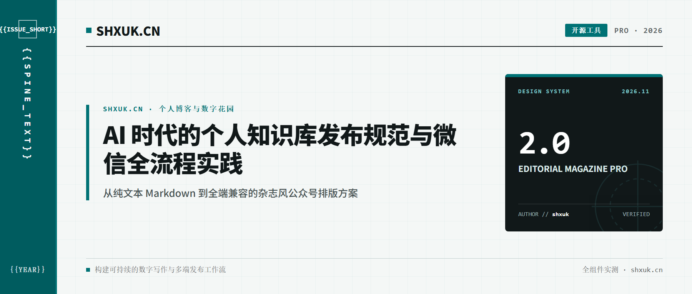

# mpress

[简体中文](./README.md) | English

`mpress` typesets Markdown into a WeChat Official Account (微信公众号) article and pushes it to the draft box — in about five seconds. It is both an **Agent Skill** and a **CLI**.

WeChat strips external CSS and JavaScript, so everything has to be inlined; pasting Markdown into the editor loses your layout, images need re-uploading one by one, and every fix after a typo creates a duplicate draft. `mpress` automates the whole pipeline while keeping your source Markdown **strictly read-only** — it never rewrites, retitles or re-paragraphs your text.

> Renamed from `wechat-article-publisher` in Nov 2026. Old URLs redirect.

<div align="center">
  
</div>

<div align="center">
  
</div>

---

## What it does

1. **Editorial components**: kicker header bars (`::: kicker`), bold lead takeaways (`::: lead`), mobile-friendly metrics (`::: metrics`), side-by-side comparison cards (`::: versus`), verdict cards (`::: verdict`), structured Q&A (`::: qa`), checklists, dossiers, steps.
2. **Native SVG folds + GitHub cards**: dual-layer translucent `::: details` folds that actually expand inside WeChat (no JS needed), plus `::: githubcard` and `::: follow` author cards.
3. **Automatic cover**: renders a 2.35:1 (1800×766) cover via headless Chrome/Edge from `templates/template-*.html`, with automatic font shrinking and truncation, and injects WeChat's 1:1 crop coordinates.
4. **Idempotent draft publishing**: uploads local images to WeChat's media library with hash caching, and updates the existing draft (`media_id`) on repeated pushes.

**Deterministic by design**: no LLM runs at render time. Same Markdown in, byte-identical `body.html` out. `layout.json` records which rule fired on which source line.

---

## Quick Start

```bash
# Install as an Agent Skill (Claude Code, Cursor, Codex, OpenClaw, …)
npx skills add shxuk/mpress
```

```bash
# Or use the CLI directly — offline preview, no keys required
git clone https://github.com/shxuk/mpress.git
cd mpress
npm install
node scripts/wechat.mjs gen templates/editorial.md
```

Outputs go to `~/.wechat-article/work/<slug>/` (configurable via `WECHAT_WORK_DIR`):

- `body.html`: the WeChat-ready inline HTML
- `layout.json`: line-by-line rule match report
- `meta.json`: extracted title, cover, and asset metadata

### Push to WeChat drafts

```bash
export WECHAT_APP_ID=...
export WECHAT_APP_SECRET=...
node scripts/wechat.mjs push path/to/your-post.md
```

You need a verified Official Account, its AppID / AppSecret, and the machine's egress IP on the API whitelist. `mpress` only creates or updates **drafts** — it never mass-sends.

---

## How It Works

1. **Fixed template expansion**: parses Markdown per `templates/editorial.md` — every `##` becomes a numbered teal tab, `###` a left-bordered subheading, plus callouts (`TIP`/`NOTE`/`WARNING`/`IMPORTANT`), `::: githubcard`, `::: details` folds, and attributed quotes.
2. **Inline CSS rendering**: uses `juice` with `assets/theme.css` to inline all styles and patches SVG height attributes so the fold animations work natively inside WeChat.
3. **Cover compositing**: renders `templates/template-*.html` at 1800×766 via Chrome (with Edge fallback).
4. **Media & draft sync**: uploads local images once (cached by content hash), then creates or updates the draft via the Official Account API.

Exit codes: `2` credentials · `3` IP whitelist · `4` images · `5` structure · `6` network.

---

## Repository Layout

- `scripts/wechat.mjs`: main CLI (`gen` / `push`)
- `components/`: `cards.mjs` (cards, callouts, quotes, code blocks) and `svg-fold.mjs` (dual-layer SVG fold)
- `assets/`: `theme.css`, cover base images, component screenshots
- `templates/`: `editorial.md` (canonical syntax) and cover HTML templates
- `docs/`: visual specs and real article samples
- `SKILL.md`: Agent Skill specification
- `llms.txt`: machine-readable project summary

## License

MIT
