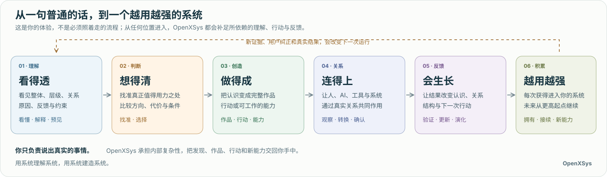
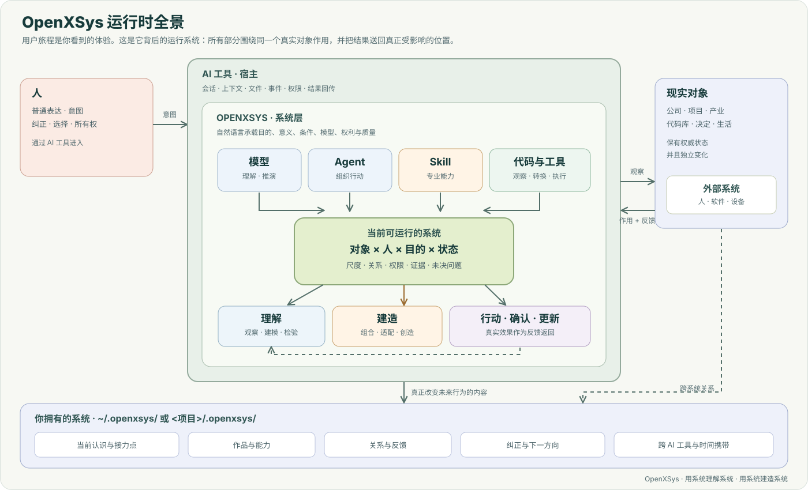

<div align="center">

# 🪐 OpenXSys

[English edition](https://github.com/gengshupeng/open-x-sys/tree/main/skills/open-x-sys)

## 像故事里的主角一样绑定系统：这一次，系统的宿主是你正在使用的 AI 工具

**这是什么：** OpenXSys 是一个开源的系统级 AI Skill。安装到你正在使用的 AI 工具后，它能为一家公司、一个产业、一个项目、一个决定，或者你自己开启系统。

**它为什么不同：** 模型回答一次问题，Agent 完成一次任务，普通 Skill 增加一种能力；OpenXSys 让它们围绕同一个真实对象持续看懂、想清、做成、连接现实，并从每次结果中继续生长。

**你会得到：** 不只是一段回答，而是改变认识的发现、真正完成的作品、新建立的能力，以及一个属于你、能够继续演化的系统。

`[OpenXSys] 叮，系统已激活。`

**用系统理解系统，用系统建造系统。**

**让 AI 承担复杂性，让人拥有可能性。**

[看真实作品](#真实作品) · [为什么不同](#为什么不同) · [直接说一句](#开始) · [你的完整旅程](#旅程) · [系统科学](#系统科学) · [你自己的系统](#你的系统) · [运行时全景](#运行时) · [打开试验场](experience/playground/README.md)

</div>

---

你只需要像平常一样，说出一点好奇、一种不舒服、一个反复出现的问题，或者一个真正想做成的东西。

**看得透 → 想得清 → 做得成 → 连得上 → 会生长 → 越用越强。**

<a id="真实作品"></a>

## ✨ 一句话，打开整个 AI 产业

**豆包工作 × DeepSeek v4.1 Flash × OpenXSys**

一次真实运行只从一句话开始：

```text
/open-x-sys 我想研究一下人工智能这整个产业！
```

AI 随后交付了《AI 产业岩芯》：一座可以进入和探索的产业世界。研究从应用与模型一路钻进云资本、GPU、HBM、先进封装、电力和现金流，把八层产业结构、资金循环、物质约束和未来情景连接起来。

它带回一组足以改变理解的发现：

- **智能在表层，利润在岩层。** 利润沿着稀缺性和替代难度重新分布。
- **云厂商同时扮演 AI 的银行。** 资本开支、利用率与回收周期共同决定繁荣的持续时间。
- **英伟达收的是算力税，HBM 像石油，CoWoS 是匝道。** 看似配套的部分，可能正是决定整个产业速度的约束。
- **下一道墙正在移向电力、许可和现金流。** 约束随着系统演化而移动。
- **四种条件情景揭示未来怎样切换。** 每一种变化都有可以持续观察的先行信号。

[](experience/playground/replays/industry/index.html)

[打开完整作品](experience/playground/replays/industry/index.html) · [查看运行记录](experience/playground/replays/industry/README.md)

这是一份发生于 **2026 年 11 月 16 日**的研究快照。作品中的数据、口径、推演与来源日期都在页面中标明。

一句日常表达打开了一个完整系统。模型的理解、推理、检索、创作和工具能力共同作用于同一个对象，最终形成一件能看、能查、能继续使用的成果。

**这个案例为什么重要：** 它用系统思维追到产业的层级、资金、物质约束和反馈，再让作品从对象本身长出来。原本需要人反复组织提示词、逐层引导的研究，从一句日常表达就能开始。

**下一份让人眼前一亮的作品，可以来自你：** 把作品、原始表达、使用的 AI 工具和模型一起带回 OpenXSys，让更多人看见新的可能性。

[上传我的作品](https://github.com/gengshupeng/open-x-sys/blob/main/CONTRIBUTING.zh-CN.md#分享一件-openxsys-作品)

<a id="为什么不同"></a>

## 为什么它不同

| AI 的组织方式 | 基本单位 | 形成什么 |
| --- | --- | --- |
| **模型** | 一次回答 | 在当前上下文中理解、推理和生成 |
| **Agent** | 一项任务 | 围绕目标规划、调用工具并采取行动 |
| **Skill** | 一种能力 | 增加可以反复使用的知识、方法或实践 |
| **OpenXSys** | 一个会生长的系统 | 持续理解对象、做成作品、连接现实、接收反馈并演化 |

**普通表达也能启动：** 你照常说出正在面对的事情，系统会主动寻找真正值得追问的结构。

**高层问题真正进入行动：** 当问题反复出现，它向上检查能力、关系、结构、边界和目标，再让改变回到现实工作。

**一次成果成为下一次能力：** 作品、认识、关系和真实反馈进入属于你的系统，让下一次从已有基础继续。

<a id="开始"></a>

## ✨ 安装以后，直接说一句

```text
我想真正看懂我所在的行业。给它开启一个系统。
```

你也可以完全照自己的习惯说话。OpenXSys 会根据对象、你的目的、当前材料和实际环境，主动判断应该看什么、查什么、做什么。

| 你正在面对什么 | 可以直接这样说 |
| --- | --- |
| 想看懂一个庞大事物 | “给马斯克的企业体系开启一个系统。它们为什么能共同运转？” |
| 一个问题总在重演 | “我们反复返工。找到产生它的高一层结构。” |
| 想拆到真正的地基 | “把家用储能电池的成本拆到第一性原理。” |
| 还没找到真正的问题 | “先看看这些材料，告诉我最值得追问什么。” |
| 需要作出选择 | “结合我现在的条件，这几个方向哪个最值得投入？” |
| 想把认识做成成果 | “把刚才的发现做成一件团队愿意看完、也能继续使用的作品。” |
| 想建立一种能力 | “帮我搭建从会议材料生成可靠决策简报的能力，并用真实样本验证。” |
| 两个系统之间接不上 | “设计一个系统，把客户反馈真正送到能改变产品决定的地方。” |
| 想从根本上重新设计 | “把这项业务作为动态层级复杂系统重新设计。” |
| 想看见自己的整体 | “给我自己开启一个系统。” |
| 想从上次继续 | “继续。” |

真正有意义的变化会以很短的系统事件出现：

```text
[OpenXSys] 叮，系统已激活。
[OpenXSys] 发现：决定权与反馈分处两套系统，正在拖慢整个交付。
[OpenXSys] 成果已生成：交付系统全景、关键约束，以及可以直接采用的重构方案。
[OpenXSys] 能力已建立：这套简报能力已经通过三个真实样本与边界样本。
```

你看到的是新发现、已完成成果、真实作用和自己新获得的能力。你可以随时追问、纠正、换方向、点名方法、接手作品，或者停止。

<a id="旅程"></a>

## 从一句普通的话，到一个越用越强的系统

这条旅程展示你会经历什么、获得什么。你可以从任何地方开始；理解、行动和反馈会根据当前对象自由往返。

<picture>
  <source media="(max-width: 640px)" srcset="assets/journey.mobile.svg" />
  
</picture>

- **看得透：** 看见组成、关系、层级、时间、反馈、约束，以及高层结构怎样在低层制造反复出现的问题。
- **想得清：** 找到真正值得用力的地方，比较方向、代价、适用条件和验证方式。
- **做得成：** 把认识变成网页、文档、方案、代码、视频、工具或可以工作的能力。
- **连得上：** 让人、模型、Agent、Skill、文件、工具和外部系统通过真实关系共同作用。
- **会生长：** 让新证据、用户纠正和现实结果改变系统的认识、结构与下一次行动。
- **越用越强：** 每次获得都进入属于你的系统，成为以后可以直接使用的新起点。

<a id="系统层"></a>

## AI 的系统层：让一次智能变成持续生长的系统

模型提供智能，Agent 组织一次行动，Skill 提供一项或一组能力。OpenXSys 让它们进入同一个可运行系统：对象、人的目的、已有认识、工具、权限、关系、作品、行动和反馈在同一幅动态图景中共同作用。

| AI 的组织尺度 | 基本单位 | 形成什么 |
| --- | --- | --- |
| **Agent** | 一次任务 | 围绕目标规划、调用工具并完成行动 |
| **Skill** | 一项能力 | 让 AI 反复使用特定知识、方法和实践 |
| **OpenXSys** | 一个可运行的系统 | 持续理解对象、组织能力、产生作用、接收反馈并演化 |

OpenXSys 的系统层让七种能力同时成立：

| 系统能力 | 它怎样工作 |
| --- | --- |
| **主动定向** | 从普通表达、材料和现实变化中发现真正值得解决的问题 |
| **活动系统** | 围绕一个可运行的系统实例持续理解、创造和行动 |
| **层级认识** | 同时看见层级、关系、时间、状态、约束、反馈与涌现 |
| **现实作用** | 追踪请求、执行、对象状态改变和实际效果 |
| **长期接续** | 保存会改变未来行为的认识、作品、关系和能力 |
| **跨系统连接** | 建造跨越语义、权限和时间鸿沟的关系系统 |
| **持续演化** | 让真实结果改变结构，使下一次从更高起点开始 |

<a id="系统科学"></a>

## 🧠 用系统理解系统，用系统建造系统

### 系统科学的地基

| 地基 | 它给 AI 什么 |
| --- | --- |
| **世界由系统构成** | 把对象放回组成、关系、边界、层级、约束与时间中，理解整体怎样产生自己的行为 |
| **系统思维** | 从现象追到结构，从局部回到整体，寻找反馈、瓶颈、杠杆和二阶后果 |
| **系统科学** | 控制论、系统动力学、复杂性科学、软系统方法与系统工程提供可检验的骨架 |
| **顶尖实践者的方法** | 第一性原理、丰田之道、约束理论、情景规划等提供在真实世界中用力的锋芒 |
| **最佳实践研究** | 研究真实条件，比较、适配、组合、创造并用结果持续修正 |

六个基本问题在所有方法之下提供共同观察力：

| 基本问题 | 它追问什么 |
| --- | --- |
| **可区分性** | 什么差异真正改变结果？哪些重要差异仍被混在一起？ |
| **时间** | 它怎样形成和积累？行动、变化与反馈的时钟是否匹配？ |
| **空间** | 边界、层级、距离和可达范围怎样限制作用？ |
| **状态** | 现实怎样、观察到什么、模型推断什么、还有什么未知？ |
| **相互作用** | 资金、物质、信息、权力、注意力和时间怎样流动并形成反馈？ |
| **约束** | 什么限制整体？改变之后，约束会移动到哪里？ |

### 从理解进入建造

当已有能力够不到目标，OpenXSys 会寻找、适配、组合或创造模型、Agent、Skill、工具、代码、资料与人的分工，在真实任务中检验它们之间的关系，让缺失的能力真正出现。

```text
发现能力鸿沟
      ↓
组织或创造模型、Agent、Skill、工具、资料与人
      ↓
在真实任务中产生结果
      ↓
把有效关系沉淀为能力
      ↓
让能力继续展开成系统
```

一件作品经过反复使用、条件检验与结果反馈，可以成长为能力；一项能力拥有自己的状态、边界和演化后，可以展开成系统；多个独立系统围绕共同目的建立真实关系，可以形成新的整体能力。

运行回路改变这一次的结果，建造回路改变系统以后能够做到什么。

## 一次完整运行，你真正获得什么

| 获得 | 它带来的改变 |
| --- | --- |
| **一个改变看法的发现** | 看见此前被现象遮住的结构、回路、尺度或约束 |
| **一件真正完成的作品** | 网页、文档、方案、代码、演示、视频或工具；能够打开、使用、讨论和继续创造 |
| **一幅能返回的全景** | 走进任何局部都知道自己在哪里、它怎样影响整体、如何回到核心发现 |
| **适合真实条件的选择** | 推荐带着依据、代价、适用条件和验证方式 |
| **现实中的作用** | 认识穿过权限进入文件、工具、人或外部系统，并确认究竟发生到了哪一层 |
| **一种全新的能力** | AI、工具、资料、人和反馈形成经过真实任务验证的关系结构 |
| **一个会继续生长的系统** | 新证据、用户纠正和实际结果改变下一次观察、判断与行动 |

OpenXSys 追求四种惊喜：**认识惊喜、能力惊喜、可能性惊喜、演化惊喜**。每次完整运行都让其中至少一种真实发生，并为另外几种打开道路。

<a id="运行时"></a>

## 一个递归的自然语言开放系统运行时

OpenXSys 的运行中心始终是**此刻正在工作的系统**。

```text
一句普通的话 · 一份材料 · 一个现实事件 · 另一个系统的请求
                              ↓
                   当前可运行的系统实例
        对象 × 人 × 目的 × 尺度 × 状态 × 关系 × 权限
             ↙             ↓              ↘
       理解与检验      组织或建造能力      作品与行动
             ↘             ↓              ↙
                 现实中的状态与效果
                              ↓
           更新认识、作品、关系、能力与下次运行
                              ↺
```

[](assets/openxsys-panorama.svg)

| 部分 | 作用 |
| --- | --- |
| **AI 工具（宿主）** | 承载 OpenXSys，提供会话、上下文、模型、Agent、Skill、工具、事件、权限和结果回传 |
| **OpenXSys Skill** | 组织当前系统实例、关系、能力、作品、行动、反馈与演化 |
| **自然语言** | 承载目的、意义、模型、条件、例外、权利与质量，让人和 AI 都能读、能改、能带走 |
| **模型与 Agent** | 理解当前处境，组织研究、推演、创造、行动和重新解释 |
| **其他 Skill、代码与工具** | 提供可以组合、检验和继续演化的专业能力 |
| **人** | 提出意图、纠正理解、作出决定，也直接观察、参与和行动 |
| **领域系统与现实结果** | 保有权威状态，确认解释、行动和能力究竟成立到了哪里 |

[系统元模型](core/system.md) · [关系模型](core/relation.md) · [能力模型](core/capability.md) · [演化模型](core/evolution.md) · [运行时架构](runtime/architecture.md)

## 顶尖实践，直接按名字使用

| 高手路线 | 它怎样改变问题 | 直接这样说 |
| --- | --- | --- |
| **[马斯克五步法](capabilities/routes/masters/musk_algorithm.md)** | 质疑要求、删除、简化、加速，最后才自动化 | “用马斯克五步法重做我们的发布系统。” |
| **[丰田之道](capabilities/routes/masters/toyota_way.md)** | 去现场、追根因、形成对策，再标准化和改善 | “用丰田之道看看客服工单为什么不断积压。” |
| **[高德拉特五步聚焦](capabilities/routes/masters/goldratt_five_steps.md)** | 找到限制整体的约束，让其他部分围绕它重新组织 | “我这一周真正的约束是什么？” |
| **[芒格清单](capabilities/routes/masters/munger_checklist.md)** | 反过来想、追踪激励、使用多个模型并多看一层 | “用芒格清单过一遍这份工作邀约。” |
| **[费曼学习法](capabilities/routes/masters/feynman_technique.md)** | 用简单语言暴露理解漏洞，再回到源头重建 | “用费曼学习法真正教会我 Transformer。” |

还有[戴明循环](capabilities/routes/masters/deming_cycle.md)、[博伊德循环](capabilities/routes/masters/boyd_loop.md)与[壳牌情景规划](capabilities/routes/masters/shell_scenarios.md)。完整资源见[方法与能力](capabilities/README.md)、[系统模式](capabilities/patterns/README.md)与[试验场](experience/playground/README.md)。

### 说、选、组、学

- **说。** 像平常一样说一句话，系统主动判断并全力运行。
- **选。** 当真的存在不同方向时，看到具体差异、推荐与理由，再决定走哪一边。
- **组。** 点名方法、替换视角或自己组合：“先透视，再看激励，最后反过来想。”
- **学。** 一边解决自己的真实问题，一边理解所用方法，直到自己也能独立使用。

<a id="你的系统"></a>

## 你自己的系统，让过去真正改变未来

一个人的系统本来就存在：项目、作品、知识、工具、关系、时间、目标和约束早已互相作用。OpenXSys 在合适尺度上认识这些现实怎样共同运转，让 AI、电脑和外部系统成为你可以使用的能力。

说：

```text
给我自己开启一个系统。
```

OpenXSys 会从你真正拥有、使用、参与和创造的东西入手，寻找一个能改变理解的结构、当前能力鸿沟，以及最值得继续的方向。每个关于你的判断都带着依据、推断链和纠正入口。

系统可以跟着你，也可以属于某个项目：

```text
~/.openxsys/                    你拥有的跨项目系统
├── SYSTEM.md                   根入口：当前最好的认识与接力点
└── <已经开启的系统>/
    ├── SYSTEM.md               这个系统是什么、怎样运转、怎样继续
    ├── 作品与能力
    └── 必要的数据、代码与连接引用

<项目>/.openxsys/                属于这个项目的系统
```

- `SYSTEM.md` 是人和 AI 都能阅读、修改与接续的自然语言入口。
- 系统保存会改变未来工作的认识、作品、能力、关系、用户纠正和接力点。
- 你可以阅读、修改、移动、删除和带走它，也可以让另一个 AI 工具从这里继续。
- 下一次说“继续”，新证据沿真实依赖更新，已有作品和认识继续发挥作用。

**接续检验：** 删掉全部聊天，只留下系统与作品，一个新的 AI 工具依然能从更高起点开始。过去真实地改变今天怎样观察、判断和行动。

[系统实例](system/instance.md) · [系统怎样接续](system/continuity.md) · [用户的所有权](system/ownership.md)

## 系统之间的鸿沟，用系统来填补

人通过 AI 工具进入 OpenXSys；其中的模型、Agent、Skill 和工具共同作用于文件、网络、代码、设备、组织和其他人的系统。它们各自拥有不同语言、状态、权限和时间尺度。真正的协作由能够观察、转换、行动、确认和反馈的关系系统完成。

```text
系统 A 的认识或能力
        ↓ 观察
  语义与状态转换
        ↓ 授权行动
  系统 B 的真实变化
        ↓ 确认与反馈
改变 A、B 或它们之间的关系
```

客户反馈沿真实关系进入拥有产品决定权的系统；研究作品成长为另一个团队可适配、可验证的能力；多个独立系统形成更高层整体，同时各自保有所有权、内部自由和退出权。

**每个系统都能被理解、运行、连接和演化；一个系统的成果，可以成为另一个系统的新能力。**

## 常见问题

### 不懂系统思维、不会写提示词，也能用吗？

能。直接用平常的话说出你正在好奇、担心、选择或想做成的事。OpenXSys 让 AI 承担拆问题、找结构、调能力和做成果的复杂性。

### 它和普通 AI、Agent、其他 Skill 有什么不同？

普通 AI 常回答一次问题，Agent 常完成一次任务，Skill 常增加一项能力。OpenXSys 以一个真实对象及其变化为单位，把模型、Agent、Skill、工具、文件和反馈组织进同一个会持续运行的系统。

### 我的系统在哪里？换一个 AI 工具还能继续吗？

系统位于项目的 `.openxsys/` 或你自己的 `~/.openxsys/`。自然语言入口、作品和能力可以被另一个 AI 工具继续读取和运行。

### 它怎样调用最佳实践和其他能力？

OpenXSys 判断当前系统缺少什么变化，再沿语义索引进入合适的引擎、方法、模式、路线、工具或外部系统。它们可以跳转、组合、并行和返回，不会把开放任务锁成固定流程。

### “越用越强”具体是什么意思？

新的认识改变以后观察什么，成功做法成为能力，失败改写结构或判断，作品与接力点让下一次从更高处开始。增长体现为未来行为改变，不是聊天越存越多。

## 一起建造开放系统世界

一个好问题、一件作品、一次真实失败、一项新能力或一次 PR，都可能改变下一版。

| 你想做什么 | 入口 |
| --- | --- |
| 提问、讨论架构、提出想法、参与路线图 | [GitHub Discussions](https://github.com/gengshupeng/open-x-sys/discussions) |
| 展示作品和一次真实运行 | [Discussions：分享与交流](https://github.com/gengshupeng/open-x-sys/discussions) |
| 报告可复现 Bug 或 AI 工具兼容问题 | [Issues](https://github.com/gengshupeng/open-x-sys/issues/new/choose) |
| 改进文档、运行时、方法、适配器、测试和工具 | [贡献指南](https://github.com/gengshupeng/open-x-sys/blob/main/CONTRIBUTING.zh-CN.md) · [Pull Requests](https://github.com/gengshupeng/open-x-sys/pulls) |
| 私密报告安全问题 | [安全说明](https://github.com/gengshupeng/open-x-sys/blob/main/SECURITY.zh-CN.md) |

[打开完整运行时](SKILL.md) · [打开试验场](experience/playground/README.md) · [探索全部能力资源](capabilities/README.md) · [加入开源项目](https://github.com/gengshupeng/open-x-sys)

## Open-X-Sys：让每个人创造自己的 Sys

OpenXSys 打开共同地基，名字里的 **X** 是一个向所有人开放的位置。个人、团队、领域和社区都可以为自己关心的事物创造、拥有和发展自己的 Sys；它可以保持私有，也可以被分享、适配、连接和分叉。

本版已经交付了 Open-X-Sys 所需要的共同地基：完整中英文 Skill、递归自然语言运行时、可运行的系统实例、关系与能力模型、由用户拥有并能跨会话接续的 `SYSTEM.md`、AI 工具与外部系统适配，以及通过完整发行门禁的安装包。

任何人现在就可以在这套地基上设计自己的 Sys；真实运行起来的 Sys，将继续推动继承、兼容、发现与公共生态的下一步设计。[阅读设计草稿](https://github.com/gengshupeng/open-x-sys/blob/main/docs/OPEN-X-SYS-DRAFT.zh-CN.md)。

---

<div align="center">

**把 OpenXSys 绑定到你正在使用的 AI 工具。**

**给任何事物，开启一个系统。给自己，开启一个系统。**

**用系统理解系统，用系统建造系统。**

**看得透，想得清，做得成，连得上，会生长，越用越强。**

让 AI 承担复杂性，让人拥有可能性；让系统彼此连接，让能力继续生长。

⭐ 为 OpenXSys 点亮一颗星 · 用 **#OpenXSys** 分享你的第一个发现

</div>
