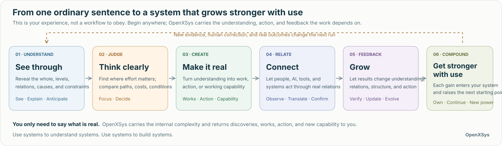
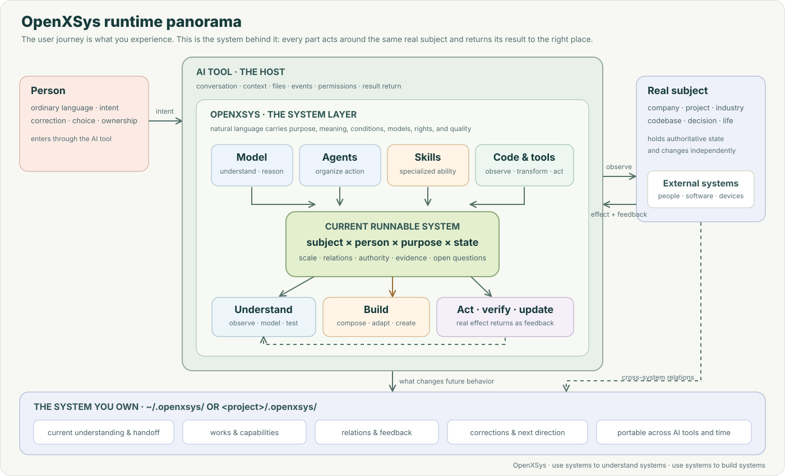

<div align="center">

# 🪐 OpenXSys

[Chinese edition](https://github.com/gengshupeng/open-x-sys/tree/main/skills/open-x-sys.zh-CN)

## Bind a system like the protagonist of a story: this time, its host is the AI tool already in your hands

**What it is:** OpenXSys is an open-source, system-level AI Skill. Install it in the AI tool you use, and it can open a system for a company, an industry, a project, a decision, or your own work and life.

**Why it is different:** A model answers a question, an Agent completes a task, and a Skill adds a capability. OpenXSys brings them into one living system that keeps understanding the same real subject, making things, connecting to reality, and growing from what happens.

**What becomes yours:** A discovery that changes the picture, a finished work, new capability, and a system you can keep using and evolving.

`[OpenXSys] Ding. System activated.`

**Use systems to understand systems. Use systems to build systems.**

**Let AI carry the complexity. Let people own the possibility.**

[See a real work](#real-work) · [Why it is different](#different) · [Say one sentence](#begin) · [Your full journey](#journey) · [Systems science](#systems-science) · [Your own system](#your-system) · [Runtime panorama](#runtime) · [Open the playground](experience/playground/README.md)

</div>

---

Begin exactly where you are: with a curiosity, a discomfort, a problem that keeps returning, or something you genuinely want to make.

**See through → Think clearly → Make it real → Connect → Grow → Get stronger with use.**

<a id="real-work"></a>

## ✨ One sentence opens the entire AI industry

**Doubao Workspace × DeepSeek V4.1 Flash × OpenXSys**

A real run began with one sentence:

```text
/open-x-sys I want to study the entire artificial-intelligence industry.
```

The AI returned *The Core Sample of the AI Industry*: an explorable industrial world. It drilled from applications and models into cloud capital, GPUs, HBM, advanced packaging, electricity, and cash flow, connecting eight layers of industrial structure, the capital cycle, material constraints, and future scenarios.

It brought back discoveries strong enough to change the picture:

- **Intelligence lives at the surface; profit lives in the strata.** Profit redistributes along scarcity and difficulty of substitution.
- **Cloud providers are also the banks of AI.** Capital expenditure, utilization, and payback periods together determine how long the boom can continue.
- **NVIDIA collects the compute tax; HBM is oil; CoWoS is the on-ramp.** What looks like supporting infrastructure may be the constraint setting the speed of the entire industry.
- **The next wall is moving toward power, permitting, and cash flow.** Constraints move as the system evolves.
- **Four conditional scenarios show how the future switches tracks.** Each transition has leading signals that can be watched over time.

[](experience/playground/replays/industry/index.html)

[Open the complete work](experience/playground/replays/industry/index.html) · [Read the run record](experience/playground/replays/industry/README.md)

This is a research snapshot from **November 16, 2026**. Dates, measures, projections, and sources appear with the data inside the work.

One ordinary sentence opened a complete system. The model's understanding, reasoning, research, creation, and tool use converged on the same object and became a result that can be explored, checked, and kept in use.

**Why this work matters:** Systems thinking follows the industry's levels, money, physical constraints, and feedback until the work grows from the subject itself. Research that once required a person to orchestrate prompts and guide every layer can begin with ordinary language.

**The next work that makes someone stop and look can come from you:** Bring back the work, your original words, and the AI tool and model you used so others can see a new possibility.

[Share my work](https://github.com/gengshupeng/open-x-sys/blob/main/CONTRIBUTING.md#share-an-openxsys-work)

<a id="different"></a>

## Why it is different

| Form of AI organization | Its unit | What happens |
| --- | --- | --- |
| **Model** | One response | Understands, reasons, and generates from the present context |
| **Agent** | One task | Plans, calls tools, and carries an objective into action |
| **Skill** | One capability | Adds repeatable knowledge, methods, or practice |
| **OpenXSys** | One living system | Keeps understanding the subject, making, connecting, receiving feedback, and evolving |

**Ordinary language is enough to begin:** Say what you are facing in your own way. The system searches for the structure that is truly worth asking about.

**Higher-level problems reach real action:** When a problem repeats, it moves upward to inspect capability, relation, structure, boundary, and goal—then carries the change back into the work.

**One result becomes future capability:** Works, understanding, relations, and real feedback enter the system you own, so the next run begins from accumulated ground.

<a id="begin"></a>

## ✨ Now, say one sentence

```text
I want to truly understand the industry I work in. Open a system for it.
```

Or speak entirely in your own way. OpenXSys uses the subject, your purpose, the material at hand, and the real environment to decide what is worth seeing, checking, and making.

| What you are facing | Say it like this |
| --- | --- |
| You want to understand something enormous | “Open a system for Elon Musk's constellation of companies. How do they operate together?” |
| A problem keeps returning | “We keep redoing the work. Find the higher-level structure producing it.” |
| You want to reach the real foundations | “Break the cost of a home energy-storage battery down to first principles.” |
| You have not found the real question yet | “Look through this material first and tell me what is most worth asking.” |
| You need to choose | “Given my actual conditions, which of these directions deserves investment?” |
| You want understanding to become a result | “Turn what we just discovered into something the team will finish and can keep using.” |
| You want to establish a capability | “Build a capability that turns meeting material into reliable decision briefs, and validate it on real samples.” |
| Two systems do not connect | “Design a system that carries customer feedback all the way to the place that can change product decisions.” |
| You want a fundamental redesign | “Redesign this business as a dynamic, hierarchical complex system.” |
| You want to see your own whole | “Open a system for me.” |
| You want to resume | “Continue.” |

Meaningful transitions appear as brief system events:

```text
[OpenXSys] Ding. System activated.
[OpenXSys] Discovery: decision rights and feedback live in two different systems, slowing the entire delivery.
[OpenXSys] Work created: a delivery-system panorama, its decisive constraint, and a redesign ready to adopt.
[OpenXSys] Capability established: the briefing capability has passed three real samples and one boundary case.
```

What you see is a new discovery, finished work, real effects, and capability you now possess. You can question, correct, redirect, name a method, take over the artifact, or stop at any time.

<a id="journey"></a>

## From one ordinary sentence to a system that grows stronger with use

This journey shows what you experience and what becomes yours. You can begin anywhere; understanding, action, and feedback move freely with the subject.

<picture>
  <source media="(max-width: 640px)" srcset="assets/journey.mobile.svg" />
  
</picture>

- **See through:** reveal components, relations, levels, time, feedback, and constraints—including the higher-level structure producing repeated lower-level problems.
- **Think clearly:** find where effort matters, compare directions, costs, conditions, and ways to test them.
- **Make it real:** turn understanding into a page, document, plan, code, video, tool, or working capability.
- **Connect:** let people, models, Agents, Skills, files, tools, and external systems act through real relations.
- **Grow:** let new evidence, human correction, and real outcomes change what the system understands and does next.
- **Get stronger with use:** every gain enters the system you own and becomes a stronger starting point for the future.

<a id="system-layer"></a>

## The system layer for AI: turn one moment of intelligence into a system that keeps growing

A model provides intelligence. An Agent organizes one action. A Skill contributes one capability or a family of capabilities. OpenXSys brings them into one runnable system, where the subject, human purpose, existing understanding, tools, authority, relations, works, actions, and feedback all act within the same changing picture.

| Scale of AI organization | Basic unit | What it forms |
| --- | --- | --- |
| **Agent** | One task | Plans around an objective, calls tools, and completes an action |
| **Skill** | One capability | Lets AI repeatedly apply particular knowledge, methods, and practice |
| **OpenXSys** | One runnable system | Continuously understands a subject, organizes capability, produces effects, receives feedback, and evolves |

The OpenXSys system layer makes seven powers available together:

| System power | How it works |
| --- | --- |
| **Active orientation** | Discovers the problem truly worth solving from ordinary language, material, and real change |
| **Living system** | Keeps understanding, creating, and acting around one runnable system instance |
| **Hierarchical understanding** | Sees hierarchy, relations, time, state, constraints, feedback, and emergence together |
| **Real effects** | Tracks request, execution, change in target state, and actual outcome |
| **Long continuity** | Preserves understanding, works, relations, and capabilities that change future behavior |
| **Cross-system connection** | Builds relation systems across gulfs of meaning, authority, and time |
| **Continuous evolution** | Lets real outcomes change structure so the next run begins from higher ground |

<a id="systems-science"></a>

## 🧠 Use systems to understand systems. Use systems to build systems.

### The foundation in systems science

| Foundation | What it gives AI |
| --- | --- |
| **A world made of systems** | Returns a subject to components, relations, boundaries, levels, constraints, and time, revealing how a whole produces its own behavior |
| **Systems thinking** | Moves from event to structure and fragment to whole, looking for feedback, bottlenecks, leverage, and second-order consequences |
| **Systems science** | Cybernetics, system dynamics, complexity science, soft systems, and systems engineering provide testable bones |
| **Methods of exceptional practitioners** | First principles, the Toyota way, the theory of constraints, scenario planning, and others bring force to real-world action |
| **Best-practice research** | Studies real conditions, compares, adapts, combines, creates, and keeps correcting through results |

Six fundamental questions provide a shared power of observation beneath every method:

| Fundamental question | What it asks |
| --- | --- |
| **Distinguishability** | Which differences truly change the outcome? Which important distinctions are still collapsed together? |
| **Time** | How did it form and accumulate? Do action, change, and feedback run on compatible clocks? |
| **Space** | How do boundary, level, distance, and reach limit what can affect what? |
| **State** | What is real, what was observed, what did the model infer, and what remains unknown? |
| **Interaction** | How do capital, matter, information, power, attention, and time flow and form feedback? |
| **Constraint** | What limits the whole? Where will the constraint move after the change? |

### From understanding into building

When existing capability cannot reach the objective, OpenXSys finds, adapts, composes, or creates models, Agents, Skills, tools, code, material, and divisions of human work. It tests the relations between them in real tasks until the missing capability becomes real.

```text
Discover a capability gulf
            ↓
Organize or create models, Agents, Skills, tools, material, and people
            ↓
Produce a result in real work
            ↓
Let the effective relation become a capability
            ↓
Let the capability continue opening into a system
```

A work that is repeatedly used, tested under conditions, and changed by result feedback can grow into a capability. A capability with its own state, boundary, and evolution can open into a system. Independent systems that establish real relations around a shared purpose can form new whole-system capability.

The runtime loop changes this result. The building loop changes what the system can do from now on.

## What a complete run gives you

| What you gain | What it changes |
| --- | --- |
| **A discovery that changes the picture** | Reveals structure, loops, scale, or constraint previously hidden by events |
| **A genuinely finished work** | A webpage, document, plan, codebase, presentation, video, or tool that opens, works, supports discussion, and can keep growing |
| **A panorama you can return to** | Wherever you enter the detail, you know where you are, how it affects the whole, and how to return to the central discovery |
| **A choice fitted to real conditions** | A recommendation with grounds, cost, operating conditions, and a way to test it |
| **An effect in reality** | Understanding crosses real authority into files, tools, people, or external systems, with clarity about how far the effect actually reached |
| **A new capability** | AI, tools, material, people, and feedback form a relational structure validated in real work |
| **A system that keeps growing** | New evidence, user correction, and actual outcomes change the next observation, judgment, and action |

OpenXSys pursues four surprises: **understanding, capability, possibility, and evolution**. Every complete run makes at least one real and opens a path to the others.

<a id="runtime"></a>

## A recursive natural-language open-system runtime

The operating center of OpenXSys is always **the system at work now**.

```text
An ordinary sentence · material · a real event · a request from another system
                                  ↓
                      Current runnable system instance
       subject × person × purpose × scale × state × relations × authority
                 ↙                ↓                 ↘
       understand and test   organize or build   works and action
                 ↘                ↓                 ↙
                     real-world state and effects
                                  ↓
          update understanding, works, relations, capability, and the next run
                                  ↺
```

[](assets/openxsys-panorama.svg)

| Part | Its role |
| --- | --- |
| **AI tool (host)** | Carries OpenXSys and provides conversation, context, models, Agents, Skills, tools, events, authority, and returned results |
| **OpenXSys Skill** | Organizes the current system instance, relations, capabilities, works, action, feedback, and evolution |
| **Natural language** | Carries purpose, meaning, models, conditions, exceptions, rights, and quality in a form both human and AI can read, change, and take away |
| **Models and Agents** | Understand the present situation and organize research, projection, creation, action, and reinterpretation |
| **Other Skills, code, and tools** | Supply professional capability that can be composed, tested, and evolved |
| **People** | Express intent, correct understanding, decide, observe, participate, and act |
| **Domain systems and real results** | Hold authoritative state and confirm how far explanations, actions, and capabilities actually hold |

[System metamodel](core/system.md) · [Relation model](core/relation.md) · [Capability model](core/capability.md) · [Evolution model](core/evolution.md) · [Runtime architecture](runtime/architecture.md)

## Exceptional practices, called by name

| Complete route | How it changes the problem | Say this |
| --- | --- | --- |
| **[Musk's algorithm](capabilities/routes/masters/musk_algorithm.md)** | Questions requirements, deletes, simplifies, accelerates, and only then automates | “Use Musk's algorithm to rebuild our release system.” |
| **[The Toyota way](capabilities/routes/masters/toyota_way.md)** | Goes to the real work, pursues causes, creates countermeasures, then standardizes and improves | “Use the Toyota way to see why support tickets keep piling up.” |
| **[Goldratt's five focusing steps](capabilities/routes/masters/goldratt_five_steps.md)** | Finds the constraint limiting the whole and reorganizes everything else around it | “What is the real constraint on my week?” |
| **[Munger's checklist](capabilities/routes/masters/munger_checklist.md)** | Inverts, follows incentives, uses multiple models, and looks one consequence further | “Run Munger's checklist over this job offer.” |
| **[The Feynman technique](capabilities/routes/masters/feynman_technique.md)** | Uses simple language to expose gaps, then returns to the source and rebuilds understanding | “Use the Feynman technique to truly teach me Transformers.” |

There are also [Deming's cycle](capabilities/routes/masters/deming_cycle.md), [Boyd's loop](capabilities/routes/masters/boyd_loop.md), and [Shell scenario planning](capabilities/routes/masters/shell_scenarios.md). Explore the complete [method and capability library](capabilities/README.md), [system patterns](capabilities/patterns/README.md), and [playground](experience/playground/README.md).

### Speak, choose, compose, learn

- **Speak.** Say one sentence in your own way; the system judges what matters and runs fully.
- **Choose.** When genuinely different directions exist, see the concrete difference, recommendation, and reasons, then choose.
- **Compose.** Name methods, replace a lens, or make your own sequence: “X-ray it, inspect incentives, then invert.”
- **Learn.** Solve your real problem while understanding the methods in use, until you can wield them independently.

<a id="your-system"></a>

## Your own system: let the past truly change the future

A person's system already exists. Projects, works, knowledge, tools, relationships, time, goals, and constraints are already acting on one another. OpenXSys understands how these realities operate together at a useful scale and turns AI, computers, and external systems into capabilities you can use.

Say:

```text
Open a system for me.
```

OpenXSys begins with what you actually own, use, participate in, and create. It looks for a structure that changes understanding, the present capability gulf, and the direction most worth continuing. Every judgment about you carries grounds, an inference path, and a way for you to correct it.

The system can travel with you or belong to a project:

```text
~/.openxsys/                    systems you own across projects
├── SYSTEM.md                   root entry: the best current understanding and handoff point
└── <an opened system>/
    ├── SYSTEM.md               what it is, how it works, how to continue
    ├── works and capabilities
    └── references to necessary data, code, and connections

<project>/.openxsys/            the system belonging to this project
```

- `SYSTEM.md` is a natural-language entry that people and AI can read, change, and continue from.
- The system preserves understanding, works, capabilities, relations, user corrections, and handoff points that change future work.
- You can read, edit, move, delete, and take it with you—or let another AI tool continue from it.
- The next time you say “Continue,” new evidence updates along real dependencies while existing works and understanding keep contributing.

**The continuity test:** delete every chat and leave only the system and its works. A new AI tool can still begin from higher ground. The past has truly changed how today observes, judges, and acts.

[System instance](system/instance.md) · [System continuity](system/continuity.md) · [User ownership](system/ownership.md)

## Bridge the gulf between systems with a system

People enter OpenXSys through AI tools. Models, Agents, Skills, and tools inside them act on files, networks, code, devices, organizations, and other people's systems. Each has its own language, state, authority, and timescale. Real collaboration happens through a relation system that can observe, translate, act, confirm, and feed back.

```text
Understanding or capability in System A
                  ↓ observe
        translate meaning and state
                  ↓ authorized action
          real change in System B
                  ↓ confirm and feed back
       change A, B, or the relation between them
```

Customer feedback travels through real relations into the system that owns product decisions. A research work grows into a capability another team can adapt and validate. Independent systems form a higher-level whole while retaining their ownership, internal freedom, and right to leave.

**Every system can be understood, run, connected, and evolved. The result of one system can become a new capability of another.**

## Frequently asked questions

### Can I use it without systems thinking or prompt engineering?

Yes. Speak normally about what you are curious about, worried about, choosing, or trying to make. OpenXSys lets the AI carry the complexity of framing the problem, finding structure, composing capability, and making the result.

### How is it different from ordinary AI, Agents, and other Skills?

Ordinary AI often answers one question, an Agent completes one task, and a Skill adds one capability. OpenXSys works in units of a real subject and its change, bringing models, Agents, Skills, tools, files, and feedback into one system that keeps running.

### Where does my system live, and can another AI tool continue it?

The system lives in a project's `.openxsys/` or your own `~/.openxsys/`. Its natural-language entry, works, and capabilities can be read and run by another AI tool.

### How does it call best practices and other capabilities?

OpenXSys judges what change the live system lacks, then follows semantic indexes into the right engine, method, pattern, route, tool, or external system. They can branch, combine, run in parallel, and return without freezing open work into a fixed process.

### What does “stronger with use” actually mean?

New understanding changes what gets observed next. Proven practice becomes capability. Failure rewrites structure or judgment. Works and handoffs let another run begin from higher ground. Growth is changed future behavior, not more stored chat.

## Build the open world of systems together

One excellent question, a work, a real failure, a new capability, or a pull request can change the next release.

| What you want to do | Begin here |
| --- | --- |
| Ask questions, discuss architecture, propose ideas, shape the roadmap | [GitHub Discussions](https://github.com/gengshupeng/open-x-sys/discussions) |
| Show a work and tell the story of a real run | [Discussions: show and tell](https://github.com/gengshupeng/open-x-sys/discussions) |
| Report a reproducible bug or AI-tool compatibility problem | [Issues](https://github.com/gengshupeng/open-x-sys/issues/new/choose) |
| Improve docs, runtime, methods, adapters, tests, or tools | [Contribution guide](https://github.com/gengshupeng/open-x-sys/blob/main/CONTRIBUTING.md) · [Pull Requests](https://github.com/gengshupeng/open-x-sys/pulls) |
| Report a security issue privately | [Security](https://github.com/gengshupeng/open-x-sys/blob/main/SECURITY.md) |

[Open the full runtime](SKILL.md) · [Open the playground](experience/playground/README.md) · [Explore all capability resources](capabilities/README.md) · [Join the open-source project](https://github.com/gengshupeng/open-x-sys)

## Open-X-Sys: let everyone create a Sys of their own

OpenXSys opens common ground, and the **X** in the name is a place open to everyone. Individuals, teams, fields, and communities can create, own, and evolve a Sys for something they care about. A Sys may remain private or be shared, adapted, connected, and forked.

This release already delivers the common ground Open-X-Sys needs: complete English and Chinese Skills, a recursive natural-language runtime, runnable system instances, models for relations and capabilities, user-owned `SYSTEM.md` continuity across conversations, adapters for AI tools and external systems, and release-tested packages.

Anyone can begin designing a Sys on this foundation today; working Sys will drive the next shared designs for inheritance, compatibility, discovery, and the commons. [Read the design draft](https://github.com/gengshupeng/open-x-sys/blob/main/docs/OPEN-X-SYS-DRAFT.md).

---

<div align="center">

**Bind OpenXSys to the AI tool you already use.**

**Open a system for anything. Open a system for yourself.**

**Use systems to understand systems. Use systems to build systems.**

**See through. Think clearly. Make it real. Connect. Grow. Get stronger with use.**

Let AI carry the complexity. Let people own the possibility. Let systems connect. Let capability keep growing.

⭐ Star OpenXSys · Share your first discovery with **#OpenXSys**

</div>
