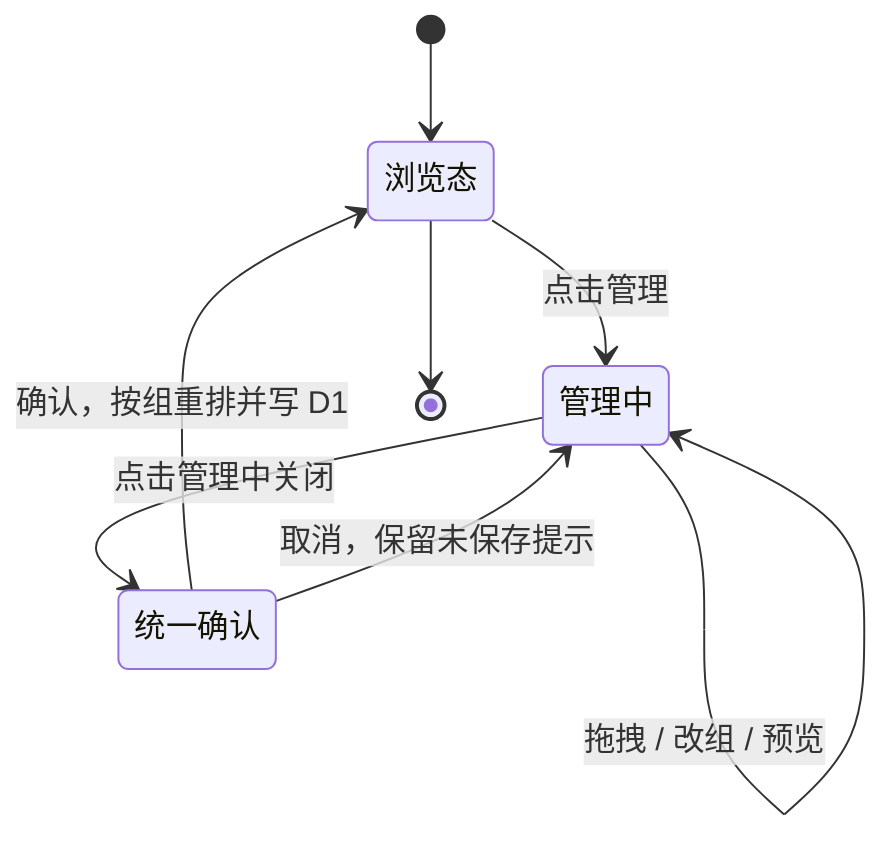

# 交互式原型 PRD 打点与分组管理引擎 2.1.0

> 版本：2.1.0 ｜ 基线：2.0 ｜ 更新：2026-11

**English summary.** Version 2.1.0 builds on the 2.0 rewrite. It adds a pre-locate state preparation hook (`PRD_PREPARE_ANCHOR`) for multi-step wizards, a single grouping resolver (`PRD_GROUPS_RESOLVE`) shared by drawer and documents, per-pin group persistence in D1 (`pinGroups`), grouped rendering in all three PRD outputs (in-page modal, standalone page, Markdown export), and groups expanded by default with collapse state kept per browser only. Existing 2.0 features remain: light glass theme, inline SVG icons, rounded square pin badges, three-state drawer, drag reordering with insertion indicators, automatic renumbering by group, unified save on exiting manage mode, dynamic view and modal anchoring, view and module filtering, four-language hot switching, visitor read-only isolation, five persistence modes, Vditor IR editor, Mermaid diagrams, and an interactive table editor. No secrets, tokens, account IDs, personal names, or company names are stored in this Skill.

**日本語の概要。** バージョン 2.1.0 は 2.0 の後継です。多段ウィザード向けの位置調整前に実行する状態復元フック（`PRD_PREPARE_ANCHOR`）、ドロワーと文書で共通のグループ判定インターフェース（`PRD_GROUPS_RESOLVE`）、D1 の `pinGroups` による注釈単位のグループ保存、三つの PRD 出力（画面内モーダル、別ページ、Markdown）でのグループ表示、デフォルト展開と折りたたみ状態のブラウザ単位保持を追加しました。機密情報は Skill に含まれません。

**한국어 요약.** 버전 2.1.0은 2.0의 후속 버전입니다. 다단계 마법사용 상태 복원 훅(`PRD_PREPARE_ANCHOR`), 드로어와 문서가 공유하는 그룹 판정 인터페이스(`PRD_GROUPS_RESOLVE`), D1 `pinGroups` 기반 주석별 그룹 저장, 세 가지 PRD 출력(모달, 별도 페이지, Markdown)의 그룹 표시, 기본 펼침과 브라우저별 접기 상태 유지를 추가했습니다. Skill에는 어떤 비밀 정보도 포함되지 않습니다.

本文件是 Agent 执行规范。目标项目接入后，UI 样式、交互、数据口径与本 Skill 资产一致。
多语言架构见第 3.8 节。示例截图见第 1 节。

## 0. 安全红线

1. 本 Skill 与注入产物**不得包含任何密钥、Token、密码、账号 ID、项目域名、姓名或公司名称**。
2. 管理员写入密钥只存目标项目的环境变量 `PRD_ADMIN_SECRET` 与本地密码管理器。
3. 部署凭据只存环境变量 `CLOUDFLARE_API_TOKEN`。命令中只引用变量名，不出现值。
4. 网关地址由目标页面注入 `window.PRD_CLOUDFLARE_URL`。Skill 内一律留空。
5. 前端零依赖。不初始化 `package.json`，不安装 npm 包。Vditor 走 CDN 或本地 vendor。
6. 修改代码、数据或执行部署前，先输出完整方案并取得用户批准。只读检查不需要审批。
7. 未经用户明确说「可以部署」或「可以发布上线」，禁止生产构建与部署。禁止 `git push`。
8. 云端写操作前先 `GET` 备份，写入后 `GET` 回读比对。
9. 示例截图使用占位文案。禁止出现真实业务主体信息。
10. 禁止无 `WHERE` 条件的 `UPDATE` 或 `DELETE`。未经批准禁止 `DROP TABLE`、`TRUNCATE`、删列。

## 1. 架构总览

| 文件 | 作用 |
|---|---|
| `assets/prd-pin-tool.js` | 核心引擎。抽屉、气泡、编辑器、圆点、定位、持久化、导出、权限、i18n、默认 CSS。 |
| `assets/prd-groups.js` | 分组扩展层。由核心引擎 loader 动态加载。 |
| `assets/prd-hook-templates.js` | 通用定位钩子。按容器映射视图、按配置打开弹窗。 |
| `assets/server.js` | 零依赖本地持久化服务。 |
| `assets/start.sh` | 本地服务启动脚本。 |
| `assets/vendor/vditor/` | Vditor 离线资源。 |
| `assets/images/` | 2.1.0 脱敏示例截图。 |
| `scripts/inject.py` | 一键植入与配置注入。 |
| `SKILL.md` | 本规范。完整功能、契约与接入流程。 |
| `README.md` | 快速开始、截图与功能说明。 |

### 加载顺序


核心引擎末尾的 `[PRD-GROUPS-V1] LOADER` 按同目录加载 `prd-groups.js?v=2.1.0`。
两个文件必须成对部署。分组扩展层用 `window.__PRD_GROUPS_V1_READY` 防止重复初始化。

### 示例截图

图片托管在本仓库 `assets/images/`。下列地址使用 2.0.0 tag，便于外部平台直接渲染。

**抽屉、分组列表与圆点标牌**


**管理模式与操作行**


**分组管理弹窗**


**页面圆点与边缘控制台**


本地相对路径：`assets/images/screenshot_drawer_overview.png` 等四个文件。全部为占位文案，无姓名、公司、项目信息。

## 2. 快速接入

### 静态 HTML 原型

```bash
python3 scripts/inject.py <目标原型目录>
cd <目标原型目录>
./start.sh
```

`inject.py` 完成：复制三个 JS 与 vendor、复制本地服务、生成每个页面的双常量数据文件、在 `</body>` 前注入配置块与脚本引用。已注入页面会跳过。

### Vue / React 工程

禁止生成独立 `.html` 原型文件。把三个 JS 放入 `public/assets/js/`，在入口文件导入核心引擎即可。
核心引擎会拦截 `history.pushState`、`replaceState`、`popstate` 与 `hashchange`，并监听 DOM 变化。

### 接入后必做

1. 按目标项目补齐 `PRD_VIEW_JUMPS`、`PRD_VIEW_LABELS`、`PRD_GROUP_PRESET`。
2. 按目标项目补齐 `PRD_HOOK_CONFIG` 的容器映射、弹窗打开器、状态准备与视图切换函数。
3. 锚点藏在分步向导、分步表单或依赖数据源时，实现 `prepareAnchor`。
4. 配置 Cloudflare 网关与 D1 表。
5. 浏览器走查分组、定位、文档分组、导出、多语言切换与访客只读。
6. 需要线上生效时，取得明确部署授权后再部署。

## 3. 完整功能清单

### 3.1 打点与编辑器

- 十字准星拾取元素。打标时自动收起抽屉。ESC 或「取消打点」按钮退出。
- 自愈式 CSS 选择器。优先 id、语义类、结构路径。
- 连续帧率发光框追踪。平滑滚动时按 `getBoundingClientRect` 重绘。
- 智能展开未激活 Tab、弹窗与折叠面板。
- 大头针气泡独立生命周期。气泡可收起侧边栏。
- Vditor IR 即时渲染。Tab / Shift+Tab 多级缩进。
- Markdown 渲染一致性。抽屉卡片、悬浮气泡与文档大屏共用 `parseMarkdown`。支持嵌套列表、跨行删除线、任务列表、水平分割线与图片。
- 卡片摘要保持固定两行高度。表格与代码块在摘要中显示占位符，详情与文档展示完整内容。
- 可视化表格直编。单元格直接输入，支持增删行列。
- 纯白底 Mermaid 矢量图。动态防截断。
- 三大规约模板：业务规则、状态机流程图、字段数据字典。
- 草稿暂存与一键恢复胶囊。
- 独立原生 Toast 容器，不依赖 `window.UI`。
- 编辑器注入「所属分组」下拉。新建默认「未分组」。
- 新建打点追加到数组末尾。保存后按组强制重排并重新编号 1..N。
- 重新拾取元素、最小化、关闭编辑器均清理待归属组状态。

### 3.2 分组引擎

- 分组始终显示。空组显示组头与数量 0，body 占位。
- 组头显示序号、折叠、组名、数量、快速定位按钮。
- 快速定位按 `anchor`、`link.target` 或 `label` 反查视图。
- 分组管理列表支持拖拽调序。拖拽行显示「插入到前 / 后」指示线。
- 分组管理入口仅在管理模式开启时显示。
- 新建分组表单只留「组名」与「选择页面元素」。
- 拾取页面元素生成 anchor。anchor 只用于跳转定位，不生成打点圆点。
- 拾取时提取 `data-view`、菜单 `data-nav`、`onclick` 里的视图名。
- 跳转切视图并模拟菜单点击，再滚动高亮。
- 删除分组二次确认。打点转入「未分组」。
- D1 顶层 `groups` 是分组定义真源。本地变更写回 D1。
- 启动时以 D1 groups 为准，轮询检测变化并重载。
- 浏览器 `localStorage` 保存打点归属，key 前缀 `prd_groups_v1_`。
- 折叠状态只认本机缓存：有记录按记录，无记录一律展开。D1 的 `collapsed` 不决定默认展示。
- 「未分组」块同规则，状态存 `cfg.otherCollapsed`。「收起 / 展开」两个批量按钮同口径。
- 打点归属同时写 D1 顶层 `pinGroups`。改组后立即写云端，换设备与文档立即生效。
- 归属优先级：`pinGroups` 逐条记录 → 分组 `match[]` 标题前缀 → 未分组。
- `window.PRD_GROUPS_RESOLVE(pins)` 是对外唯一归属接口，返回 `[{ id, name, order, pins[] }]`，末尾附未分组，空分组不返回。抽屉与三种 PRD 文档共用。

### 3.3 管理模式

- 顶部「管理」开关。访客只读时隐藏全部管理入口。
- 管理期间的卡片移动、分组重排只做预览与 localStorage 写入。不改编号、不写 D1。
- 「有未保存变动」横条提示。
- 关闭「管理中」时统一二次确认。确认后同步 groups、应用预览顺序、按组强制重排、重新编号、写 D1。
- 取消则保留变动与提示。
- 管理行只保留「移至 / 改组 / 删除」与拖拽手柄。
- 卡片拖拽显示插入位置指示线。
- 重绘保持列表滚动位置，不跳回顶部。
- 排序、编辑、删除复用核心引擎既有 API 完成持久化。



### 3.4 圆点渲染与过滤

- 圆角方标牌 28×20，靛蓝渐变，白字，柔和阴影。工具默认 CSS 同步生效，避免异步竞态闪黑。
- 同坐标圆点按 4 列网格错开。
- 非当前视图锚点、隐藏祖先、跨模块侧栏锚点不渲染。
- 侧栏锚点按 `data-nav`、当前视图、期望菜单过滤。
- 全局元素始终显示。
- `MutationObserver` 监听 `childList`，忽略工具浮层自身 DOM 变化，避免自循环。
- 业务视图切换后调用 `PRD_REFRESH_MARKERS` 同步与延迟各刷新一次。
- 徽标条件更新，避免反复写 DOM 触发 observer。

### 3.5 定位系统

- `PRD_PIN_LOCATOR.navigate(selector, pin)`：按 `data-view`、最近宿主、结构路径、容器映射、标题兜底推断视图。
- 动态容器锚点即使已在目标视图也强制重渲染。
- `PRD_PIN_LOCATOR.openModal(pin)`：按标题与 selector 分类打开对应弹窗。弹窗创建必须同步。
- `window.PRD_PREPARE_ANCHOR(selector, pin, view)`：切视图、开弹窗之后，恢复目标元素依赖的页面状态。幂等。
- 状态准备覆盖三类：分步向导的第 N 步、分步表单的中间态、依赖数据源切换的元素。
- 挂点顺序固定：`navigate` → `openModal` → `PRD_PREPARE_ANCHOR` → 查询 → 重试前再准备一次。
- 目标元素不存在时，核心引擎按 120ms 间隔最多重试 8 次。
- 弹窗内元素、动态表格、工作台容器均通过配置映射覆盖，不按 pin id 硬编码。
- 定位失败时给出明确提示。
- 分组快速定位与打点定位共用同一套准备钩子。
- 分组 anchor 为通用布局容器（`body`、`main`、`.content` 等）时不作锚点，降级为分组视图跳转。
- 分组 anchor 的 `view` 为空时，按分组 `label` 反查视图。

### 3.6 显示与导出

- 亮色玻璃 + 靛蓝强调。CSS 变量收口。内联 SVG 矢量图标。emoji 已收敛。
- 边缘控制台 38px 窄竖条。三态抽屉：全展开 / 半收起 / 全收起。
- 半收起为 56px 标号竖条。点击标号定位并弹出气泡。
- 版本栏控件同高、同圆角、同边框。收起 / 展开为图标加文字，两个动作随时可用。
- 头部两行。标题不带 pageKey 字母。
- 气泡、编辑器、PRD 大屏、新网页 PRD 不显示 selector 与 pageKey 字母。
- 导出 Markdown 加分组目录与「所属分组」。条目按分组顺序输出，组前加 `## 分组：<组名>`。
- 新网页 PRD 的 TOC 与正文同时按组分段，组头显示组名与条数。
- PRD 文档大屏（弹窗）左右两侧同时按组显示：左 TOC 组头带条数，右正文组头带「共 N 项」。
- 三处输出同源 `resolveDocGroups()`，条目顺序一致。打点序号保持原编号，不重排。
- 分组引擎异步就绪时，文档先按可用数据渲染，就绪后按分组签名变化自动重绘一次。
- PRD 文档大屏带目录大纲与独立新网页打开。
- 多格式导出：Markdown、JS 数据、打印 PDF。

### 3.7 权限与持久化

- 访客只读：隐藏新增、编辑、删除、排序、版本新建与导入入口。
- 创立人鉴权：输入管理员密钥校验。通过后展示完整工作台。
- 一键锁定恢复只读。
- 五模态持久化：Cloudflare D1、Supabase、JSONBin、GitHub Contents、本地 Node 服务。
- 云端真实 HTTP 200 后才写本地镜像。失败原子回滚。
- 任何保存都保留 D1 顶层 `groups`。
- 多版本严格物理隔离。导入冲突支持覆盖 / 追加 / 另存。
- 四语言热切换（中 / 英 / 日 / 韩）并持久化偏好。详见 3.8。

权限矩阵：

| 入口 | 访客只读 | 已解锁 | 管理中 |
|---|---|---|---|
| 查看打点、定位、PRD 大屏 | 显示 | 显示 | 显示 |
| 新增 / 编辑 / 删除打点 | 隐藏 | 显示 | 显示 |
| 排序管理、版本新建 / 导入 | 隐藏 | 显示 | 显示 |
| 分组按钮、分组管理 | 隐藏 | 隐藏 | 显示 |
| 拖拽调序、改组、关闭管理保存 | 隐藏 | 隐藏 | 显示 |

五模态持久化对比：

| 模式 | 读 | 写 | 适用 |
|---|---|---|---|
| Cloudflare D1 | `GET /api/prd/:docId` | `POST` + Bearer | 团队协作、公网演示 |
| Supabase | PostgREST GET | PostgREST 合并写 | 大容量备选 |
| JSONBin | `/latest` | PUT + Master Key | 免建表 |
| GitHub Contents | 仓库文件 | REST Commit | 需要审计历史 |
| 本地 Node 服务 | `/api/save-prd` | 磁盘 JS | 纯脱机开发 |

### 3.8 多语言支持（i18n）

工具内建 **四语言完整字典**，不是简单文案替换。

| 语言 | key | Vditor 映射 |
|---|---|---|
| 简体中文 | `zh-CN` | `zh_CN` |
| English | `en` | `en_US` |
| 日本語 | `ja` | `ja_JP` |
| 한국어 | `ko` | `ko_KR` |

字典结构：

```javascript
const I18N = {
  'zh-CN': { addPinBtn: '新增打点', manageOrder: '管理', /* ... */ },
  'en':    { addPinBtn: 'Add Pin',   manageOrder: 'Manage', /* ... */ },
  'ja':    { addPinBtn: 'ピン追加', manageOrder: '管理', /* ... */ },
  'ko':    { addPinBtn: '핀 추가', manageOrder: '관리', /* ... */ }
};
function t(key) {
  const dict = I18N[currentLang] || I18N['en'] || I18N['zh-CN'];
  return dict[key] !== undefined ? dict[key] : (I18N['zh-CN'][key] !== undefined ? I18N['zh-CN'][key] : key);
}
```

覆盖范围：抽屉左侧控制按钮、顶部操作栏、管理提示条与按钮、搜索占位符、需求卡片脚标、Vditor 全量语言包、PRD 大屏所有元数据与目录大纲、版本冲突弹窗、Toast、权限弹窗、语言名称。
词条数量 115+。切换后即刻热重绘所有组件与徽标。

- 偏好持久化：`localStorage('prd_ui_lang')`。
- 切换入口：抽屉顶部语言下拉。切换无需刷新。
- Vditor 语言联动：`getVditorLang()` 返回对应语言包标识。
- 回退规则：当前语言 → 中文 → key 本身。缺词条不会显示空白。
- 文档页面标题也按语言字典解析。

新增词条流程：

1. 在四份字典使用同一个 key。
2. 使用 `t('key')` 读取，禁止把可见文案硬编码进 HTML 字符串。
3. 变量插值使用字符串拼接，不依赖第三方模板引擎。
4. 回读四份字典，确认 key 集合一致。
5. 浏览器逐语言切换走查。

扩展第 5 种语言：

1. 在 `I18N` 增加新字典与语言名称。
2. 在抽屉语言下拉增加 `<option>`。
3. 在 `getVditorLang` 增加映射。若 Vditor 无对应包，回退 `en_US`。
4. 补齐全部词条后做整页走查。

多语言与界面自解释规则共同生效：说明信息下沉到代码注释，界面只保留必要表单标签与危险操作后果提示。

### 3.9 版本管理与导入冲突

- `PRD_VERSION_REGISTRY` 维护 `{ activeVersion, versions }`。
- 页面大头针、抽屉列表、气泡、PRD 大屏只展示当前激活版本数据。
- 新建版本为空白版本。复制版本生成副本。
- 上传 `.js` / `.json` 时弹出冲突模态框：覆盖现有版本、追加合并、另存为新版本。
- 版本切换、删除、导入均走鉴权与二次确认。

### 3.10 SPA 与 DOM 自适应

- 代理 `history.pushState` / `replaceState`，监听 `popstate` 与 `hashchange`。
- `MutationObserver` 监听 DOM 动态挂载，50–100ms 内重算坐标。
- 过滤 Vue `data-v-*` 与 React CSS-in-JS 哈希类名，优先语义路径。
- 中文路由做 `encodeURIComponent` 清洗，避免请求头编码错误。
- 业务视图切换后主动刷新圆点。

## 4. 数据契约

### 4.1 D1 / 云端 data

```json
{
  "pageKey": "<无后缀页面名>",
  "versionRegistry": { "activeVersion": "v1.0.0", "versions": { "v1.0.0": [] } },
  "savedPins": [],
  "updatedAt": "ISO 时间",
  "groups": [],
  "pinGroups": {}
}
```

- `savedPins` 与 `versionRegistry.versions[activeVersion]` 同源。
- `groups` 是顶层字段。旧版工具忽略它，因此兼容旧显示。
- `groups[]` 字段：`id / name / order / match[] / label / collapsed / anchor / link`。
- `anchor`：`{ selector, view, pageKey }`。
- `match[]` 是标题前缀关键词。
- `pinGroups` 是顶层字段：`{ "<selector>\u0001<title>": "<groupId>" }`。逐条打点归属，优先于 `match[]`。
- 旧客户端不识别 `pinGroups`，保存时会丢弃该字段；关键归属须同时用 `match[]` 覆盖。
- `groups[].collapsed` 只作为快照写入，不决定他人默认展示。
- docId 统一去掉 `.html` 后缀。
- 写入体：`{"data": <上述对象>}`。

### 4.2 本地数据文件

`prd-data-<name>.js` 包含 `PAGE_PRD_DATA`、`INITIAL_PRD_DATA`、`PRD_VERSION_REGISTRY`。
双常量同源。`file://` 直开时作兜底。http/线上环境由云端热替换。

### 4.3 缓存版本

`window.PRD_CACHE_VERSION_OVERRIDE` 可注入。未注入时用 `v1`。
数据口径变化时升此值，清浏览器缓存。
静态脚本 `?v=2.1.0` 参数只用于资源缓存 bust。

## 5. 配置钩子完整表

目标页面在引入数据文件与核心引擎前注入以下全局。全部可选。禁止写入密钥。

| 全局 | 作用 |
|---|---|
| `PRD_CLOUDFLARE_URL` | Cloudflare Pages 网关地址。 |
| `PRD_CACHE_VERSION_OVERRIDE` | 本地缓存版本。 |
| `PRD_GROUP_PRESET` | 初始分组数组。 |
| `PRD_VIEW_LABELS` | 视图 key → 中文名。 |
| `PRD_VIEW_JUMPS` | 视图 key → `{ go, render }`。 |
| `PRD_PAGE_FILES` | 页面文件列表 `{ label, url }`。 |
| `PRD_HOOK_CONFIG` | 定位钩子配置，见下表。 |
| `PRD_PREPARE_ANCHOR` | 由钩子模板暴露。定位前恢复页面状态。业务侧可覆盖。 |
| `PRD_D1_GROUPS` | 云端拉回的分组定义。 |
| `PRD_D1_PIN_GROUPS` | 云端拉回的逐条打点归属。 |
| `PRD_GROUPS_RESOLVE` | 分组扩展层暴露的归属接口 `(pins) => [{ id, name, order, pins[] }]`。 |
| `PRD_REFRESH_MARKERS` | 核心引擎暴露。业务渲染后主动重绘圆点。 |

`PRD_HOOK_CONFIG` 字段：

| 字段 | 作用 |
|---|---|
| `containerHints` | `[["#containerId", "viewKey"], ...]`。动态容器 → 视图。 |
| `titleViewHints` | `{ "标题关键词": "viewKey" }`。 |
| `dynamicPattern` | RegExp。命中时即使已在目标视图也强制重渲染。 |
| `modalOpeners` | `[{ title, selector, view, open }]`。按顺序匹配弹窗。 |
| `prepareAnchor` | `function(selector, pin, view)`。恢复分步向导 / 分步表单 / 数据源依赖状态。必须幂等。 |
| `switchView` | `function(viewKey)`。切视图并渲染动态内容。 |
| `currentView` | `function()`。返回当前视图 key。 |
| `scope` | `function()`。返回 `{ top, home }`。 |

## 6. Cloudflare 部署规范

### 数据表

```sql
CREATE TABLE IF NOT EXISTS prd_docs (
  id TEXT PRIMARY KEY,
  data TEXT NOT NULL,
  updated_at TEXT NOT NULL
);
```

### 网关接口

- `GET /api/prd/:docId`：公开只读。
- `POST /api/prd/:docId`：校验 `Authorization: Bearer <环境变量>` 后写入。
- 支持 CORS 预检。

### 配置规范

- `PRD_ADMIN_SECRET` 只存 Pages 环境变量与本地密码管理器。
- `CLOUDFLARE_API_TOKEN` 只在部署命令的环境变量中临时传入。
- 命令模板只写 `$PRD_ADMIN_SECRET` 与 `$CLOUDFLARE_API_TOKEN` 变量名。
- 写入前 `GET` 备份到 `archive/d1-<docId>-before-<时间戳>.json`。
- 写入后 `GET` 回读，核对 `savedPins` 与 `versionRegistry` 逐字段一致。
- `deploy/public/` 是构建产物，不参与数据口径，不入库。

### 命令速查

```bash
# 只读备份
curl -sS "$PRD_GATEWAY/api/prd/$DOC_ID" > "archive/d1-$DOC_ID-before-$TS.json"

# 写入（变量由环境提供，命令不出现值）
curl -X POST "$PRD_GATEWAY/api/prd/$DOC_ID" \
  -H "Authorization: Bearer $PRD_ADMIN_SECRET" \
  -H 'Content-Type: application/json' \
  --data-binary @payload.json

# 部署
CLOUDFLARE_API_TOKEN="$CLOUDFLARE_API_TOKEN" wrangler pages deploy public --project-name "$PROJECT" --branch main
```

## 7. 工程结构与产物

```text
pm-proto-prd-pin/
├── SKILL.md
├── README.md
├── scripts/inject.py
└── assets/
    ├── prd-pin-tool.js
    ├── prd-groups.js
    ├── prd-hook-templates.js
    ├── server.js
    ├── start.sh
    ├── vendor/vditor/
    └── images/
```

目标项目植入后：

```text
<target>/
├── *.html
├── server.js
├── start.sh
└── assets/
    ├── js/
    │   ├── prd-pin-tool.js
    │   ├── prd-groups.js
    │   ├── prd-hook-templates.js
    │   └── prd-data-<page>.js
    └── vendor/vditor/
```

## 8. 验证清单

- `node --check` 三个 JS、数据文件与 server.js。
- `python3 -m py_compile scripts/inject.py`。
- 抽取 HTML 内联脚本做语法检查。
- `git diff --check`。
- 试注入到临时目录，确认三个脚本引用、配置块与数据文件。
- 浏览器走查：分组渲染、按组新增、排序模式分组保留、拖拽指示线、关闭管理统一保存、元素拾取、分组跳转、访客只读、导出分组、动态视图定位。
- 多语言走查：四语言逐一切换，核对抽屉、编辑器、PRD 大屏、Toast 文案。
- 线上部署后核对端点、静态资源版本与 D1 回读。
- 全量扫描注入产物，确认无任何密钥值、姓名、公司或项目名。
- 用 `rg` 复查打点描述，禁止表现层词与旧版对比词。

## 9. 故障排查

| 现象 | 处理 |
|---|---|
| 刷新后旧样式 | 升脚本 `?v=` 参数并强刷。 |
| 分组按钮不显示 | 仅在管理模式开启且已解锁时显示。 |
| 打点定位失败 | 补齐 `PRD_HOOK_CONFIG` 容器映射与弹窗打开器。核心引擎会重试 8 次。 |
| 编号不连续 | 关闭「管理中」触发统一确认与按组重排。 |
| 圆点在其它模块残留 | 补齐 `currentView`、`scope`、`PRD_VIEW_LABELS`。 |
| 空组不显示 | 2.0 起所有分组始终显示。 |
| 列表跳回顶部 | 2.0 保留 `scrollTop`。 |
| 页面卡顿 | 检查 observer 是否忽略了工具浮层自身 DOM 变化。 |
| 语言切换后文案缺失 | 补齐四份字典同一 key，检查 `t(key)` 回退。 |
| Vditor 工具栏图标异常 | 检查样式沙箱隔离与 `getVditorLang` 映射。 |

## 10. 安全与回滚

- 风险：分组配置跨浏览器不同步；结构路径 selector 在业务 DOM 改动后可能失效。
- 回滚：还原注入前文件；D1 用备份 JSON 按网关 POST 恢复；静态部署回滚到上一版本。
- 删除分组、排序变动、退出打标模式等操作必须保留清晰后果提示。
- 说明信息下沉到代码注释。界面只保留必要标签与危险操作提示。
- 写操作入口防重复提交，绑定 loading / disabled，在 `finally` 恢复状态。
- 多图片/附件按 fileId 批量获取预览地址，禁止逐行重复请求。
- 大整数 ID 作为字符串处理。`0` 是合法状态，空值检查用 `value !== null && value !== undefined`。

## 11. 变更清单

### 2.1.0（2026-11）

1. 新增 `PRD_PREPARE_ANCHOR` 状态准备钩子。修复分步向导、分步表单、数据源依赖元素的定位空白页。挂点顺序：`navigate` → `openModal` → 准备 → 查询。
2. 定位失败重试前会再跑一次准备钩子，避免动态渲染慢一拍。
3. 分组快速定位降级：通用容器 anchor 不作锚点；`view` 为空时按 `label` 反查；失败回退到视图跳转。
4. 分组跳转与打点定位共用同一准备钩子。
5. PRD 文档三处输出统一按组：弹窗左右两侧、新网页 TOC 与正文、导出 Markdown。打点序号保持原编号。
6. 新增 `PRD_GROUPS_RESOLVE` 归属接口。抽屉与文档共用同一口径，优先 `pinGroups`，回退 `match[]` 前缀。
7. D1 新增顶层 `pinGroups` 逐条归属。改组即写云端。旧客户端会丢弃该字段，关键归属须同时用 `match[]` 覆盖。
8. 分组默认展开。折叠状态只认本机缓存，D1 `collapsed` 不决定默认展示。「未分组」同规则。
9. 文档首帧按可用数据渲染，分组引擎就绪后按分组签名变化重绘一次。

### 2.0（基线）

1. 核心引擎与分组扩展层拆分为两个文件，loader 动态加载。
2. 分组成为一等公民：自建、改名、删除、拖拽调序、元素拾取 anchor、快速定位。
3. 管理模式统一保存：预览顺序、未保存横条、关闭时二次确认、按组强制重排编号。
4. 圆点改为圆角方标牌，默认 CSS 同步亮色化，同坐标网格错开。
5. 视图、顶部模块、侧栏菜单、动态容器、弹窗锚点全部纳入渲染与定位过滤。
6. 动态视图主动刷新与定位延迟重试，修复偶发定位失败。
7. 导出 Markdown 与新网页 PRD 按组显示。
8. UI 全面改为亮色玻璃 + 靛蓝强调 + 内联 SVG。
9. 管理模式重绘保持列表滚动位置。
10. 四语言 i18n 热切换、Vditor 语言联动与词条回退规则完整保留。
11. 注入脚本生成双常量数据文件与通用钩子配置块。
12. 本地服务改为通用实现。示例截图全部换成 2.0 脱敏图。
13. 文档补齐 English / 日本語 / 한국어 摘要、多语言章节、权限矩阵、状态机与可渲染截图。
14. Skill 内嵌 `.git` 历史移除。全部资产无密钥、无项目主体信息。

## 12. 文档与表达规则

- 短句，主动语态，一次一个意思。
- 技术名词保留英文：API、Worker、D1、PRD、ADR、Turn、i18n。
- 说明信息写进代码注释，不进入前端可见文案。
- 危险操作保留后果提示。
- 方案、契约、决策记录只用 Markdown。复杂流程用 Mermaid。
- 一个打点描述只讲一个关键流程。只写触发条件、状态流转、结果、字段、权限。不写颜色、样式、尺寸、布局、toast、提示文案。
- 写入前复查表现层词与旧版对比词。写入后核对双常量、`GET` 回读、缓存版本与当次 Turn。
