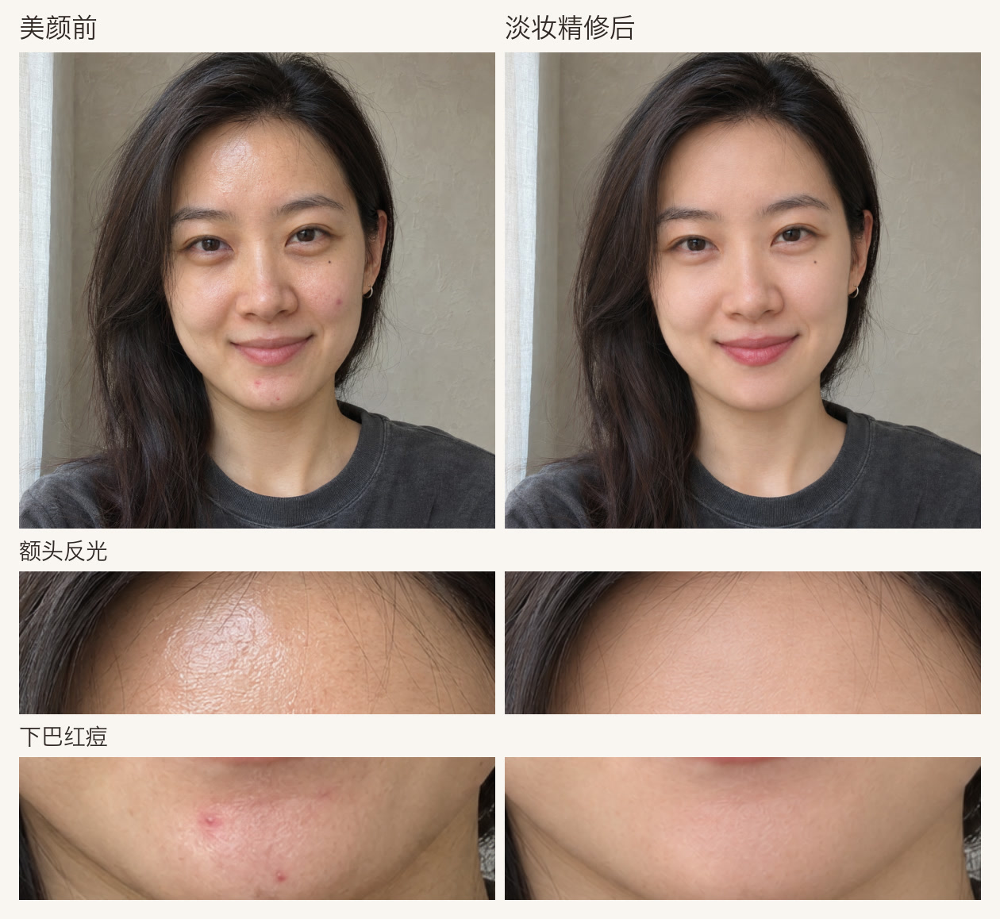

# 自然人像精修 · Portrait Retouch

上传一张自拍，说出想修的位置，例如「下巴的红痘帮我去掉，眼下的小痣留着」。自然人像精修会把这个要求落实到原照片上，交付可单独使用的成片，也可以用同位置、同倍率的局部放大核对细节。



示例使用 AI 生成的虚构人像。右侧成片由左侧原图编辑得到。可以放大比较额头的反光、下巴的红痘，以及两张照片中都保留的眼下小痣。[查看原图](assets/before.png) · [查看精修成片](assets/after.png)

## 安装与试用

在支持图像编辑的智能助手中使用。支持 Skills CLI 的环境可运行：

```sh
npx skills add hzw-object/portrait-retouch --skill portrait-retouch
```

上传照片后，试试这句话：

> 用 $portrait-retouch 把这张自拍修成日常头像。压一下额头油光，淡化眼下阴影，保留笑纹。给我独立成片，并把修过的位置放大对比。

默认自然轻修。想要示例里的妆感，可以明确说「淡妆精修，唇色用玫瑰豆沙色」。[查看完整示例提示词](SKILL.md)
