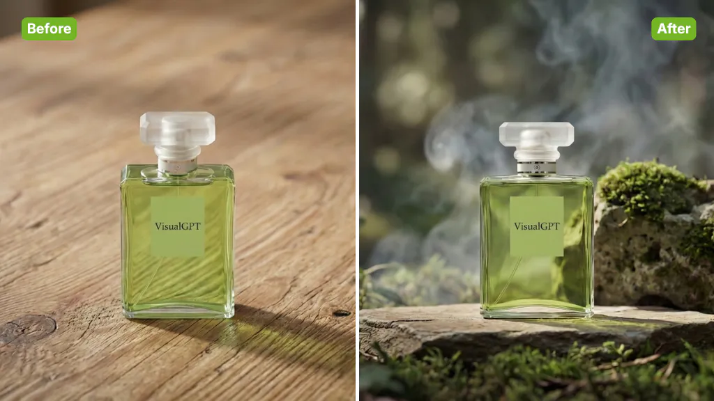
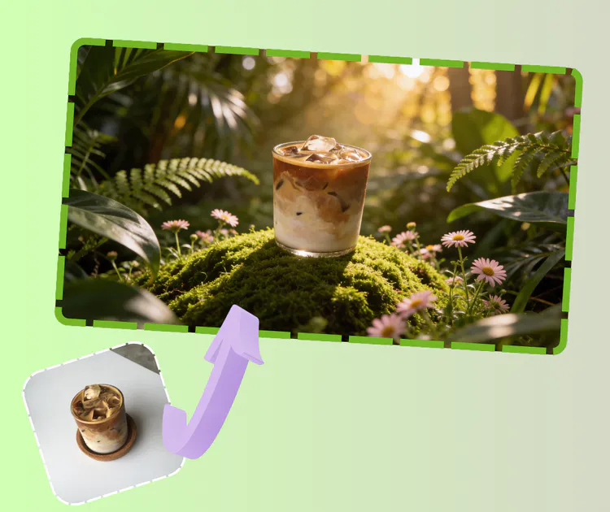
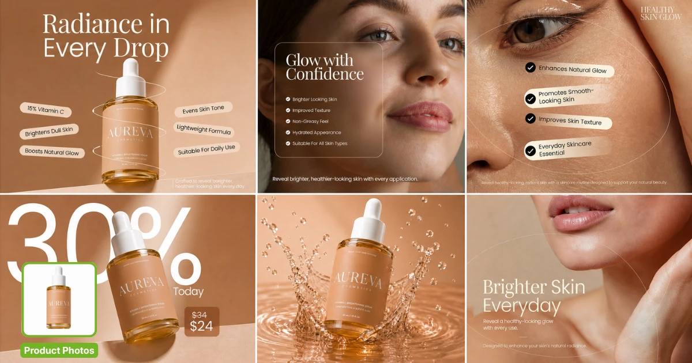

# Product Photo Kit

By [VisualGPT](https://visualgpt.io/).

Turn a product photo or brief into a coordinated ecommerce image plan, complete prompts, and product-specific review checks. Use the prompts with your preferred image-generation or editing tool that accepts product references.

The core workflow requires no particular provider account, API key, or integration. VisualGPT is the author and source of the bundled examples; its [execution guide](references/visualgpt-guide.md) is optional.

## What it prepares

A useful starter kit contains six separate images:

| Image | Purpose |
| --- | --- |
| Clean hero | Present the complete product with an uncluttered background |
| Lifestyle scene 1 | Show the product in a relevant setting |
| Lifestyle scene 2 | Add a distinct setting or composition within the same visual direction |
| Detail image | Highlight a feature visible in the original reference |
| Feature card | Present confirmed product information or leave room for later typesetting |
| Social creative | Adapt the visual direction to a promotional composition |

The image count and roles follow your request. Each planned image receives a complete, independent prompt with the product identity, framing, lighting, text policy, and relevant exclusions. Six planned images means six separate deliverables, not a six-panel collage.

The Skill also separates confirmed product facts from creative choices and unknown specifications. It avoids inventing capacities, dimensions, ingredients, performance claims, or discounts.

## Install

Download the [Skill ZIP](https://github.com/visualgptio/product-photo-kit/releases/latest/download/product-photo-kit.zip) and extract the `product-photo-kit` folder. You can also download this repository and keep `SKILL.md`, `agents/`, `references/`, and `assets/` together in a folder with that name.

For Codex, place that folder in `~/.codex/skills/product-photo-kit`. For another agent that supports `SKILL.md`, use its documented Skill installation location. No image-provider setup is needed to prepare a plan and prompts.

## Use

Invoke the Skill and provide a product photo, target channel, and any confirmed product details:

```text
Use $product-photo-kit to plan six coordinated images for my independent
store: a clean hero, two lifestyle scenes, a detail image, a feature card,
and a vertical social creative. Use my product photo as the identity
reference. Give me complete prompts and a handoff for my current
reference-image editor. Do not generate images yet.
```

A product brief is enough to draft the plan. When no photo is supplied, the Skill labels the prompts as drafts and leaves product details to the actual reference.

To create the images, attach your original product photo in your chosen tool, paste one complete prompt at a time, select the settings it actually offers, and compare each result with the original. Reference fidelity and available controls vary by tool. Keep the original photo as the product identity reference for every shot.

## Real example references

The bundled examples include three six-image plans and eighteen newly authored prompts. Read the [case studies](references/case-studies.md) for the full plans and prompts, or inspect the [structured examples](references/example-kits.json).

### Perfume: tabletop photo to woodland scene



An existing official demonstration with the input depiction on the left and the displayed result on the right. Borrow its soft light, stone surface, and woodland atmosphere. The visible VisualGPT label belongs to this example product; it is not a requirement for your own images.

Source: [VisualGPT AI Product Photography](https://visualgpt.io/ai-product-photography).

### Iced coffee: botanical lifestyle scene



The source photo appears in the lower-left inset. The larger scene illustrates warm light and botanical depth. The colored frame and arrow are part of the published presentation, not elements requested in the new prompts.

Source: [VisualGPT AI Product Photography](https://visualgpt.io/ai-product-photography).

### Skincare: a coordinated amber gallery



A published gallery with a shared amber and peach palette. Its ingredient, efficacy, price, and discount copy does not establish facts for a different product. The new kit prompts use the visual direction while omitting unconfirmed claims.

Source: [VisualGPT AI Product Detail Page Generator](https://visualgpt.io/product-detail-page).

These images are existing official public-page demonstrations, not results generated by this Skill. Standalone original input files and historical generation prompts are not published. All eighteen bundled prompts are newly authored and have not been generation-tested; they are not claimed to reproduce the published examples. The [source manifest](references/case-sources.json) records the public URLs, source descriptions, and image hashes.

## Optional: create in VisualGPT

If you choose VisualGPT, use the [optional VisualGPT guide](references/visualgpt-guide.md) for its Product Photography and Product Detail Page workflows. The guide's interface controls and limits apply to VisualGPT only. You can use the core plan and prompts without opening that guide.

## Files

- [SKILL.md](SKILL.md): the reusable workflow and routing instructions.
- [Prompt patterns](references/prompt-patterns.md): product identity, shot roles, batch briefs, and targeted corrections.
- [Delivery template](references/kit-template.md): a flexible output structure.
- [Case studies](references/case-studies.md): the three real example references and new prompt sets.
- [Optional provider guide](references/visualgpt-guide.md): VisualGPT-specific instructions.

This version prepares plans, prompts, and review checks. It does not automatically upload photos, submit generation jobs, spend credits, or publish store listings.
