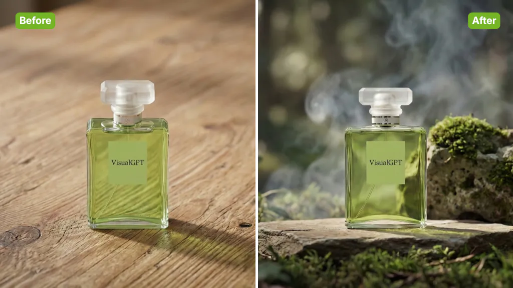
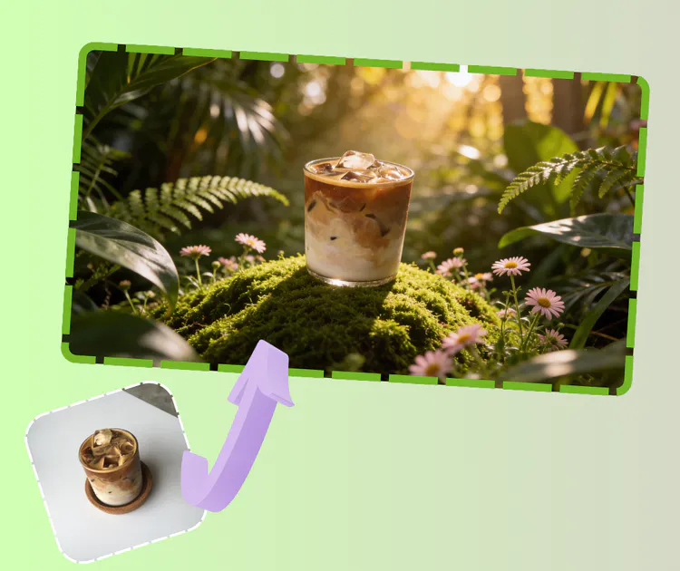
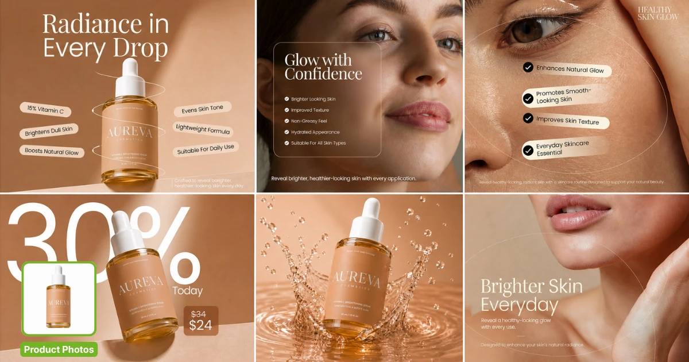

# Product image examples and new kit prompts

Example images published by VisualGPT; prompts can be adapted for the user's chosen reference-image tool.

Verified: **2026-11-18**. These are existing **official public tool-page examples**, not Explore records and not results generated by this new skill. The product-photo and detail-page Explore categories were empty when checked. Exact historical prompts and standalone input files are not published. Source and result depictions are contained in the original composites. All prompts below are **newly authored, not generation-tested**.

Use the images as visual references. To execute a prompt, attach a clean photo of your actual product in your preferred reference-image tool; do not upload an entire marketing composite as the identity reference. For the example products themselves, obtain the original single-product photo first. Rewrite the concrete product lock for a different SKU.

The six prompts in each case plan six independent outputs. They do not claim the existing source illustration was generated by those prompts. Source graphics may contain before/after labels, arrows, or promotional text; these are not requested in the new outputs.

## Perfume — woodland product photo kit



Source: [https://visualgpt.io/ai-product-photography](https://visualgpt.io/ai-product-photography) · [original image](https://cdn.static-boost.com/visualgpt/static/ai-product-photography/demo-1.webp).

The left Before panel is the only available input depiction; no standalone original input URL is supplied. The right After panel is the displayed result. This existing official demo was not generated by the new skill.

**Observed facts and unknowns**

Visible: a clear rectangular bottle, pale green liquid, a transparent faceted cap, and a pale green front label reading VisualGPT. Unknown: capacity, fragrance notes, ingredients, and environmental attributes.

**Visual direction**

Sage green and pale limestone; soft upper-left light and natural contact shadows. Ferns provide background atmosphere without implying ingredients.

**Transferable idea**

Borrow the moss-edged stone, shallow depth of field, and soft light from the right panel. The left panel is the Before input depiction within the published composite; no standalone original input file is published.

**New six-image kit — newly authored prompts**

| Image | Ratio | Suggested output filename |
|---|---|---|
| Clean product hero | 1:1 | `perfume-forest-01-hero.png` |
| Woodland lifestyle scene | 4:5 | `perfume-forest-02-forest.png` |
| Vanity lifestyle scene | 4:5 | `perfume-forest-03-vanity.png` |
| Visible detail close-up | 1:1 | `perfume-forest-04-detail.png` |
| Bottle silhouette composition | 4:5 | `perfume-forest-05-feature.png` |
| Social campaign background | 9:16 | `perfume-forest-06-social.png` |

### Clean product hero / 01-hero

```text
Create one standalone product image, not a collage or a before-and-after layout. Use the supplied single-product photo as the identity reference. Preserve the clear rectangular perfume bottle, pale green liquid, transparent faceted cap, bottle proportions, and the light green front label with its existing VisualGPT lettering. Keep the cap closed and retain all visible edges and glass thickness. Do not reveal an unsupported rear view or invent label copy. Place the complete upright bottle on a very light warm-gray seamless surface, centered with comfortable margins. Use soft upper-left light, restrained glass highlights, and a natural contact shadow. No props. Compose for a 1:1 crop using a matching setting if available. Add no promotional text, watermark, arrow, colored border, or source-photo inset; preserve only existing product-label artwork.
```

### Woodland lifestyle scene / 02-forest

```text
Create one standalone product image, not a collage or a before-and-after layout. Use the supplied single-product photo as the identity reference. Preserve the clear rectangular perfume bottle, pale green liquid, transparent faceted cap, bottle proportions, and the light green front label with its existing VisualGPT lettering. Keep the cap closed and retain all visible edges and glass thickness. Do not reveal an unsupported rear view or invent label copy. Place the upright bottle on a flat moss-edged stone in a softly blurred woodland. Keep a clean dry contact area under the bottle. Use distant fern fronds and dappled soft upper-left light; no plant overlaps the product or its label. Compose for a 4:5 crop using a matching setting if available. Add no promotional text, watermark, arrow, colored border, or source-photo inset; preserve only existing product-label artwork.
```

### Vanity lifestyle scene / 03-vanity

```text
Create one standalone product image, not a collage or a before-and-after layout. Use the supplied single-product photo as the identity reference. Preserve the clear rectangular perfume bottle, pale green liquid, transparent faceted cap, bottle proportions, and the light green front label with its existing VisualGPT lettering. Keep the cap closed and retain all visible edges and glass thickness. Do not reveal an unsupported rear view or invent label copy. Place the upright bottle on a pale limestone vanity against a muted sage wall, with one folded ivory cloth far behind it. Keep the bottle dominant, the front label unobstructed, and the upper-left light soft. Do not add another bottle or decorative packaging. Compose for a 4:5 crop using a matching setting if available. Add no promotional text, watermark, arrow, colored border, or source-photo inset; preserve only existing product-label artwork.
```

### Visible detail close-up / 04-detail

```text
Create one standalone product image, not a collage or a before-and-after layout. Use the supplied single-product photo as the identity reference. Preserve the clear rectangular perfume bottle, pale green liquid, transparent faceted cap, bottle proportions, and the light green front label with its existing VisualGPT lettering. Keep the cap closed and retain all visible edges and glass thickness. Do not reveal an unsupported rear view or invent label copy. Create a tight front-facing crop of the actual cap, neck, and upper bottle as shown in the reference. Retain the exact cap facets and green liquid appearance, with a softly blurred sage-gray background and controlled reflections. Do not create a spray action, open the cap, or show an invented mechanism. Compose for a 1:1 crop using a matching setting if available. Add no promotional text, watermark, arrow, colored border, or source-photo inset; preserve only existing product-label artwork.
```

### Bottle silhouette composition / 05-feature

```text
Create one standalone product image, not a collage or a before-and-after layout. Use the supplied single-product photo as the identity reference. Preserve the clear rectangular perfume bottle, pale green liquid, transparent faceted cap, bottle proportions, and the light green front label with its existing VisualGPT lettering. Keep the cap closed and retain all visible edges and glass thickness. Do not reveal an unsupported rear view or invent label copy. Place the complete bottle in the lower right on pale stone, leaving the upper left clean for later typesetting. Use a muted sage background and soft upper-left light to emphasize the existing rectangular silhouette. Do not add callout lines, scent ingredients, badges, or functional claims. Compose for a 4:5 crop using a matching setting if available. Add no promotional text, watermark, arrow, colored border, or source-photo inset; preserve only existing product-label artwork.
```

### Social campaign background / 06-social

```text
Create one standalone product image, not a collage or a before-and-after layout. Use the supplied single-product photo as the identity reference. Preserve the clear rectangular perfume bottle, pale green liquid, transparent faceted cap, bottle proportions, and the light green front label with its existing VisualGPT lettering. Keep the cap closed and retain all visible edges and glass thickness. Do not reveal an unsupported rear view or invent label copy. Create a vertical campaign composition with the upright bottle in the lower third on flat stone. Place soft out-of-focus fern shadows in the background and leave the upper half uncluttered for a separately added headline. Preserve readable front-label placement and soft upper-left light. No sale sticker or environmental symbols. Compose for a 9:16 crop using a matching setting if available. Add no promotional text, watermark, arrow, colored border, or source-photo inset; preserve only existing product-label artwork.
```

**Review**: compare the result with the original single-product photo; reject altered product geometry, label artwork, color or included items. Use your preferred reference-image generation or editing tool for these complete per-image prompts. For VisualGPT, the optional guide explains its Custom mode.

## Iced coffee — botanical café image kit



Source: [https://visualgpt.io/ai-product-photography](https://visualgpt.io/ai-product-photography) · [original image](https://cdn.static-boost.com/visualgpt/static/ai-product-photography/case-1.webp).

The lower-left inset depicts the source photo. It is part of the composite; no standalone input asset is published. The large upper panel is the displayed product scene. The composite has decorative green borders and a purple arrow that are not part of the intended generated product photo.

**Observed facts and unknowns**

Visible: a clear straight-sided glass, ice, a pale lower layer, and a darker coffee layer. Unknown: actual serving capacity, ingredients, calories, and whether the drink is sugar-free or organic.

**Visual direction**

Botanical green and warm cream; warm, soft side light. Preserve the drink layers and glass proportions without adding unconfirmed ingredients.

**Transferable idea**

Borrow the layered botanical foreground and background, together with the warm light. The lower-left inset depicts the input photo within the published composite; the green border and purple arrow belong only to its presentation layout.

**New six-image kit — newly authored prompts**

| Image | Ratio | Suggested output filename |
|---|---|---|
| Clean drink hero | 1:1 | `iced-coffee-lifestyle-01-hero.png` |
| Botanical lifestyle scene | 4:5 | `iced-coffee-lifestyle-02-botanical.png` |
| Everyday café scene | 4:5 | `iced-coffee-lifestyle-03-cafe.png` |
| Ice and rim detail | 1:1 | `iced-coffee-lifestyle-04-detail.png` |
| Layered drink composition | 4:5 | `iced-coffee-lifestyle-05-feature.png` |
| Vertical social background | 9:16 | `iced-coffee-lifestyle-06-social.png` |

### Clean drink hero / 01-hero

```text
Create one standalone product image, not a collage or a before-and-after layout. Use the supplied single-glass drink photo as the product reference. Preserve the same clear straight-sided glass, its proportions and rim, the visible ice, and the existing pale lower layer and darker coffee appearance above it. Retain the drink fill level as closely as the reference allows. Do not add a handle, straw, logo, garnish, ingredients, or extra servings. Place the single glass on a warm off-white seamless tabletop. Show the entire glass with a natural contact shadow, gentle highlights on the glass, and warm soft side light. Keep the actual layered drink visible. No surrounding objects. Compose for a 1:1 crop using a matching setting if available. Add no promotional text, watermark, arrow, colored border, or source-photo inset; preserve only existing product-label artwork.
```

### Botanical lifestyle scene / 02-botanical

```text
Create one standalone product image, not a collage or a before-and-after layout. Use the supplied single-glass drink photo as the product reference. Preserve the same clear straight-sided glass, its proportions and rim, the visible ice, and the existing pale lower layer and darker coffee appearance above it. Retain the drink fill level as closely as the reference allows. Do not add a handle, straw, logo, garnish, ingredients, or extra servings. Place the glass on a clean flat stone surface with moss around, but not under or inside, the serving area. Use softly blurred ferns and small distant flowers with warm filtered side light. Keep all foliage away from the rim and drink, and make the glass the clear subject. Compose for a 4:5 crop using a matching setting if available. Add no promotional text, watermark, arrow, colored border, or source-photo inset; preserve only existing product-label artwork.
```

### Everyday café scene / 03-cafe

```text
Create one standalone product image, not a collage or a before-and-after layout. Use the supplied single-glass drink photo as the product reference. Preserve the same clear straight-sided glass, its proportions and rim, the visible ice, and the existing pale lower layer and darker coffee appearance above it. Retain the drink fill level as closely as the reference allows. Do not add a handle, straw, logo, garnish, ingredients, or extra servings. Place the glass on a light oak café table near a softly lit window, with a muted green wall in the background. Keep the scene empty of food, people, cutlery, and second drinks. Use warm gentle side light and keep the original drink appearance and glass proportions. Compose for a 4:5 crop using a matching setting if available. Add no promotional text, watermark, arrow, colored border, or source-photo inset; preserve only existing product-label artwork.
```

### Ice and rim detail / 04-detail

```text
Create one standalone product image, not a collage or a before-and-after layout. Use the supplied single-glass drink photo as the product reference. Preserve the same clear straight-sided glass, its proportions and rim, the visible ice, and the existing pale lower layer and darker coffee appearance above it. Retain the drink fill level as closely as the reference allows. Do not add a handle, straw, logo, garnish, ingredients, or extra servings. Frame a closer view of the visible rim, ice, and upper drink layer from the supplied reference, preserving the actual glass edge and drink colors. Keep a warm neutral background and realistic highlights. Do not invent foam, toppings, condensation patterns that hide the contents, or a new ingredient. Compose for a 1:1 crop using a matching setting if available. Add no promotional text, watermark, arrow, colored border, or source-photo inset; preserve only existing product-label artwork.
```

### Layered drink composition / 05-feature

```text
Create one standalone product image, not a collage or a before-and-after layout. Use the supplied single-glass drink photo as the product reference. Preserve the same clear straight-sided glass, its proportions and rim, the visible ice, and the existing pale lower layer and darker coffee appearance above it. Retain the drink fill level as closely as the reference allows. Do not add a handle, straw, logo, garnish, ingredients, or extra servings. Place the single glass on the right against a warm cream background, with generous empty space on the left. Light the existing pale and dark drink layers softly so they remain visible. Do not add ingredient diagrams, measurements, nutrition facts, or a recipe. Compose for a 4:5 crop using a matching setting if available. Add no promotional text, watermark, arrow, colored border, or source-photo inset; preserve only existing product-label artwork.
```

### Vertical social background / 06-social

```text
Create one standalone product image, not a collage or a before-and-after layout. Use the supplied single-glass drink photo as the product reference. Preserve the same clear straight-sided glass, its proportions and rim, the visible ice, and the existing pale lower layer and darker coffee appearance above it. Retain the drink fill level as closely as the reference allows. Do not add a handle, straw, logo, garnish, ingredients, or extra servings. Place the glass in the lower third of a vertical frame on a light stone table, with soft botanical shadows in the background and uncluttered space above it. Use the same warm side light and muted green palette. Do not add a price, promotion, health claim, brand mark, arrow, or decorative frame. Compose for a 9:16 crop using a matching setting if available. Add no promotional text, watermark, arrow, colored border, or source-photo inset; preserve only existing product-label artwork.
```

**Review**: compare the result with the original single-product photo; reject altered product geometry, label artwork, color or included items. Use your preferred reference-image generation or editing tool for these complete per-image prompts. For VisualGPT, the optional guide explains its Custom mode.

## Skincare — coordinated amber image kit



Source: [https://visualgpt.io/product-detail-page](https://visualgpt.io/product-detail-page) · [original image](https://cdn.static-boost.com/visualgpt/static/product-detail-page/demo-beauty-skincare.webp).

A green outlined Product Photos inset in the lower-left panel depicts the source product. No standalone original input or individual six result assets are provided. The whole six-panel composite is the existing official gallery, not a six-image run made by this new skill.

**Observed facts and unknowns**

Visible: an amber-toned cylindrical dropper bottle, a white dropper cap, a warm label, and AUREVA lettering. Unknown: active ingredients and concentrations, capacity, efficacy, original price, and discount.

**Visual direction**

Amber, warm peach, and ivory; soft upper-left light. Build the set around the product, glass, and contact shadows without suggesting skin-treatment outcomes.

**Transferable idea**

Borrow the coordinated warm palette and product proportions across the six-image gallery. A Product Photos input inset appears in the lower-left panel. Concentrations, benefits, and discounts shown in the original artwork are not treated as product facts for this case.

**New six-image kit — newly authored prompts**

| Image | Ratio | Suggested output filename |
|---|---|---|
| Warm studio hero | 1:1 | `skincare-gallery-01-hero.png` |
| Vanity lifestyle scene | 4:5 | `skincare-gallery-02-vanity.png` |
| Amber glass studio scene | 4:5 | `skincare-gallery-03-studio.png` |
| Cap and packaging detail | 1:1 | `skincare-gallery-04-detail.png` |
| Packaging composition background | 4:5 | `skincare-gallery-05-feature.png` |
| Social series background | 9:16 | `skincare-gallery-06-social.png` |

### Warm studio hero / 01-hero

```text
Create one standalone product image, not a collage or a before-and-after layout. Use the supplied single-product photo as the identity reference. Preserve the cylindrical amber-toned dropper bottle, white dropper cap, exact visible bottle and cap proportions, warm front label, and existing AUREVA lettering. Keep the bottle closed and retain the original label artwork without rewriting small text. Do not add an opened pipette, extra package, or unsupported rear view. Place the complete upright bottle centered on a warm ivory seamless surface with a subtle peach background. Use soft upper-left light and a gentle natural contact shadow. Preserve glass reflections and the front-label position. No props. Compose for a 1:1 crop using a matching setting if available. Add no promotional text, watermark, arrow, colored border, or source-photo inset; preserve only existing product-label artwork.
```

### Vanity lifestyle scene / 02-vanity

```text
Create one standalone product image, not a collage or a before-and-after layout. Use the supplied single-product photo as the identity reference. Preserve the cylindrical amber-toned dropper bottle, white dropper cap, exact visible bottle and cap proportions, warm front label, and existing AUREVA lettering. Keep the bottle closed and retain the original label artwork without rewriting small text. Do not add an opened pipette, extra package, or unsupported rear view. Place the bottle on a pale warm-stone vanity, with an out-of-focus folded cream towel far behind it. Keep the scene uncluttered, the bottle fully visible, and the front label facing the camera. Use soft upper-left light and the established amber-peach palette. No hands, face, or skin before-and-after. Compose for a 4:5 crop using a matching setting if available. Add no promotional text, watermark, arrow, colored border, or source-photo inset; preserve only existing product-label artwork.
```

### Amber glass studio scene / 03-studio

```text
Create one standalone product image, not a collage or a before-and-after layout. Use the supplied single-product photo as the identity reference. Preserve the cylindrical amber-toned dropper bottle, white dropper cap, exact visible bottle and cap proportions, warm front label, and existing AUREVA lettering. Keep the bottle closed and retain the original label artwork without rewriting small text. Do not add an opened pipette, extra package, or unsupported rear view. Place the bottle on a dry matte peach studio surface, with one translucent amber glass panel far in the background casting a soft warm shape. Keep the product upright, dry, and dominant. Use soft upper-left light. Do not add water splashes or imply water resistance. Compose for a 4:5 crop using a matching setting if available. Add no promotional text, watermark, arrow, colored border, or source-photo inset; preserve only existing product-label artwork.
```

### Cap and packaging detail / 04-detail

```text
Create one standalone product image, not a collage or a before-and-after layout. Use the supplied single-product photo as the identity reference. Preserve the cylindrical amber-toned dropper bottle, white dropper cap, exact visible bottle and cap proportions, warm front label, and existing AUREVA lettering. Keep the bottle closed and retain the original label artwork without rewriting small text. Do not add an opened pipette, extra package, or unsupported rear view. Frame a close front view of the existing white dropper cap and upper label, showing only details visible in the reference. Retain the real cap proportions, bottle curvature, label alignment, and glass color. Use soft warm light and a neutral peach background. Do not show product application or invent formula texture. Compose for a 1:1 crop using a matching setting if available. Add no promotional text, watermark, arrow, colored border, or source-photo inset; preserve only existing product-label artwork.
```

### Packaging composition background / 05-feature

```text
Create one standalone product image, not a collage or a before-and-after layout. Use the supplied single-product photo as the identity reference. Preserve the cylindrical amber-toned dropper bottle, white dropper cap, exact visible bottle and cap proportions, warm front label, and existing AUREVA lettering. Keep the bottle closed and retain the original label artwork without rewriting small text. Do not add an opened pipette, extra package, or unsupported rear view. Place the full upright bottle on the right with clean space on the left for later typesetting. Use an ivory-to-peach studio background and soft upper-left light to reveal the bottle silhouette and packaging. Add no ingredient percentage, clinical statement, skin-benefit claim, award, or certification. Compose for a 4:5 crop using a matching setting if available. Add no promotional text, watermark, arrow, colored border, or source-photo inset; preserve only existing product-label artwork.
```

### Social series background / 06-social

```text
Create one standalone product image, not a collage or a before-and-after layout. Use the supplied single-product photo as the identity reference. Preserve the cylindrical amber-toned dropper bottle, white dropper cap, exact visible bottle and cap proportions, warm front label, and existing AUREVA lettering. Keep the bottle closed and retain the original label artwork without rewriting small text. Do not add an opened pipette, extra package, or unsupported rear view. Create a vertical brand composition with the upright bottle in the lower third on a warm ivory surface and a softly curved peach backdrop behind it. Leave the upper half clear for separately approved copy. Maintain the exact product appearance and soft upper-left light. Do not add a face, before-and-after skin, price, discount, efficacy claim, or sale graphic. Compose for a 9:16 crop using a matching setting if available. Add no promotional text, watermark, arrow, colored border, or source-photo inset; preserve only existing product-label artwork.
```

### Optional batch brief

Use this brief only if your chosen tool can assign different roles to separate image outputs. If it creates variations of one shared prompt, use the six individual prompts instead. Respect the actual input limit and ratio controls. VisualGPT-specific steps are kept in the optional provider guide.

```text
Create six separate coordinated product images, not a six-panel collage. Use the original product reference in each image. Visible product facts: an amber-toned cylindrical bottle, white dropper cap, warm front label, and AUREVA lettering. Preserve exact visible shape, cap geometry, color, label artwork, and product count. Keep the bottle closed; do not invent a rear view, extra packaging, or small label text. Shared direction: amber, warm peach, ivory, soft upper-left light, natural contact shadows, and no added promotional text. Image roles: 1) complete product on an ivory studio surface; 2) warm-stone vanity with a distant cream towel; 3) matte peach studio setting with a distant amber glass panel; 4) close view of the visible cap and upper label; 5) bottle at right with clean space at left; 6) vertical composition with clean space above. Do not add skin portraits, ingredient concentrations, capacity, efficacy claims, certifications, prices, discounts, liquid splashes, or product application. Assign ratios per image only if the tool supports it. Otherwise run the complete prompts individually. Inspect any generated plan before rendering the images.
```

**Review**: compare the result with the original single-product photo; reject altered product geometry, label artwork, color or included items. Use your preferred reference-image generation or editing tool for these complete per-image prompts. For VisualGPT, the optional guide explains its Custom mode.

## Provenance

The [source manifest](case-sources.json) records public pages, image URLs, retrieval date, file hashes, and what is available about each input/output. It contains no account credentials or administrative access instructions.
