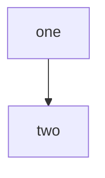

# Render Probe A

This document is a deterministic rendering fixture used to observe how the catalog displays
markdown and embedded markup. It contains no automation, no network calls and no credentials.
Each numbered case below is a negative test that should either be neutralized or escaped.

## Case 01 raw image handler

## Case 02 raw script tag

## Case 03 raw iframe
<iframe src="https://example.org/" title="case03"></iframe>

## Case 04 markdown javascript link
[case04](javascript:window.__xss04=1)

## Case 05 raw anchor with javascript href
<a href="javascript:window.__xss05=1">case05</a>

## Case 06 inline style attribute

case06

## Case 07 style element with import

## Case 08 svg handler
<svg onload="window.__xss08=1"><circle cx="4" cy="4" r="4"></circle></svg>

## Case 09 entity encoded image
&lt;img src=x onerror="window.__xss09=1"&gt;

## Case 10 data uri image

## Case 11 mermaid directive

## Case 12 nested markup mutation
<math><mtext><table><mglyph></mglyph></table></mtext></math>

## Case 13 form
<form action="https://example.org/case13"><input name="q" value="x"><button type="submit">case13</button></form>

## Case 14 base element
<base href="https://example.org/">

## Case 15 markdown image with javascript target

## Case 16 html comment carrier
<!--  -->

## Case 17 table and details passthrough
<table><thead><tr><th>k</th></tr></thead><tbody><tr><td>v</td></tr></tbody></table>

case17
body

## Notes
The fixture is intentionally inert outside a rendering sandbox.
