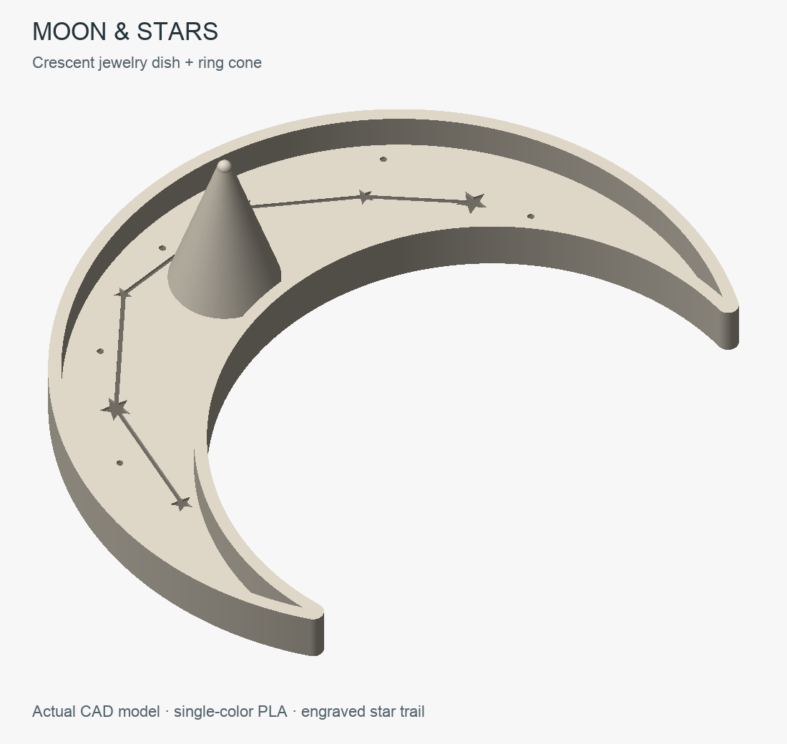

# Crescent jewelry dish

Original editable CAD: a rounded crescent dish, ring cone and engraved decorative star trail. No photos, third-party meshes, printer presets or G-code are included.

Install the root `requirements-core.txt`, then run:

```sh
.venv/bin/python examples/moon-jewelry-dish/build_dish.py
.venv/bin/python scripts/u1_mesh_check.py examples/moon-jewelry-dish/moon-jewelry-dish.stl
```

Outputs are millimeter STL/GLB plus a geometry report in this directory. The source contains the design dimensions; edit it and regenerate for changes. Its assertions check the encoded STL for a closed, consistently wound single solid. A 0.005 mm CAD tolerance removes tiny boolean fragments before export.

Approximate size: 97.3 × 128 × 34 mm. A 0.4 mm U1 PLA slice at 0.20 mm layers, three walls and 15% gyroid was about 25 g / 50 minutes without supports. This is an example estimate, not a portable print profile or physical print test. Select your own current U1/nozzle/plate/spool settings and inspect the layers.


