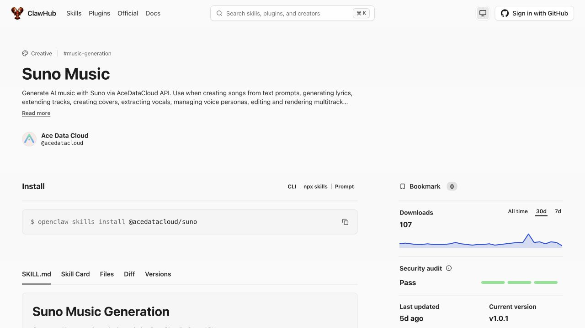

# Tripo 3D by Ace Data Cloud

An Ace Data Cloud maintained integration for tripo-3d, using your own Ace service API key. This is not an official integration from the model brand or OpenClaw. Install this service alone; no suite or extra MCP is required.

## 1. Install from the native catalog

Open the [ClawHub listing](https://clawhub.ai/acedatacloud/skills/tripo-3d) (it may be unavailable until publication) and verify publisher `@acedatacloud`:

```sh
openclaw skills install @acedatacloud/tripo-3d
```

Older/direct workflows can use `clawhub install @acedatacloud/tripo-3d`. Source/preview availability is not registry approval; inspect the real listing and installed version.



This historical Suno Skill 1.0.1 page shows the publisher and install entry only. Other services use their own listing above. It is not an installation or execution result for this candidate, and does not prove a paid call. See bundled `assets/source.json` for provenance and limits. A real screenshot of the new native Key configuration is still pending.

## 2. Register and copy a service key

[Register or sign in to Ace](https://platform.acedata.cloud/?utm_source=agent_skill&utm_medium=referral&utm_campaign=evergreen) → [Applications](https://platform.acedata.cloud/console/applications?utm_source=agent_skill&utm_medium=referral&utm_campaign=evergreen) → **General application**. Choose **Initialize General Application** if needed. Check service access, balance and [current pricing](https://platform.acedata.cloud/models?utm_source=agent_skill&utm_medium=referral&utm_campaign=evergreen).
Copy its API Key or choose **Manage Keys → Create** for a dedicated key. Set expiry, usage limits and **Allowed APIs** as needed: `/tripo/generations`, `/tripo/models`, `/tripo/animations`, `/tripo/tasks`.
Copy the raw value without `Bearer `. A `platform-...` account token is not a service key. Never put a real key in a prompt, screenshot or repository.


Image source: original Ace SunoDify tutorial screenshots at the pinned commit, reused 2026-10-18; capture date is unspecified. They are key-location references, not a new account test. No new OpenClaw configuration screenshot is claimed.

## 3. Use OpenClaw's native Skill credential field

On the Gateway machine, merge this entry into `skills.entries` in `~/.openclaw/openclaw.json`; **do not replace the entire file**. Replace the placeholder privately:

```json
{
  "skills": {
    "entries": {
      "tripo-3d": {
        "enabled": true,
        "apiKey": "YOUR_ACE_SERVICE_API_KEY"
      }
    }
  }
}
```

Alternatively set `ACEDATACLOUD_API_TOKEN=your_service_key` in `~/.openclaw/.env`. Choose one method, protect file permissions (for example `chmod 600`), restart the Gateway and start a new session.
The Skill's `primaryEnv` maps the native `apiKey` to the host agent turn. A sandbox does not automatically inherit it: configure the same variable separately for the sandbox per the [official Skills config](https://docs.openclaw.ai/tools/skills-config). Do not paste the key into a chat.

## 4. First use and result

After checking the cost and getting the user's agreement to generate, ask: **Use the Tripo skill to check whether the Khronos sample Box model can be rigged.**
The exact request examples and model IDs are bundled in `SKILL.md`; no other service installation is required.
Expected result: The rig check succeeds with riggable false for this mesh. Retrieve the original task ID. This check is free.
Save any returned task ID and retrieve that same ID until explicit success or failure. A timeout or pending preview is not permission to submit again. Preserve errors rather than switching models. Prompts and referenced media are sent to `api.acedata.cloud`; use only content you are entitled to process.

## Troubleshooting

- 401: check the full key and Gateway/sandbox environment; do not include `Bearer ` inside the key value.
- 403: check access, expiry, limits and Allowed APIs; content moderation can also return 403, so read the error.
- 429: reduce rate; do not automatically retry a paid submission.
- Missing Skill: the configuration key is `tripo-3d`; restart and check Skill eligibility. `curl` and the service key are required.
- Pending, 5xx or timeout: retrieve the original task, retain the trace ID and do not treat a preview URL as completion.

Acquisition tags identify pre-signup context only; they do not prove users, payments or revenue.
