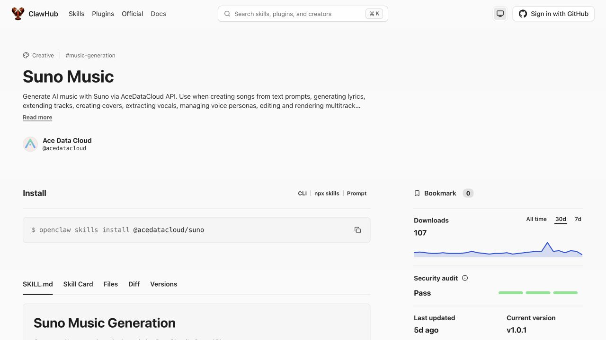

# Tripo 3D by Ace Data Cloud

这是 Ace Data Cloud 维护的 tripo-3d 集成，使用你自己的 Ace 服务 API Key；不声称是模型品牌方或 OpenClaw 官方发布。每个技能独立安装，不需要安装合集或额外 MCP。

## 1. 从官方目录安装

[ClawHub 条目](https://clawhub.ai/acedatacloud/skills/tripo-3d)（发布前可能尚不可用），确认发布者是 `@acedatacloud`：

```sh
openclaw skills install @acedatacloud/tripo-3d
```

旧版也可使用 `clawhub install @acedatacloud/tripo-3d`。本说明/预览不代表新版已通过审核；以真实条目和安装结果为准。



这是 Suno Skill 1.0.1 的真实历史目录页，仅说明发布者与安装入口；其他服务使用上面的各自条目。它不是本候选包的安装/运行结果，也不证明付费调用。图像来源与限制在包内 `assets/source.json`；新的原生 Key 配置实拍仍待补齐。

## 2. 注册并取得服务密钥

[注册或登录 Ace](https://platform.acedata.cloud/?utm_source=agent_skill&utm_medium=referral&utm_campaign=evergreen) → [Applications](https://platform.acedata.cloud/console/applications?utm_source=agent_skill&utm_medium=referral&utm_campaign=evergreen) → **General application**（没有则先 Initialize General Application）。检查该服务的权限、余额和[当前价格](https://platform.acedata.cloud/models?utm_source=agent_skill&utm_medium=referral&utm_campaign=evergreen)。
复制 API Key，或 **Manage Keys → Create** 创建专用密钥；按需限制有效期、额度和 Allowed APIs：`/tripo/generations`, `/tripo/models`, `/tripo/animations`, `/tripo/tasks`。
只复制 Key 值，不加 `Bearer `。`platform-...` 管理 token 不能代替服务密钥。不要把 Key 发到聊天、截图或 Git。


配图来源：Ace SunoDify 固定提交的原始教程图，2026-10-18 复用；拍摄日期未声明，不代表当前账号实测。安装页面使用原生 ClawHub 入口；当前安装配置尚无新增界面截图。

## 3. 填入 OpenClaw 原生 Skill 配置

在运行 Gateway 的机器编辑 `~/.openclaw/openclaw.json`，把下面的 `skills.entries` 条目合并到现有配置，**不要覆盖整个文件**；把占位值替换为 Key：

```json
{
  "skills": {
    "entries": {
      "tripo-3d": {
        "enabled": true,
        "apiKey": "YOUR_ACE_SERVICE_API_KEY"
      }
    }
  }
}
```

也可以只在 `~/.openclaw/.env` 设置 `ACEDATACLOUD_API_TOKEN=你的服务密钥`。选择一种方式，保护文件权限（例如 `chmod 600`），重启 Gateway 并开始新会话。
原生 `apiKey` 通过本技能的 `primaryEnv` 注入到宿主的当前 Agent 回合；沙箱不会自动继承，需按 [OpenClaw 官方配置](https://docs.openclaw.ai/tools/skills-config) 给沙箱单独注入同名环境变量。不要把真实 Key 粘贴到示例/提示词。

## 4. 首次使用与结果

确认本次成本并获得用户对生成的同意后，输入：**用 Tripo 技能检查 Khronos 的 Box 示例模型能否绑定骨骼。**。具体请求字段、模型和例子在本包 `SKILL.md`，无需再安装别的服务。
预期：使用原任务 ID 查询，骨骼检查成功后该网格的 riggable 为 false。本次检查免费。
返回任务 ID 后保存它，仅查询同一 ID，直到明确成功/失败；不要因超时或处理中重复提交付费生成。失败保留原始错误，不切换模型。用户内容/参考媒体会发送到 `api.acedata.cloud`，仅使用有权处理的内容。

## 常见问题

- 401：检查完整 Key、Gateway/沙箱环境，确保未把 `Bearer ` 作为 Key 的一部分。
- 403：核服务权限、Key 到期/额度/Allowed APIs；也可能是内容审核拒绝，按原错误处理。
- 429：降低频率；不要自动重试付费提交。
- 技能未出现：确认配置键为 `tripo-3d`，重启并查看技能检查结果；需 `curl` 与服务 Key。
- Pending/5xx/超时：查询原 task，保留 trace ID，不能据预览 URL 宣称完成。

来源标记只用于注册前归因，不保证已经产生用户、收入或付费转化。
