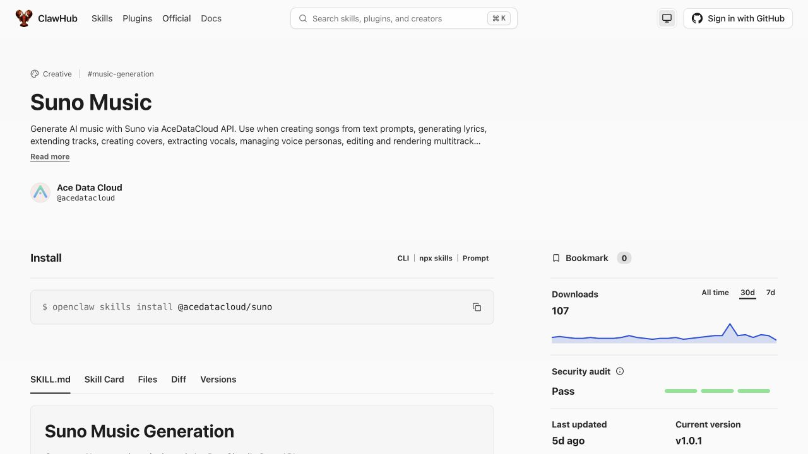

# Tripo 3D by Ace Data Cloud

An Ace Data Cloud maintained integration for tripo-3d, using your own Ace service API key. This is not an official integration from the model brand or OpenClaw. Install this service alone; no suite or extra MCP is required.

## 1. Install from the native catalog

Open the [ClawHub listing](https://clawhub.ai/acedatacloud/skills/tripo-3d) (it may be unavailable until publication) and verify publisher `@acedatacloud`:

```sh
openclaw skills install @acedatacloud/tripo-3d
```

Older/direct workflows can use `clawhub install @acedatacloud/tripo-3d`. Source/preview availability is not registry approval; inspect the real listing and installed version.



This historical Suno Skill 1.0.1 page shows the publisher and install entry only. Other services use their own listing above. It is not an installation or execution result for this candidate, and does not prove a paid call. See bundled `assets/source.json` for provenance and limits. A real screenshot of the new native Key configuration is still pending.

## 2. Register and copy a service key

[Register or sign in to Ace](https://platform.acedata.cloud/?utm_source=agent_skill&utm_medium=referral&utm_campaign=evergreen) → [Applications](https://platform.acedata.cloud/console/applications?utm_source=agent_skill&utm_medium=referral&utm_campaign=evergreen) → **General application**. Choose **Initialize General Application** if needed. Check service access, balance and [current pricing](https://platform.acedata.cloud/models?utm_source=agent_skill&utm_medium=referral&utm_campaign=evergreen).
Copy its API Key or choose **Manage Keys → Create** for a dedicated key. Set expiry, usage limits and **Allowed APIs** as needed: `/tripo/generations`, `/tripo/models`, `/tripo/animations`, `/tripo/tasks`.
Copy the raw value without `Bearer `. A `platform-...` account token is not a service key. Never put a real key in a prompt, screenshot or repository.


Image source: original Ace SunoDify tutorial screenshots at the pinned commit, reused 2026-10-18; capture date is unspecified. They are key-location references, not a new account test. No new OpenClaw configuration screenshot is claimed.

## 3. Use OpenClaw's native Skill credential field

On the Gateway machine, merge this entry into `skills.entries` in `~/.openclaw/openclaw.json`; **do not replace the entire file**. Replace the placeholder privately:

```json
{
  "skills": {
    "entries": {
      "tripo-3d": {
        "enabled": true,
        "apiKey": "YOUR_ACE_SERVICE_API_KEY"
      }
    }
  }
}
```

Alternatively set `ACEDATACLOUD_API_TOKEN=your_service_key` in `~/.openclaw/.env`. Choose one method, protect file permissions (for example `chmod 600`), restart the Gateway and start a new session.
The Skill's `primaryEnv` maps the native `apiKey` to the host agent turn. A sandbox does not automatically inherit it: configure the same variable separately for the sandbox per the [official Skills config](https://docs.openclaw.ai/tools/skills-config). Do not paste the key into a chat.

## 4. First use and result

After checking the cost and getting the user's agreement to generate, ask: **Use the Tripo skill to check whether the Khronos sample Box model can be rigged.**
The exact request examples and model IDs are bundled in `SKILL.md`; no other service installation is required.
Expected result: The rig check succeeds with riggable false for this mesh. Retrieve the original task ID. This check is free.
Save any returned task ID and retrieve that same ID until explicit success or failure. A timeout or pending preview is not permission to submit again. Preserve errors rather than switching models. Prompts and referenced media are sent to `api.acedata.cloud`; use only content you are entitled to process.

## Troubleshooting

- 401: check the full key and Gateway/sandbox environment; do not include `Bearer ` inside the key value.
- 403: check access, expiry, limits and Allowed APIs; content moderation can also return 403, so read the error.
- 429: reduce rate; do not automatically retry a paid submission.
- Missing Skill: the configuration key is `tripo-3d`; restart and check Skill eligibility. `curl` and the service key are required.
- Pending, 5xx or timeout: retrieve the original task, retain the trace ID and do not treat a preview URL as completion.

Acquisition tags identify pre-signup context only; they do not prove users, payments or revenue.

## Service API reference


# Tripo 3D

Use `https://api.acedata.cloud` with `Authorization: Bearer $ACEDATACLOUD_API_TOKEN` and JSON bodies. A restricted token needs the requested operation and `/tripo/tasks` for polling. [Token setup](https://github.com/AceDataCloud/Skills/blob/main/skills/_shared/authentication.md)

## Submit and retrieve

Use `POST /tripo/generations` to create a model. Choose exactly one of `prompt`, `image_url`, or `image_urls`. The following H-series text request costs **2 Ace Credits** on successful delivery. Standard texture is the default and costs 4 for H-series text.

```bash
curl --fail-with-body --silent --show-error https://api.acedata.cloud/tripo/generations \
  -H "Authorization: Bearer ${ACEDATACLOUD_API_TOKEN:?Set your Ace service token}" \
  -H 'Content-Type: application/json' \
  -H "Idempotency-Key: ${TRIPO_REQUEST_KEY:?Set one unique key for this operation}" \
  -d '{"prompt":"A wooden chair with four straight legs","texture":"none","async":true}'
```

Generate one unique idempotency key before the first submission. Save the key and request body together. For a retry of the same operation use that same key and body. Save the returned `task_id` as `TASK_ID` as soon as the server acknowledges it.

```bash
curl --fail-with-body --silent --show-error https://api.acedata.cloud/tripo/tasks \
  -H "Authorization: Bearer ${ACEDATACLOUD_API_TOKEN:?Set your Ace service token}" \
  -H 'Content-Type: application/json' \
  -d "{\"id\":\"${TASK_ID:?Use the original task ID}\"}"
```

Query every few seconds until the task record contains `response.success`. On success, read `response.data[0].model_url` and the optional `image_url`; keep `response.data[0].id` for subsequent operations on this user's model. Report `response.error` and the trace ID on failure. For `submission_unknown` keep the original ID for reconciliation. A single missing or inaccessible task returns `{}`.

Requests are synchronous by default and return the result directly at `data[0]`. Either `async: true` or `callback_url` returns the receipt `{"task_id":"<TASK_ID>"}`. The completion callback receives the terminal result. Batch lookup uses `{"action":"retrieve_batch","ids":["<FIRST_ID>","<SECOND_ID>"]}` or `trace_ids`, up to 100. Read `items` in input order; an unavailable task occupies a `null` slot.

[Asynchronous task reference](https://github.com/AceDataCloud/Skills/blob/main/skills/_shared/async-tasks.md) · [Ace MCP directory](https://github.com/AceDataCloud/Skills/blob/main/skills/_shared/mcp-servers.md)

## Use a local MCP client

Configure the command `uvx` with the argument `mcp-tripo` and supply `ACEDATACLOUD_API_TOKEN` through your client’s environment. Use `tripo_get_task` to resume a submitted task or `tripo_get_tasks` for batches. [MCP package](https://pypi.org/project/mcp-tripo/)

## Choose the operation

| User request | JSON body fields |
| --- | --- |
| Generate from text | `/tripo/generations` with `prompt`. For geometry only set `texture: "none"`. |
| Generate from one or several views | Use `image_url` or `image_urls` on `/tripo/generations`. Images must be public HTTPS PNG or JPEG up to 20 MiB each. Supply 2–4 slots in front, left, back, right order, with front plus at least one other image. Use `null` to skip an intermediate view. |
| Import an existing file | `/tripo/models` with `action: "import"` and a publicly accessible HTTPS `model_url` for GLB, GLTF, OBJ, FBX or STL up to 150 MiB. Keep the returned model ID. |
| Change materials | `/tripo/models` with `action: "texture"`, an owned `model_id` or a `model_url`, and optionally a text prompt or reference images. `texture_quality` accepts `fast`, `standard`, `detailed` or `extreme`. |
| Convert a file | `/tripo/models` with `action: "convert"`, the model reference and `format` set to `GLTF`, `FBX`, `USDZ`, `OBJ`, `STL` or `3MF`. Preserve the returned format and container when saving. OBJ is delivered as a ZIP with its materials. |
| Check a character | `/tripo/animations` with `action: "rig_check"` and a `model_id` or `model_url`. Inspect the boolean `data[0].riggable` even when false. |
| Add a skeleton | `/tripo/animations` with `action: "rig"` and a model reference. Use the resulting rigged model ID for motion. |
| Animate a rigged model | `/tripo/animations` with `action: "retarget"`, the owned rigged `model_id` and either `animation: "preset:walk"` or `animations: ["preset:walk","preset:idle"]`. Choose 1–5 compatible presets. The result can be one file with multiple animation tracks. |

To test the integration without using credits, check the [Khronos sample Box](https://github.com/KhronosGroup/glTF-Sample-Assets/tree/main/Models/Box). Submit this JSON to `POST /tripo/animations`, then query the returned task ID.

```json
{
  "action": "rig_check",
  "model_url": "https://raw.githubusercontent.com/KhronosGroup/glTF-Sample-Assets/main/Models/Box/glTF-Binary/Box.glb",
  "async": true
}
```

## Estimate Ace Credits

| Generation model | Text, geometry / standard texture | Image or multiview, geometry / standard texture |
| --- | --- | --- |
| H (default `v3.1-20260211`) | 2 / 4 | 4 / 6 |
| `P1-20260311` | 6 / 8 | 8 / 10 |
| `P2-20260801` | 20 / 22 | 20 / 22 |

Texture processing costs 2, 2, 4 or 6 Credits for `fast`, `standard`, `detailed` or `extreme`. Basic and advanced format conversion cost 1 and 2. Rigging costs 5. Retargeting costs 2 per animation preset. Import, rig check and task lookup are free. [Service pricing](https://platform.acedata.cloud/services/tripo) · [API examples](https://github.com/AceDataCloud/APIs/tree/main/tripo)
