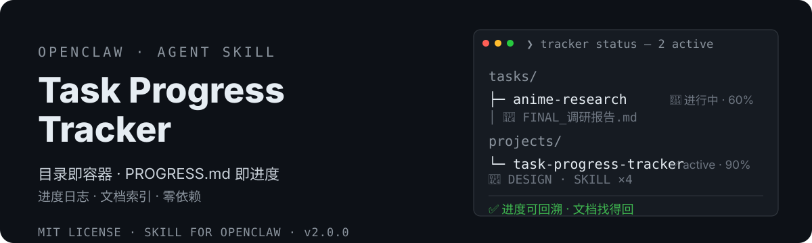

# OpenClaw Task Progress Tracker 🗂️

> Manage tasks/ and projects/ directories with PROGRESS.md cards — directory as container, PROGRESS.md as progress.

<p align="center">
  
</p>

> Lightweight progress cards for your workspace tasks/ and projects/ directories.
> Pure files, zero dependencies, no CLI. Status + progress log + document index in one place — every task's progress is traceable, every document findable.


- 📚 **xiaoyaoclaw-kb-retriever** (knowledge base retriever): local KB retrieval — hierarchical data_structure.md index navigation + progressive retrieval over md/pdf/xlsx, zero dependencies, Windows & macOS ready. <https://github.com/dtsola/xiaoyaoclaw-kb-retriever>
[](https://clawhub.ai/dtsola/skills/xiaoyaoclaw-task-progress-tracker)

## Why you need it

Every AI agent session starts fresh. Without progress tracking, your work will:
- ❌ **Lost context** — tasks half-done across sessions, no way to resume
- ❌ **Scattered documents** — reports and docs buried in random folders, impossible to find later
- ❌ **No traceability** — "what did I do on this task last week?" — gone
- ❌ **Heavy tools** — full project-management suites (CLI + external services) are overkill for a file-based workflow

This skill solves it in one go: **directory as container + PROGRESS.md progress card + document index**.

## Features

- 📁 **Two objects** — tasks (30 min ~ 1 week, short-lived) and projects (> 1 week, continuously maintained)
- 🗂️ **Directory as container** — `tasks/<slug>/`, `projects/<slug>/` are the task/project themselves, no parallel structure
- 📋 **PROGRESS.md progress card** — frontmatter (status / progress / docs) + append-only progress log + document index
- 🔗 **Document index** — machine-readable (YAML `docs` array) + human-readable (index table) dual channel
- 🚦 **Restrained creation** — only responds to explicit instructions, no global skill hooks (lesson learned from v1)
- 🪶 **Zero dependency** — pure file operations, no CLI, no external services, no database
- 🏠 **Sister-skill synergy** — pairs with workspace-initializer (directory rules) and memory-distill (memory distillation)

## Install

```bash
# From ClawHub (recommended)
clawhub install xiaoyaoclaw-task-progress-tracker

# Or manually from GitHub
git clone https://github.com/dtsola/xiaoyaoclaw-task-progress-tracker
# Put SKILL.md and templates/ into your skills directory
```

## Usage

Tell your agent in plain language:

| You say | What happens |
|---------|-------------|
| "Start a task: research XX" | Creates `tasks/xx/` + PROGRESS.md card |
| "Create a project: XX platform" | Creates `projects/xx/` + PROGRESS.md card |
| "Task XX progress: research done, writing report" | Appends progress log + updates timestamp |
| "Attach a doc to XX: outputs/xxx.png is the result" | Records the doc's current path in the index (moves it into `docs/` only after you approve the source→destination) |
| "What tasks/projects are running?" | Summarizes all active cards |
| "Where is XX project now?" | Reads the PROGRESS.md and reports |
| "Task XX is done" | Marks done + logs to today's memory file |

## 🚀 Quick Start

### Step 1: Install the skill

```bash
clawhub install xiaoyaoclaw-task-progress-tracker
```

### Step 2: Create your first task

Tell your agent:

> start a task: research XX

It will create `tasks/<slug>/PROGRESS.md` with status active.

### Step 3: Maintain daily

Say a progress update, attach a doc — the agent keeps the card updated. Open any PROGRESS.md to see status, timeline, and document index at a glance.

## How it compares

| | v1 (deprecated) | **v2 (this)** |
|---|---|---|
| Status carrier | PROGRESS.md (dual-track: status layer × content layer) | ✅ PROGRESS.md as the only card (status + log + index in one) |
| Creation trigger | any skill activation = create entry (false positives) | ✅ explicit user instruction / clear expectation only |
| Documents | not managed | ✅ docs/ index (cairn artifact idea, no CLI) |
| Dependencies | none | ✅ none (stays lightweight) |

## Directory structure

```
xiaoyaoclaw-task-progress-tracker/
├── SKILL.md                    # the skill itself (intent table + operations + boundaries)
├── templates/
│   ├── task-card.md            # task PROGRESS.md template
│   └── project-card.md         # project PROGRESS.md template
├── assets/readme/              # hero + community QR
├── DESIGN.md                   # design document
├── USER_GUIDE.md               # user guide (from the user's perspective)
├── README.md
└── LICENSE
```

## License

MIT — use it freely, attribution optional.

---

## 🛠️ Need customization?

**Agent & Skills customization, from ¥800 (≈$110).**

- WeChat: `dtsola` (note: **openclaw custom**)
- Services: OpenClaw multi-agent deployment / workspace standardization / custom Skill development / agent memory system setup

## 💬 Join the community

Xiaoyao product family user group — feedback · exchange · suggestions:

<p align="center">
  
</p>

<p align="center">Scan to join, or add WeChat <code>dtsola</code> (note: <b>加群</b>)</p>

## Sister projectss

- 🏠 **xiaoyaoclaw-workspace-initializer** (workspace initializer): gives every agent a "home" — standard directory structure + WORKSPACE.md rules + multi-agent config safety. <https://github.com/dtsola/xiaoyaoclaw-workspace-initializer>
- 🧠 **xiaoyaoclaw-memory-distill** (memory distill): turns conversations into structured memory. <https://github.com/dtsola/xiaoyaoclaw-memory-distill>
- 🩹 **xiaoyaoclaw-workspace-auditor**: read-only workspace health check — 5 categories, graded report with fix suggestions, zero-dependency, never modifies files. <https://github.com/dtsola/xiaoyaoclaw-workspace-auditor>
- 📎 **xiaoyaoclaw-web-clipper**: save any web page as clean local Markdown with frontmatter — dual-engine extraction (readability + trafilatura fallback), Chinese-safe filenames, batch clipping with dedup; output lands in knowledge/clippings/ ready for kb-retriever indexing. <https://github.com/dtsola/xiaoyaoclaw-web-clipper>
- 🤝 **xiaoyaoclaw-agent-orchestrator** (collaboration layer): on top of the ecosystem — split, dispatch, track, aggregate, retry.<https://github.com/dtsola/xiaoyaoclaw-agent-orchestrator>
- 📊 **xiaoyaoclaw-usage-report**: parse session JSONL to answer how long each task took, which tools/skills/models were used, and how many tokens were consumed — zero dependency, local only, token is the primary metric. <https://github.com/dtsola/xiaoyaoclaw-usage-report>
- 🎛️ **xiaoyaoclaw-commander** (cross-tool commander, **command layer**): command your XiaoyaoClaw/OpenClaw multi-agent system from any Agent Skills tool (Claude Code / Codex / OpenCode / Trae / DSH). <https://github.com/dtsola/xiaoyaoclaw-commander>
- 🔍 **xiaoyaoclaw-seo-skill** (SEO skill): analyze & optimize website search visibility — audit (technical SEO) / page / content / schema / geo (AI search, AEO/GEO) workflows + zero-dependency audit script, cross-tool ready. <https://github.com/dtsola/xiaoyaoclaw-seo-skill>

## 