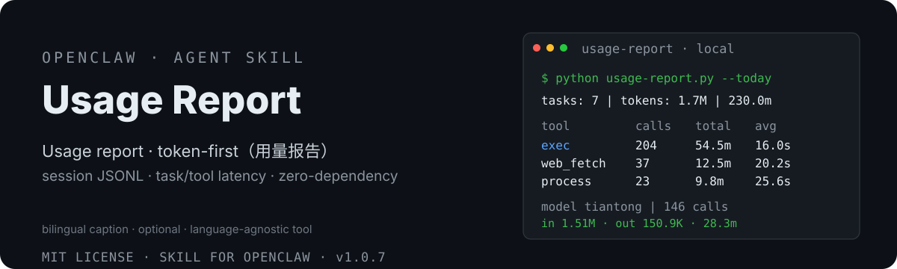

# OpenClaw Usage Report 📊

> Usage & performance reporting for OpenClaw — how long each task took, which tools/skills/models were used, how many tokens were consumed.

<p align="center">
  
</p>

> Note: the hero image is a Chinese/bilingual brand asset; the report text defaults to Chinese and can be adapted to your language — this tool imposes no language or region restriction.


> Answer "how long did each agent task take, which tools/skills/models were used, how many tokens were consumed".
> OpenClaw usage & performance reporting — parse session JSONL locally, zero dependency, data never leaves your machine.


[](https://clawhub.ai/dtsola/skills/xiaoyaoclaw-usage-report)

## Why you need it

OpenClaw has no built-in per-task performance panel. Trying to optimize your agents, you:
- ❌ **Don't know how long each task took** — no timing stats, just gut feeling
- ❌ **Can't find the slowest tool** — is exec / web_fetch / process the bottleneck? No data
- ❌ **Can't reconcile token usage** — how many tokens per agent/model? All blurry
- ❌ **No trace of skill usage** — which skills were used, how many times? Nobody knows

But the data has always been there — local session JSONL files (`state/agents/*/sessions/*.jsonl`) already record timestamps and token usage for every task, tool call, and model call. This tool consumes that data directly: **zero dependency · local only · data never leaves your machine**.

## Features

- ⏱️ **Task duration** — wall-clock + active duration per task (excludes user thinking gaps)
- 🔢 **Model tokens** — per agent/model: call count, input/output tokens (real usage = input+output)
- 🧮 **Model latency** — estimated (event-ts gap, capped at 10 min), total & average per agent/model
- 🔧 **Tool latency** — per tool: count, errors, total/avg/max duration — find bottlenecks at a glance
- 🧩 **Skill usage** — inferred from `read` calls: skill name, load count, agents
- 📈 **Daily trend** — daily input/output tokens and call counts
- 🤖 **MCP tools** — same structure as regular tools (toolCall/toolResult), covered natively
- 🔒 **Zero-dependency, local-only** — pure Python standard library, no network calls, no uploads
- 🧼 **Minimized output** — reports and JSON contain aggregated statistics only by default (no conversation content, no session IDs); session-level detail requires the explicit `--include-sessions` flag
- ⏰ **Optional Cron daily report** — `--today --json` for scheduled reports; enable it yourself

## Install

```bash
# From ClawHub (recommended)
clawhub install xiaoyaoclaw-usage-report

# Or manually from GitHub
git clone https://github.com/dtsola/xiaoyaoclaw-usage-report
# Put scripts/usage-report.py into your scripts directory
```

## Usage

1. Install the skill (from ClawHub, or drop it into your skills directory manually)
2. Ask explicitly (the skill never runs on its own and does no background scanning) — tell your agent "**run today's usage report**"; it will:
   - Locate the usage-report skill → detect the OpenClaw state directory
   - Parse all agents' session JSONL → output task duration / model tokens / tool latency / skill usage / daily trend
3. Keep asking conversationally: slowest tool, per-agent accounting, 7-day trend, skill inventory
4. Optional: say "schedule a usage report push at 22:00 daily" for an automatic daily report

### CLI reference (optional)

Prefer running the script directly instead of chatting:

```bash
python scripts/usage-report.py --today    # today (all dimensions by default)
python scripts/usage-report.py --week     # last 7 days
python scripts/usage-report.py --all      # all history
python scripts/usage-report.py --agent xiaoxia   # filter by agent
python scripts/usage-report.py --by-tool  # tool latency only
python scripts/usage-report.py --skills   # skills only
python scripts/usage-report.py --today --json   # JSON (aggregated stats only; the script writes to stdout only — saving it is your call)
python scripts/usage-report.py --today --json --include-sessions    # add session-level detail (IDs/timestamps - do not share publicly)
python scripts/usage-report.py --today --include-paths              # show the full data directory path (redacted by default)
```

The data directory is resolved in this order: `--state <path>` → `OPENCLAW_STATE` env var (the only environment variable read) → desktop build default (Windows XiaoyaoClaw: `C:\Users\<user>\AppData\Roaming\xiaoyaoclaw-desktop\runtime\openclaw\state`). **The directory actually used is printed at the top of every report, redacted to its last two segments**; add `--include-paths` for the full path.

## 🚀 Quick Start (3 steps, 5 minutes)

### Step 1: Install the skill

```bash
clawhub install xiaoyaoclaw-usage-report
```

### Step 2: Trigger your first report with one sentence

Tell your agent:

> Run today's usage report

(**Activation boundary**: it only runs when you explicitly ask for usage/performance data; generic words like "report" or "stats" trigger a clarifying question instead of a full scan of every agent's sessions.)

The agent then: locates the usage-report skill → parses session JSONL under the state directory (today by default) → outputs task duration / model tokens / tool latency / skill usage / daily trend overview.

### Step 3: Verify + conversational follow-ups

Check these key blocks in the report:

```
📊 总览: 7 个任务 | 总 token(input+output): 1,747,066 | 总耗时: 230.0m

📦 按 agent / 模型（token=input+output 真实消耗；模型耗时≈事件ts间隔，cap 10min）
  Agent     模型                      调用    输入tok    输出tok   模型总耗时  平均
  tiantong  deepseek/deepseek-v4-flash  146  1,513,943  150,870      28.3m  11.6s

🔧 按工具（耗时 = toolResult - toolCall）
  工具        次数  失败   总耗时   平均   最慢
  exec        204    1    54.5m  16.0s  6.2m
```

> Note: the sample above keeps the tool's built-in Chinese labels. Report text defaults to Chinese and can be adapted to your language — the tool imposes no language or region restriction.

No need to memorize any commands — just ask:

> Which tool is the slowest? Which agent consumed the most tokens? What's the daily trend over the last 7 days?

Want a daily report pushed automatically? Tell your agent:

> Schedule a usage report push at 22:00 daily

### Daily habits

| Scenario | Tell your agent |
|---|---|
| Daily reconciliation | "Run today's usage report", or schedule a 22:00 Cron push |
| Find bottlenecks | "Which tool is the slowest" → optimize it first |
| Skill inventory | "Which skills are used a lot, which are idle" |
| Per-agent accounting | "How many tokens did xiaoxia use today" |
| Pre-release review | "Run the last 7 days usage report" for the trend |
| Automation | "Schedule a usage report push at 22:00 daily" |

## Privacy & data scope

- **Read-only**: parses local session JSONL (`state/agents/*/sessions/*.jsonl`) only — **no file is modified, deleted or written**
- **Zero network**: the script reads local files with the Python standard library only — **no network calls, no external services, no uploads** (GitHub / website links in these docs are human-readable references and are not used at runtime)
- **Minimized output**: reports and JSON contain **aggregated statistics only** by default (counts / duration / tokens / tools / models / skill names) — **no conversation content, no session IDs, no absolute local paths** (the data directory is redacted to its last two segments, e.g. `…/openclaw/state`)
- **The time window is a hard boundary**: once a window is selected (`--today` / `--week`; with no flag the default is **today**), **every** dimension (agent/model, tools, skills, daily trend, tasks) aggregates **in-window events only** — out-of-window history is never aggregated and never appears in the output (a long session spanning the boundary is truncated to its in-window part). Full history requires the explicit `--all` flag.
- **Explicit opt-ins**: `--include-sessions` adds session-level fields (`agent` / `id` / `start` / `end` / `duration_ms` / `active_ms` / `model_ms` / `models` / `tokens` / `tools` / `msgs`); `--include-paths` reveals the full local path. Both print a sensitive-metadata warning — **do not share publicly**
- **No cost estimation**: the script reads, computes and outputs no cost fields at all (docs, report and JSON are consistent)
- **Data directory**: resolution order = `--state` argument → `OPENCLAW_STATE` env var (the only environment variable read) → desktop build default; the directory actually used is printed at the top of the report, redacted to its last two segments by default
- **Scheduling is your call**: cron / HEARTBEAT integration is never created automatically; it requires your explicit request and confirmation

## Statistics rules (important)

1. **Real token usage = input + output**. `totalTokens` includes cacheRead (re-counted every turn; measured inflation 1.3x–14x+, up to 568x per message) — the script already avoids this.
2. **Tool duration = toolResult.ts − assistant(toolCall).ts**, includes the model's tool-call decision time (not pure execution time).
3. **Model latency is an estimate** (assistant event ts − previous event ts, capped at 10 min). ⚠️ Do not use `message.timestamp` (batch-write timestamp); exact duration lives only in the diagnostics-otel event layer.
4. **No cost estimation**: the script reads, computes and outputs **no cost fields** (docs, report and JSON are fully consistent); pricing differs per provider, so tokens are the universal metric. For costs, convert tokens × your own unit price.
5. **Skill stats** cover only skills actually loaded via `read` (metadata-injected but never loaded ones are not counted).
6. **Time window = hard boundary**: all aggregation runs on in-window events; with no window flag the default is **today** (never a full-history scan), and full history requires the explicit `--all` flag.

## Cron daily report (optional, user-configured)

The tool supports `--today --json` output (aggregated statistics only by default) for scheduled daily token reports. **The skill never creates scheduled jobs itself**: whether to enable one and when to push is entirely up to the user's explicit request and confirmation.

OpenClaw cron example:

```json
{
  "name": "openclaw-usage-daily",
  "schedule": { "kind": "cron", "expr": "0 22 * * *", "tz": "Asia/Shanghai" },
  "payload": {
    "kind": "agentTurn",
    "message": "Run `python <script-path>/usage-report.py --today` and send me the report"
  },
  "sessionTarget": "isolated",
  "delivery": { "mode": "announce" }
}
```

Or use Windows Task Scheduler / Linux crontab to run the script directly.

## How it compares

| | claw-lens (local dashboard) | **xiaoyaoclaw-usage-report** |
|---|---|---|
| Form | Node web dashboard, needs a running service | ✅ Zero-dependency Python CLI, single file |
| Install cost | npm install + always-on service | ✅ Copy & run |
| Data source | Same session JSONL | ✅ Same session JSONL |
| Model latency | Not provided | ✅ Estimated (event-ts gap) |
| Token accounting | Not distinguished | ✅ Real usage input+output, avoids cacheRead inflation |
| Output | Web visualizations | ✅ Terminal tables + JSON pipeline (cron/CI friendly) |
| Data safety | Local | ✅ Local, zero upload |

## Directory structure

```
xiaoyaoclaw-usage-report/
├── SKILL.md                    # the skill itself (usage + triggers)
├── scripts/
│   └── usage-report.py         # main script (zero-dependency stdlib)
├── docs/
│   └── DESIGN.md               # design document
├── assets/readme/
│   ├── hero.svg                # README hero
│   └── community-qr.png        # community QR code
├── README.md
└── LICENSE
```

## License

MIT — use it freely, attribution optional.

---

## 🛠️ Need customization?

**Agent & Skills customization, from ¥800 (≈$110).**

- WeChat: `dtsola` (note: **openclaw custom**)
- Services: OpenClaw multi-agent deployment / workspace standardization / custom Skill development / usage monitoring & optimization

## 💬 Join the community

Xiaoyao product family user group — feedback · exchange · suggestions:

<p align="center">
  
</p>

<p align="center">Scan to join, or add WeChat <code>dtsola</code> (note: <b>加群</b>)</p>

## Sister projects

> The links below are **human-readable references** (docs / community); the runtime script makes no network requests and never opens them.

- 🏠 **xiaoyaoclaw-workspace-initializer** (workspace initializer): gives every agent a "home" — standard directory structure + WORKSPACE.md rules + multi-agent config safety. <https://github.com/dtsola/xiaoyaoclaw-workspace-initializer>
- 🧠 **xiaoyaoclaw-memory-distill** (memory distillation): turn conversations into structured memory — semantic classification + first-run build + incremental dedup + sensitive-info skip. <https://github.com/dtsola/xiaoyaoclaw-memory-distill>
- 🗂️ **xiaoyaoclaw-task-progress-tracker** (task progress tracker): directory as container, PROGRESS.md as progress — lifecycle management for tasks/ and projects/. <https://github.com/dtsola/xiaoyaoclaw-task-progress-tracker>
- 📚 **xiaoyaoclaw-kb-retriever** (knowledge base retriever): local KB retrieval — hierarchical data_structure.md index + progressive retrieval over md/pdf/xlsx, zero-dependency, Windows & macOS. <https://github.com/dtsola/xiaoyaoclaw-kb-retriever>
- 🩹 **xiaoyaoclaw-workspace-auditor**: read-only workspace health check — 5 categories, graded report with fix suggestions, zero-dependency, never modifies files. <https://github.com/dtsola/xiaoyaoclaw-workspace-auditor>
- 📎 **xiaoyaoclaw-web-clipper**: save any web page as clean local Markdown with frontmatter — dual-engine extraction (readability + trafilatura fallback), Chinese-safe filenames, batch clipping with dedup; feeds knowledge/clippings/ for kb-retriever. <https://github.com/dtsola/xiaoyaoclaw-web-clipper>
- 🤝 **xiaoyaoclaw-agent-orchestrator** (agent orchestrator): split tasks, dispatch to agents, track progress, aggregate results, retry on failure — daily multi-agent coordination. <https://github.com/dtsola/xiaoyaoclaw-agent-orchestrator>
- 🎛️ **xiaoyaoclaw-commander** (cross-tool commander, **command layer**): command your XiaoyaoClaw/OpenClaw multi-agent system from any Agent Skills tool (Claude Code / Codex / OpenCode / Trae / DSH). <https://github.com/dtsola/xiaoyaoclaw-commander>
- 🔍 **xiaoyaoclaw-seo-skill** (SEO skill): analyze & optimize website search visibility — audit (technical SEO) / page / content / schema / geo (AI search, AEO/GEO) workflows + zero-dependency audit script, cross-tool ready. <https://github.com/dtsola/xiaoyaoclaw-seo-skill>
