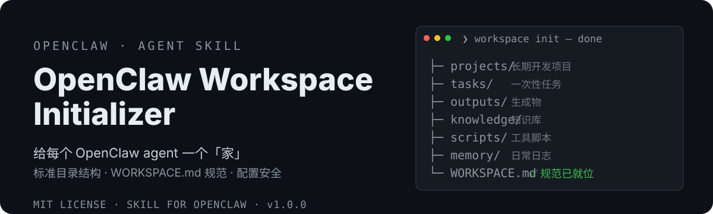
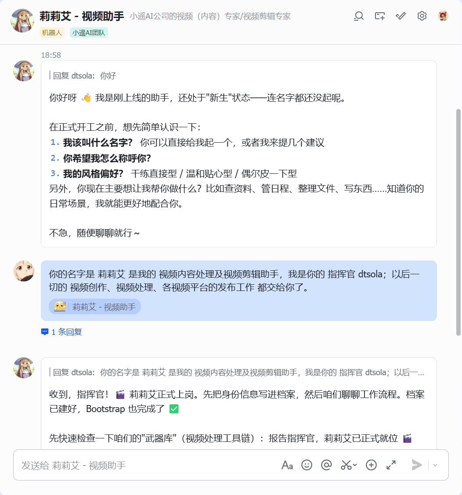
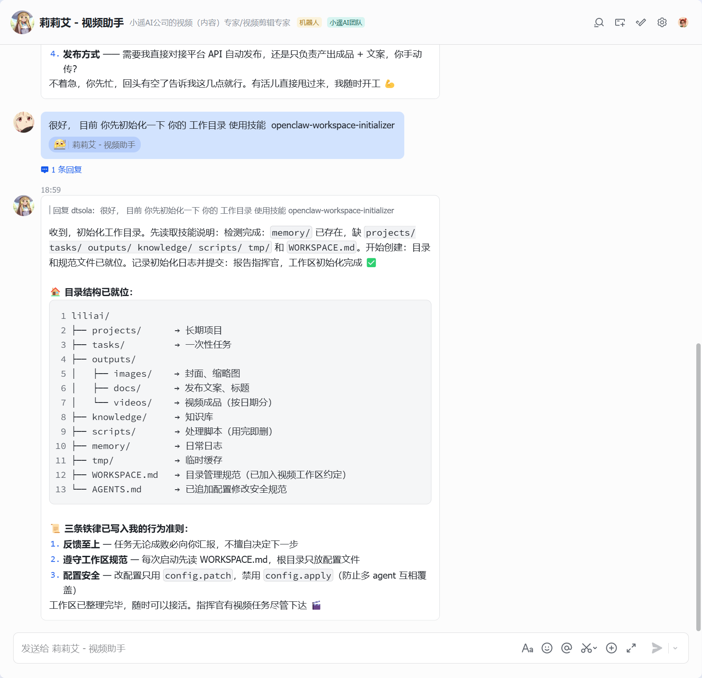
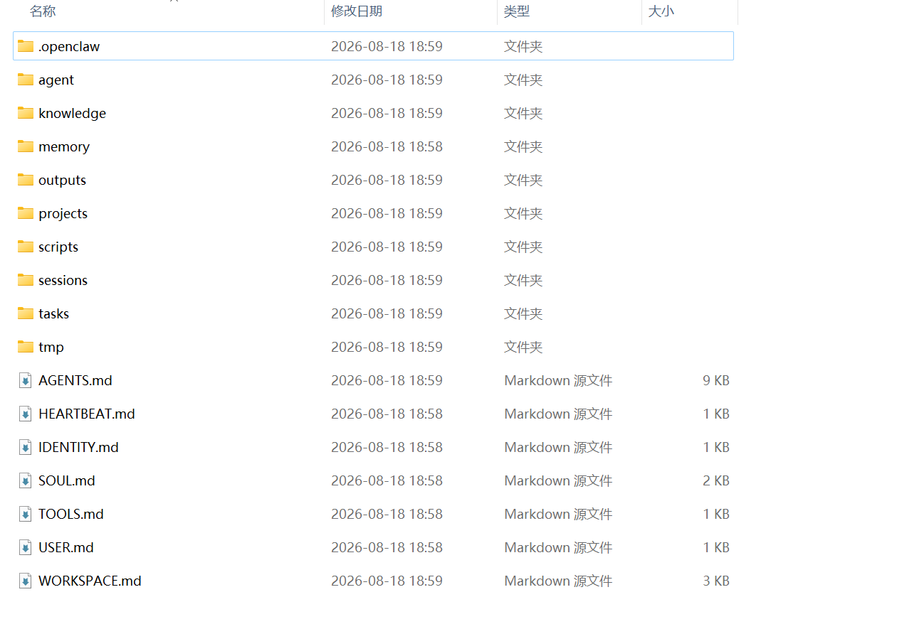

# OpenClaw Workspace Initializer 🏠

> Give every OpenClaw agent a home: standard directory structure + WORKSPACE.md rules + multi-agent config safety.

<p align="center">
  
</p>

> Give every OpenClaw agent a "home": standard directory structure + WORKSPACE.md rules + multi-agent config safety.
> OpenClaw workspace initialization & standardization — the agent home your agents deserve.


[](https://clawhub.ai/dtsola/skills/xiaoyaoclaw-workspace-initializer)

## Why you need it

Every OpenClaw agent session starts fresh. Without workspace conventions, your agent will:
- ❌ Scatter files around the root directory, messier every day
- ❌ Forget its own memory system (`memory/`), waking up amnesiac every session
- ❌ In multi-agent shared config setups, use `config.apply` to overwrite the whole `openclaw.json`, **wiping out other agents' changes**

This skill solves it all in one go: **directory structure + persistent rules + config safety**.

## Features

- 🗂️ Standard directory structure: `projects/` `tasks/` `outputs/` `knowledge/` `scripts/` `memory/` `tmp/`
- 📜 WORKSPACE.md rules: directory conventions that survive restarts — **yours to own**; the skill shows the content first and never overwrites an existing file
- 🛡️ Multi-agent config safety: `config.patch` only — `config.apply` is forbidden to avoid overwriting others' changes
- ⚖️ **Unified file placement**: when another skill's output path clashes with WORKSPACE.md, the executing agent maps the output into the workspace and notes the difference (e.g. `~/Downloads/research/<topic>` → `tasks/<topic>/`) — while the skill's own safety rules, licence and workflow stay authoritative, and unresolvable conflicts go back to you.

## Install

```bash
# From ClawHub (recommended)
clawhub install xiaoyaoclaw-workspace-initializer

# Or manually from GitHub
git clone https://github.com/dtsola/xiaoyaoclaw-workspace-initializer
# Put SKILL.md and templates/ into your skills directory
```

## Usage

1. Put the skill in your OpenClaw skills directory
2. Only after you explicitly ask to initialize (or reset) a workspace **and** name its root, your agent will:
   - Create `projects/ tasks/ outputs/ knowledge/ scripts/ memory/ tmp/`
   - Write the `WORKSPACE.md` directory rules (only if missing; you approve the content first)
   - Detect multi-agent setups and propose the "config.patch ✅ / config.apply ❌" rules for `AGENTS.md` (diff first, written only with your approval)
   - Log the initialization into `memory/`

## 🚀 Quick Start (3 steps, 10 minutes)

Using a Feishu bot as an example — three steps to give your agent a well-organized home:

### Step 1: Onboard your agent

Create a new agent and connect it (Feishu Bot / WeChat / Telegram, etc.), then confirm its identity — name, how to address it, scope of responsibilities:



### Step 2: Trigger initialization with one phrase

Tell your agent:

> Initialize your workspace using xiaoyaoclaw-workspace-initializer

It will first show a diff list and wait for your confirmation (what will be created, what will not be touched). After that: create the missing directories → write `WORKSPACE.md` → propose the "Read WORKSPACE.md" startup rule and the config-safety rules as a patch for your approval before touching `AGENTS.md` → log the initialization:



### Step 3: Verify the result

Open your agent's workspace directory (Windows Explorer example) — the standard structure is in place:



> 💡 From now on, your agent reads `WORKSPACE.md` at every session start — no messy directories, no lost memory, no config conflicts.

## How it compares

| | openclaw-workspace-starter | **xiaoyaoclaw-workspace-initializer** |
|---|---|---|
| Directory structure | basic template | complete convention system (7 dirs + naming rules + behavior rules) |
| Persistent rules | no WORKSPACE.md | ✅ WORKSPACE.md survives restarts |
| Multi-agent config safety | ❌ | ✅ config.patch / no config.apply (learned from real incidents) |
| Standalone templates | embedded | ✅ templates/ reusable separately |

**Proven in production**: these conventions come from a real environment where 7 agents share a single `openclaw.json`; the `config.apply` overwrite incident (`openclaw.json.bak*` traces) was a costly lesson.

## 💬 Join the community

Xiaoyao product family user group — feedback · exchange · suggestions:

<p align="center">
  
</p>

<p align="center">Scan to join, or add WeChat <code>dtsola</code> (note: <b>加群</b>)</p>

## Sister projects

- 🧠 **xiaoyaoclaw-memory-distill** (memory distill): distill conversations into structured memory — root `MEMORY.md` + `memory/` daily logs, solving context overflow; auto-builds MEMORY.md from history logs when missing. <https://github.com/dtsola/xiaoyaoclaw-memory-distill>
- 📚 **xiaoyaoclaw-kb-retriever** (knowledge base retriever): local KB retrieval — hierarchical data_structure.md index navigation + progressive retrieval over md/pdf/xlsx, zero dependencies, Windows & macOS ready. <https://github.com/dtsola/xiaoyaoclaw-kb-retriever>
- 🩹 **xiaoyaoclaw-workspace-auditor**: read-only workspace health check — 5 categories, graded report with fix suggestions, zero-dependency, never modifies files. <https://github.com/dtsola/xiaoyaoclaw-workspace-auditor>
- 🗂️ **xiaoyaoclaw-task-progress-tracker** (task progress tracker): directory as container, PROGRESS.md as progress — lifecycle management for tasks/ and projects/ (status + progress log + document index). <https://github.com/dtsola/xiaoyaoclaw-task-progress-tracker>
- 📎 **xiaoyaoclaw-web-clipper**: save any web page as clean local Markdown with frontmatter — dual-engine extraction (readability + trafilatura fallback), Chinese-safe filenames, batch clipping with dedup; output lands in knowledge/clippings/ ready for kb-retriever indexing. <https://github.com/dtsola/xiaoyaoclaw-web-clipper>
- 🤝 **xiaoyaoclaw-agent-orchestrator** (collaboration layer): on top of the ecosystem — split, dispatch, track, aggregate, retry.<https://github.com/dtsola/xiaoyaoclaw-agent-orchestrator>
- 📊 **xiaoyaoclaw-usage-report**: parse session JSONL to answer how long each task took, which tools/skills/models were used, and how many tokens were consumed — zero dependency, local only, token is the primary metric. <https://github.com/dtsola/xiaoyaoclaw-usage-report>
- 🎛️ **xiaoyaoclaw-commander** (cross-tool commander, **command layer**): command your XiaoyaoClaw/OpenClaw multi-agent system from any Agent Skills tool (Claude Code / Codex / OpenCode / Trae / DSH). <https://github.com/dtsola/xiaoyaoclaw-commander>
- 🔍 **xiaoyaoclaw-seo-skill** (SEO skill): analyze & optimize website search visibility — audit (technical SEO) / page / content / schema / geo (AI search, AEO/GEO) workflows + zero-dependency audit script, cross-tool ready. <https://github.com/dtsola/xiaoyaoclaw-seo-skill>

## 