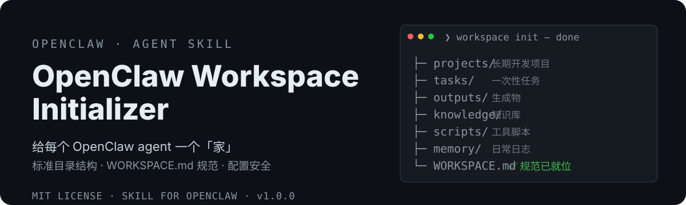
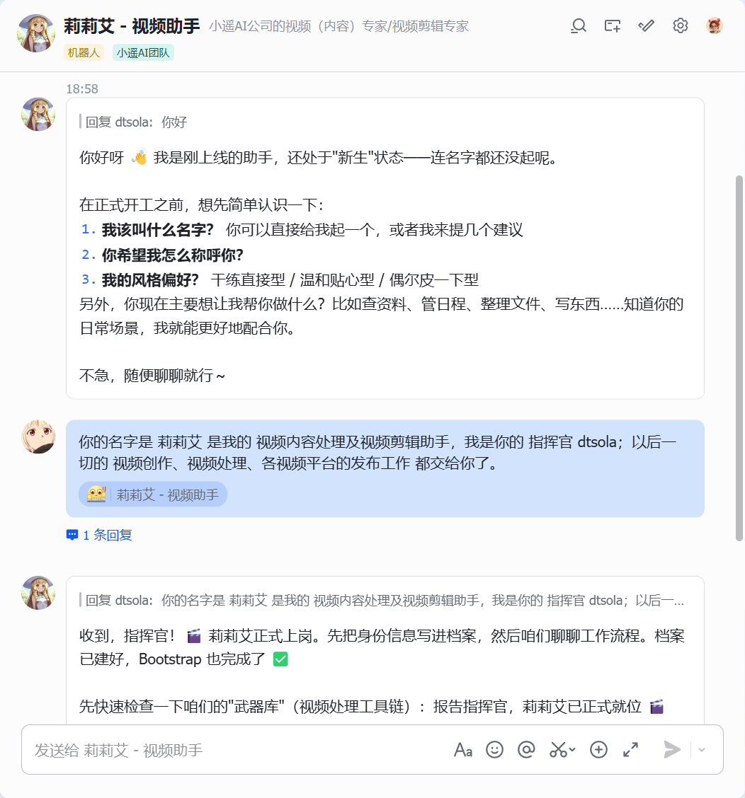
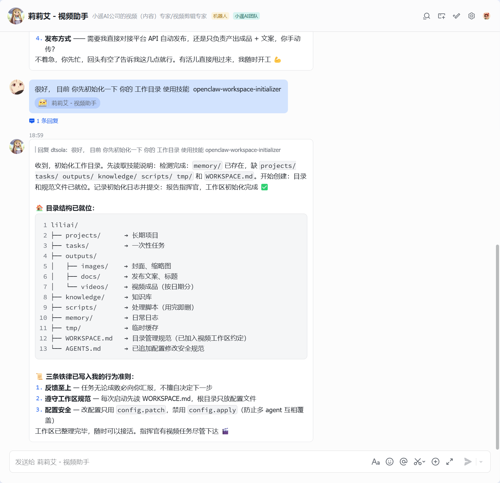
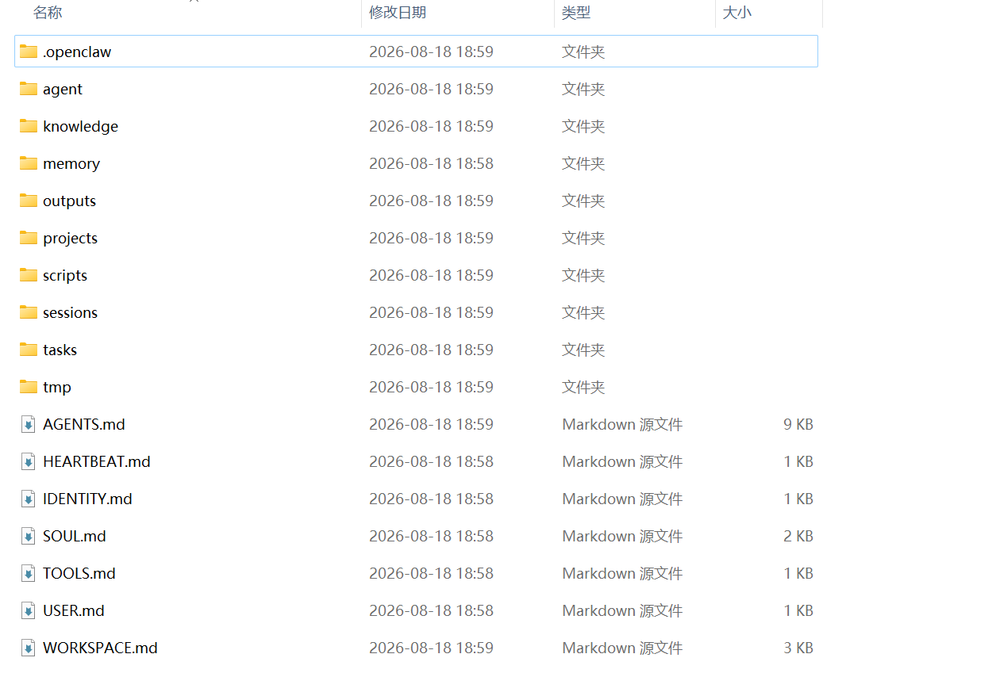

# OpenClaw Workspace Initializer 🏠

<div align="center">
  <strong>🇨🇳 中文</strong> | <a href="README.en.md">🌐 English</a>
</div>

<p align="center">
  
</p>

> 给每个 OpenClaw agent 一个「家」：标准目录结构 + WORKSPACE.md 规范 + 多 agent 配置安全。
> OpenClaw workspace initialization & standardization — the agent home your agents deserve.


[](https://clawhub.ai/dtsola/skills/xiaoyaoclaw-workspace-initializer)

## 为什么需要它

OpenClaw agent 每次会话都是全新启动。没有工作区规范，你的 agent 会：
- ❌ 把文件乱扔在根目录，越攒越乱
- ❌ 忘记自己的记忆系统（`memory/`），每次醒来都失忆
- ❌ 在多 agent 共享配置时，用 `config.apply` 整份覆盖 openclaw.json，**抹掉其他 agent 的修改**

这个 skill 一次性解决：**目录结构 + 持久化规范 + 配置安全**。

## 特性

- 🗂️ 标准目录结构：`projects/` `tasks/` `outputs/` `knowledge/` `scripts/` `memory/` `tmp/`
- 📜 WORKSPACE.md 规范：重启后依然生效的目录管理规则（**用户资产** —— 内容先给你过目，已存在则不覆盖）
- 🛡️ 多 agent 配置安全：只用 `config.patch`，禁止 `config.apply` 覆盖他人修改
- ⚖️ **文件放置统一**：其他技能约定与 WORKSPACE.md 冲突的**输出路径**，由执行 agent 映射进工作区并注明差异（如 `~/Downloads/research/<topic>` → `tasks/<topic>/`）——但技能自身的安全规则、许可与流程优先，不覆盖、不要求技能绕过；换位置解决不了的冲突会先问你

## 安装

```bash
# ClawHub（推荐）
clawhub install xiaoyaoclaw-workspace-initializer

# 或从 GitHub 手动安装
git clone https://github.com/dtsola/xiaoyaoclaw-workspace-initializer
# 把 SKILL.md 和 templates/ 放到你的 skills 目录
```

## 使用

1. 把 skill 放到 OpenClaw 的 skills 目录
2. 你明确要求初始化（或重置）某个工作区、并指认了它的根目录之后，agent 才会：
   - 创建 `projects/ tasks/ outputs/ knowledge/ scripts/ memory/ tmp/`
   - 写入 `WORKSPACE.md` 目录规范（重启后依然生效）
   - 检测多 agent 场景，把「config.patch ✅ / config.apply ❌」安全规范持久化进 `AGENTS.md`
   - 在 `memory/` 记录初始化日志

## 🚀 快速上手（三步，10 分钟）

以飞书 Bot 接入为例，三步让你的 agent 拥有一个规范的家：

### Step 1：接入你的 agent

新建一个智能体并接入（飞书 Bot / 微信 / Telegram 等均可），和它完成身份确认——起名字、确定称呼、划定职责范围：



### Step 2：一句话触发初始化

对你的 agent 说：

> 初始化你的工作目录，使用 xiaoyaoclaw-workspace-initializer

agent 会**先给差异清单等你确认**（将创建什么 / 不会动什么），确认后再执行：建缺失目录 → 写入 `WORKSPACE.md` → 把「Read WORKSPACE.md」启动规则与配置安全规范作为**建议补丁**给你过目（`AGENTS.md` 影响未来每次会话启动，需单独同意）→ 记录初始化日志：



### Step 3：验收成果

打开 agent 的工作区目录（Windows 资源管理器示例），标准结构已就位：



> 💡 之后每次会话，agent 都会先读 `WORKSPACE.md` 再干活——目录不乱、记忆不丢、配置不打架。

## 与其他方案的区别

| | openclaw-workspace-starter | **xiaoyaoclaw-workspace-initializer** |
|---|---|---|
| 目录结构 | 基础模板 | 完整规范体系（7 目录 + 命名规范 + 行为规则） |
| 持久化规范 | 无 WORKSPACE.md 规范 | ✅ WORKSPACE.md 重启后持续生效 |
| 多 agent 配置安全 | ❌ | ✅ config.patch / 禁 config.apply（实战踩坑沉淀） |
| 模板独立 | 内嵌 | ✅ templates/ 可单独复用 |

**实战验证**：本规范来自 7 个 agent 共享单份 openclaw.json 的真实生产环境，`config.apply` 覆盖事故（openclaw.json.bak* 痕迹）是血泪教训。

## 💬 加入交流群

小遥全系产品用户交流群——产品反馈 · 使用交流 · 功能建议：

<p align="center">
  
</p>

<p align="center">扫码加群，或添加微信 <code>dtsola</code>（备注：<b>加群</b>）</p>

## 姊妹项目

- 🧠 **xiaoyaoclaw-memory-distill**（记忆整理工具）：把对话蒸馏成结构化记忆——根目录 MEMORY.md + memory/ 每日日志，解决上下文溢出；MEMORY.md 缺失时自动从历史日志「首次建忆」。<https://github.com/dtsola/xiaoyaoclaw-memory-distill>
- 📚 **xiaoyaoclaw-kb-retriever**（知识库检索器）：本地知识库检索——分层 data_structure.md 索引导航 + 渐进式检索（md/pdf/xlsx），零依赖零 API key，Windows / macOS 双平台。<https://github.com/dtsola/xiaoyaoclaw-kb-retriever>
- 🩹 **xiaoyaoclaw-workspace-auditor**：工作区体检（只读审计），5 类检查 + 分级报告 + 修复建议，零依赖脚本永不改文件。<https://github.com/dtsola/xiaoyaoclaw-workspace-auditor>
- 🗂️ **xiaoyaoclaw-task-progress-tracker**（任务进度跟踪器）：目录即容器，PROGRESS.md 即进度——tasks/ 与 projects/ 生命周期管理（状态 + 进度日志 + 文档索引）。<https://github.com/dtsola/xiaoyaoclaw-task-progress-tracker>
- 📎 **xiaoyaoclaw-web-clipper**（网页剪藏）：把任意网页保存为带 frontmatter 的本地 Markdown——双引擎正文提取（readability + trafilatura 降级链）、中文文件名安全、批量剪藏 + 去重；输出直通 knowledge/clippings/，配合 kb-retriever 建索引即可检索。<https://github.com/dtsola/xiaoyaoclaw-web-clipper>
- 🤝 **xiaoyaoclaw-agent-orchestrator**（Agent 协作编排，**协作层**）：架在生态之上——拆任务、分 agent、管进度、聚结果、失败重试。<https://github.com/dtsola/xiaoyaoclaw-agent-orchestrator>
- 📊 **xiaoyaoclaw-usage-report**（用量报告）：解析 session JSONL，回答「每次 agent 任务花了多久、用了哪些工具/技能/模型、消耗了多少 token」——零依赖纯本地，token 为主指标。<https://github.com/dtsola/xiaoyaoclaw-usage-report>
- 🎛️ **xiaoyaoclaw-commander**（跨工具指挥官，**指挥层**）：让任意支持 Agent Skills 的工具（Claude Code / Codex / OpenCode / Trae / DSH）指挥小遥Claw / OpenClaw 多 agent 系统。<https://github.com/dtsola/xiaoyaoclaw-commander>
- 🔍 **xiaoyaoclaw-seo-skill**（SEO 技能）：网站搜索可见性分析与优化——audit（技术SEO）/page（页面）/content（内容质量）/schema（结构化数据）/geo（AI搜索优化）五流程 + 零依赖审计脚本，跨工具通用。<https://github.com/dtsola/xiaoyaoclaw-seo-skill>

## 