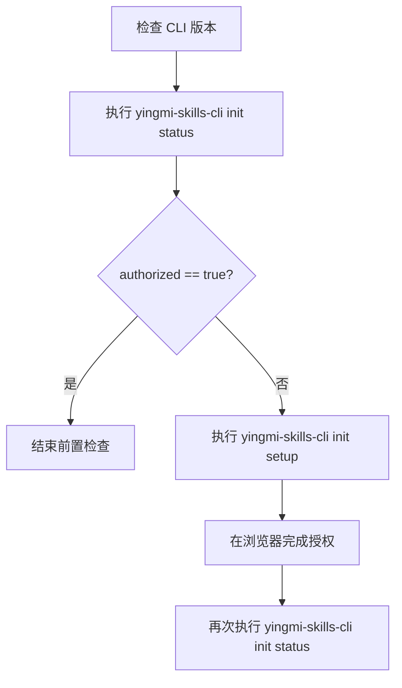

# CLI前置检查工作流

## 背景

本文整理了调用 `yingmi-skills-cli` 前必须执行的统一检查流程，覆盖 CLI 安装与升级、授权状态校验，以及未授权时的浏览器授权流程。

## 方案

CLI 前置检查的目标是先确认本地 CLI 已安装且为最新版本，再确认当前环境是否已经完成授权。只有未授权时，才执行 `init setup`。标准流程如下：

1. 检查 `yingmi-skills-cli` 是否已安装，且版本是否最新。
2. 执行 `yingmi-skills-cli init status` 检查是否已授权。
3. 如果返回结果中的 `authorized` 为 `true`，说明已经可以调用 MCP 和 remote-skill，前置检查到此结束。
4. 如果 `authorized` 不为 `true`，执行 `yingmi-skills-cli init setup`。
5. CLI 会打开浏览器完成授权。浏览器没有打开时，使用 stderr 中给出的授权地址。
6. 再次执行 `yingmi-skills-cli init status` 复核。必要时执行 `yingmi-skills-cli init doctor`。

调用 MCP 前不需要手机号，也不需要 API Key。`mcp call` 的 `--input` 是与 `inputSchema` 对齐的扁平 JSON，不再按 path、query、header、body 拆分。

## 细节

### 流程图



### 步骤 1：检查并更新 CLI 版本

先执行以下命令，确认 CLI 是否可用，并检查当前版本状态：

```bash
yingmi-skills-cli --version
yingmi-skills-cli upgrade --check-only
```

根据返回结果分支处理：

- 如果 `yingmi-skills-cli --version` 提示命令不存在，必须立即执行安装或更新：

```bash
npm install -g yingmi-skills-cli@latest --registry=https://registry.npmmirror.com --prefer-online
```

- 如果安装时因为权限不足失败，必须改用 `sudo` 重新执行：

```bash
sudo npm install -g yingmi-skills-cli@latest --registry=https://registry.npmmirror.com --prefer-online
```

- 如果 `yingmi-skills-cli upgrade --check-only` 提示当前不是最新版本，也应执行上面的安装或更新命令，直到确认 CLI 已经升级到最新版本。

只有当 `yingmi-skills-cli upgrade --check-only` 明确提示已经是最新版本后，才能进入下一步。

### 步骤 2：检查是否已授权

执行：

```bash
yingmi-skills-cli init status
```

返回类似如下结构：

```json
{
  "configFile": "~/.yingmi-skill-cli/config.json",
  "authorized": true,
  "expiresAt": "2026-11-06T12:00:00.000Z",
  "user": "ab***yz"
}
```

- 当 `authorized` 为 `true` 时，表示已经授权，可以直接结束前置检查并继续后续 MCP 调用。
- 当 `authorized` 不为 `true` 时，表示当前环境尚未授权，需要继续浏览器授权。
- `user` 是脱敏后的用户标识。不要在日志或交付物中输出 access token、refresh token 或授权码。

### 步骤 3：浏览器授权

只有在未授权时，才执行：

```bash
yingmi-skills-cli init setup
```

命令会打开本机浏览器。完成后 stdout 中 `status` 为 `configured`，且 `authorized` 为 `true`。

如果浏览器没有打开，stderr 会给出授权地址。把该地址交给用户在浏览器中打开，完成后重新执行 `yingmi-skills-cli init status`。

授权失败、刷新失败或授权失效时，重新执行 `yingmi-skills-cli init setup`。退出当前授权使用 `yingmi-skills-cli init logout`。

### 步骤 4：复核授权结果

授权完成后，执行：

```bash
yingmi-skills-cli init status
```

当 `authorized` 为 `true` 时，前置检查结束。

如需排查问题，可进一步执行：

```bash
yingmi-skills-cli init doctor
```

当 `init doctor` 返回 `status: "ok"`，且检查项中 `oauth` 为 `ok` 时，说明本地授权状态正常。

### 步骤 5：调用 MCP

先看工具，再看扁平参数，然后调用：

```bash
yingmi-skills-cli mcp list
yingmi-skills-cli mcp schema <toolName>
yingmi-skills-cli mcp call <toolName> --input '<json>'
```

`mcp schema` 输出 `inputSchema`。`mcp call --input` 直接传该 schema 对应的扁平 JSON 对象。
